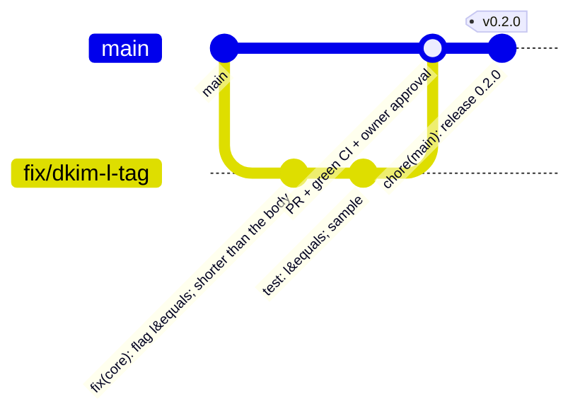
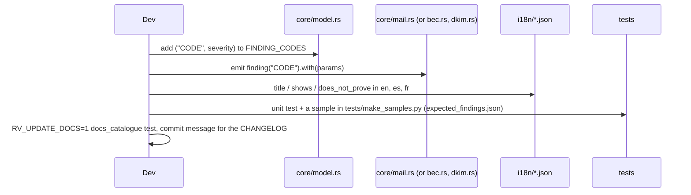

# Contributing to RV MailAuth

Thank you for helping. This is a forensic tool: results may be presented in court, so every change
must keep results **correct, reproducible and explainable**.

## Workflow



1. Open an issue first for anything bigger than a typo.
2. Branch from `main`: `feat/…`, `fix/…`, `docs/…`. Never push to `main`, force-push or merge without the owner's
   approval.
3. Commit with [Conventional Commits](https://www.conventionalcommits.org/): `feat(core): …`, `fix(cli): …`,
   `docs: …`, `test: …`, `ci: …`. A `!` or `BREAKING CHANGE:` footer marks breaking changes. The changelog and
   version numbers are generated from these messages.
4. Open a pull request. CI must be green on Linux **and** Windows.
5. A maintainer reviews. Changes to hashing, the audit chain or report wording need two approvals.

## Before you push

```bash
export RV_TEST_PYTHON=python                                       # blake3 jsonschema pyhanko dkimpy pynacl
cargo fmt --all
cargo clippy --workspace --all-targets --locked -- -D warnings
cargo test --workspace --locked
cargo deny check
cargo run -q -p rv-mailauth-cli -- docs-cli > docs/usage-cli.md   # if you changed any --help text
RV_UPDATE_DOCS=1 cargo test -p rv-mailauth-core --test docs_catalogue   # if you changed a finding or limitation
cargo build -q -p rv-mailauth-cli && sh examples/sample/run.sh target/debug/rv-mailauth
python ../rakvor-tool-forge/scripts/validate_project.py . --run --tests
```

## Rules that keep the tool defensible

| Area | Rule |
| --- | --- |
| Evidence | Never open evidence for writing. Never follow symbolic links. |
| Core | The core never prints. Front-ends only render `Event`s. |
| Hashing | Any change needs known-answer tests (`hash::KNOWN_ANSWERS`). |
| Audit | Do not change the chain algorithm without bumping the log format and keeping `verify-log` able to read old logs. |
| Findings | Every finding has `shows` **and** `does_not_prove` wording in **all three** languages (`i18n/*.json`; a test checks the keys match), a severity in `model.rs` (`FINDING_CODES`), and its row in `docs/reports.md` (generated). Signals, never verdicts: no wording may claim proof. |
| DKIM | Verification stays offline by default: the worker code path has no network code (a test checks it); keys come from the examiner's file, and any DNS lookup is the parent's, audited and flagged. |
| Samples | Synthetic only (`example.org`, `example.net`, `.example`, ISO test IBANs). Regenerate with `tests/make_samples.py`; private keys are generated in memory and never written. No real email, address or key in the repository. |
| Shared code | `src/core/src/trust.rs`, the AppId table in `src/cli/tests/packaging.rs` and `deny.toml` are identical in every Rakvor repository: change all copies together. |
| Reports | Adding a field to a JSON report: update `schemas/` and `docs/reports.md`. Removing one is a breaking change. |
| Docs | Each page under `docs/` keeps at least one Mermaid diagram that renders on GitHub. |
| Dependencies | New crates need a reason in the PR and a licence on the allow-list of `deny.toml` (MIT, Apache-2.0, BSD, ISC, Zlib, MPL-2.0, …) — no GPL, AGPL or LGPL (`cargo deny check` enforces it). Pin parsers and verifiers exactly (`=x.y.z`): their output is evidence. |

## Adding a new finding



## Code of conduct

Be respectful and precise. Assume good faith. Harassment is not tolerated.
