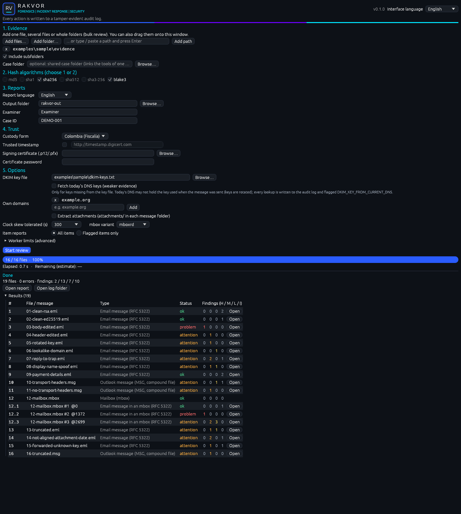
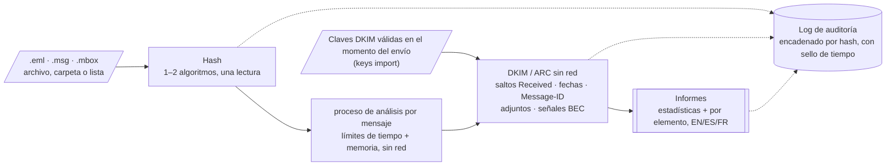
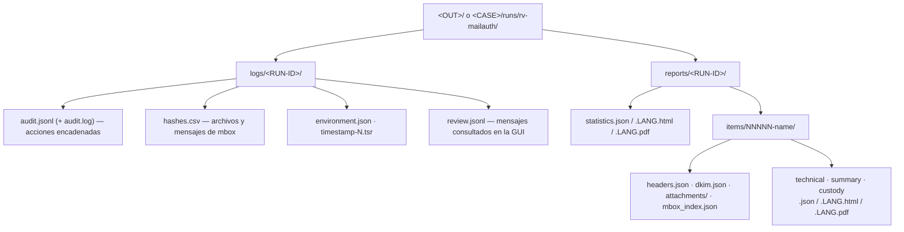

> La versión de referencia es la inglesa ([README.md](README.md)); esta traducción la sigue.

<p align="center"></p>

# RV MailAuth

[English](README.md) · **Español** · [Français](README.fr.md)

<!-- forge:description -->
**Señales de autenticidad del correo electrónico.** Revisa archivos .eml, .msg de Outlook y .mbox: firmas DKIM y ARC verificadas de nuevo sin red con claves aportadas por el perito, la ruta Received, fechas y zonas horarias, Message-ID, adjuntos y señales de compromiso del correo empresarial.
<!-- /forge:description -->

[](https://github.com/Panacota96/rv-mailauth/actions/workflows/ci.yml)


RV MailAuth busca **señales** de que un correo se modificó después de enviarse, o de que no es lo que dice ser. Nunca
dice "auténtico" ni "falsificado": cada hallazgo indica lo que muestra **y lo que no demuestra**, y cada paso se
escribe en un log de auditoría a prueba de manipulaciones. Es una herramienta de análisis de Rakvor: en un caso,
rv-hashinv registra la evidencia y rv-mailauth vuelve a verificar cada archivo contra ese registro antes de analizarlo.





## Contenido

- [Qué hace](#qué-hace)
- [Instalación](#instalación)
- [Inicio rápido](#inicio-rápido)
- [Salidas](#salidas)
- [Límites](#límites)
- [Documentación](#documentación)
- [Estructura del proyecto](#estructura-del-proyecto)
- [Contribuir, seguridad, licencia](#contribuir-seguridad-licencia)
- [Licencia](#licencia)

## Qué hace

| | |
| --- | --- |
| **DKIM y ARC, sin red** | Cada firma DKIM y la cadena ARC se verifican con las claves públicas que aporta **usted** (`--dkim-keys`, preparadas a partir de registros DNS archivados con `keys import`). El hash del cuerpo muestra si el texto es el que se firmó, sin ninguna clave. No se consulta nada en la red salvo que agregue `--online`, que se audita y se marca como evidencia más débil. |
| **Ruta y fechas** | Cada salto Received se analiza (salto 1 = el más cercano al remitente); horas que retroceden, un Date posterior al primer servidor, zonas horarias incoherentes, un Message-ID de otro dominio, adjuntos fechados después del mensaje. |
| **Señales BEC** | Dominios parecidos al suyo (`--own-domain`; caracteres Unicode confundibles, punycode, distancia de edición, dominio organizativo según una Public Suffix List fijada), Reply-To / Return-Path en otra organización, nombres visibles que toman prestado el suyo, textos sobre datos de pago (EN/ES/FR) e IBAN válidos. |
| **Outlook y buzones** | `.msg` leído a través de sus propiedades MAPI (DKIM figura como *no evaluado*, nunca como fallido: Outlook vuelve a codificar el mensaje); cada mensaje de un `.mbox` se analiza como un elemento propio, citado por el hash del mbox, su número y su desplazamiento en bytes. |
| **Lotes robustos** | Un proceso de análisis por mensaje con límites de tiempo y memoria: un mensaje hostil pasa a ser `PARSER_FAILED` para ese elemento, no el fin de la ejecución. Barra de progreso, tiempo transcurrido, tiempo restante, cancelación en cualquier momento. |
| **Auditable** | `audit.jsonl` encadenado por hash (cada archivo leído y escrito, cada archivo de claves y cada consulta DNS), sello de tiempo RFC 3161, PDF firmados con el certificado del perito, un formato de custodia por elemento (Colombia / Francia). `verify-log` y `verify-case` lo vuelven a comprobar todo más tarde. |
| **Dos interfaces** | `rv-mailauth` (línea de comandos) y `rv-mailauth-gui` (aplicación de escritorio para Windows 10/11 con un visor de mensajes que comprueba los hashes contra el log de auditoría y registra cada consulta en un log de revisión encadenado). Mismo motor, mismos resultados. |

## Instalación

**Windows 10/11**: desde la página [Releases](https://github.com/Panacota96/rv-mailauth/releases), cuando se publique
una versión:

- `rv-mailauth-<version>-windows-x64-setup.exe`: instalador (por usuario, acceso en el menú Inicio, CLI en el PATH), o
- `rv-mailauth-<version>-windows-x64.zip`: portable; descomprima y ejecute.

Verifique la descarga antes de usarla ([docs/installation.es.md](docs/installation.es.md): `SHA256SUMS`, procedencia,
Authenticode, self-test y la ejecución de la muestra).

**Desde el código fuente** (Rust 1.99.1 fijado en `rust-toolchain.toml`; mínimo 1.98):

```bash
cargo build --release --locked -p rv-mailauth-cli -p rv-mailauth-gui
# binarios: target/release/rv-mailauth y target/release/rv-mailauth-gui
```

## Inicio rápido

```powershell
# Compruebe la compilación: cada algoritmo de hash contra vectores de prueba publicados
rv-mailauth self-test

# Convertir los registros DNS archivados del dominio del remitente en un archivo de claves (la importación se audita)
rv-mailauth keys import E:\archive\example-org-2026.zone --key-file E:\CASE-014\case-keys.txt

# Analizar cada mensaje registrado en la carpeta del caso (tras la recepción con rv-hashinv), sin red, informes en español
rv-mailauth analyze --case-dir E:\CASE-014 --dkim-keys E:\CASE-014\case-keys.txt --own-domain acme.example --lang es

# O una carpeta de .eml/.msg/.mbox sin carpeta del caso
rv-mailauth analyze -i D:\export -r --hash sha256,md5 --dkim-keys case-keys.txt --own-domain acme.example

# Más tarde, demostrar que nada se alteró (cadena de auditoría, sello de tiempo, log de revisión, registro, evidencia)
rv-mailauth verify-case E:\CASE-014 --rehash
rv-mailauth verify-log E:\CASE-014\runs\rv-mailauth\<RUN-ID>\logs
```

**Aplicación de escritorio:** inicie *RV MailAuth*, agregue la evidencia (o una carpeta del caso), marque uno o dos
algoritmos de hash, elija el archivo de claves DKIM y sus dominios propios en *5. Opciones*, pulse *Iniciar revisión*
y luego **Abrir** en cualquier mensaje para ver sus saltos, su tabla DKIM y sus hallazgos
([docs/usage-gui.es.md](docs/usage-gui.es.md)).

Las tareas habituales, paso a paso: [docs/quick-guide.es.md](docs/quick-guide.es.md).

Pruébela con la muestra sintética: `examples/sample/run.sh target/release/rv-mailauth` (o `run.ps1`), código de salida
esperado 3: dos mensajes se editaron después de firmarse ([examples/](examples/README.md), en inglés).

## Salidas



| Código de salida (`analyze`) | Significado |
| :-: | --- |
| 0 | Terminado, ningún hallazgo de severidad alta |
| 1 | Error de ejecución (entrada inexistente, salida no escribible, log del caso bloqueado) |
| 2 | Error de uso (p. ej. tres algoritmos de hash, un archivo `--dkim-keys` ilegible, un `--own-domain` no válido) |
| 3 | Terminado con al menos un hallazgo de severidad alta (p. ej. `DKIM_BODY_HASH_MISMATCH`), o la carpeta del caso no pasa la verificación |
| 130 | Cancelado (se escribieron informes parciales) |

Cada hallazgo, su severidad y su texto: [docs/reports.md](docs/reports.md#findings-catalogue) (en inglés).

## Límites

- **Señales, no veredictos.** Un mensaje sin hallazgos no queda probado como auténtico; un hallazgo no prueba una falsificación.
- **DKIM vale lo que vale la clave.** Use la clave publicada cuando se envió el mensaje; la clave de hoy puede hacer
  fallar un mensaje genuino (las claves rotan). Una firma válida muestra que el contenido firmado no cambió desde que
  lo firmó quien tenía la clave del dominio, no quién lo escribió ni que las cabeceras no firmadas sean originales.
- **Las cabeceras son afirmaciones.** Las líneas Received, Date y Authentication-Results son texto que cualquiera que
  tenga el archivo podría editar; SPF y DMARC no se vuelven a evaluar.
- **Un `.msg` es una conversión** (DKIM no evaluado; a veces faltan las cabeceras de transporte). **PST/OST no se
  leen**: expórtelos primero. Deshacer el escape de un mbox depende de la variante (`--mbox-variant`).
- **Límites técnicos abiertos:** una firma cuya caducidad `x=` es anterior a la fecha del análisis no se evalúa; una
  firma con `l=` cubre solo una parte del cuerpo; S/MIME no se verifica ([docs/HANDOFF.md](docs/HANDOFF.md#6-open-work),
  en inglés).
- **Las comprobaciones BEC son heurísticas**, con falsos positivos y todavía sin tasas de error medidas.

La lista completa, con responsables y remedios: [docs/admissibility.md](docs/admissibility.md#consolidated-gap-list)
(en inglés).

## Documentación

| Página | Para |
| --- | --- |
| [docs/quick-guide.es.md](docs/quick-guide.es.md) | Las seis tareas habituales (analyze, carpeta del caso, verify-log, verify-case, timestamp, archivos de claves DKIM), cada botón de la GUI, códigos de salida |
| [docs/usage.es.md](docs/usage.es.md) | Caso completo: recepción con rv-hashinv, keys import, análisis, visor de la GUI, `verify-case`, interpretación de cada hallazgo, solución de problemas |
| [docs/usage-gui.es.md](docs/usage-gui.es.md) | La aplicación de escritorio y el visor de mensajes |
| [docs/usage-cli.md](docs/usage-cli.md) | Cada comando y opción (generado desde `--help`, en inglés) |
| [docs/installation.es.md](docs/installation.es.md) | Instalar y verificar una versión, compilar desde el código fuente para auditores |
| [docs/theory.md](docs/theory.md) | Por qué funciona cada paso: parte A en lenguaje sencillo (DKIM, hash del cuerpo, rotación de claves, cabeceras Received, BEC), parte B para expertos (en inglés) |
| [docs/reports.md](docs/reports.md) | Tipos de informe, salidas por mensaje, el catálogo de hallazgos, los esquemas JSON (en inglés) |
| [docs/admissibility.md](docs/admissibility.md) | Requisitos de Colombia, Francia/UE, ISO/IEC y EE. UU./Reino Unido frente a la herramienta, brechas, lista de control del perito (**borrador pendiente de revisión por un abogado**; en inglés) |
| [docs/case-folder.md](docs/case-folder.md) | Carpeta de caso compartida: registro, log del caso, papel de análisis, `verify-case` (en inglés) |
| [docs/forensic-audit.md](docs/forensic-audit.md) | Pista de auditoría, cadena de hashes, sellos de tiempo, informes firmados, acciones registradas (en inglés) |
| [docs/architecture.md](docs/architecture.md) | Cómo encajan el motor, el proceso de análisis, la CLI y la GUI (en inglés) |
| [docs/development.md](docs/development.md) | Compilación, pruebas, oráculos, actualizaciones de la PSL, CI/CD, publicación (en inglés) |
| [docs/HANDOFF.md](docs/HANDOFF.md) | Estado, estructura, comandos de cada día, decisiones, trabajo pendiente (en inglés) |
| [docs/adr/](docs/adr/) | Decisiones de arquitectura (lenguaje, verificación del sello de tiempo, avisos de seguridad, diseño del correo; en inglés) |

El README, la guía rápida, la guía de uso, la guía de la aplicación de escritorio y la guía de instalación existen
también en español (`.es.md`) y en francés (`.fr.md`); las páginas en inglés son la referencia.

## Estructura del proyecto

```text
rv-mailauth/
├── src/
│   ├── core/      motor: flujo, auditoría, carpeta del caso, informes, confianza (compartido) + mail, dkim, msg, mbox, bec, psl, worker
│   ├── cli/       línea de comandos rv-mailauth (clap): analyze, keys, verify-log, verify-case, timestamp, self-test, describe
│   └── gui/       aplicación de escritorio rv-mailauth-gui (egui); state.rs y viewer.rs contienen las reglas comprobables
├── templates/     plantillas HTML de los informes + CSS
├── i18n/          textos de los informes y de la GUI: en.json, es.json, fr.json
├── schemas/       esquemas JSON de los informes, de la carpeta del caso y de la salida de describe
├── docs/          documentación (los diagramas Mermaid se muestran en GitHub)
├── scripts/       comprobaciones de la documentación (las traducciones mantienen la forma de las páginas en inglés)
├── tests/         generador de muestras, oráculo dkimpy, verificadores en Python, caso de referencia, fixtures de TSA
├── examples/      evidencia sintética, claves DKIM públicas, hallazgos y hashes esperados, scripts de ejecución
├── packaging/     instalador de Windows (Inno Setup)
└── .github/       flujos de CI y de publicación
```

## Contribuir, seguridad, licencia

- Cómo contribuir: [CONTRIBUTING.md](CONTRIBUTING.md) · Cambios: [CHANGELOG.md](CHANGELOG.md)
- Reportar una vulnerabilidad de forma privada: [SECURITY.md](SECURITY.md)
- Licencia: ver [Licencia](#licencia). Avisos de terceros (incluida la Public Suffix List, MPL-2.0): [NOTICE](NOTICE).

## Licencia

Código disponible, uso no comercial: [PolyForm Noncommercial 1.0.0](LICENSE). Cualquiera puede usar, estudiar,
modificar y compartir RV MailAuth con fines no comerciales. Se exige el crédito en todo uso: "RV MailAuth by Rakvor", y
conservar la línea `Required Notice:` de [LICENSE](LICENSE). El uso comercial (venderla, servicios pagos, uso en el
trabajo remunerado de una empresa con fines de lucro) requiere una licencia escrita de Rakvor: ver
[COMMERCIAL.md](COMMERCIAL.md). Rakvor conserva todos los derechos comerciales como titular de los derechos de autor.
Los textos de licencia de Rakvor ([COMMERCIAL.md](COMMERCIAL.md), [NOTICE](NOTICE), esta sección) son borradores,
pendientes de verificación por un abogado (*to be verified*; Colombia, Francia), y no constituyen asesoría legal. Los
componentes de terceros conservan sus propias licencias: [NOTICE](NOTICE).
