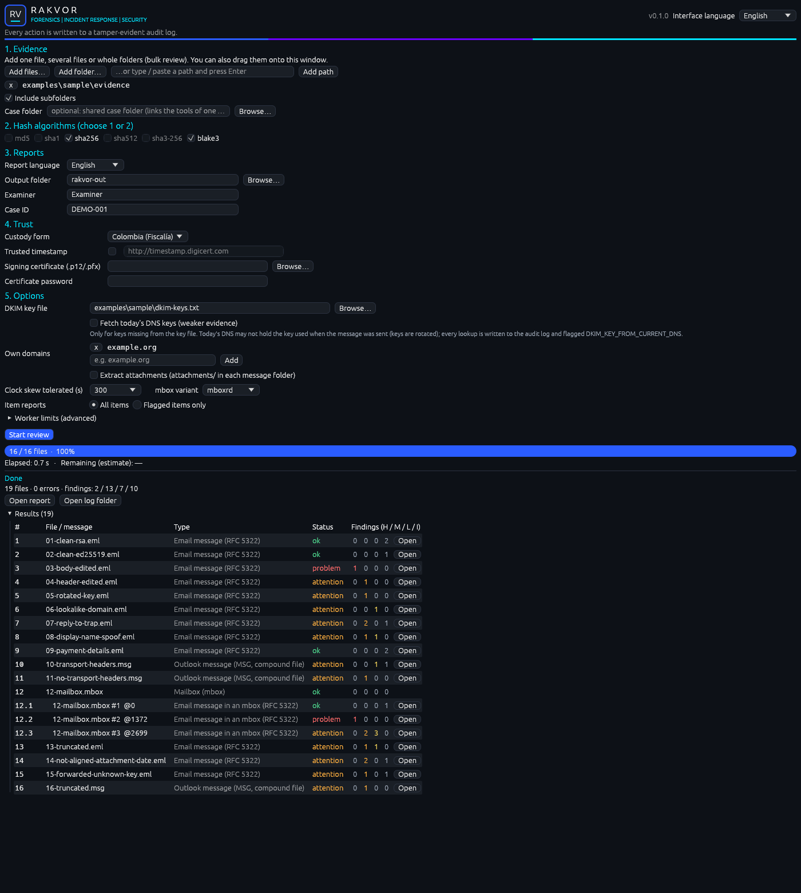
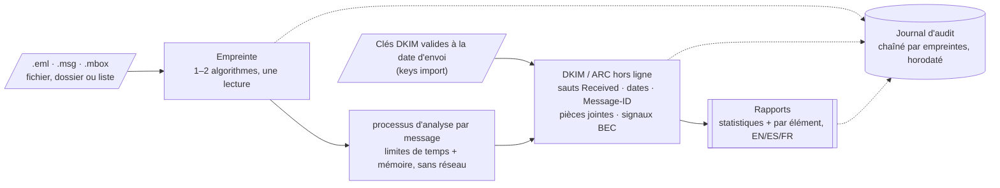
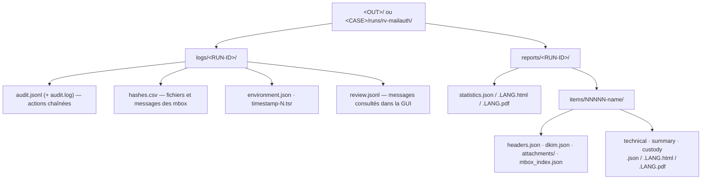

> La version de référence est la version anglaise ([README.md](README.md)) ; cette traduction la suit.

<p align="center"></p>

# RV MailAuth

[English](README.md) · [Español](README.es.md) · **Français**

<!-- forge:description -->
**Signaux d'authenticité des courriels.** Contrôle les fichiers .eml, .msg d'Outlook et .mbox : signatures DKIM et ARC revérifiées hors ligne avec les clés fournies par l'expert, chemin Received, dates et fuseaux horaires, Message-ID, pièces jointes et signaux de compromission de la messagerie d'entreprise.
<!-- /forge:description -->

[](https://github.com/Panacota96/rv-mailauth/actions/workflows/ci.yml)


RV MailAuth cherche des **signaux** indiquant qu'un courriel a été modifié après son envoi, ou qu'il n'est pas ce qu'il
prétend être. Il ne dit jamais « authentique » ni « falsifié » : chaque constatation indique ce qu'elle montre **et ce
qu'elle ne prouve pas**, et chaque étape est écrite dans un journal d'audit inviolable. C'est un outil d'analyse de
Rakvor : dans une affaire, rv-hashinv enregistre les éléments et rv-mailauth revérifie chaque fichier avec ce registre
avant de l'analyser.





## Sommaire

- [Ce qu'il fait](#ce-quil-fait)
- [Installation](#installation)
- [Démarrage rapide](#démarrage-rapide)
- [Sorties](#sorties)
- [Limites](#limites)
- [Documentation](#documentation)
- [Organisation du projet](#organisation-du-projet)
- [Contribuer, sécurité, licence](#contribuer-sécurité-licence)
- [Licence](#licence)

## Ce qu'il fait

| | |
| --- | --- |
| **DKIM et ARC, hors ligne** | Chaque signature DKIM et la chaîne ARC sont vérifiées avec les clés publiques que **vous** fournissez (`--dkim-keys`, préparées à partir d'enregistrements DNS archivés avec `keys import`). L'empreinte du corps montre si le texte est celui qui a été signé, sans aucune clé. Rien n'est recherché sur le réseau sauf si vous ajoutez `--online`, qui est audité et signalé comme une preuve plus faible. |
| **Chemin et dates** | Chaque saut Received est analysé (saut 1 = le plus proche de l'expéditeur) ; des heures qui reculent, un Date postérieur au premier serveur, des fuseaux incohérents, un Message-ID d'un autre domaine, des pièces jointes datées après le message. |
| **Signaux BEC** | Domaines sosies du vôtre (`--own-domain` ; caractères Unicode confondables, punycode, distance d'édition, domaine organisationnel d'après une Public Suffix List figée), Reply-To / Return-Path dans une autre organisation, noms affichés qui empruntent le vôtre, formulations sur les coordonnées de paiement (EN/ES/FR) et IBAN valides. |
| **Outlook et boîtes aux lettres** | `.msg` lu par ses propriétés MAPI (DKIM indiqué *non évalué*, jamais en échec : Outlook réencode le message) ; chaque message d'un `.mbox` est analysé comme un élément à part entière, cité par l'empreinte du mbox, son numéro et son décalage en octets. |
| **Lots robustes** | Un processus d'analyse par message avec des limites de temps et de mémoire : un message hostile devient `PARSER_FAILED` pour cet élément, pas la fin de l'exécution. Barre de progression, temps écoulé, temps restant, annulation à tout moment. |
| **Auditable** | `audit.jsonl` chaîné par empreintes (chaque fichier lu et écrit, chaque fichier de clés et chaque requête DNS), horodatage RFC 3161, PDF signés avec le certificat de l'expert, une fiche de traçabilité par élément (Colombie / France). `verify-log` et `verify-case` revérifient tout plus tard. |
| **Deux interfaces** | `rv-mailauth` (ligne de commande) et `rv-mailauth-gui` (application de bureau Windows 10/11 avec une visionneuse de messages qui contrôle les empreintes avec le journal d'audit et consigne chaque consultation dans un journal de consultation chaîné). Même moteur, mêmes résultats. |

## Installation

**Windows 10/11** : depuis la page [Releases](https://github.com/Panacota96/rv-mailauth/releases), une fois une version
publiée :

- `rv-mailauth-<version>-windows-x64-setup.exe` : programme d'installation (par utilisateur, raccourci dans le menu Démarrer, CLI dans le PATH), ou
- `rv-mailauth-<version>-windows-x64.zip` : portable, à décompresser et lancer.

Vérifiez le téléchargement avant usage ([docs/installation.fr.md](docs/installation.fr.md) : `SHA256SUMS`, provenance,
Authenticode, self-test et l'exécution de l'échantillon).

**À partir des sources** (Rust 1.99.1 fixé dans `rust-toolchain.toml` ; minimum 1.98) :

```bash
cargo build --release --locked -p rv-mailauth-cli -p rv-mailauth-gui
# binaires : target/release/rv-mailauth et target/release/rv-mailauth-gui
```

## Démarrage rapide

```powershell
# Vérifier la compilation : chaque algorithme d'empreinte avec des vecteurs de test publiés
rv-mailauth self-test

# Transformer les enregistrements DNS archivés du domaine de l'expéditeur en fichier de clés (l'import est audité)
rv-mailauth keys import E:\archive\example-org-2026.zone --key-file E:\CASE-014\case-keys.txt

# Analyser chaque message enregistré dans le dossier de l'affaire (après la réception par rv-hashinv), hors ligne, rapports en espagnol
rv-mailauth analyze --case-dir E:\CASE-014 --dkim-keys E:\CASE-014\case-keys.txt --own-domain acme.example --lang es

# Ou un dossier de .eml/.msg/.mbox sans dossier d'affaire
rv-mailauth analyze -i D:\export -r --hash sha256,md5 --dkim-keys case-keys.txt --own-domain acme.example

# Plus tard, prouver que rien n'a été altéré (chaîne d'audit, horodatage, journal de consultation, registre, éléments)
rv-mailauth verify-case E:\CASE-014 --rehash
rv-mailauth verify-log E:\CASE-014\runs\rv-mailauth\<RUN-ID>\logs
```

**Application de bureau :** lancez *RV MailAuth*, ajoutez les éléments (ou un dossier de l'affaire), cochez un ou deux
algorithmes d'empreinte, choisissez le fichier de clés DKIM et vos domaines propres sous *5. Options*, appuyez sur
*Lancer l'analyse*, puis sur **Ouvrir** devant n'importe quel message pour voir ses sauts, son tableau DKIM et ses
constatations ([docs/usage-gui.fr.md](docs/usage-gui.fr.md)).

Les tâches courantes, étape par étape : [docs/quick-guide.fr.md](docs/quick-guide.fr.md).

Essayez-le sur l'échantillon synthétique : `examples/sample/run.sh target/release/rv-mailauth` (ou `run.ps1`), code de
sortie attendu 3 : deux messages ont été modifiés après leur signature ([examples/](examples/README.md), en anglais).

## Sorties



| Code de sortie (`analyze`) | Signification |
| :-: | --- |
| 0 | Terminé, aucune constatation de gravité élevée |
| 1 | Erreur d'exécution (entrée introuvable, sortie non inscriptible, journal de l'affaire verrouillé) |
| 2 | Erreur d'utilisation (p. ex. trois algorithmes d'empreinte, un fichier `--dkim-keys` illisible, un `--own-domain` invalide) |
| 3 | Terminé avec au moins une constatation de gravité élevée (p. ex. `DKIM_BODY_HASH_MISMATCH`), ou le dossier de l'affaire échoue à la vérification |
| 130 | Annulé (rapports partiels écrits) |

Chaque constatation, sa gravité et son libellé : [docs/reports.md](docs/reports.md#findings-catalogue) (en anglais).

## Limites

- **Des signaux, pas des verdicts.** Un message sans constatation n'est pas prouvé authentique ; une constatation ne prouve pas une falsification.
- **DKIM ne vaut que ce que vaut la clé.** Utilisez la clé publiée à l'envoi du message ; la clé d'aujourd'hui peut
  faire échouer un message authentique (les clés tournent). Une signature valide montre que le contenu signé n'a pas
  changé depuis qu'un détenteur de la clé du domaine l'a signé, pas qui l'a écrit, ni que les en-têtes non signés sont
  d'origine.
- **Les en-têtes sont des affirmations.** Les lignes Received, Date et Authentication-Results sont du texte que
  quiconque détient le fichier pourrait modifier ; SPF et DMARC ne sont pas réévalués.
- **Un `.msg` est une conversion** (DKIM non évalué ; en-têtes de transport parfois absents). **Les PST/OST ne sont pas
  lus** : exportez-les d'abord. Le déséchappement d'un mbox dépend de la variante (`--mbox-variant`).
- **Limites techniques ouvertes :** une signature dont l'expiration `x=` est antérieure à la date de l'analyse n'est
  pas évaluée ; une signature `l=` ne couvre qu'une partie du corps ; S/MIME n'est pas vérifié
  ([docs/HANDOFF.md](docs/HANDOFF.md#6-open-work), en anglais).
- **Les contrôles BEC sont des heuristiques**, avec des faux positifs et sans taux d'erreur mesurés pour l'instant.

La liste complète, avec les responsables et les remèdes : [docs/admissibility.md](docs/admissibility.md#consolidated-gap-list)
(en anglais).

## Documentation

| Page | Pour |
| --- | --- |
| [docs/quick-guide.fr.md](docs/quick-guide.fr.md) | Les six tâches courantes (analyze, dossier de l'affaire, verify-log, verify-case, timestamp, fichiers de clés DKIM), chaque bouton de la GUI, codes de sortie |
| [docs/usage.fr.md](docs/usage.fr.md) | Affaire de bout en bout : réception avec rv-hashinv, keys import, analyse, visionneuse de la GUI, `verify-case`, interprétation de chaque constatation, dépannage |
| [docs/usage-gui.fr.md](docs/usage-gui.fr.md) | L'application de bureau et la visionneuse de messages |
| [docs/usage-cli.md](docs/usage-cli.md) | Chaque commande et option (généré à partir de `--help`, en anglais) |
| [docs/installation.fr.md](docs/installation.fr.md) | Installer et vérifier une version, compiler à partir des sources pour les auditeurs |
| [docs/theory.md](docs/theory.md) | Pourquoi chaque étape fonctionne : partie A en langage simple (DKIM, empreinte du corps, rotation des clés, en-têtes Received, BEC), partie B pour les experts (en anglais) |
| [docs/reports.md](docs/reports.md) | Types de rapport, sorties par message, catalogue des constatations, schémas JSON (en anglais) |
| [docs/admissibility.md](docs/admissibility.md) | Exigences de la Colombie, de la France/UE, de l'ISO/IEC et des États-Unis/Royaume-Uni rapportées à l'outil, écarts, liste de contrôle de l'expert (**brouillon en attente de la relecture d'un avocat** ; en anglais) |
| [docs/case-folder.md](docs/case-folder.md) | Dossier d'affaire partagé : registre, journal de l'affaire, rôle d'analyse, `verify-case` (en anglais) |
| [docs/forensic-audit.md](docs/forensic-audit.md) | Piste d'audit, chaîne d'empreintes, horodatages, rapports signés, actions consignées (en anglais) |
| [docs/architecture.md](docs/architecture.md) | Comment s'assemblent le moteur, le processus d'analyse, la CLI et la GUI (en anglais) |
| [docs/development.md](docs/development.md) | Compilation, tests, oracles, mises à jour de la PSL, CI/CD, publication (en anglais) |
| [docs/HANDOFF.md](docs/HANDOFF.md) | État, organisation, commandes courantes, décisions, travail en cours (en anglais) |
| [docs/adr/](docs/adr/) | Décisions d'architecture (langage, vérification de l'horodatage, avis de sécurité, conception du courriel ; en anglais) |

Le README, le guide rapide, le guide d'utilisation, le guide de l'application de bureau et le guide d'installation
existent aussi en espagnol (`.es.md`) et en français (`.fr.md`) ; les pages en anglais font référence.

## Organisation du projet

```text
rv-mailauth/
├── src/
│   ├── core/      moteur : chaîne de traitement, audit, dossier de l'affaire, rapports, confiance (partagé) + mail, dkim, msg, mbox, bec, psl, worker
│   ├── cli/       ligne de commande rv-mailauth (clap) : analyze, keys, verify-log, verify-case, timestamp, self-test, describe
│   └── gui/       application de bureau rv-mailauth-gui (egui) ; state.rs et viewer.rs contiennent les règles testables
├── templates/     modèles HTML des rapports + CSS
├── i18n/          textes des rapports et de la GUI : en.json, es.json, fr.json
├── schemas/       schémas JSON des rapports, du dossier de l'affaire et de la sortie de describe
├── docs/          documentation (les diagrammes Mermaid s'affichent sur GitHub)
├── scripts/       contrôles de la documentation (les traductions gardent la forme des pages anglaises)
├── tests/         générateur d'échantillons, oracle dkimpy, vérificateurs Python, affaire de référence, fixtures de TSA
├── examples/      éléments d'exemple synthétiques, clés DKIM publiques, constatations et empreintes attendues, scripts
├── packaging/     programme d'installation Windows (Inno Setup)
└── .github/       workflows de CI et de publication
```

## Contribuer, sécurité, licence

- Comment contribuer : [CONTRIBUTING.md](CONTRIBUTING.md) · Modifications : [CHANGELOG.md](CHANGELOG.md)
- Signaler une vulnérabilité en privé : [SECURITY.md](SECURITY.md)
- Licence : voir [Licence](#licence). Avis de tiers (dont la Public Suffix List, MPL-2.0) : [NOTICE](NOTICE).

## Licence

Code source disponible, usage non commercial : [PolyForm Noncommercial 1.0.0](LICENSE). Toute personne peut
utiliser, étudier, modifier et partager RV MailAuth à des fins non commerciales. La mention est obligatoire dans tout
usage : « RV MailAuth by Rakvor », en conservant la ligne `Required Notice:` de [LICENSE](LICENSE). L'usage commercial
(la vendre, des services payants, l'usage dans le travail rémunéré d'une entreprise à but lucratif) nécessite une
licence écrite de Rakvor : voir [COMMERCIAL.md](COMMERCIAL.md). Rakvor conserve tous les droits commerciaux en tant
que titulaire du droit d'auteur. Les textes de licence de Rakvor ([COMMERCIAL.md](COMMERCIAL.md), [NOTICE](NOTICE),
cette section) sont des projets, à faire vérifier par un avocat (*to be verified* ; Colombie, France), et ne
constituent pas un avis juridique. Les composants tiers conservent leurs propres licences : [NOTICE](NOTICE).
