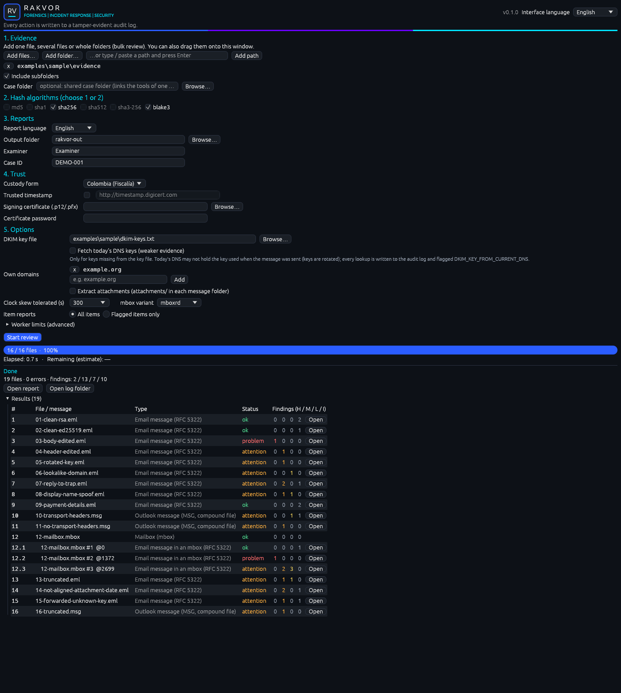
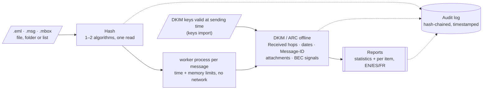
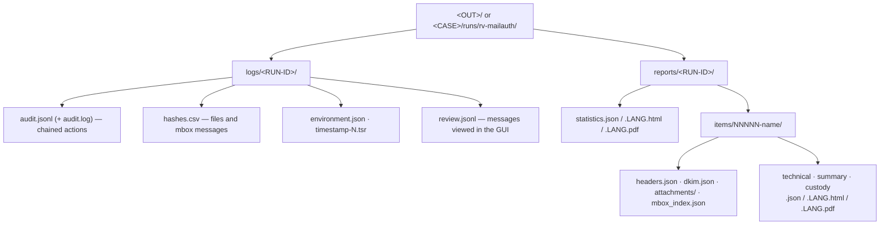

<p align="center"></p>

# RV MailAuth

<!-- forge:description -->
**Email authenticity signals.** Checks .eml, Outlook .msg and .mbox files: DKIM and ARC signatures re-verified offline with examiner-supplied keys, the Received path, dates and time zones, Message-ID, attachments and business-email-compromise signals.
<!-- /forge:description -->

[](https://github.com/Panacota96/rv-mailauth/actions/workflows/ci.yml)
-6B00FF)


RV MailAuth looks for **signals** that an email was changed after it was sent, or is not what it claims to be. It
never says "authentic" or "forged": every finding states what it shows **and what it does not prove**, and every
step is written to a tamper-evident audit log. It is a Rakvor analysis tool: in a case, rv-hashinv registers the
evidence and rv-mailauth re-verifies each file against that registry before analysing it.





## Contents

- [What it does](#what-it-does)
- [Install](#install)
- [Quick start](#quick-start)
- [Outputs](#outputs)
- [Limits](#limits)
- [Documentation](#documentation)
- [Project layout](#project-layout)
- [Contributing, security, licence](#contributing-security-licence)

## What it does

| | |
| --- | --- |
| **DKIM and ARC, offline** | Every DKIM signature and the ARC chain verified with the public keys **you** supply (`--dkim-keys`, prepared from archived DNS records with `keys import`). The body hash shows whether the text is the one that was signed — without any key. Nothing is looked up on the network unless you add `--online`, which is audited and flagged as weaker evidence. |
| **Route and dates** | Every Received hop parsed (hop 1 = closest to the sender); times that go backwards, a Date later than the first server, inconsistent time zones, a Message-ID from another domain, attachments dated after the message. |
| **BEC signals** | Lookalike domains of your own (`--own-domain`; Unicode confusables, punycode, edit distance, organisational domain from a pinned Public Suffix List), Reply-To / Return-Path at another organisation, display names that borrow your name, payment-details wording (EN/ES/FR) and valid IBANs. |
| **Outlook and mailboxes** | `.msg` read through its MAPI properties (DKIM listed as *not evaluated*, never failed: Outlook re-encodes the message); every message of an `.mbox` analysed as an item of its own, cited by the mbox's digest, its number and byte offset. |
| **Robust bulk runs** | One worker process per message with time and memory limits: a hostile message becomes `PARSER_FAILED` for that item, not the end of the run. Progress bar, elapsed time, ETA, cancel at any time. |
| **Auditable** | Hash-chained `audit.jsonl` (every file read and written, every key file and DNS lookup), RFC 3161 timestamp, PDFs signed with the examiner's certificate, a custody form per item (Colombia / France). `verify-log` and `verify-case` re-check everything later. |
| **Two front-ends** | `rv-mailauth` (command line) and `rv-mailauth-gui` (Windows 10/11 desktop app with a message viewer that checks digests against the audit log and records each viewing in a chained review log). Same engine, same results. |

## Install

**Windows 10/11** — from the [Releases](https://github.com/Panacota96/rv-mailauth/releases) page, once a version is
released:

- `rv-mailauth-<version>-windows-x64-setup.exe` — installer (per-user, Start-menu shortcut, CLI on PATH), or
- `rv-mailauth-<version>-windows-x64.zip` — portable: unzip and run.

Verify the download before use ([docs/installation.md](docs/installation.md): `SHA256SUMS`, provenance,
Authenticode, self-test and the sample run).

**From source** (Rust 1.99.1 pinned in `rust-toolchain.toml`; minimum 1.98):

```bash
cargo build --release --locked -p rv-mailauth-cli -p rv-mailauth-gui
# binaries: target/release/rv-mailauth and target/release/rv-mailauth-gui
```

## Quick start

```powershell
# Check the build: every hash algorithm against published test vectors
rv-mailauth self-test

# Turn archived DNS records of the sender's domain into a key file (the import is audited)
rv-mailauth keys import E:\archive\example-org-2026.zone --key-file E:\CASE-014\case-keys.txt

# Analyse every message registered in the case folder (after rv-hashinv intake), offline, Spanish reports
rv-mailauth analyze --case-dir E:\CASE-014 --dkim-keys E:\CASE-014\case-keys.txt --own-domain acme.example --lang es

# Or a folder of .eml/.msg/.mbox without a case folder
rv-mailauth analyze -i D:\export -r --hash sha256,md5 --dkim-keys case-keys.txt --own-domain acme.example

# Later, prove nothing was altered (audit chain, timestamp, review log, registry, evidence)
rv-mailauth verify-case E:\CASE-014 --rehash
rv-mailauth verify-log E:\CASE-014\runs\rv-mailauth\<RUN-ID>\logs
```

**Desktop app:** start *RV MailAuth*, add the evidence (or a case folder), tick one or two hash algorithms, choose
the DKIM key file and your own domains under *5. Options*, press *Start review*, then **Open** any message to see
its hops, DKIM table and findings ([docs/usage-gui.md](docs/usage-gui.md)).

Try it on the synthetic sample: `examples/sample/run.sh target/release/rv-mailauth` (or `run.ps1`), expected exit
code 3 — two messages were edited after signing ([examples/](examples/README.md)).

## Outputs



| Exit code (`analyze`) | Meaning |
| :-: | --- |
| 0 | Completed, no high-severity finding |
| 1 | Runtime error (input not found, output not writable, case log locked) |
| 2 | Usage error (e.g. three hash algorithms, an unreadable `--dkim-keys` file, an invalid `--own-domain`) |
| 3 | Completed with at least one high-severity finding (e.g. `DKIM_BODY_HASH_MISMATCH`), or the case folder fails verification |
| 130 | Cancelled (partial reports written) |

Every finding, its severity and wording: [docs/reports.md](docs/reports.md#findings-catalogue).

## Limits

- **Signals, not verdicts.** A message without findings is not proven authentic; a finding does not prove forgery.
- **DKIM is only as good as the key.** Use the key published when the message was sent; today's key can fail a
  genuine message (keys rotate). A valid signature shows the signed content is unchanged since a holder of the
  domain's key signed it — not who wrote it, nor that unsigned headers are original.
- **Headers are claims.** Received, Date and Authentication-Results lines are text anyone holding the file could
  edit; SPF and DMARC are not re-evaluated.
- **`.msg` is a conversion** (DKIM not evaluated; transport headers sometimes missing). **PST/OST are not read**:
  export them first. mbox un-escaping depends on the variant (`--mbox-variant`).
- **Open technical limits:** a signature whose `x=` expiry is before the analysis date is not evaluated; an `l=`
  signature covers only part of the body; S/MIME is not verified ([docs/HANDOFF.md](docs/HANDOFF.md#6-open-work)).
- **BEC checks are heuristics** with false positives and no measured error rates yet.

The full list, with owners and remedies: [docs/admissibility.md](docs/admissibility.md#consolidated-gap-list).

## Documentation

| Page | For |
| --- | --- |
| [docs/usage.md](docs/usage.md) | End-to-end case: rv-hashinv intake, keys import, analysis, GUI viewer, `verify-case`, interpreting each finding, troubleshooting |
| [docs/usage-gui.md](docs/usage-gui.md) | The desktop app and the message viewer |
| [docs/usage-cli.md](docs/usage-cli.md) | Every command and option (generated from `--help`) |
| [docs/installation.md](docs/installation.md) | Installing and verifying a release, building from source for auditors |
| [docs/theory.md](docs/theory.md) | Why each step works: Part A in plain language (DKIM, body hash, key rotation, Received headers, BEC), Part B for experts |
| [docs/reports.md](docs/reports.md) | Report kinds, per-message outputs, the findings catalogue, JSON schemas |
| [docs/admissibility.md](docs/admissibility.md) | Colombia, France/EU, ISO/IEC and US/UK requirements mapped to the tool, gaps, examiner checklist (**draft pending a lawyer's review**) |
| [docs/case-folder.md](docs/case-folder.md) | Shared case folder: registry, case log, analysis role, `verify-case` |
| [docs/forensic-audit.md](docs/forensic-audit.md) | Audit trail, hash chain, timestamps, signed reports, actions recorded |
| [docs/architecture.md](docs/architecture.md) | How the engine, the worker, the CLI and the GUI fit together |
| [docs/development.md](docs/development.md) | Building, testing, oracles, PSL updates, CI/CD, releasing |
| [docs/HANDOFF.md](docs/HANDOFF.md) | State, layout, everyday commands, decisions, open work |
| [docs/adr/](docs/adr/) | Architecture decisions (language, timestamp verification, advisories, email design) |

## Project layout

```text
rv-mailauth/
├── src/
│   ├── core/      engine: pipeline, audit, case folder, reports, trust (shared) + mail, dkim, msg, mbox, bec, psl, worker
│   ├── cli/       rv-mailauth command line (clap): analyze, keys, verify-log, verify-case, timestamp, self-test, describe
│   └── gui/       rv-mailauth-gui desktop app (egui); state.rs and viewer.rs hold the testable rules
├── templates/     HTML report templates + CSS
├── i18n/          report and GUI wording: en.json, es.json, fr.json
├── schemas/       JSON Schemas of the reports, case folder and describe output
├── docs/          documentation (Mermaid diagrams render on GitHub)
├── tests/         sample generator, dkimpy oracle, Python verifiers, golden case, TSA fixtures
├── examples/      synthetic sample evidence, public DKIM keys, expected findings and hashes, run scripts
├── packaging/     Windows installer (Inno Setup)
└── .github/       CI and release workflows
```

## Contributing, security, licence

- How to contribute: [CONTRIBUTING.md](CONTRIBUTING.md) · Changes: [CHANGELOG.md](CHANGELOG.md)
- Report a vulnerability privately: [SECURITY.md](SECURITY.md)
- **Licence status: draft.** The Rakvor Source-Auditable Licence ([LICENSE](LICENSE)) is a draft pending a lawyer's
  review (Colombia, France): the tool is used locally by Rakvor; customers, courts and their experts may inspect and
  rebuild the source for audit; no redistribution. Third-party notices (including the Public Suffix List, MPL-2.0):
  [NOTICE](NOTICE).
