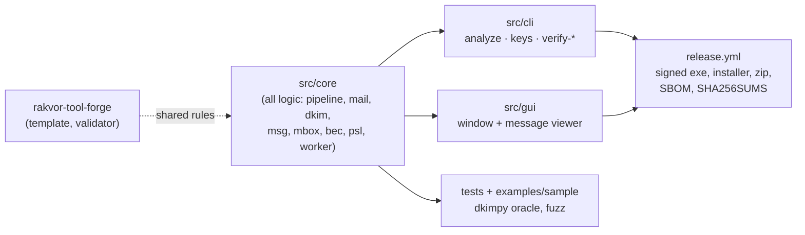

# Handover — rv-mailauth 0.1.0 (unreleased)

State on 2026-11-12 (branch `mailauth-core`, not yet merged to `main`). **rv-mailauth** — analysis: email
authenticity signals for `.eml`, Outlook `.msg` and `.mbox` (DKIM/ARC verified offline with examiner-supplied keys,
Received hops and dates, Message-ID, attachments, BEC signals).

This page is for whoever picks the project up next: where things are, how to build, test and release it, the
decisions already made and what is still open. The user-facing guides are [usage.md](usage.md),
[usage-gui.md](usage-gui.md) and [installation.md](installation.md); the method is in [theory.md](theory.md).



## 1. State at handover

| Item | Value |
| --- | --- |
| Version | 0.1.0 in `version.txt`; nothing released yet (release-please starts after the first merge to `main`) |
| Branch | `mailauth-core`: core, CLI and GUI integrated, docs written from the code; merging needs the owner's approval |
| Toolchain | Rust pinned in `rust-toolchain.toml` (1.99.1); `rust-version` = 1.98, the minimum of mail-parser 1.0 ([development.md](development.md#toolchain-pin)) |
| CI | `ci.yml`: lint (fmt, cargo-deny, clippy `-D warnings`, actionlint) on Linux; tests on Linux and Windows (with Windows clippy), sample run, Python verifiers, golden case from the Python profile, dkimpy oracle, real-TSA smoke test |
| Releases | signed with the internal Rakvor code-signing certificate once released; the chain ends at "Rakvor Internal Code Signing Root CA", SHA-256 `DC:9B:A1:A2:FC:D4:F0:63:3C:52:14:B7:CC:EB:25:BE:D8:F3:F7:D9:EB:AF:11:15:90:25:0C:BC:AA:83:DF:60` |
| Forge | the contract this repository follows and its validator live in [rakvor-tool-forge](https://github.com/Panacota96/rakvor-tool-forge); the pinned versions are in its [version table](https://github.com/Panacota96/rakvor-tool-forge#using-a-pinned-commit) |

## 2. Where things are

| Path | What it holds |
| --- | --- |
| `src/core/src/run.rs`, `audit.rs`, `case.rs`, `verify.rs`, `review.rs` | the forensic pipeline shared with the other tools: hashing, audit chain, case folder, `verify-log` (incl. `review.jsonl`), reports |
| `src/core/src/analyzer.rs` | routing: `.eml`/`.msg` to the message analysis (worker), mbox to the container split, other files to the inventory logic |
| `src/core/src/mail.rs` | one message: headers, Received hops, dates, Authentication-Results, attachments, findings |
| `src/core/src/dkim.rs`, `dnsfetch.rs` | offline DKIM/ARC with injected keys; key-file parser; `--online` fetch (parent only) |
| `src/core/src/msg.rs`, `mbox.rs` | Outlook compound file (MAPI properties); mbox split and un-escaping |
| `src/core/src/bec.rs`, `psl.rs`, `data/` | lookalike domains, Reply-To, display name, payment wording; the pinned Public Suffix List |
| `src/core/src/worker.rs` | one worker process per message: limits, protocol, network isolation |
| `src/core/src/model.rs` | finding codes and severities, options, message model |
| `src/cli` (`main.rs`, `keys.rs`), `src/gui` (`state.rs`, `viewer.rs`, `app.rs`) | thin front ends; the GUI logs every user action (`ui_*`) and writes `review.jsonl` from the message viewer |
| `i18n/` | all report and GUI wording, EN/ES/FR, same keys |
| `examples/sample`, `tests/make_samples.py`, `tests/oracle_dkim.py` | synthetic evidence, public keys, expected findings and hashes; the dkimpy oracle |
| `tests/fixtures/tsa-chains` | 34 TSA certificate chains with OpenSSL's verdicts (shared by every tool) |
| `docs/` | theory (Part A for non-experts, Part B for experts), admissibility (draft), usage, reports, ADRs |
| `packaging/`, `deny.toml` | Inno Setup script; licence allow-list (no GPL/AGPL/LGPL) and advisory exceptions |

**Shared code.** `src/core/src/trust.rs` is byte-identical in rv-hub, rv-hashinv, rv-rsmf, rv-certcheck,
rv-imgauth, rv-pdfauth, rv-mailauth and the forge template; the installer AppId table in
`src/cli/tests/packaging.rs` and the `deny.toml` policy are shared too. `src/core/src/outputs.rs` (re-hash of the
outputs an audit log records, used by `verify-log` and `verify-case`) is shared the same way, byte-identical with
rv-hashinv: it depends only on `crate::hash` and `serde_json`; its module documentation lists every audit shape of
every tool (here `output_written` with `details.file` and `details.hashes`; the `keys import` entry has no file in
the run and is skipped with the reason). Change all copies in one go and compare their SHA-256; never edit them
here alone.

## 3. Everyday commands

```bash
export RV_TEST_PYTHON=<workspace>/.venv/Scripts/python.exe     # blake3 jsonschema pyhanko dkimpy pynacl
cargo fmt --all -- --check
cargo clippy --workspace --all-targets --locked -- -D warnings
cargo test --workspace --locked
cargo deny check
cargo build -q -p rv-mailauth-cli && sh examples/sample/run.sh target/debug/rv-mailauth.exe
python <forge>/scripts/validate_project.py . --run --tests       # the Rakvor contract (forge checkout)
```

Generated docs: `docs/usage-cli.md` (`rv-mailauth docs-cli`) and the findings and limitations tables of
`docs/reports.md` (`RV_UPDATE_DOCS=1 cargo test -p rv-mailauth-core --test docs_catalogue`); tests fail when they
drift.

## 4. Releasing

Conventional Commits drive release-please: `feat:` minor, `fix:` patch, `docs:`/`test:`/`chore:` no release.
Merging the release PR tags the version and the release workflow builds, signs, packages and uploads. Full steps,
secrets (`SIGN_PFX_BASE64`, `SIGN_PFX_PASSWORD`) and the manual fallback: [release-process.md](release-process.md).

- Never merge, push to `main`, force-push or publish a release without the owner's approval.
- CI on release-please's own PRs can stop at *action required*: approve the run (Actions tab) before merging.
- After a release, verify it independently: `SHA256SUMS` over the downloaded assets, and every `.exe` (installer,
  CLI, GUI) chaining to the root above (`signtool verify /pa /v`).

## 5. Decisions

| ADR | Decision |
| --- | --- |
| [0001](adr/0001-language.md) | Implementation language (Rust) |
| [0002](adr/0002-tsa-token-verification.md) | How RFC 3161 tokens and TSA chains are verified |
| [0003](adr/0003-dependency-advisories.md) | Dependency advisories, exceptions and RSA blinding (incl. mail-auth's verify-only rsa 0.9) |
| [0004](adr/0004-email-design-decisions.md) | Offline keys by default and `--online` as weaker evidence; `.msg` DKIM not evaluated; mbox custody model; worker default; `DKIM_SIGNATURE_INVALID` medium; pinned PSL |

Standing rules: no private key, password or real personal data in the repository (the sample keys were thrown
away after signing; only public keys are kept); secrets only through environment variables or prompts and never
logged; no GPL/AGPL/LGPL components; tools report signals, not verdicts.

## 6. Open work

- The licence (`LICENSE`) and the admissibility analysis ([admissibility.md](admissibility.md)) are drafts pending a
  lawyer's review (Colombia and France); every citation marked [to verify] must be checked first.
- **Signature expiry (`x=`) is checked against the analysis clock.** mail-auth 0.15 rejects a signature whose `x=`
  is in the past *today* as expired, before it computes the body hash; such signatures are reported
  `DKIM_SIGNATURE_NOT_EVALUATED` (reason: signature expired). Evaluating them as of the sending time needs a
  verifier entry point that takes the time (upstream request or a small wrapper). Gap G-MAIL4.
- **`l=` body length.** A signature with `l=` covers only the first `l` bytes of the body; content added after it
  passes. `dkim.json` records `body_length`, but no finding flags `l=` shorter than the body. Gap G-MAIL5.
- PST/OST containers are not read (no permissively licensed Rust reader; libpff is LGPL). Export to `.msg`, `.eml`
  or mbox with a documented tool and register the export.
- S/MIME and OpenPGP signatures are not verified (planned for rv-certcheck v0.3); SPF and DMARC are not evaluated —
  the receiving server's `Authentication-Results` are recorded as stated evidence only.
- No validated error rates for the BEC heuristics on a documented corpus (gap G5); TSA revocation is never checked
  (G18, [ADR 0002](adr/0002-tsa-token-verification.md)); RUSTSEC-2023-0071 stays an exception until `cms` 0.3 and a
  mail-auth on rsa 0.10 ([ADR 0003](adr/0003-dependency-advisories.md)).
- Recorded outputs (gap G19, closed): `verify-log` and `verify-case` re-hash every report, per-message output,
  `hashes.csv` and `environment.json` the audit log records (`src/core/src/outputs.rs`). The Python oracle
  `tests/verify_chain.py` does not re-hash them yet; the script in [usage.md](usage.md#8-verifying-a-run) does.

The gap table in [admissibility.md](admissibility.md#consolidated-gap-list) lists every known limitation with its
owner (engineering, counsel, examiner, firm).
