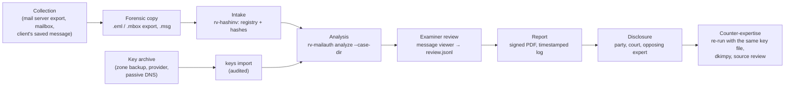
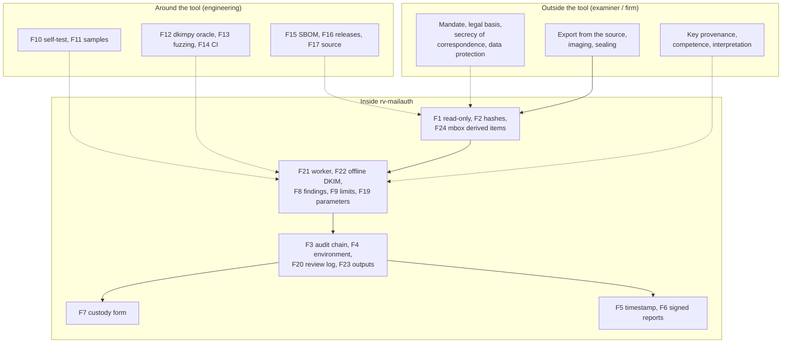
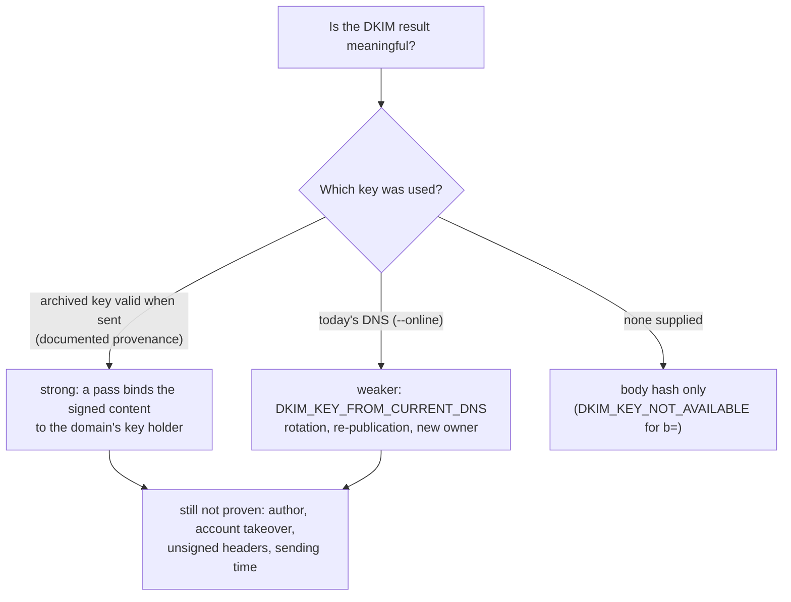

# Admissibility and reliability

> **DRAFT — pending review by a lawyer. Not legal advice.** This page maps legal and technical requirements to
> what RV MailAuth actually does, so that an examiner, a lawyer or an opposing expert can see where the tool helps
> and where it does not. It reuses the structure and the verified citations of the sister tools' pages
> (rv-imgauth and rv-pdfauth, built on the Rakvor legal research note of 2026-10-21) and adds the points specific
> to email. **It must be reviewed by counsel in each jurisdiction before it is relied on or quoted.** Anything
> marked **[to verify]** must not be cited before a lawyer or engineer has checked it against the primary source;
> no mark on this page was upgraded beyond what the sister pages record.

## Contents

- [1. Purpose and how to read this page](#1-purpose-and-how-to-read-this-page)
- [2. Evidence lifecycle and where each control sits](#2-evidence-lifecycle-and-where-each-control-sits)
- [3. The reliability argument for email authentication](#3-the-reliability-argument-for-email-authentication)
- [4. Email-specific issues every jurisdiction raises](#4-email-specific-issues-every-jurisdiction-raises)
- [5. Colombia](#5-colombia)
- [6. France and the European Union](#6-france-and-the-european-union)
- [7. International standards](#7-international-standards)
- [8. United States and United Kingdom](#8-united-states-and-united-kingdom)
- [Limitations stated in every report](#limitations-stated-in-every-report)
- [Consolidated gap list](#consolidated-gap-list)
- [Examiner checklist before filing a report](#examiner-checklist-before-filing-a-report)
- [Sources](#sources)

## 1. Purpose and how to read this page

RV MailAuth is used **locally** by Rakvor; it is not distributed. Clients, courts and opposing experts may audit
its source ([LICENSE](../LICENSE), itself a draft pending legal review). Its results are **signals for an
examiner, never a verdict** ([theory.md](theory.md#a1-what-the-tool-is-and-is-not)). Admissibility and weight are
decided by a court about the **examiner's evidence**, of which the tool's output is one part.

| Status | Meaning |
| --- | --- |
| **met** | A tool feature satisfies or directly supports the requirement (the file or command is named) |
| **partial** | Supported, with a named shortfall |
| **examiner** | An obligation of the examiner or of Rakvor as a firm, not a tool feature |
| **gap** | Not met today; listed in the [consolidated gap list](#consolidated-gap-list) |
| **context** | Background that frames the other rows |

| Mark | Meaning |
| --- | --- |
| **[V]** | Article or clause number and substance checked against the primary text in the research note, as recorded in the sister tools' pages |
| **[S]** | Checked against a secondary source; the number is reliable, check the wording before quoting |
| **[to verify]** | Not verified against the primary text (including every citation new to this page); do not cite before checking |

Research limits that still apply: the Colombian project PDFs were verified against official web copies, not the
project files; only the free preview of ISO/IEC 27037 was read; ISO/IEC 27041/27042 clause text is paywalled
[to verify]; Légifrance refused automated access (French texts read from the Pappers LEGI mirror). No primary
source was read for this page: every citation that does not appear in the sister pages is marked [to verify].

### Tool features referred to in the tables

| Key | Feature | Where it is implemented |
| --- | --- | --- |
| F1 | Read-only evidence access; modification time compared around hashing | [run.rs](../src/core/src/run.rs) (`mtime_unchanged` in `item_hashed`) |
| F2 | Hashing with 1 or 2 algorithms; the analysed bytes hashed again by the worker (`headers.json` → `sha256`); every mbox message hashed again from the mbox (`message_hashed`) | [hash.rs](../src/core/src/hash.rs), [mail.rs](../src/core/src/mail.rs); `hashes.csv` |
| F3 | SHA-256 hash-chained audit log + independent verifier | [audit.rs](../src/core/src/audit.rs); `verify-log`; [tests/verify_chain.py](../tests/verify_chain.py) |
| F4 | `environment.json`: tool, compiler and every dependency version (incl. `mail-parser`, `mail-auth`), the Public Suffix List version and digest, OS, host, user, command line | [env.rs](../src/core/src/env.rs), [run.rs](../src/core/src/run.rs) |
| F5 | RFC 3161 timestamp of the audit chain head | [trust.rs](../src/core/src/trust.rs) (shared); `--tsa-url`, `--no-timestamp`, `timestamp` |
| F6 | PDF reports signed with the examiner's certificate (CMS `adbe.pkcs7.detached`) | `--sign-cert`; [report/pdf.rs](../src/core/src/report/pdf.rs) |
| F7 | Per-item chain-of-custody form: Colombia (Fiscalía style) or France (scellés), plus English; mbox messages cite their mbox | `--jurisdiction`; `custody.json/.html/.pdf` |
| F8 | Findings state what they show **and** what they do not prove; no verdict, no score | [reports.md](reports.md#findings-catalogue) (generated from [i18n/en.json](../i18n/en.json)); es, fr |
| F9 | Ten limitations printed in every report (key at sending time, headers are claims, .msg, mbox escaping, BEC false positives, …) | [reports.md](reports.md#limitations-printed-in-every-report) |
| F10 | Known-answer self-test (hash algorithms only) | `rv-mailauth self-test` |
| F11 | 16 synthetic sample files (19 items) with exact expected findings and independently computed hashes | [examples/](../examples/README.md); `run.sh` / `run.ps1`; [samples.rs](../src/core/tests/samples.rs) |
| F12 | Independent oracles: dkimpy re-verifies every DKIM signature of the sample; Python chain and schema verifiers | [tests/oracle_dkim.py](../tests/oracle_dkim.py), [tests/validate_reports.py](../tests/validate_reports.py) |
| F13 | Fuzz test of the message, .msg and mbox parsers (6 400 deterministic mutations, no panic, no hang) | [fuzz.rs](../src/core/tests/fuzz.rs) |
| F14 | CI on Windows and Linux | `.github/workflows/ci.yml` |
| F15 | SBOM and build provenance | `.github/workflows/release.yml` |
| F16 | Versioned releases with `SHA256SUMS`, signed with the internal Rakvor certificate | [installation.md](installation.md) |
| F17 | Source auditable by customers and opposing experts; local use only | [LICENSE](../LICENSE) (draft) |
| F18 | Case folder: every item re-hashed and compared with the intake registry (rv-hashinv); `verify-case` | [case-folder.md](case-folder.md) |
| F19 | Every analysis parameter recorded: key file path and SHA-256 and the keys it holds, PSL version, own domains, clock skew, mbox variant, limits, isolation | `analysis_configured` in `audit.jsonl` |
| F20 | Review log: messages opened in the GUI viewer after the run, hash-chained and anchored to `run_finished`; checked by `verify-log` and `verify-case` | [review.rs](../src/core/src/review.rs); `review.jsonl` |
| F21 | Worker isolation per message: time and memory limits, no network code, empty network namespace on Linux | [worker.rs](../src/core/src/worker.rs); `--isolation`, `--worker-timeout`, `--worker-memory-mb` |
| F22 | DKIM verified **offline** with examiner-supplied keys; `keys import` audits the archive's SHA-256; each signature names its key source and line; `--online` lookups audited and flagged as weaker evidence | [dkim.rs](../src/core/src/dkim.rs), [keys.rs](../src/cli/src/keys.rs); [ADR 0004](adr/0004-email-design-decisions.md) |
| F23 | Hashed per-message outputs: `headers.json`, `dkim.json`, extracted attachments, `mbox_index.json` | `output_written` in `audit.jsonl` |
| F24 | mbox messages as derived items: id `<mbox>#<n>@<offset>`, citing the mbox digests and byte offsets | [mbox.rs](../src/core/src/mbox.rs); `derived_from`, `locator.mbox` |

## 2. Evidence lifecycle and where each control sits

## 3. The reliability argument for email authentication

Courts ask, in different words, whether the method is **reliable** and whether it was **reliably applied** here.
For email the core method — DKIM verification — is a published internet standard (RFC 6376), implemented by every
large mail provider; the tool's contribution is to apply it **offline**, with keys whose provenance the examiner
documents, and to record every step.

| Factor | What RV MailAuth offers | Status |
| --- | --- | --- |
| **Testability** | Deterministic findings for a given key file and options ([theory.md B18](theory.md#b18-determinism-and-repeatability)); 19 sample items with exact expected findings (F11); dkimpy oracle (F12); fuzzing (F13); every parameter recorded (F19) | met |
| **Known or potential error rate** | DKIM verification is cryptographic: a false "valid" needs a broken hash or signature scheme, and the false "invalid" cases are known and stated (rotated key, re-encoding, forwarding) (F8, F9). The BEC heuristics and date checks have **no error rates measured on a documented corpus** (G5) | partial / gap |
| **Peer review and standards** | DKIM (RFC 6376), ARC (RFC 8617), Authentication-Results (RFC 8601), Unicode TR39, the Public Suffix List; verification by mail-auth, cross-checked by dkimpy (F12). No external review of this implementation (G7) | partial |
| **Standards controlling the operation** | Fixed severities and wording (F8), parameters recorded (F19), release verification ([installation.md](installation.md)), examiner checklist below | partial |
| **General acceptance** | DKIM and Received-header analysis are standard practice in email forensics and in mail operations; lookalike and display-name checks are standard anti-phishing heuristics | met (DKIM) / partial (heuristics) |
| **Validation for intended use** (ISO/IEC 27041; ISO/IEC 17025 §7.2.2 [V]) | Inputs exist (F10–F14) but no per-release validation report (G6) | gap |
| **Reliable application in this case** (FRE 702(d) [V]) | Audit chain of every step (F3), environment (F4), key file digest and key source per signature (F19, F22), messages the examiner looked at (F20), timestamp (F5), signed report (F6) | met |

## 4. Email-specific issues every jurisdiction raises

### 4.1 The key at sending time

A DKIM result is only as good as the public key. The tool cannot establish that a key in the key file was the
domain's key when the message was sent: that is a matter of the archive's provenance (a zone backup from the
domain holder, a provider's export, a passive-DNS record with dates), which the examiner documents and discloses
with the key file (its SHA-256 is in every run's audit log, F22). Keys are rotated: a genuine old message checked
with today's key fails exactly like a message whose signed headers were edited (`DKIM_SIGNATURE_INVALID` is
therefore medium, [ADR 0004](adr/0004-email-design-decisions.md)). The body hash is different: it needs no key,
and a mismatch (`DKIM_BODY_HASH_MISMATCH`, high) holds whatever key is supplied. Two technical limits are open:
a signature whose `x=` expiry is earlier than the **analysis** date is not evaluated at all (G-MAIL4), and a
signature with `l=` covers only part of the body (G-MAIL5).

### 4.2 Outlook .msg re-encoding

A `.msg` is Outlook's re-encoding of a message into MAPI properties: the body and attachments are not the bytes
that travelled, and the original header section survives only in `PR_TRANSPORT_MESSAGE_HEADERS`, and not always.
DKIM is therefore **not evaluated** on a `.msg` (never reported as failed), and a `.msg` without transport
headers has no route or authentication evidence at all (`MSG_TRANSPORT_HEADERS_MISSING`). Under the "native
format or exact reproduction" rules (CGP art. 247, Ley 527 art. 8, below) a `.msg` is a **conversion**; when the
email's authenticity is disputed, ask for the message in its original MIME form (server export, `.eml` saved by
the recipient, or the mailbox) and register it at intake (G-MAIL2).

### 4.3 mbox messages as derived items

The mbox is the registered evidence; each message is a **derived item** identified by its number and byte offsets
and hashed again from the mbox (F24). Anyone can cut the same bytes out of the registered mbox and obtain the same
digest; no extracted copy is created. Two caveats: un-escaping of `>From ` lines follows the selected variant and
can be ambiguous (limitation `MBOX_ESCAPING_AMBIGUOUS`; the variant is in F19), and messages beyond
`--max-mbox-messages` are listed but not analysed (G-MAIL3).

### 4.4 Headers are claims

Received, Date and Authentication-Results lines are text written by servers and clients; anyone who held the file
could add or edit an unsigned one. The tool records Authentication-Results **as stated evidence**
(`AUTH_RESULTS_RECORDED`) and never re-runs SPF or DMARC (G-MAIL7); its date and hop checks find inconsistencies,
not forgeries.

## 5. Colombia

### 5.1 Ley 906 de 2004 (Código de Procedimiento Penal)

Context: adversarial criminal procedure; data messages are *elementos materiales probatorios / evidencia física*
(art. 275 lit. g [V]); authenticity rests on the chain of custody (arts. 254–266, 277 [V]); expert evidence is
tested orally (arts. 405–423 [V]); a novel technique must meet at least one of the criteria of art. 422 [V].

| # | Requirement | Source | How rv-mailauth meets it | Status |
| --- | --- | --- | --- | --- |
| CO-P1 | Data messages are EMP/EF and enter the custody regime | Art. 275 lit. g [V] | F7 per-item form (mbox messages cite their mbox); F2 identity by hash | met |
| CO-P2 | *Cadena de custodia* shows identity, original state, collection, preservation, packaging, sending, places, dates, custodians | Art. 254 [V] | F2, F3, F7, F18; physical packaging by the examiner | met (digital) / examiner (physical) |
| CO-P3 | Custodians record full name, cédula and position | Art. 264 [V] | F7 persons and transfer rows filled in by hand | partial (G9) |
| CO-P4 | Each custodian prevents destruction, substitution, alteration | Art. 261 [V] | F1, F2 (second read hashed by the worker), F3 | met |
| CO-P5 | Authenticity = detected, fixed, collected, packed and kept in custody | Art. 277 [V] | F3, F7, F18 (`--case-dir` re-verifies every file against the intake registry) | met |
| CO-P6 | Evidence legal only if collected lawfully | Art. 276 [V] | None — emails raise the secrecy of correspondence (see CO-D5) | examiner |
| CO-P7 | Lab report describes procedures, instruments and their state, scientific principles, interpretation | Art. 210 [V] | F4, F10, F19, F22; technical report "Method"; F8, F9; [theory.md](theory.md) | met |
| CO-P8 | Perito holds recognised competence; party report with *certificación de idoneidad* | Arts. 408, 413 [V] | None | examiner |
| CO-P9 | Summary report disclosed ≥ 5 days before the hearing | Art. 415 [V] | F6 produces the report | examiner |
| CO-P10 | Perito examined on instruments, principles, methods and corroboration by other experts | Art. 417 [V] | F4, F12 (dkimpy), F17, F19; validation dossier missing (G6) | partial |
| CO-P11 | Court weighs competence, acceptance of principles, instruments, consistency | Art. 420 [V] | DKIM is a published standard (RFC 6376); BEC heuristics without error rates (G5) | partial |
| CO-P12 | Novel technique: verifiable; published and peer-reviewed; reliability level established; academic acceptance | Art. 422 [V] | Verifiable (F11, F12, F19); published standards; reliability of the heuristics not measured (G5) | partial |
| CO-P13 | Peritos have access to the EMP referred to | Art. 416 [V] | F17, F11, F16; per-message outputs hashed (F23); the key file disclosed with its digest (F22) | met |
| CO-P14 | Data messages authenticated by certification or "informe de experto" | Art. 424 #7, art. 426 [V] | F6 expert report route | met (expert route) |
| CO-P15 | Documentary appraisal: not altered in form or content | Art. 432 #1 [V] | Signals of alteration (F8); the tool never concludes on this point | partial (examiner opinion) |
| CO-P16 | Best evidence: original required where part of custody or technical study | Arts. 433–434 [V] | F1; analyse the native message (`.eml`/mbox export), not a printout or a `.msg` conversion (§4.2) | examiner |

### 5.2 Ley 1564 de 2012 (Código General del Proceso) — documentary evidence

Context: civil, commercial, labour and family litigation, where most email disputes are heard. A *dictamen* must
be "claro, preciso, exhaustivo y detallado" with ten disclosures (art. 226 [V]), weighed by *sana crítica*
(art. 232 [V]); data-message documents are presumed authentic (art. 244 [V]) and valued as such only in native
format or exact reproduction (art. 247 [V]); a disowned document needs its authenticity established (art. 272
[V]); a *tacha de falsedad* leads to a *cotejo pericial* (art. 270 [V]). That data messages are "documentos" for
the CGP (art. 243) is [to verify].

| # | Requirement | Source | How rv-mailauth meets it | Status |
| --- | --- | --- | --- | --- |
| CO-C1 | *Dictamen* clear, precise, exhaustive and detailed, explaining exams, methods, technical bases | Art. 226 [V] | F6, F8, F9, F19; [theory.md](theory.md) | met (template) / examiner |
| CO-C2 | Ten disclosures, incl. whether methods differ from earlier reports (#8, #9) and attaching the documents used (#10) | Art. 226 #1–10 [V]; look-back periods [to verify] | #8–#9: F4, F16 pin the method version; #10: F3, `hashes.csv`, the key file and its digest (F22) | met (#8–#10) / examiner |
| CO-C3 | Expert declares independence; specialised institution or professional | Arts. 226, 227 [V] | None | examiner |
| CO-C4 | Opposing party may summon the expert or file a competing dictamen | Art. 228 [V] | F11, F12, F16, F17, F19, F22 make reproduction possible (same key file, same result) | met (support) |
| CO-C5 | *Sana crítica* on soundness, foundations, competence | Art. 232 [V] | F8, F9; validation dossier missing (G6) | partial |
| CO-C6 | No fees contingent on the outcome | Art. 235 [V] | None | examiner |
| CO-C7 | Data messages count only in native format or exact reproduction | Art. 247 [V] | F1, F2; `.eml`/mbox are native MIME; a `.msg` is a conversion and a printout an ordinary document (§4.2, G-MAIL2) | met / examiner |
| CO-C8 | Data-message documents presumed authentic; disowned ones need authenticity established | Arts. 244, 272 [V] | Signals only (F8); DKIM gives the strongest technical support when the key at sending time is documented (§4.1) | met (support) |
| CO-C9 | *Tacha de falsedad*: judge orders a *cotejo pericial* | Art. 270 [V] | rv-mailauth, F6 | met (support) |
| CO-C10 | Data messages are documents | Art. 243 [to verify] | — | context |

### 5.3 Ley 527 de 1999 (mensajes de datos)

Context: Colombian implementation of the UNCITRAL Model Law on Electronic Commerce. An email is the archetypal
*mensaje de datos* (definition in art. 2 lit. a [to verify]). The articles the sister pages verified frame the
email questions: originality (art. 8), integrity (art. 9), admissibility (art. 10) and weight (art. 11).

| # | Requirement | Source | How rv-mailauth meets it | Status |
| --- | --- | --- | --- | --- |
| CO-L1 | Evidential effect not denied solely because information is a data message | Arts. 5, 10 [V] | None | context |
| CO-L2 | "Original": a reliable guarantee that integrity was kept since the information was first generated in final form | Art. 8 lit. a [V] | From intake onward: F2, F3, F5. **Before** intake: for the signed parts of a message, a DKIM pass with the key valid at sending time is a technical guarantee from the sending server's signing moment (§4.1); unsigned headers and `.msg` conversions have none | partial |
| CO-L3 | Integrity = "completa e inalterada", except endorsements and changes inherent to communication, storage, display | Art. 9 [V] | `DKIM_BODY_HASH_MISMATCH` shows the body is not the signed one; the wording lists changes "inherent to communication" (mailing lists, footers, re-encoding) as alternative explanations, and a `.msg` is never failed for its storage re-encoding (§4.2) — for counsel to argue | met (support) |
| CO-L4 | Weight by *sana crítica*: reliability of generation, archiving, communication, integrity, originator | Art. 11 [V] | Generation and communication: Received hops, dates, DKIM/ARC (signals). Integrity: F2, F3, F5, DKIM. Originator: DKIM binds content to the **domain's key holder**, not to a person; BEC signals | partial |
| CO-L5 | Retention in a format that "reproduce con exactitud", with origin, destination, date and time | Art. 12 [V] | F1; `headers.json` keeps From, To, Date, Message-ID, every hop as written (F23) | met |
| CO-L6 | Signature requirement met by a method that identifies, shows approval, reliable and appropriate | Art. 7 [V] | A DKIM signature is the **domain's** (server's) signature, not the author's; the examiner's report is signed with F6 | context / met (reports) |
| CO-L7 | *Firma digital* presumption needs an authorised *entidad de certificación* | Art. 28 parágrafo, arts. 29–30 [V] | F6 uses the examiner's own certificate | gap (G3) |
| CO-L8 | Trusted time-stamping is a service of authorised certification entities | Art. 30 #5 [V]; art. 2 lit. d [V] | F5 uses an RFC 3161 TSA (default DigiCert) | gap (G2) |

### 5.4 Fiscalía chain-of-custody manual

The current manual is *Manual del Sistema de Cadena de Custodia* v4 (2018) [S]; it has no procedure specific to
digital evidence or email; ISO/IEC 27037 and the Rama Judicial cartilla fill that.

| # | Requirement | Source | How rv-mailauth meets it | Status |
| --- | --- | --- | --- | --- |
| CO-F1 | Validity requirements: autenticidad, capacidad demostrativa, identidad, integridad, preservación, seguridad, almacenamiento, continuidad, registro | Manual 2018 §5.3 [S] | identidad, integridad: F2; continuidad, registro: F3, F7, F18, F20; preservación: F1 | met / examiner |
| CO-F2 | One *Registro de Cadena de Custodia* per EMP/EF | Manual 2018 §6 [S] | F7 is an internal record, not the official form; an mbox is one EMP with derived messages (F24) | partial (G9) |
| CO-F3 | Minimum fields: dates, NUNC, EMP/EF identifier, description, parties and ID | Manual 2018 §7.3 [S] | F7 has case id, description, transfer rows; persons filled by hand | partial (G9) |
| CO-F4 | Receiver inspects; only the designated perito opens | Manual 2018 §6 [S] | F2 re-hash; F3 logs each run; F20 logs each later viewing | met / examiner |

### 5.5 Personal data and the secrecy of correspondence

Emails are personal data and private correspondence; attachments often contain sensitive data.

| # | Requirement | Source | How rv-mailauth meets it | Status |
| --- | --- | --- | --- | --- |
| CO-D1 | Principles incl. *acceso y circulación restringida*, *seguridad*, *confidencialidad* | Ley 1581 art. 4 [V] | Local processing, no telemetry; offline DKIM by default — `--online` sends the key names (selector and domain) of the messages to the DNS (F22) | met (tool) / examiner |
| CO-D2 | Sensitive data for the "defensa de un derecho en un proceso judicial" | Ley 1581 art. 6 lit. d [V] | None | examiner |
| CO-D3 | Security conditions; breach reporting | Ley 1581 arts. 17, 18 [V] | Outputs reproduce addresses, subjects and (with `--extract-attachments`) the attachments; no encryption at rest | examiner / gap (G13) |
| CO-D4 | International transfers only to adequate countries | Ley 1581 art. 26 [V] | Local processing | examiner |
| CO-D5 | Correspondence is inviolable and may be intercepted or examined only by court order | Constitución Política art. 15 [to verify] | None: the mandate and legal basis for examining the mailbox are the examiner's | examiner (counsel) |

### 5.6 Judicial-school criteria

The Escuela Judicial cartilla reproduces CSJ Sala Civil, 16 Dec. 2010 (exp. 11001-3110-005-2004-01074-01) [S],
separating *autenticidad* from *veracidad* and applying art. 11 Ley 527.

| # | Requirement | Source | How rv-mailauth meets it | Status |
| --- | --- | --- | --- | --- |
| CO-J1 | *Integralidad*, *inalterabilidad* | CSJ Civ. 16-12-2010 via cartilla [S] | F2, F3, F5; DKIM body hash and header signature for the signed parts | met (from intake) / partial (before) |
| CO-J2 | *Rastreabilidad* | Same [S] | F7, F18; Received hops as stated; mbox offsets (F24) | partial (depends on the export) |
| CO-J3 | *Autenticidad*: identify the author and link them to the content | Same [S] | DKIM identifies the signing **domain**, not the author; BEC signals; never attribution | partial (examiner) |
| CO-J4 | Never access original media without write-blocking; clocks synchronised | Cartilla §9.4, §9.5 [V] | F1 is software read-only, not a hardware blocker; host clock not recorded | partial (G10, G12) |
| CO-J5 | Tested procedures, known tool error rates, two tools to cross-check | Cartilla §9.10.1 [V] | F12 (dkimpy as second tool); heuristic error rates not measured (G5) | partial |

## 6. France and the European Union

### 6.1 Code de procédure pénale (CPP)

Evidence is free in criminal matters (art. 427 [to verify]); expertise on "une question d'ordre technique" (arts.
156 ff. [S]). **Recodification:** ordonnance n° 2025-1091 of 19 Nov. 2025 rewrote the legislative part of the CPP;
the articles below are shown as repealed on **1 January 2029** [S]; a concordance table is needed then (G14).

| # | Requirement | Source | How rv-mailauth meets it | Status |
| --- | --- | --- | --- | --- |
| FR-P1 | Data seized as the medium or a copy made in the presence of those attending; inventoried and sealed | Arts. 56, 97 [V] | F2 hash of the copy; F7 FR form (internal record) | partial (G9) / examiner |
| FR-P2 | Qualified person copies data "sans porter atteinte à leur intégrité", reports under arts. 163, 166 | Art. 60-3 [V] | F1, F2, F3, F6 | met |
| FR-P3 | Expertise limited to technical questions | Arts. 156, 158 [S] | F8: technical signals only, no verdict, no legal conclusion | met |
| FR-P4 | Experts from the national or cour d'appel lists; others swear at each appointment | Arts. 157, 160 [V] | None | examiner (G8) |
| FR-P5 | Experts may open and re-seal; mention it in the report | Art. 163 [V] | F7, F3 | partial |
| FR-P6 | Report describes operations and conclusions, signed | Art. 166 [V] | F6, F3, F19, F20 (which messages were examined in the viewer) | met |
| FR-P7 | Parties may request a *complément d'expertise ou contre-expertise* | Art. 167 [S] | F11, F12, F16, F17, F19, F22 make counter-expertise reproducible | met (support) |

### 6.2 Civil side: Code civil art. 1366 and the email as an electronic writing

C. civ. art. 1366 [V]: an electronic writing has the same probative force as paper "sous réserve que puisse être
dûment identifiée la personne dont il émane et qu'il soit établi et conservé dans des conditions de nature à en
garantir l'intégrité". For an email produced as evidence, both conditions are where the tool helps — and where it
stops:

| # | Requirement | Source | How rv-mailauth meets it | Status |
| --- | --- | --- | --- | --- |
| FR-C1 | Integrity of the electronic writing "établi et conservé" | C. civ. art. 1366 [V] | Since signing: DKIM body hash and header signature over the signed fields, with the key at sending time (§4.1). Since intake: F2, F3, F5. Conservation in a `.msg` is a conversion (§4.2) | partial |
| FR-C2 | The person "dont il émane" can be identified | C. civ. art. 1366 [V] | DKIM identifies the signing domain only; BEC signals point at impersonation; identification of a person is the examiner's and the court's | partial (examiner) |
| FR-C3 | Reliable identification process linked to the act; presumption under decree conditions | C. civ. art. 1367 al. 2 [V]; décret 2017-1416 [V] | Applies to Rakvor's reports: F6 is not a qualified signature | gap (G3) |
| FR-C4 | The judge resolves conflicts of written evidence by the most plausible title | C. civ. art. 1368 [V] | Signals and their alternatives (F8) feed that assessment | context |
| FR-C5 | Freedom of proof of legal facts; adversarial principle; technician's personal and impartial work | C. civ. art. 1358, CPC arts. 16, 233, 237, 238, 276 [to verify] | F17, F11, F12; [theory.md](theory.md); F8 (no legal verdict) | met (support) / examiner |
| FR-C6 | Secrecy of correspondence (criminal protection of emails) | Code pénal art. 226-15 [to verify] | None: lawful access to the mailbox is the examiner's and the client's | examiner (counsel) |

### 6.3 eIDAS — Regulation (EU) 910/2014 as amended by (EU) 2024/1183 (time stamps)

Verified [V] against the EUR-Lex consolidated text (CELEX 02014R0910-20241018), as recorded in the sister pages.

| # | Requirement | Source | How rv-mailauth meets it | Status |
| --- | --- | --- | --- | --- |
| EU-1 | A time stamp is not denied legal effect solely because it is electronic or not qualified | Art. 41(1) [V] | F5 | met (no presumption) |
| EU-2 | A **qualified** time stamp enjoys a presumption of accurate date/time and integrity | Art. 41(2) [V] | F5 with the default non-qualified TSA | gap (G2) |
| EU-3 | Qualified ETS requirements | Art. 42 [V]; CIR (EU) 2025/1929 [S; annex to verify] | `--tsa-url` pointed at a QTSP on an EU Trusted List | gap (configure a QTSP) |
| EU-4 | Advanced electronic signature: uniquely linked, under sole control, changes detectable | Art. 26 [V] | F6 (key in a `.p12` file). A DKIM signature is a server's seal, not the author's advanced signature | met technically (reports); not qualified (G3) |

What a non-qualified RFC 3161 token gives: cryptographic proof that the audit chain head existed no later than
the TSA time. What it does not give: the art. 41(2) presumption; any proof about when the **email** was sent.

### 6.4 GDPR (Regulation (EU) 2016/679)

| # | Requirement | Source | How rv-mailauth meets it | Status |
| --- | --- | --- | --- | --- |
| EU-D1 | Lawful basis; special categories only under an exception such as legal claims | Arts. 6, 9(2)(f) [V] | None | examiner |
| EU-D2 | Data minimisation and storage limitation | Art. 5(1)(c), (e) [V] | `headers.json` keeps addresses and subjects; attachments are copied only with `--extract-attachments`; `--item-reports flagged` reduces reports | partial (G13) / examiner |
| EU-D3 | Processor contract, security, breach notification, DPIA | Arts. 28, 32, 33, 35 [V] | Local processing, no telemetry; F3 | met (tool) / examiner |
| EU-D4 | Data protection by design and by default | Art. 25 [V] | Offline by default (no DNS lookup reveals which domains are examined); only a hash leaves the machine (optional timestamp) | met |
| EU-D5 | Transfers to Colombia need art. 46 safeguards | Art. 46 [V] | Local processing | examiner |
| EU-D6 | Criminal matters for a judicial authority may fall under Directive (EU) 2016/680 | [to verify] | None | examiner (counsel) |

## 7. International standards

### 7.1 ISO/IEC 27037:2012 — identification, collection, acquisition and preservation

| # | Requirement | Source | How rv-mailauth meets it | Status |
| --- | --- | --- | --- | --- |
| ISO-1 | Auditability | §5.3.2 [V title / S content] | F3, F20, F4, F6, F19 | met |
| ISO-2 | Repeatability (same environment) | §3.17 [V] | Deterministic findings for the same key file and options (F11 checks exact findings) | met |
| ISO-3 | Reproducibility (different environment, operator) | §3.18 [V] | CI on Windows and Linux (F14); dkimpy (F12); releases not bit-reproducible (G22) | met / partial |
| ISO-4 | Justifiability | §5.3.5 [V title] | F8, F9, F19; key provenance documented by the examiner (§4.1) | partial |
| ISO-5 | A copy includes verification means; hash at intake, work on a copy | §3.6 [V] | F2, F18; mbox messages verifiable by offset and digest (F24) | met |
| ISO-6 | Verification function must be collision-resistant | §3.25 [V] | `md5,sha1` accepted without SHA-2/3 | gap (G11) |
| ISO-7 | Avoid spoliation and tampering | §3.19, §3.21 [V] | F1, F2; no extracted copies of mbox messages | met (logical) / partial (G10) |
| ISO-8 | Chain of custody, documentation of all actions | §6.1, §6.6 [V titles] | F7, F3, F20 | met |

### 7.2 ISO/IEC 27041:2015 (assurance of methods) and ISO/IEC 27042:2015 (analysis and interpretation)

Editions verified on iso.org [V]; clause text [to verify].

| # | Requirement | Source | How rv-mailauth meets it | Status |
| --- | --- | --- | --- | --- |
| ISO-9 | Validate each method for its intended use before use, with documented requirements, tests and results | 27041 [to verify clauses]; 17025:2017 §7.2.2 [V] | Sample with exact expectations, dkimpy, fuzzing (F11–F13); **no validation dossier per release; no error rates for the heuristics** | gap (G5, G6) |
| ISO-10 | Re-validate after changes to the tool or its dependencies | 27041 [to verify]; 17025 §7.11.2 [V] | F14 CI, F15 SBOM; exact pins of mail-parser and mail-auth; PSL pinned and recorded (F4) | partial (G6) |
| ISO-11 | Verification by the user before casework | 27041 [to verify]; 17025 §7.2.1 [V title] | `self-test` + sample run ([installation.md](installation.md#6-first-run-self-test-and-sample)) | met |
| ISO-12 | Repeatability and reproducibility of analysis | 27042 [V title; to verify clauses] | F11, F14, F19, F22 | met |
| ISO-13 | Interpretation states limitations and alternative explanations | 27042 [to verify] | F8 ("does not prove" = alternative explanations), F9 | met |
| ISO-14 | Competence of the examiner in interpretation | 27042 [to verify] | None | examiner |
| ISO-15 | Laboratory accreditation | 17025:2017 [V] | None | gap (G1) |

## 8. United States and United Kingdom

None of these binds a Colombian or French court; opposing experts use them as the vocabulary of reliability.

| # | Requirement | Source | How rv-mailauth meets it | Status |
| --- | --- | --- | --- | --- |
| US-1 | Opinion based on sufficient facts and data | FRE 702(b) [V] | F3, F2, F19, F22 | met |
| US-2 | Product of reliable principles and methods | FRE 702(c) [V] | Published standards (RFC 6376, 8617); F11–F13; validation report missing | partial (G6) |
| US-3 | Reliable application to the facts (2023 amendment) | FRE 702(d) [V] | F3, F4, F19, F20, F22 | met |
| US-4 | Daubert: testability | *Daubert v. Merrell Dow*, 509 U.S. 579 (1993) [to verify citation] | F11, F12, F13 | met |
| US-5 | Daubert: peer review and publication | Daubert | Standards published; this implementation not reviewed externally | partial (G7) |
| US-6 | Daubert: known or potential error rate | Daubert | DKIM: cryptographic, false results explained (F8); heuristics: not measured | partial / gap (G5) |
| US-7 | Daubert: standards controlling operation | Daubert | F19, F16, checklist below | partial |
| US-8 | Daubert: general acceptance; Kumho extends the gatekeeping to technical expertise | Daubert; *Kumho Tire v. Carmichael*, 526 U.S. 137 (1999) [to verify citation] | DKIM and header analysis accepted practice | met / partial |
| US-9 | Process producing an accurate result | FRE 901(b)(9) [V] | F10–F12 | met |
| US-10 | Self-authentication by hash certification | FRE 902(14) [V] | F2; no certification template | partial |
| US-11 | Authentication by distinctive characteristics (often used for email) | FRE 901(b)(4) [to verify] | Headers, hops, Message-ID and DKIM as characteristics, with their limits (F8) | met (support) |
| UK-1 | Expert's overriding duty to the court; report contents, statement of truth, range of opinion | CPR Part 35 and PD 35 [to verify rule numbers] | F8, F9 support stating limits and alternatives | examiner |
| UK-2 | Methods validated before use; accreditation for regulated forensic activities | FSR Code of Practice v2 (in force 2 Oct. 2025) §24 [V] | F11–F14 | gap (G1, G6) if UK work is in scope |

## Limitations stated in every report

The ten limitations printed in every report, with their exact English wording, are generated into
[reports.md](reports.md#limitations-printed-in-every-report) from `i18n/en.json`. The email-specific ones are
`DKIM_NEEDS_KEY_AT_SENDING_TIME`, `MISSING_SIGNATURE_PROVES_NOTHING`, `HEADERS_ARE_CLAIMS`,
`MSG_MAY_LACK_TRANSPORT_HEADERS`, `MBOX_ESCAPING_AMBIGUOUS` and `BEC_HEURISTICS_FALSE_POSITIVES`; the shared ones
are `CLEAN_RESULT_IS_NOT_AUTHENTICITY`, `TIMESTAMP_PROVES_EXISTENCE_ONLY`, `SIGNATURE_TABLE_LIMITED` and
`TIMESTAMPS_FROM_FILESYSTEM`.

## Consolidated gap list

Owners: **Eng.** = engineering, **Counsel**, **Examiner**, **Firm** = Rakvor management.

| ID | Gap | Affected | Mitigation now | Remedy | Owner |
| --- | --- | --- | --- | --- | --- |
| G1 | No ISO/IEC 17025 accreditation (COFRAC / ONAC) | ISO-15, UK-2 | State "not accredited" | Accreditation roadmap | Firm |
| G2 | TSA not qualified (eIDAS 41(2)) and not a Colombian ECD (Ley 527 art. 30 #5) | EU-2, EU-3, CO-L8 | `--tsa-url` to a QTSP or ONAC-accredited ECD | Dual stamping for cross-border cases | Eng. + Counsel |
| G3 | Reports signed with the examiner's own certificate: not a QES or *firma digital* | CO-L7, FR-C3, EU-4 | Publish the certificate fingerprint | Qualified certificates on a QSCD | Eng. + Examiner |
| G5 | **No validated error rates** for the BEC heuristics (lookalike, Reply-To, display name, payment wording) and the date checks; no documented corpus | CO-P11, CO-P12, CO-J5, ISO-9, US-6 | Findings as signals with alternative explanations (F8, F9) | Build a documented corpus of genuine and BEC messages; publish detection and false-positive rates per release | Eng. |
| G6 | No per-release validation record (plan, criteria, results, sign-off) | ISO-9, ISO-10, US-2, CO-P10, CO-C5 | Keep CI logs, the dkimpy result and the sample run with the case | CI-generated signed validation report per tag | Eng. + Firm |
| G7 | No external review of this implementation | CO-P12, US-5 | Offer source review to opposing experts | External review | Firm |
| G8 | Examiner status (French lists, oath; Colombian idoneidad, CGP art. 226 disclosures) | FR-P4, CO-P8, CO-C2 | Examiner prepares them | Report fields for art. 226 and CPP art. 166 | Examiner + Eng. |
| G9 | Custody forms are internal records, not the official Fiscalía *Registro* or scellés | CO-F2, CO-F3, CO-P3, FR-P1 | Use the official forms alongside | Map to the official forms | Eng. + Counsel |
| G10 | Software read-only, not a hardware write blocker | CO-J4, ISO-7 | Work on exports or write-blocked copies | Record blocker details in the case folder | Examiner + Eng. |
| G11 | `md5,sha1` accepted without SHA-2/3 | ISO-6 | Always select sha256 or sha512 | Enforce the policy | Eng. |
| G12 | Host clock; only the chain head is stamped | CO-J4 | Check time sync before the run | Record clock source and offset | Eng. |
| G13 | Personal data and correspondence: outputs reproduce addresses, subjects and (option) attachments; no encryption at rest or retention tooling | CO-D3, EU-D2 | Encrypted case volume; extract attachments only when needed | Retention and secure-deletion tooling | Firm + Eng. |
| G14 | CPP renumbering on 1 Jan. 2029 | FR section | Cite with the version date | Concordance table | Counsel |
| G17 | Source access without a defined protocol; LICENSE is a draft pending legal review | CO-P13, FR-P7 | Provide the tagged source on request | NDA / inspection protocol | Firm + Counsel |
| G18 | `verify-log` does not check TSA revocation, policy OID or accuracy | EU-2 | `openssl ts -verify` as a second check; revocation established separately from CRL/OCSP evidence covering genTime | Revocation and policy checks | Eng. |
| G19 | Re-verification of the run's outputs against the digests in the audit log — **closed**: `verify-log` and `verify-case` re-hash every file the audit log records (reports, per-message `headers.json` / `dkim.json` / `mbox_index.json` / attachments, `hashes.csv`, `environment.json`) with every recorded algorithm; an edited, deleted or replaced output, or a recorded path leading outside the run folder, is a problem (exit 3) named in the output ([src/core/src/outputs.rs](../src/core/src/outputs.rs)). The key file of `keys import` (written outside the run folder) is listed as not re-hashed; files the run never recorded are not checked; kept for numbering | — | — | — | — |
| G22 | Release binaries not bit-for-bit reproducible | ISO-3 | Provenance attestation + functional equivalence | Path remapping, deterministic packaging | Eng. |
| G23 | Windows: no OS-level network block for the worker (no network code, but no sandbox) | CO-D1 | Offline workstation or firewall rule | AppContainer / WFP | Eng. |
| G-MAIL1 | **Key at sending time** cannot be established by the tool; it rests on the archive's provenance | CO-L2, FR-C1, US-1 | Document each key's source and validity dates; disclose the key file (SHA-256 in every run); avoid `--online` or disclose it | Key-provenance fields in `keys import` (source, validity window) printed in the report | Examiner + Eng. |
| G-MAIL2 | `.msg` is a conversion: DKIM not evaluated; no transport headers → no route evidence | CO-C7, CO-P16, FR-C1 | Ask for the native MIME message; register it at intake | Read PST/OST and server exports directly (needs a permissive reader) | Examiner + Eng. |
| G-MAIL3 | mbox: `>From ` un-escaping can be ambiguous (mboxo); messages beyond `--max-mbox-messages` not analysed | CO-L3, ISO-5 | Choose the variant that matches the exporter; raise the limit | Detect the variant from the exporter | Eng. |
| G-MAIL4 | Signatures whose `x=` is earlier than the **analysis** date are not evaluated (mail-auth checks expiry against the current clock, before the body hash) | CO-L2, FR-C1 | Note it for every `DKIM_SIGNATURE_NOT_EVALUATED` with reason "expired"; check `bh=` by hand (dkimpy with a fixed time) | Verifier entry point that takes the sending time | Eng. |
| G-MAIL5 | `l=` signatures cover only part of the body; no finding flags `l=` shorter than the body | CO-L3, FR-C1 | Check `body_length` in `dkim.json` | Finding for content beyond `l=` | Eng. |
| G-MAIL6 | PST/OST not read (no permissively licensed reader; libpff is LGPL) | CO-C7 | Export with a documented tool and register the export | Permissive reader | Eng. |
| G-MAIL7 | SPF and DMARC not evaluated; S/MIME and OpenPGP signatures not verified | CO-L4, US-1 | Authentication-Results recorded as stated (`AUTH_RESULTS_RECORDED`); rv-certcheck for S/MIME when available | rv-certcheck v0.3 | Eng. |
| G-MAIL8 | The bundled Public Suffix List may differ from the one in force when the message was sent | US-1 | Version recorded per run (F4) | Historical lists on demand | Eng. |

## Examiner checklist before filing a report

1. **Mandate and legal basis** documented (order, contract, consent; Ley 1581 / GDPR basis; secrecy of
   correspondence). Fees not contingent.
2. **Competence documents** ready (Colombia: idoneidad, CGP art. 226; France: list status or oath).
3. **The installed tool was verified**: `SHA256SUMS`, provenance, Authenticode against the Rakvor root;
   `self-test` passed; the sample run gave the expected summary ([installation.md](installation.md)).
4. **The messages analysed are native**: `.eml` or mbox exported from the source (not printouts, forwards or
   `.msg` conversions unless that is the question), registered at intake (`--case-dir`, rv-hashinv).
5. **Hash policy**: one of the algorithms is sha256 or sha512.
6. **Keys**: every DKIM key comes from a documented archive valid at sending time (zone backup, provider export,
   passive DNS with dates), imported with `keys import`; the key file and its SHA-256 are kept with the case.
   `--online` was not used, or its use is disclosed with every `DKIM_KEY_FROM_CURRENT_DNS`.
7. **Own domains** given (`--own-domain`) for BEC cases, and listed in the report.
8. **Workstation clock** synchronised; time source noted.
9. **The run is complete** (`run_finished`) and `rv-mailauth verify-log <log folder>` prints OK, including the
   review entries and the `outputs:` line (every report and per-message output re-hashed against
   the audited digests); `python tests/verify_chain.py <log folder>` exits 0.
10. **Timestamp** obtained and checked (`verify-log --tsa-ca`, `openssl ts -verify`), and the TSA certificate's
    revocation status at genTime established from CRL/OCSP evidence covering genTime, kept with the case.
11. **No `PARSER_FAILED`, `FILE_STRUCTURE_DAMAGED` or expired-signature `DKIM_SIGNATURE_NOT_EVALUATED` left
    unexplained**; `.msg` items declared as conversions; `l=` signatures checked against `body_length`.
12. **Every finding relied on** is presented with what it does **not** prove; alternative explanations
    (forwarding, mailing lists, re-encoding, rotated keys, clock drift, legitimate sending services) were
    considered.
13. **Limitations** kept, plus case-specific ones; the absence of validated error rates for the heuristics is
    stated (G5).
14. **Custody**: official forms completed alongside the internal form (G9); mbox messages cited by mbox digest and
    offset.
15. **Report signed** (`--sign-cert`); certificate fingerprint stated.
16. **Case file kept together**: evidence copy, key file, `logs/<RUN-ID>/` (incl. `review.jsonl`, `.tsr`),
    `reports/<RUN-ID>/`, tool release and this page's version (git commit).
17. **Counsel reviewed** the legal statements for the jurisdiction and date.

## Sources

Legal sources (Colombian, French, EU, ISO, US/UK) are those of the Rakvor research note of 2026-10-21, as
recorded with the same marks in the sister pages (rv-imgauth and rv-pdfauth `docs/admissibility.md`). Citations
first made on this page (Ley 527 art. 2 lit. a, CGP art. 243, Constitución Política art. 15, Code pénal
art. 226-15, FRE 901(b)(4)) have **not** been checked against a primary source and are marked [to verify].

Colombia

- Ley 527/1999: project file `Ley_527_de_1999.pdf` (read in full for the research note).
- Ley 906/2004: <https://www.secretariasenado.gov.co/senado/basedoc/ley_0906_2004_pr005.html>,
  <https://normativa.colpensiones.gov.co/colpens/docs/ley_0906_2004_pr009.htm>
- Ley 1564/2012 (CGP): <https://normativa.colpensiones.gov.co/colpens/docs/ley_1564_2012_pr005.htm>,
  <https://normativa.colpensiones.gov.co/colpens/docs/ley_1564_2012_pr006.htm>
- Ley 1581/2012: <https://www.secretariasenado.gov.co/senado/basedoc/ley_1581_2012.html>
- Fiscalía manual: <https://www.fiscalia.gov.co/colombia/wp-content/uploads/MANUAL-DEL-SISTEMA-DE-CADENA-DE-CUSTODIA.pdf>

France and EU

- CPP arts. 56, 60-3, 97, 157, 160, 163, 166 via justice.pappers.fr (LEGI mirror) [V]; ordonnance n° 2025-1091 [S];
  Code civil arts. 1366–1368 and décret 2017-1416 [V]: <https://justice.pappers.fr/loi/LEGITEXT000006070721/article/LEGIARTI000032042461>
- eIDAS consolidated: <https://eur-lex.europa.eu/legal-content/EN/TXT/HTML/?uri=CELEX:02014R0910-20241018>
- GDPR: <https://eur-lex.europa.eu/eli/reg/2016/679/oj>

Standards and guidance

- ISO/IEC 27037 <https://www.iso.org/standard/44381.html>, 27041 <https://www.iso.org/standard/44405.html>,
  27042 <https://www.iso.org/standard/44406.html>, 17025 <https://www.iso.org/standard/66912.html>
- RFC 6376 (DKIM), RFC 8617 (ARC), RFC 8601 (Authentication-Results), RFC 5322 — technical references for the
  method, see [theory.md B19](theory.md#b19-references).

US and UK

- FRE 702 <https://www.law.cornell.edu/rules/fre/rule_702>, 901 <https://www.law.cornell.edu/rules/fre/rule_901>,
  902 <https://www.law.cornell.edu/rules/fre/rule_902> [V for 702, 901(b)(9), 902(14)]
- Daubert v. Merrell Dow Pharmaceuticals, 509 U.S. 579 (1993); Kumho Tire Co. v. Carmichael, 526 U.S. 137 (1999)
  [to verify citations]
- UK Civil Procedure Rules Part 35 and Practice Direction 35 [to verify]; UK FSR Code of Practice v2 [V]:
  <https://www.gov.uk/government/publications/forensic-science-activities-statutory-code-of-practice-version-2/forensic-science-activities-statutory-code-of-practice-version-2-accessible>
