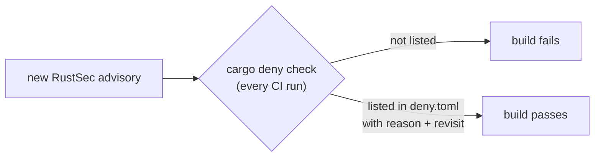

# ADR 0003 — Dependency advisories, exceptions and RSA blinding

- **Status:** accepted (2026-11-11); adopted by rv-mailauth on 2026-11-12 (copied from rv-imgauth; the rv-mailauth part is added below)
- **Scope:** every Rakvor tool; the forge template (Rust: `cargo deny`; Python: `pip-audit`)

## Context

CI checked dependency licences but not advisories. A check on 2026-11-10 found, in every tool: tokio 1.54.0
(yanked), `time` 0.3.45 (RUSTSEC-2026-0009) and `ctutils` 0.4.2 (RUSTSEC-2026-0385), plus RUSTSEC-2023-0071
("Marvin", a timing side channel in rsa 0.9). Four repositories had no cargo-deny configuration at all.

## Decision

1. Every repository runs `cargo deny check advisories licenses bans sources` in CI with the same `deny.toml`
   policy; a new advisory fails the build. Python projects from the forge run `pip-audit` over the hash-pinned
   `uv export`.
2. An exception is an `ignore` entry naming the advisory, why it does not apply to how the crate is used, and when
   it is revisited.
3. Fixed versions may need a newer compiler: `rust-version` was raised from 1.85 to 1.88 (the build toolchain is
   pinned at a newer version anyway, so releases were unaffected). rv-mailauth starts at `rust-version` 1.98
   because mail-parser 1.0 needs it ([development.md](../development.md#toolchain-pin)).
4. **RUSTSEC-2023-0071 is an exception.** rsa 0.9 comes in through `cms` 0.2, and no stable `cms` uses rsa 0.10.
   The examiner's key only signs (never decrypts), and since 2026-11-10 it signs only through `BlindedSigningKey`
   in `trust.rs`: `cms` signs through the plain `Signer` trait, which rsa 0.9 implements **without** blinding, so
   the wrapper signs with OS randomness. PKCS#1 v1.5 signatures are deterministic: the bytes are unchanged and a
   test proves it. Revisit when a stable `cms` 0.3 is released.
5. **rv-mailauth links rsa 0.9 a second time, through `mail-auth` 0.15** (built with `default-features = false`
   and the `rust-crypto` backend, so no C build of aws-lc). There it only **verifies** DKIM and ARC signatures
   with public keys. Marvin is a timing attack on private-key operations (decryption, and signing without
   blinding); a verification never touches a private key, so this use is not affected. The same `ignore` entry
   covers both paths and its reason names both. Revisit also when `mail-auth` moves to rsa 0.10.

## Consequences

- A dependency advisory published between two commits can turn CI red without a code change; that is intended.
- The Python profile signs PDFs through pyHanko and `cryptography` (OpenSSL), which blinds RSA by default.
