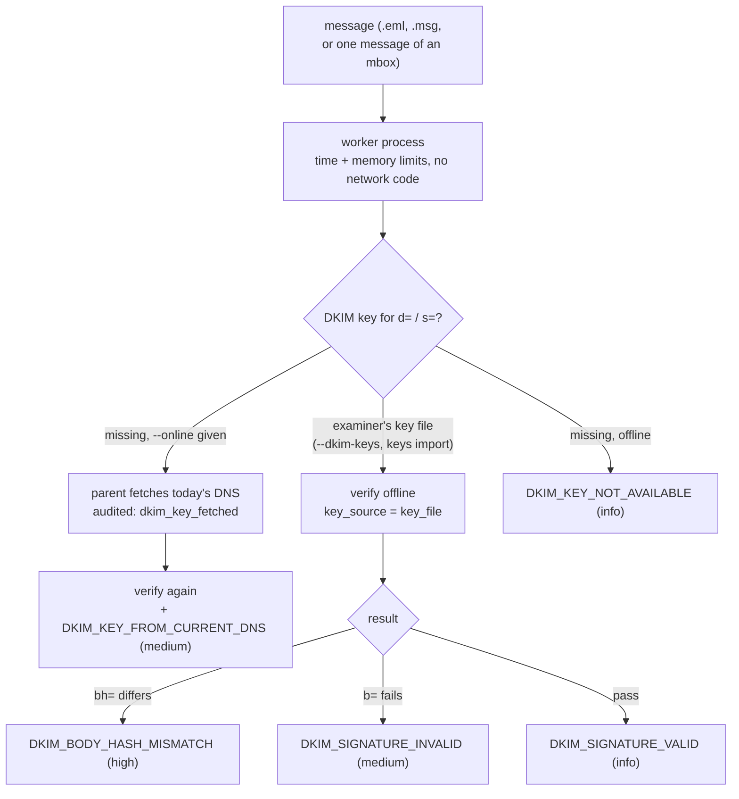

# ADR 0004 — Email analysis: keys, .msg, mbox custody, worker isolation, severities, Public Suffix List

- **Status:** accepted (2026-11-12)
- **Scope:** rv-mailauth (`src/core/src/dkim.rs`, `dnsfetch.rs`, `msg.rs`, `mbox.rs`, `worker.rs`, `psl.rs`,
  `model.rs`, `run.rs`)

## Context

An email's authenticity signals depend on things outside the file: the DKIM public key that was published when
the message was sent, the client that saved the file, and the container it came in. A forensic tool must say
which evidence each result rests on, must not change its answer with today's network, and must not let one
hostile message stop a bulk review of a mailbox. Six decisions follow from that; each is visible in the code and
in the reports.

## Decision

1. **Offline keys by default; `--online` is weaker evidence.** The verifier (mail-auth's `MessageAuthenticator`)
   is built with a resolver that has no name server at all; keys are injected into its DNS cache from the
   examiner's key file (`--dkim-keys`, produced from archived records by `keys import`, whose SHA-256 is in the
   audit log). A key that is not supplied makes the signature `DKIM_KEY_NOT_AVAILABLE`: no query can leave the
   machine. `--online` fetches only the missing keys, in the **parent** process with the system resolver (one
   `dkim_key_fetched` audit entry per name, with the TXT record's SHA-256), then repeats the analysis
   (`analysis_repeated`). Every signature checked with such a key also carries `DKIM_KEY_FROM_CURRENT_DNS`
   (medium), because today's key may not be the key that signed.
2. **DKIM over a `.msg` is not evaluated, never failed.** Outlook stores MAPI properties, not the MIME message: the
   body and attachments are re-encoded and the original header section survives only in
   `PR_TRANSPORT_MESSAGE_HEADERS` (0x007D), and not always. With transport headers the signatures are listed as
   `DKIM_SIGNATURE_NOT_EVALUATED` (reason `msg_body_not_original`, low); without them the item gets
   `MSG_TRANSPORT_HEADERS_MISSING` (medium) and DKIM is not attempted. A failure would be an artefact of the
   format and would read as tampering.
3. **mbox custody: the mbox is the evidence, each message a derived item.** The mbox is hashed and (with
   `--case-dir`) verified against the registry as one file. It is split by a byte scan in the parent (no
   parsing); every message gets the stable id `<mbox path>#<n>@<offset>`, is hashed again from the mbox bytes
   (`message_started`, `message_hashed`), is analysed by its own worker, and every output cites the mbox's
   digests, `n`, the separator offset, the first-header offset and the length. Un-escaping of `>From ` lines
   follows `--mbox-variant` (mboxrd by default) and is a stated limitation. Messages beyond
   `--max-mbox-messages` are listed as not analysed.
4. **One worker process per message by default.** `--isolation worker` (the default for the CLI and the GUI) runs
   each message in a child process of the same executable, started only after the parent has applied the limits
   (Windows Job Object memory limit, kill-on-close, no error dialog; Unix `RLIMIT_AS` and no core dump; Linux also
   an empty network namespace), with a timeout. A crash, hang or limit becomes `PARSER_FAILED` (medium) for that
   item only, files a failed worker left are kept and audited as `partial_output`, and the bulk run continues.
   `--isolation in-process` exists for debugging; the choice is in the audit log.
5. **`DKIM_SIGNATURE_INVALID` is medium; `DKIM_BODY_HASH_MISMATCH` is high.** The body hash (`bh=`) is computed
   from the message alone, so a mismatch shows the body changed after signing whatever key is supplied. The
   header signature (`b=`) needs the key: with a matching body hash, a failure can come from edited signed headers
   **or** from a key that is not the one that signed (rotation, a wrong selector archive). The tool cannot tell
   which, so it does not raise it to high or change the exit code; the wording says both.
6. **A pinned Public Suffix List.** Organisational domains (DKIM alignment, Reply-To/Return-Path and Message-ID
   comparisons, lookalike labels) use the PSL bundled in `src/core/data/public_suffix_list.dat` (MPL-2.0,
   unmodified), with its version, commit and SHA-256 in `PSL_VERSION.txt`; a test checks the digest, and
   `environment.json` and `analysis_configured` record it. Results are repeatable and independent of the network;
   the list can differ from the one in force when the message was sent (a stated limitation). Updating it is a
   deliberate commit ([development.md](../development.md#public-suffix-list-update)).

## Alternatives considered

- *Query DNS by default (what mail clients do):* rejected — the result would depend on the day of the analysis
  and on whoever controls the domain now, and a lookup leaks the case to the domain's DNS operator.
- *Evaluate DKIM over a .msg rebuilt into MIME:* rejected — the rebuilt body is not the signed one; every result
  would be a false failure.
- *Extract the mbox into .eml files and analyse those:* rejected — the extracted files would be new evidence with
  no provable link to the registered mbox; offsets and digests give the same separation without copies.
- *Parse in process with `catch_unwind` only:* kept as the in-process mode, but it cannot stop an infinite loop or
  an allocation storm in a dependency.
- *DKIM_SIGNATURE_INVALID high:* rejected — a rotated key would make a genuine message look tampered with and
  change the run's exit code.
- *A PSL fetched at run time or a crate with its own embedded list:* rejected — the version would not be pinned by
  this repository or recorded per run.

## Consequences

- An offline result is only as good as the key file: the examiner must document where each key comes from and
  when it was valid (archived zone, provider export, passive DNS). The limitation `DKIM_NEEDS_KEY_AT_SENDING_TIME`
  is printed in every report.
- `.msg` evidence gives weaker DKIM evidence than `.eml`; ask for the original MIME message (an export from the
  server, or an .eml saved by the recipient) when DKIM matters.
- A large mbox gives many items; `--item-reports flagged` keeps the report count down, and the statistics report
  then lists unflagged messages without a link.
- Worker isolation costs one process start per message (measured in the audit log, `elapsed_ms`); on Windows the
  worker has no network block from the OS (`isolated: false` is recorded), only the absence of network code.
- Updating the PSL changes organisational domains for a few rare suffixes; the version in each run's records lets
  a reviewer reproduce a result with the list that produced it.
