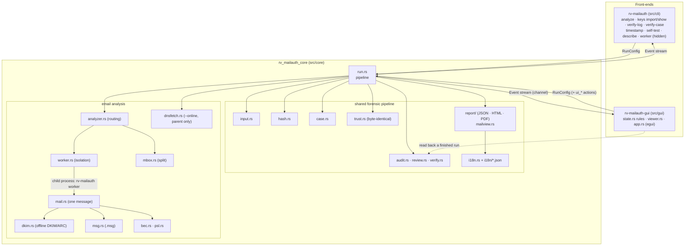
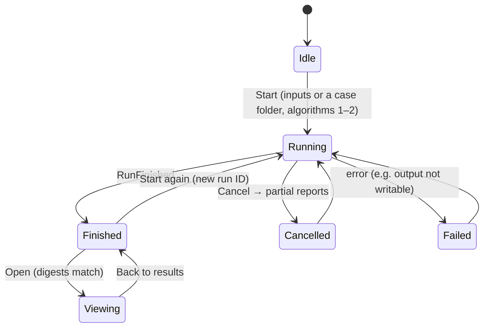

# Architecture

One engine, two front-ends. The engine (`src/core`) does all the work and never prints; the CLI and the GUI only
turn user input into a `RunConfig` and render the `Event`s the engine emits, so both interfaces produce identical
logs and reports. Inside the engine, the forensic pipeline (hashing, audit chain, case folder, reports, trust) is
shared with every Rakvor tool; the email analysis plugs into it at one entry point (`analyzer::analyze_item`) and
runs, by default, in a separate worker process per message.



## Modules

| Module | Responsibility |
| --- | --- |
| `input.rs` | Files, folders, list files → sorted, de-duplicated, absolute paths. Symbolic links not followed. |
| `hash.rs` | One read loop (1 MiB chunks) feeding 1–2 digests; known-answer self-test. |
| `analyzer.rs` | `classify` (eml / msg / mbox / other) and `analyze_item`, the frozen entry point the pipeline calls for every item and every mbox message; the inventory logic for non-email files. |
| `worker.rs` | One child process per message (`rv-mailauth worker …`, protocol `rv-mailauth-worker/1`): limits applied before the child reads evidence, timeout, output collection, `PARSER_FAILED` on any failure. |
| `mail.rs` | One message: `analyze_bytes` (pure: no file system, no network) parses headers, hops, dates, Authentication-Results, attachments, runs DKIM/ARC and the BEC checks; `analyze_message` writes `headers.json`, `dkim.json`, attachments. |
| `dkim.rs` | Key-file parser (simple and BIND forms), offline verifier (mail-auth with an empty resolver and an injected DNS cache), result classification, alignment. |
| `dnsfetch.rs` | `--online` only: today's DKIM key records through the system resolver, called by `run.rs` in the parent, one audit entry per lookup. |
| `msg.rs` | Outlook compound file: MAPI properties, transport headers, attachments. |
| `mbox.rs` | Streaming split into messages (`<path>#<n>@<offset>`), `mbox_index.json`, un-escaping (mboxrd / mboxo). |
| `bec.rs`, `psl.rs` | Lookalike domains (TR39 skeletons, edit distance), Reply-To / Return-Path, display name, payment wording; organisational domain from the bundled Public Suffix List. |
| `model.rs` | Finding codes and severities, `DomainOptions`, the message model (headers, hops, DKIM report, attachments). |
| `audit.rs`, `review.rs`, `verify.rs` | Append-only hash-chained `audit.jsonl`; the review log of GUI viewing anchored to `run_finished`; `verify-log` (chain, timestamps, truncation anchors, review log). |
| `case.rs` | Shared case folder: `case.json`, hash-chained `case-log.jsonl` under a lock, the registry (read only here: `CASE_ROLE = Analysis`), `verify_case`. See [case-folder.md](case-folder.md). |
| `trust.rs` | RFC 3161 client and verifier, PDF signing — byte-identical in every Rakvor tool ([ADR 0002](adr/0002-tsa-token-verification.md)). |
| `report/` | View models → minijinja HTML (`templates/`), built-in PDF writer, schema-versioned JSON; `mailview.rs` builds the email sections of the technical review. |
| `events.rs`, `env.rs`, `run.rs` | Typed events and ETA; `environment.json`; orchestration, cancellation, duplicates, `hashes.csv`, reports. |
| `src/gui/src/state.rs`, `viewer.rs` | Every rule the window enforces, and the read-back of a finished run from its audit log (digest-checked message view), headless-testable. |
| `src/cli/src/keys.rs` | `keys import` (its own audit run) and `keys show`. |

## One run, step by step

```mermaid
sequenceDiagram
    autonumber
    participant UI as CLI / GUI
    participant R as run.rs
    participant A as audit.jsonl
    participant FS as Evidence (read-only)
    participant W as worker process
    participant O as reports/
    UI->>R: run(config, sink, cancel)
    R->>A: run_started, ui_* actions, environment_recorded, analysis_configured
    R->>A: inputs_resolved
    R-->>UI: RunStarted{total_items, total_bytes}
    loop each item
        R->>A: item_started
        R->>FS: open read-only, read 1 MiB chunks, hash
        R-->>UI: Progress{elapsed_ms, eta_ms} (≤ every 150 ms)
        R->>A: item_hashed{digests, mtime_unchanged}
        R->>W: analyse (.eml/.msg; or each mbox message after message_started/message_hashed)
        W->>O: headers.json, dkim.json, attachments/
        W-->>R: findings + outputs (one JSON document)
        R->>A: output_written{digests} …, item_analyzed{findings, status}
        R-->>UI: ItemFinished
    end
    R->>A: duplicate_group(s), hash_register_written
    R->>O: per-item technical, summary, custody (JSON/HTML/PDF)
    R->>A: item_reports_written / item_reports_skipped
    R->>A: timestamp_obtained (or timestamp_pending)
    R->>O: statistics (JSON/HTML/PDF)
    R->>A: statistics_report_written, run_finished
    R-->>UI: RunFinished
```

## Run states (as the GUI sees them)



## Concurrency, isolation and cancellation

- The GUI runs the engine on a background thread and receives events through a channel, so the window stays
  responsive; the elapsed-time label is refreshed from the window clock.
- Items are processed **sequentially** on purpose: the order of audit entries equals the order of work. Each
  message is analysed in its own worker process (the GUI and CLI executable started as `worker`), which the parent
  waits for; a crash, hang or memory blow-up kills only that worker and becomes `PARSER_FAILED`.
- The worker never touches the audit log: the parent hashes and records everything the worker wrote, after it has
  ended. Files listed outside the item folder are rejected; files left by a failed worker are kept and audited as
  `partial_output`.
- Cancellation is an `AtomicBool` checked after every 1 MiB chunk and between items; the engine still writes
  `hashes.csv`, partial reports and `run_cancelled`.

## Why Rust

See [ADR 0001](adr/0001-language.md); the email decisions are in [ADR 0004](adr/0004-email-design-decisions.md).
