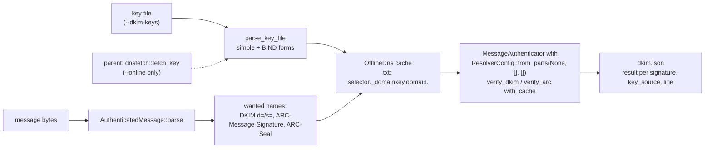
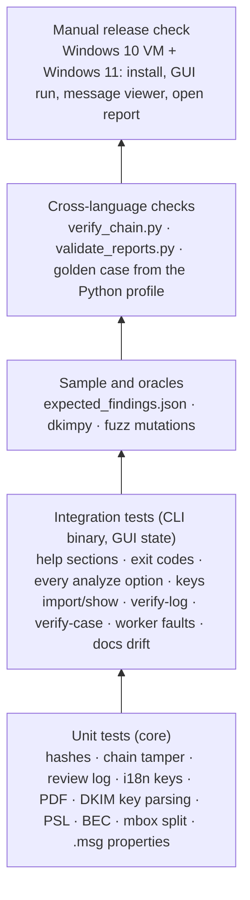
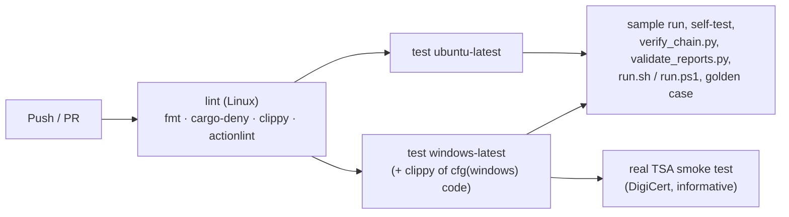
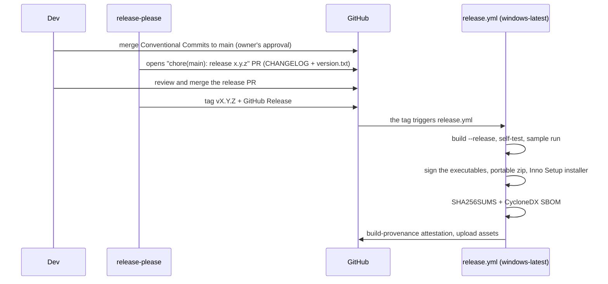

# Development, CI/CD and releases

For the project's state, layout and open work start with [HANDOFF.md](HANDOFF.md); the design decisions are in
[adr/](adr/). This page is the developer's reference: how to build and test, what pins what and why, the test
oracles, and how CI and releases run.

## Build and test locally

```bash
export RV_TEST_PYTHON=python          # Python with blake3 jsonschema pyhanko dkimpy pynacl (the test helpers)
cargo build --workspace               # debug build of core, CLI and GUI
cargo test  --workspace --locked      # unit + integration tests (GUI tests are headless)
cargo clippy --workspace --all-targets --locked -- -D warnings
cargo fmt --all -- --check
cargo deny check                      # advisories, licences (no GPL/AGPL/LGPL), bans, sources
cargo build -q -p rv-mailauth-cli && sh examples/sample/run.sh target/debug/rv-mailauth   # the sample check
python ../rakvor-tool-forge/scripts/validate_project.py . --run --tests                  # the Rakvor contract
cargo run -p rv-mailauth-gui
```

Linux needs no system packages to build. On Windows use the MSVC toolchain; binaries are linked with the static C
runtime (`.cargo/config.toml`), so they run on a clean Windows 10/11. On a small Windows machine,
`CARGO_PROFILE_DEV_DEBUG=0 CARGO_INCREMENTAL=0` keeps the debug build small.

### Toolchain pin

| Pin | Value | Why |
| --- | --- | --- |
| `rust-toolchain.toml` | **1.99.1** (rustfmt, clippy, minimal profile) | One compiler for local builds, CI and releases, so lints do not drift and an auditor rebuilds a release with the compiler recorded in its `environment.json` (`tool.rustc`). Both workflows run `rustup toolchain install`, which reads this file. Bump it deliberately, in this one file, with a green CI. |
| `rust-version` (workspace `Cargo.toml`) | **1.98** | The minimum, set by **mail-parser 1.0**, which declares `rust-version = "1.98"` (edition 2024). Older compilers cannot build the MIME parser at all. |
| `mail-parser` | `=1.0.1` | MIME parsing of `.eml` and mbox messages; exact pin, because a parser change can change what a header or attachment looks like in the reports. |
| `mail-auth` | `=0.15.1`, `default-features = false`, features `rust-crypto`, `dns-hickory`, `arc` | DKIM and ARC verification. `rust-crypto` replaces the default aws-lc backend (a C/CMake build) with pure-Rust RSA and Ed25519 **verification**; `dns-hickory` is used only by `--online` in the parent process; offline, the verifier gets a resolver with no name server and the keys are injected into its DNS cache (below). Exact pin: verification results are evidence. |
| `cfb` | 0.15 | Reads the OLE compound file of an Outlook `.msg` (`src/core/src/msg.rs` reads the MAPI streams itself). |
| `unicode-security`, `idna` | 0.1, 1 | Confusable skeletons (Unicode TR39) and punycode decoding for the lookalike-domain check. |
| `tokio` | 1, `rt` only | mail-auth's API is async; each verification runs on a current-thread runtime, no network driver offline. |

### How offline verification is wired (`src/core/src/dkim.rs`)



A name missing from the cache reaches the resolver, which has no server and fails at once ("no connections
available"); that error is classified as `key_not_available`. The worker code path (`worker`, `analyzer`, `mail`,
`msg`, `mbox`, `dkim`, `bec`, `model`, `hash`) has no network code; `worker_code_path_has_no_network_code` checks
it, and `src/core/src/dnsfetch.rs` (the only DNS lookup) is called by `run.rs` in the parent.

### Worker test hooks

`RV_WORKER_TEST_FAULT=crash|hang|oom`, `RV_WORKER_TEST_TIMEOUT_S` and `RV_WORKER_TEST_NO_NETNS=1` make the worker
misbehave on purpose in **debug builds only** (`src/cli/tests/worker.rs`, `src/core/src/worker.rs`); release
builds ignore them.

## Samples, oracles and fuzzing

| What | Where | Run by |
| --- | --- | --- |
| **Synthetic samples** — 16 files, 19 items: clean RSA and Ed25519 signatures, body and header edits, a rotated key, lookalike / Reply-To / display-name / payment cases, two `.msg` (with and without transport headers), an mbox of three messages, truncated files, an unaligned signature with a late attachment date, an unknown selector with a broken ARC set | `tests/make_samples.py` writes `examples/sample/evidence/`, the **public** keys (`dkim-keys.txt`), `expected_findings.json` (from the construction, not from a run) and `expected_hashes.csv` (hashlib/blake3). Throwaway private keys are generated in memory and discarded; re-running changes every signature and hash, so commit the whole output together | `src/core/tests/samples.rs`, `examples/sample/run.sh`/`run.ps1`, CI |
| **DKIM oracle** — dkimpy re-verifies every signature of the sample (mbox split, un-escaping and key parsing re-implemented in Python on purpose) and must agree with `dkim.json`, signature by signature | `tests/oracle_dkim.py` (needs `dkimpy pynacl`; exit 77 = skipped) | `samples.rs` through `RV_TEST_PYTHON`; installed in CI |
| **Fuzzing** — deterministic mutations of every sample (bit flips, truncation, inserted and overwritten bytes, duplicated or removed slices, hostile DKIM/ARC/MIME header lines) through `analyze_bytes` (MIME, .msg compound file, DKIM/ARC with the sample keys, BEC) and the mbox split; no panic, no slow case | `src/core/tests/fuzz.rs` (stable toolchain, no cargo-fuzz); `RV_FUZZ_ITERATIONS` (default 400 per sample, 6 400 cases) | `cargo test` |
| **Chain and report verifiers** — Python re-checks the audit chain, `hashes.csv` and every JSON report against `schemas/` | `tests/verify_chain.py`, `tests/validate_reports.py` | CI, by hand |
| **Golden case** — a case folder written by the Python profile must verify with this build | `tests/golden/` (`unpack.py`, `regenerate.py`) | CI |
| **Docs drift** — `docs/usage-cli.md` equals `rv-mailauth docs-cli`; the findings and limitations tables of [reports.md](reports.md) equal `i18n/en.json` and the severities in `model.rs` | `src/cli/tests/cli.rs` (`usage_doc_matches_help`), `src/core/tests/docs_catalogue.rs` | `cargo test` |

After changing `--help`, run `cargo run -q -p rv-mailauth-cli -- docs-cli > docs/usage-cli.md`. After changing a
finding's wording, severity or a limitation, run
`RV_UPDATE_DOCS=1 cargo test -p rv-mailauth-core --test docs_catalogue` and review the diff of `docs/reports.md`.

## Public Suffix List update

The organisational domain (alignment, Reply-To/Return-Path and Message-ID comparisons, lookalike labels) comes from
the Public Suffix List bundled in `src/core/data/public_suffix_list.dat` (MPL-2.0, unmodified; see `NOTICE`), pinned
by `src/core/data/PSL_VERSION.txt` ([ADR 0004](adr/0004-email-design-decisions.md), decision 6).

1. Download `https://publicsuffix.org/list/public_suffix_list.dat` and replace the file **unmodified**.
2. In `PSL_VERSION.txt` update `version` (the `VERSION:` line at the top of the file), `commit` (of the
   publicsuffix/list repository), `downloaded` and `sha256` (`sha256sum public_suffix_list.dat`).
3. `cargo test --workspace` — `psl::tests::bundled_list_matches_its_pinned_digest` fails if the digest does not
   match; the alignment and lookalike tests show whether a result changed.
4. Commit both files together (`chore: update the Public Suffix List to <version>`). Every run records the version
   and digest (`environment.json` → `data_files`, and `analysis_configured`), so older reports stay reproducible
   with the list that produced them.

## Test pyramid



## Continuous integration



`ci.yml` runs on every push to `main`, every pull request and on demand, with read-only permissions.

## Releasing



| Artifact | Built by |
| --- | --- |
| `rv-mailauth-X.Y.Z-windows-x64.zip` | portable: both executables, README, LICENSE, NOTICE, docs, examples (sample scripts and expectations included) |
| `rv-mailauth-X.Y.Z-windows-x64-setup.exe` | Inno Setup (`packaging/windows/installer.iss`), per-user install, adds the CLI to PATH; ships the sample evidence and `dkim-keys.txt` |
| `SHA256SUMS` | over the assets |
| `sbom.cdx.json` | `cargo cyclonedx` |
| Attestation | `actions/attest-build-provenance` |

Code signing, secrets and the manual fallback: [release-process.md](release-process.md). Never merge to `main`,
push to it or publish a release without the owner's approval.

### Release checklist (manual)

- [ ] `rv-mailauth self-test` and `examples\sample\run.ps1` pass with the released exe on Windows 10 **and** 11
- [ ] GUI opens, runs the sample with `dkim-keys.txt`, the message viewer opens a message ("match the digests in
      the audit log"), *Open report* works, `verify-log` prints the review entries
- [ ] `SHA256SUMS` matches the downloaded files; `gh attestation verify` passes; every `.exe` chains to the Rakvor
      root
- [ ] CHANGELOG entry reviewed by a human
