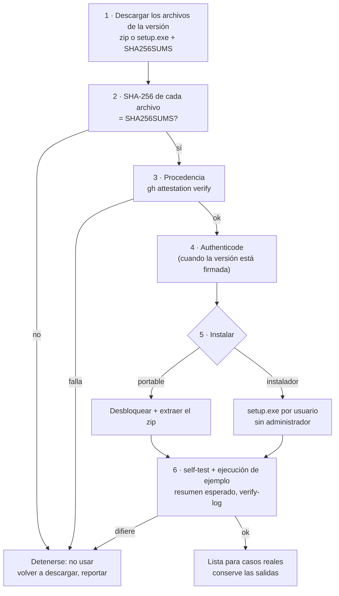

> La versión de referencia es la inglesa ([installation.md](installation.md)); esta traducción la sigue.

# Instalación y verificación (Windows 10/11)

RV MailAuth se ejecuta **localmente** en el PC con Windows 10 u 11 del perito (x64). No necesita derechos de
administrador, ni runtime (runtime de C estático), ni red, salvo para el sello de tiempo RFC 3161 opcional y la
consulta opcional de claves DKIM con `--online`. Esta página cubre: obtener una versión, **demostrar que es la
compilación auténtica**, instalarla (zip portable o instalador por usuario), el self-test de la primera ejecución, el
uso sin red, la compilación desde el código fuente para auditores, dónde quedan los archivos y la desinstalación.

Por qué importa la verificación: un tribunal puede preguntar cómo sabe usted que el programa que ejecutó es aquel cuyo
código fuente revisó un experto. Los pasos 2–4 y 6 dan esa respuesta; conserve su salida en el expediente del caso
([admissibility.md](admissibility.md#examiner-checklist-before-filing-a-report), paso 3, en inglés).



## Requisitos

| Elemento | Requisito |
| --- | --- |
| Sistema operativo | Windows 10 u 11, x64 (`MinVersion=10.0`, `ArchitecturesAllowed=x64compatible` en el instalador). Linux/macOS: compilar desde el código fuente. |
| Derechos | Usuario estándar. El instalador es por usuario (`PrivilegesRequired=lowest`). |
| Disco | Los dos ejecutables y la documentación (unos pocos MB); las salidas necesitan unos 11 archivos de informe por elemento para un idioma (19 con `--lang all`) más los logs. |
| Memoria | Los archivos se hashean en bloques de 1 MiB. Cada mensaje se analiza en su propio proceso de análisis, limitado por `--worker-memory-mb` (por defecto 1024 MiB) y `--max-message-mb` (por defecto 200 MiB); un mbox se divide con una lectura secuencial de bytes, así que su tamaño no aumenta el uso de memoria. |
| Gráficos | Ninguno: la GUI también funciona en máquinas virtuales sin controlador de GPU (renderizado por software). |
| Red | Ninguna, salvo la solicitud opcional de sello de tiempo y las consultas de claves con `--online` (vea el [paso 7](#7-uso-sin-red-y-en-equipos-aislados)). |
| Verificación de versiones | Opcional, solo aviso: la aplicación de escritorio al arrancar y `rv-mailauth update-check` leen la página pública de la última versión en github.com ([Verificación de versiones](#verificación-de-versiones)); `RV_NO_UPDATE_CHECK=1` la desactiva. |

## 1. Descarga

Archivos de la versión en la página GitHub Releases del repositorio (`Panacota96/rv-mailauth`):

| Archivo | Qué es |
| --- | --- |
| `rv-mailauth-X.Y.Z-windows-x64.zip` | Portable: `rv-mailauth.exe`, `rv-mailauth-gui.exe`, README, LICENSE, COMMERCIAL.md, NOTICE, CHANGELOG, `docs/`, `examples/` |
| `rv-mailauth-X.Y.Z-windows-x64-setup.exe` | Instalador Inno Setup, por usuario |
| `SHA256SUMS` | SHA-256 del zip, del instalador y del SBOM (formato `sha256sum`: `<hash>  ./<archivo>`) |
| `sbom.cdx.json` | Lista de materiales de software CycloneDX (cada dependencia Rust y su versión) |

Póngalos en una carpeta, p. ej. `C:\Rakvor\downloads\rv-mailauth-0.1.0\`.

## 2. Verificar la descarga

```powershell
cd C:\Rakvor\downloads\rv-mailauth-0.1.0
Get-Content .\SHA256SUMS | ForEach-Object {
    $hash, $name = $_ -split '\s+', 2
    $name = $name.TrimStart('*').Replace('./', '')
    if (Test-Path $name) {
        $actual = (Get-FileHash -Algorithm SHA256 $name).Hash.ToLower()
        if ($actual -eq $hash) { "OK    $name" } else { "FAIL  $name  (got $actual)" }
    } else { "skip  $name (not downloaded)" }
}
```

```bash
sha256sum -c --ignore-missing SHA256SUMS      # Linux, o Git Bash en Windows
```

Cada archivo descargado debe imprimir `OK`. `SHA256SUMS` lo produce el mismo flujo de trabajo y no está atestado él
mismo: el paso 3 es la verificación más fuerte.

## 3. Verificar la procedencia de la compilación

Cada zip e instalador lleva una atestación de procedencia de compilación de GitHub (`actions/attest-build-provenance`):
una declaración firmada de que ese archivo exacto lo compiló el flujo de publicación del repositorio a partir de un
commit dado. En un equipo con acceso a internet y la CLI de GitHub:

```powershell
gh attestation verify .\rv-mailauth-0.1.0-windows-x64.zip --repo Panacota96/rv-mailauth
gh attestation verify .\rv-mailauth-0.1.0-windows-x64-setup.exe --repo Panacota96/rv-mailauth
```

La salida nombra el flujo de trabajo (`.github/workflows/release.yml`) y el commit de origen; anote ambos. Para un
laboratorio aislado, verifique en un equipo conectado y lleve los archivos verificados en un soporte protegido contra
escritura (la CLI de GitHub también puede descargar el paquete de atestación y la raíz de confianza para
verificaciones sin red; ver `gh attestation verify --help`). `SHA256SUMS` y el SBOM no están atestados.

## 4. Verificar la firma Authenticode (versiones firmadas)

El flujo de publicación firma `rv-mailauth.exe`, `rv-mailauth-gui.exe` y el instalador **solo cuando hay un
certificado de firma de código configurado** para el repositorio. Las versiones se firman con el certificado de firma
de código **interno** de Rakvor ("Rakvor Code Signing (internal)", emitido por "Rakvor Internal Code Signing Root
CA"). No es un certificado público: Windows solo confía en él en los equipos donde está instalada la raíz de Rakvor
(los portátiles de Rakvor, ya que la herramienta se usa localmente y no se distribuye). Auditores y clientes
verifican las versiones con los pasos 2–3 y pueden inspeccionar la firma con la huella de la raíz que figura abajo.

Instale la raíz una vez por equipo Rakvor (PowerShell como el usuario que ejecuta la herramienta; el archivo es
`packaging/signing/rakvor-code-signing-root.cer` en el repositorio):

```powershell
# Compruebe primero la huella; debe ser exactamente:
#   SHA-256 DC9BA1A2FCD4F0633C5214B7CCEB25BED8F3F7D9EBAF111590250CBCAA83DF60
(New-Object System.Security.Cryptography.X509Certificates.X509Certificate2 .\rakvor-code-signing-root.cer).GetCertHashString([System.Security.Cryptography.HashAlgorithmName]::SHA256)
Import-Certificate -FilePath .\rakvor-code-signing-root.cer -CertStoreLocation Cert:\CurrentUser\Root
```

Windows muestra un cuadro de confirmación para la nueva raíz; acéptelo solo si la huella coincidió. Sin la raíz,
`Get-AuthenticodeSignature` informa `UnknownError` (cadena hacia una raíz no confiable) y SmartScreen puede advertir
igualmente en la primera ejecución. Verifique:

```powershell
Get-AuthenticodeSignature .\rv-mailauth-0.1.0-windows-x64-setup.exe |
    Format-List Status, StatusMessage, SignerCertificate, TimeStamperCertificate
# después de extraer el zip:
Get-AuthenticodeSignature .\rv-mailauth.exe, .\rv-mailauth-gui.exe | Format-Table Status, Path
```

| Estado | Significado |
| --- | --- |
| `Valid` | Firmado e intacto; el firmante debe ser "Rakvor Code Signing (internal)" |
| `UnknownError` | Firmado, pero la raíz de Rakvor no está instalada en este equipo (instálela como arriba) |
| `NotSigned` | La versión se compiló sin certificado de firma: apóyese en los pasos 2–3; Windows SmartScreen advertirá |
| `HashMismatch` / otro | Deténgase: el archivo fue alterado después de firmarse |

Con el Windows SDK, `signtool verify /pa /v rv-mailauth.exe` da la cadena completa.

## 5. Instalar

### 5a. Zip portable

```powershell
# solo después de los pasos 2–4
Unblock-File .\rv-mailauth-0.1.0-windows-x64.zip
Expand-Archive .\rv-mailauth-0.1.0-windows-x64.zip -DestinationPath C:\Rakvor\tools\rv-mailauth-0.1.0
cd C:\Rakvor\tools\rv-mailauth-0.1.0
.\rv-mailauth.exe --version
```

Conserve una carpeta por versión para poder volver a ejecutar un caso pasado con la versión exacta registrada en su
`environment.json`. Opcional, solo para la sesión actual: `$env:Path += ";C:\Rakvor\tools\rv-mailauth-0.1.0"`.

### 5b. Instalador (por usuario, sin administrador)

Haga doble clic en `rv-mailauth-X.Y.Z-windows-x64-setup.exe` (asistente en inglés, español o francés). Instala en
`%LOCALAPPDATA%\Programs\Rakvor\RV MailAuth\`, crea un grupo *Rakvor* en el menú Inicio (aplicación + documentación) y
ofrece dos tareas: **Add the rv-mailauth command to PATH** (PATH del usuario, marcada en la primera instalación) y un
icono en el escritorio. Abra luego una terminal **nueva** para que el PATH se aplique.

Sin intervención:

```powershell
.\rv-mailauth-0.1.0-windows-x64-setup.exe /VERYSILENT /SUPPRESSMSGBOXES /NORESTART /TASKS="addtopath"
```

El instalador copia los ejecutables, README, LICENSE, COMMERCIAL.md, NOTICE, CHANGELOG, `docs\`, la evidencia de
muestra (`examples\sample\evidence\`) y las claves públicas de la muestra (`examples\sample\dkim-keys.txt`), no los
scripts de la muestra, `expected_findings.json` ni `expected_hashes.csv` (están en el zip y en el árbol de código).

### 5c. Bibliotecas nativas

Ninguna. RV MailAuth son dos ejecutables autónomos: el hash, el análisis MIME (mail-parser), la verificación DKIM/ARC
(mail-auth con su motor `rust-crypto` en Rust puro, no la biblioteca de C aws-lc), el lector de archivos compuestos de
Outlook, la Public Suffix List (un archivo de datos compilado dentro), el escritor de PDF, el cliente RFC 3161 y el
firmante CMS están compilados dentro (crates en Rust puro, listados en el SBOM), y el runtime de C se enlaza de forma
estática (`.cargo/config.toml`). No hay ninguna DLL que verificar ni que mantener junto a los ejecutables.

## 6. Self-test de la primera ejecución y ejemplo

```powershell
rv-mailauth --version
rv-mailauth self-test
```

`self-test` imprime `PASS` para md5, sha1, sha256, sha512, sha3-256 y blake3 (respuestas conocidas para `"abc"`),
código de salida 0. Solo prueba las implementaciones de hash. Luego ejecute la muestra sintética (16 archivos de
correo, 19 elementos), que ejercita DKIM y ARC con las claves públicas de la muestra, las comprobaciones de fechas, de
saltos y de BEC, el tratamiento de `.msg` y mbox, los informes y la cadena de auditoría:

```powershell
# zip portable (script incluido): self-test, keys show, análisis de la muestra, verify-log, hallazgos por elemento
# frente a expected_findings.json, hashes.csv frente a expected_hashes.csv
.\examples\sample\run.ps1 -Bin .\rv-mailauth.exe

# instalador (no se instala ningún script): ejecútelo a mano en una carpeta temporal
$app = "$env:LOCALAPPDATA\Programs\Rakvor\RV MailAuth"
$out = Join-Path $env:TEMP "rv-mailauth-check"
rv-mailauth analyze -i "$app\examples\sample\evidence" --hash sha256,md5 --out $out --progress none --no-timestamp `
  --dkim-keys "$app\examples\sample\dkim-keys.txt" --own-domain acme.example
$LASTEXITCODE                                  # 3: la muestra contiene mensajes alterados (expected_findings.json)
rv-mailauth verify-log (Get-ChildItem "$out\logs" | Select-Object -Last 1).FullName   # OK … chain intact
```

Resumen esperado: **19 elementos (16 archivos + 3 mensajes del mbox), 0 errores, hallazgos alto 2, medio 13, bajo 7,
info 10**, código de salida **3**: dos mensajes cuyo cuerpo ya no coincide con su firma DKIM (`03-body-edited.eml` y
el mensaje 2 de `12-mailbox.mbox`); los códigos exactos por elemento están en `examples\sample\expected_findings.json`
y en la tabla de [examples/README.md](../examples/README.md) (en inglés). Sin `--dkim-keys` el resumen cambia (las
firmas pasan a `DKIM_KEY_NOT_AVAILABLE`), así que indique siempre el archivo de claves de la muestra. La columna
SHA-256 de `hashes.csv` debe ser igual a `examples\sample\expected_hashes.csv` (calculado de forma independiente con
Python), por ejemplo:

| Archivo | Tamaño | SHA-256 |
| --- | --: | --- |
| `01-clean-rsa.eml` | 1464 | `d774e6fb20d569075f2767ee4dd92136071f6c2fa81ce0979600069b89596f59` |
| `02-clean-ed25519.eml` | 1063 | `35736d319dd2c2b75b04a48253a5f39c4d3c2a3a65a7479b9f30bde0e1c42f1d` |

`run.ps1` / `run.sh` hacen ellos mismos las dos comparaciones: comparan los códigos de hallazgo y el estado de cada
elemento con `expected_findings.json` (`findings and status match expected_findings.json (19 items)`), y el tamaño,
el SHA-256 y el MD5 de cada archivo con `expected_hashes.csv` (`hashes.csv matches expected_hashes.csv (16 files: size,
SHA-256, MD5)`), y salen con 3 ante cualquier diferencia. Para el instalador (no se instala ningún script), compare
`$out\logs\<RUN-ID>\hashes.csv` con el `expected_hashes.csv` del árbol de código, o ejecute
`python tests\verify_chain.py <carpeta de logs>` desde el árbol de código, que vuelve a hashear cada archivo de
`hashes.csv` y cada salida que registra el log de auditoría.

Conserve la salida de la consola y la carpeta de la ejecución como registro de esta verificación.

## 7. Uso sin red y en equipos aislados

Además de la comprobación de versiones opcional ([Verificación de versiones](#verificación-de-versiones)), la red se
usa solo en dos lugares: la solicitud de sello de tiempo RFC 3161 (un HTTP POST de un hash de 32 bytes a la TSA,
[src/core/src/trust.rs](../src/core/src/trust.rs)) y, solo con `analyze --online` (GUI: *Consultar las claves DNS de
hoy*), las consultas DNS TXT de las claves DKIM que faltan, `selector._domainkey.domain`, a través del resolutor del
sistema, en el proceso principal ([src/core/src/dnsfetch.rs](../src/core/src/dnsfetch.rs)); los procesos de análisis
no contienen código de red. `--online` está desactivado por defecto, y cada consulta revela al DNS qué dominios se
examinan. No hay telemetría ni comprobación de licencia.

| Para desactivar el sello de tiempo | Cómo |
| --- | --- |
| Una ejecución de la CLI | `--no-timestamp` |
| Todas las ejecuciones de la CLI en este equipo / sesión | `$env:RV_NO_TIMESTAMP = "1"` (o defínala como variable de entorno del usuario) |
| GUI | desmarque **4. Confianza → Sello de tiempo confiable** antes de *Iniciar revisión* |
| Consultas de claves DKIM | nunca ocurren salvo que se indique `--online` (GUI: *5. Opciones → Consultar las claves DNS de hoy*) |

Una ejecución sin red con el sello de tiempo activado termina igualmente: registra `timestamp_pending` y el informe
estadístico muestra una advertencia. Más tarde, en un equipo que pueda llegar a la TSA, ejecute
`rv-mailauth timestamp <carpeta de logs>` (vuelve a verificar la cadena y luego agrega `timestamp_obtained`). Para usar
una TSA interna o cualificada, indique `--tsa-url` (ver
[admissibility.md](admissibility.md#53-eidas--regulation-eu-9102014-as-amended-by-eu-20241183)). El sello de tiempo
solo es cualificado según eIDAS si la dirección de la TSA es la de un prestador cualificado de servicios de confianza
(QTSP) inscrito en una lista de confianza de la UE; la dirección por defecto (DigiCert) no lo es. El sistema operativo
no impone la restricción de red; en un equipo conectado, una regla de salida del Firewall de Windows para
`rv-mailauth.exe` / `rv-mailauth-gui.exe` que solo permita el servidor de la TSA la impone.

## 8. Compilar desde el código fuente para auditores

### Cadena de herramientas

| Elemento | Versión |
| --- | --- |
| Rust | Fijado por [rust-toolchain.toml](../rust-toolchain.toml): **1.99.1** con rustfmt y clippy; `rustup` lo instala y lo selecciona automáticamente dentro del árbol de código. `Cargo.toml` declara `rust-version = "1.98"` (edición 2024) como mínimo, impuesto por mail-parser 1.0 ([development.md](development.md#toolchain-pin), en inglés). Para coincidir exactamente con una versión, use el compilador registrado en el `environment.json` de esa versión → `tool.rustc` (p. ej. `rustc 1.99.1 (58cf8f9c3 2026-10-13)`). |
| Enlazador de Windows | Visual Studio 2022 Build Tools, carga de trabajo *Desktop development with C++* (MSVC + Windows SDK); destino `x86_64-pc-windows-msvc`. El CRT estático se define en `.cargo/config.toml`. |
| Linux | No hacen falta paquetes del sistema para compilar la CLI. |
| Opcional | Python 3.12 con `blake3 jsonschema pyhanko dkimpy pynacl` para los verificadores independientes, el oráculo DKIM y las pruebas de confianza (`RV_TEST_PYTHON=python`). |

### Compilación

```powershell
git clone https://github.com/Panacota96/rv-mailauth.git
cd rv-mailauth
git checkout v0.1.0                       # the tag of the release under review
rustc --version                           # must print the pinned 1.99.1
cargo build --release --locked -p rv-mailauth-cli -p rv-mailauth-gui
.\target\release\rv-mailauth.exe self-test
.\examples\sample\run.ps1 -Bin .\target\release\rv-mailauth.exe
cargo test --workspace --locked            # unit + integration tests (trust tests skip without pyhanko, the DKIM oracle without dkimpy)
```

```bash
# Linux
cargo build --release --locked -p rv-mailauth-cli
target/release/rv-mailauth self-test && examples/sample/run.sh target/release/rv-mailauth
python3 tests/verify_chain.py examples/sample/out/logs/$(ls examples/sample/out/logs | tail -n 1)
# entre perfiles: una carpeta de caso escrita por el perfil Python de la forja debe verificarse con esta compilación
python3 tests/golden/unpack.py tests/golden/case-by-python.zip.b64 /tmp/golden
target/release/rv-mailauth verify-case /tmp/golden/CASE-GOLDEN
```

`--locked` se niega a compilar si `Cargo.lock` tuviera que cambiar, así que el conjunto de dependencias es igual al
listado en `environment.json` → `dependencies` y en `sbom.cdx.json`. La versión del producto viene de `version.txt`;
las versiones de las crates en `Cargo.toml` no cambian, así que una versión nunca modifica el archivo de bloqueo.

### Reproducir los hashes de una versión

Sea preciso sobre lo que puede y no puede coincidir bit a bit en esta versión (brecha G22):

| Artefacto | ¿Idéntico bit a bit a la versión publicada? | Cómo verificarlo |
| --- | --- | --- |
| Archivos de `docs/`, `examples/` | Sí (desde git; finales de línea LF salvo `*.ps1`, `*.iss`) | `git ls-files` + `Get-FileHash` frente al zip extraído |
| `rv-mailauth.exe`, `rv-mailauth-gui.exe` | **No garantizado**: las rutas no se reasignan y la cabecera PE lleva datos del momento del enlace. El compilador es el fijado en `rust-toolchain.toml` (ambos flujos ejecutan `rustup toolchain install`, que lee ese archivo; confírmelo con `environment.json` → `tool.rustc` de una ejecución de la versión) | La atestación de procedencia (paso 3) vincula el binario publicado al flujo de trabajo y al commit; luego compare el comportamiento (abajo) |
| zip, instalador | No (marcas de tiempo del archivo comprimido) | Atestación (paso 3) |

**Equivalencia funcional**: ejecute el ejemplo con el binario publicado y con su compilación, y luego compare los
hashes y los hallazgos de cada elemento:

```bash
python - "<release-out>/reports/<RUN-ID>" "<your-out>/reports/<RUN-ID>" <<'EOF'
import glob, json, sys
def load(run):
    out = {}
    for p in sorted(glob.glob(f"{run}/items/*/technical.json")):
        t = json.load(open(p, encoding="utf-8"))
        out[t["item"]["file_name"]] = (t["hashes"], t["item"]["detected_type"],
                                       [(f["code"], f["severity"], f["params"]) for f in t["findings"]])
    return out
a, b = load(sys.argv[1]), load(sys.argv[2])
print("identical findings and digests" if a == b else "DIFFERENT: " + ", ".join(k for k in a if a.get(k) != b.get(k)))
EOF
```

Ejecute la muestra con `--dkim-keys examples/sample/dkim-keys.txt --own-domain acme.example` en los dos lados.

## 9. Dónde quedan las cosas

| Qué | Ubicación |
| --- | --- |
| Programa (instalador) | `%LOCALAPPDATA%\Programs\Rakvor\RV MailAuth\` (`rv-mailauth.exe`, `rv-mailauth-gui.exe`, `docs\`, `examples\sample\evidence\`, `examples\sample\dkim-keys.txt`, `unins000.exe`) |
| Programa (portable) | la carpeta que extrajo |
| Entrada del PATH (tarea del instalador) | variable de entorno del usuario `Path` (`HKCU\Environment`) |
| Salidas de las ejecuciones | `--out` (por defecto `.\rakvor-out` **relativo a la carpeta actual**): `logs\<RUN-ID>\` (con `review.jsonl` en cuanto se abren mensajes en el visor), `reports\<RUN-ID>\`. Con `--case-dir`: `<CASE>\runs\rv-mailauth\<RUN-ID>\`. La GUI usa su campo *Carpeta de salida* (o la carpeta del caso) |
| Carpeta del caso | donde la cree con `--case-dir` (`case.json`, `case-log.jsonl`, `evidence\`, `runs\`) |
| Ajustes de la GUI | no se guardan: cada inicio usa los valores por defecto; cada cambio hecho antes de una ejecución se registra en el log de auditoría de esa ejecución (`ui_*`) |
| Certificado de firma | donde usted lo guarde; solo se registran su ruta, su sujeto y su huella SHA-256, nunca la contraseña |
| Archivos de claves DKIM | donde usted los guarde; `keys import` escribe el archivo de claves que usted nombra y su propio `logs\<RUN-ID>\` dentro de `--out` |
| Datos locales, cachés, archivos temporales | ninguno (los procesos de análisis solo escriben en las carpetas de los elementos de la ejecución) |

## 10. Desinstalar

- **Instalador:** *Configuración → Aplicaciones → Aplicaciones instaladas → RV MailAuth → Desinstalar*, o ejecute
  `"%LOCALAPPDATA%\Programs\Rakvor\RV MailAuth\unins000.exe"`. Quita los archivos instalados y los accesos directos.
  **La entrada del PATH del usuario no se quita** en esta versión; quítela con:

  ```powershell
  $dir = "$env:LOCALAPPDATA\Programs\Rakvor\RV MailAuth"
  $p = [Environment]::GetEnvironmentVariable("Path", "User").Split(";") | Where-Object { $_ -and $_ -ne $dir }
  [Environment]::SetEnvironmentVariable("Path", ($p -join ";"), "User")
  ```

- **Portable:** borre la carpeta.
- **Se conservan a propósito** (en ambos casos): las salidas de las ejecuciones y las carpetas de caso (material del
  caso). Conserve el zip de la versión y `SHA256SUMS` de cada versión usada en un caso, para poder volver a ejecutarlo.

## 11. Problemas de instalación

| Síntoma | Causa y solución |
| --- | --- |
| SmartScreen "Windows protegió su PC" (editor desconocido) | SmartScreen juzga un archivo por la **reputación** de un certificado de confianza pública; la raíz interna de Rakvor no lo es, así que la advertencia aparece incluso cuando la firma es `Valid` (y siempre cuando es `NotSigned`). Solo después de pasar los pasos 2–4: *Más información → Ejecutar de todas formas*, o quite antes la marca de archivo descargado con `Unblock-File .\<archivo>` (hágalo sobre el zip **antes** de extraerlo). Solo desaparece del todo con un certificado público (ver `docs/release-process.md` §5). |
| `rv-mailauth` no se reconoce | No se eligió la tarea del PATH, o la terminal se abrió antes de instalar: abra una terminal nueva o use la ruta completa. |
| `self-test` imprime `FAIL` | No use esta compilación para evidencia; vuelva a descargar y repita los pasos 2–4. |
| El resumen del ejemplo difiere del paso 6 | Versión equivocada o archivos de ejemplo modificados; compare `environment.json` con las notas de la versión y los hashes del ejemplo con `expected_hashes.csv`. |
| Ventana de la GUI en blanco o muy lenta en una máquina virtual | Sin controlador de GPU se usa el renderizado por software; asigne más CPU a la máquina virtual. |
| Compilar desde el código fuente descarga otro compilador | Esperado: rustup instala la 1.99.1 fijada en `rust-toolchain.toml`. Sin red, instálela antes (`rustup toolchain install 1.99.1 --profile minimal`). |

## Verificación de versiones

¿Hay una versión más reciente publicada? La herramienta puede decírselo; nunca se actualiza sola.

| | |
| --- | --- |
| Cuándo | La aplicación de escritorio verifica una vez al arrancar, en segundo plano (solo aparece un aviso con la página de la versión cuando hay una más reciente). La CLI solo verifica con `rv-mailauth update-check` (`--json` para scripts; salida 0 = última, 3 = versión más reciente, 1 = no se pudo verificar). Ningún otro comando contacta la red para esto. RV Hub verifica cada herramienta que lista. |
| Qué se envía | Un HTTPS GET de `https://github.com/Panacota96/rv-mailauth/releases/latest` (se lee la redirección, no se sigue) con `User-Agent: rv-mailauth/<version>` y ninguna otra cabecera, cookie ni parámetro: nada sobre el caso, la evidencia, el perito ni el equipo. |
| Qué hace | Nombra la versión más reciente y su página. Nunca descarga ni instala nada: descargue la versión y verifíquela (`SHA256SUMS`, cadena Authenticode hasta la raíz de Rakvor) como en [Verificar la descarga](#2-verificar-la-descarga) antes de usarla. |
| Auditoría | La verificación no forma parte de una ejecución y no se escribe en ningún log de auditoría; una verificación fallida o lenta (sin red, límite de 5 s) nunca bloquea la herramienta. |
| Desactivarla | `RV_NO_UPDATE_CHECK=1` (cualquier valor salvo vacío o `0`), o el archivo `update-check-off` en `%APPDATA%\Rakvor` (lo escribe el ajuste de RV Hub): desactivada para toda herramienta Rakvor en este equipo. |
| Código | [src/core/src/update.rs](../src/core/src/update.rs) (compartido, idéntico byte a byte, en toda herramienta Rakvor) |
