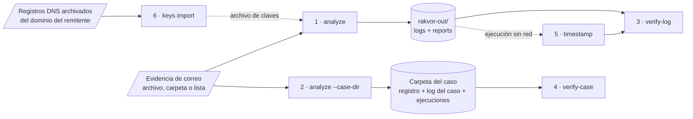
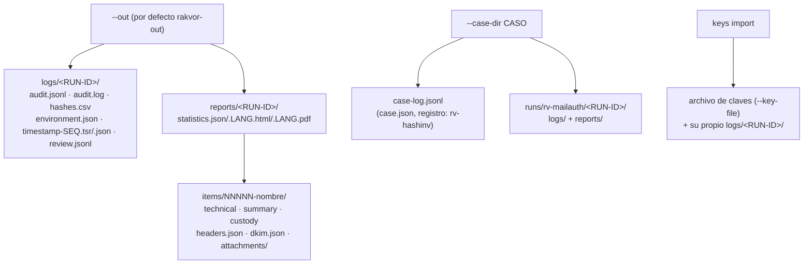

> La versión de referencia es la inglesa ([quick-guide.md](quick-guide.md)); esta traducción la sigue.

# Guía rápida

RV MailAuth busca señales de que un correo electrónico se modificó después de enviarse, o de que no es lo que dice
ser. Lee cada evidencia que se le entrega (`.eml`, `.msg` de Outlook o `.mbox`: un archivo, una carpeta o una lista de
archivos) sin cambiarla, calcula su hash, y comprueba sin red cada firma DKIM y la cadena ARC con las claves públicas
que usted aporta, los saltos Received entre sí y frente a la cabecera Date, el Message-ID, los adjuntos y las señales
de compromiso del correo empresarial (dominios parecidos, nombres visibles, Reply-To en otro lugar, datos de pago).
Cada mensaje se analiza en un proceso de análisis separado. Escribe informes para el perito y para el cliente, y
registra cada acción en un log de auditoría encadenado por hashes. Sus hallazgos son **señales, no veredictos**: cada
uno dice lo que muestra y lo que no demuestra. Un mensaje sin hallazgos no queda probado como auténtico, y un hallazgo
no prueba una falsificación ni muestra quién cambió el mensaje ni por qué; una firma DKIM válida no muestra quién
escribió el mensaje. Esta página cubre las seis tareas habituales. La guía completa es [usage.es.md](usage.es.md), y
cada opción está en [usage-cli.md](usage-cli.md) (en inglés).



## Dos formas de usarla

| Modo | Programa | Cuándo usarlo |
| --- | --- | --- |
| Aplicación de escritorio (GUI) | `rv-mailauth-gui.exe` (menú Inicio: *RV MailAuth*) | Windows 10/11. Elige la evidencia, el archivo de claves y las opciones en una ventana, pulsa **Iniciar revisión** y luego **Abrir** en un mensaje para verlo en el visor de mensajes. |
| Línea de comandos (CLI) | `rv-mailauth.exe` | Scripts, lotes, los comandos de verificación (`verify-log`, `verify-case`, `timestamp`) y los archivos de claves DKIM (`keys`). |

Las dos usan el mismo motor. Con la misma evidencia, el mismo archivo de claves y las mismas opciones dan los mismos
hashes y hallazgos, y las dos escriben los mismos archivos.

## Aplicación de escritorio: qué hace cada botón

No se escribe nada en el disco hasta que pulsa **Iniciar revisión**. Cada cambio que haga antes se guarda en memoria
y se escribe en el log de auditoría de la ejecución como una entrada `ui_*` cuando la ejecución empieza. Abrir un
mensaje después de la ejecución se escribe en el log de revisión de la ejecución (`review.jsonl`).

| Botón o casilla | Qué hace | Qué escribe |
| --- | --- | --- |
| **Agregar archivos…** | Abre el selector de archivos de Windows y agrega los archivos elegidos a la lista de evidencia. | `ui_input_added` (una por archivo) |
| **Agregar carpeta…** | Agrega una carpeta completa. | `ui_input_added` |
| **Agregar ruta** | Agrega la ruta escrita en el cuadro de al lado (pulsar Enter hace lo mismo). | `ui_input_added` |
| Arrastrar y soltar | Los archivos o carpetas soltados en la ventana se agregan a la lista de evidencia, como con **Agregar archivos…**. | `ui_input_added` |
| **x** (junto a una entrada) | Quita esa entrada de la lista de evidencia. | `ui_input_removed` |
| **Incluir subcarpetas** | Activada por defecto: las carpetas se leen con sus subcarpetas. | `ui_recursive_changed` |
| **Examinar…** junto a **Carpeta del caso** | Elige la carpeta compartida del caso. La carpeta de salida pasa a ser `<case>/runs/rv-mailauth/<RUN-ID>` y ya no se puede editar. | `ui_case_dir_changed` |
| Casillas de los algoritmos de hash (md5 … blake3) | Uno o dos algoritmos (por defecto sha256). Con dos marcados, los demás se desactivan. | `ui_hash_selection_changed` |
| **Idioma de los informes** | English, Español, Français o los tres. | `ui_language_changed` |
| **Examinar…** junto a **Carpeta de salida** | Elige dónde se escriben `logs/` y `reports/` (por defecto `rakvor-out`). | Nada hasta la ejecución: la carpeta usada se registra en `environment.json` |
| **Perito** e **ID del caso** (campos de texto) | El nombre del perito (por defecto, su usuario de Windows) y una referencia de caso opcional. | Nada hasta la ejecución: el perito se escribe en cada entrada de auditoría y en cada informe, el ID del caso en los informes |
| **Formato de custodia** | Colombia (Fiscalía) o Francia (scellé); siempre se agrega una copia en inglés. | `ui_jurisdiction_changed` |
| **Sello de tiempo confiable** (casilla y dirección) | Activado por defecto. Pide a la autoridad RFC 3161 de esa dirección un sello de tiempo para el log de auditoría. | `ui_timestamp_changed` |
| **Examinar…** junto a **Certificado de firma (.p12/.pfx)** | Elige su certificado. Cada informe PDF se firma entonces con él. Escriba la **Contraseña del certificado** en el campo de debajo. La contraseña solo se guarda en memoria y nunca se registra. | `ui_signing_certificate_changed` (solo la ruta) |
| **Examinar…** junto a **Archivo de claves DKIM** | Elige el archivo de claves (como lo escribe `keys import`, Tarea 6) cuyas claves públicas verifican sin red las firmas DKIM y ARC. Sin él, las firmas son `DKIM_KEY_NOT_AVAILABLE` (una discrepancia del hash del cuerpo se detecta igualmente). | `ui_dkim_keys_changed` |
| **Consultar las claves DNS de hoy (evidencia más débil)** | Desactivada por defecto. Busca en el DNS de hoy las claves que faltan en el archivo de claves. Cada consulta se audita y cada resultado basado en ella se marca `DKIM_KEY_FROM_CURRENT_DNS`. | `ui_online_dns_changed` |
| **Añadir** (y **x** junto a un dominio) en **Dominios propios** | Agrega el dominio escrito en el cuadro (pulsar Enter hace lo mismo), o quita uno. Los dominios de su organización son la referencia de las comprobaciones de dominio parecido y de nombre visible. | `ui_own_domain_added`, `ui_own_domain_removed` |
| **Extraer los adjuntos (attachments/ en la carpeta de cada mensaje)** | Desactivada por defecto. Copia cada adjunto, decodificado, en la carpeta del mensaje (siempre se lista con su SHA-256). | `ui_extract_attachments_changed` |
| **Todos los elementos** / **Solo elementos señalados** (Informes por elemento) | Informes por elemento para todos los elementos, o solo para los que tienen un hallazgo por encima de informativo. | `ui_item_reports_changed` |
| **Iniciar revisión** | Inicia la ejecución con los ajustes mostrados. | `ui_start_clicked` y luego toda la ejecución (ver [Dónde van las salidas](#dónde-van-las-salidas)) |
| **Cancelar** | Se detiene después del mensaje que se está leyendo y escribe informes parciales. | `item_cancelled`, `run_cancelled` |
| **Abrir informe** | Abre el informe de estadísticas (`statistics.<LANG>.html`) de la ejecución terminada. | Nada |
| **Abrir carpeta de logs** | Abre la carpeta de logs de la ejecución. | Nada |
| **Abrir** (uno por fila de la tabla Resultados) | Abre el visor de mensajes sobre ese mensaje, tras comprobar `headers.json` y `dkim.json` frente a los hashes del log de auditoría (solo se muestra si coinciden). | `ui_message_viewed` (o `ui_message_refused`) en `review.jsonl` |
| **Volver a los resultados** | Sale del visor de mensajes. | Nada |
| **ID de evidencia** (panel de resultado) | Tras una ejecución en una carpeta del caso, lista el ID de evidencia de cada elemento (E0001…) y su control contra el registro. Solo lectura. | Nada |
| **Advertencias** (panel de resultado) | Lista los errores encontrados durante la ejecución. Solo lectura. | Nada aquí: la ejecución registra cada error como `item_error` |

El sello de tiempo solo es cualificado en el sentido de eIDAS si la dirección de la TSA es la de un prestador
cualificado de servicios de confianza (QTSP) inscrito en una lista de confianza de la UE; la dirección por defecto
(DigiCert) no lo es.

Los selectores también se registran: **Desfase de reloj tolerado (s)** (`ui_clock_skew_changed`), **Variante mbox**
(`ui_mbox_variant_changed`) y, en **Límites del proceso de análisis (avanzado)**, el tiempo máximo por mensaje, la
memoria por proceso, el mensaje más grande analizado y los mensajes analizados por mbox (`ui_worker_timeout_changed`,
`ui_worker_memory_changed`, `ui_max_message_size_changed`, `ui_max_mbox_messages_changed`). El selector **Idioma de la
interfaz** (arriba a la derecha) se registra como `ui_interface_language_changed`. Cuando RV Hub abre la aplicación
sobre una carpeta del caso, el log empieza con `ui_case_dir_from_launcher`.

## Tarea 1: Analizar un correo o una carpeta

1. Compruebe la compilación una vez en este PC: `rv-mailauth self-test` debe imprimir `PASS` para cada algoritmo
   (código de salida 0).
2. Ejecute el análisis sobre una copia verificada de la evidencia, nunca sobre el soporte original, con el archivo de
   claves DKIM del dominio del remitente (la Tarea 6 crea uno; aquí, el `dkim-keys.txt` de la muestra) y su propio
   dominio. Quite `--no-timestamp` cuando el PC pueda llegar a la TSA: la ejecución obtiene entonces también el sello de
   tiempo (`timestamp: ok …`).

   ```powershell
   rv-mailauth analyze -i evidence -r --hash sha256,md5 --lang es --case CASE-2026-014 --actor "Ana Ruiz" --dkim-keys dkim-keys.txt --own-domain acme.example --no-timestamp
   ```

3. Lea el resumen. Sobre una copia de la evidencia de muestra (`examples\sample\evidence`, 16 archivos, uno de ellos un
   mbox de tres mensajes) en `evidence`, sin red (`--no-timestamp`), el comando anterior imprime:

   ```text
   DONE (high-severity findings)  run 20261126T214931Z-ad6f3e
     items: 19  bytes: 63410  errors: 0  elapsed: 4.0 s
     findings: high 2, medium 13, low 7, info 10
     timestamp: off
     report: rakvor-out\reports\20261126T214931Z-ad6f3e\statistics.es.html
     logs:   rakvor-out\logs\20261126T214931Z-ad6f3e
   ```

4. Abra el archivo de `report:`. Luego, para cada elemento, abra `technical.<LANG>.html` (para el perito) o
   `summary.<LANG>.html` (para el cliente), o **Abrir** el mensaje en la aplicación de escritorio para ver sus saltos,
   su tabla DKIM y sus hallazgos.

**Qué escribe:** `rakvor-out/logs/<RUN-ID>/` (log de auditoría, `hashes.csv`, `environment.json`) y
`rakvor-out/reports/<RUN-ID>/` (informe de estadísticas y, por elemento, una revisión técnica, un resumen, un formato
de custodia, `headers.json`, `dkim.json` y, para un mbox, `mbox_index.json`).

**Cómo leer el resultado:** `DONE` con código de salida 0 significa que no hay hallazgos de severidad alta.
`DONE (high-severity findings)` con código de salida 3 es un resultado normal para la evidencia, no un error: la
muestra contiene dos mensajes cuyo cuerpo ya no coincide con su firma DKIM (`DKIM_BODY_HASH_MISMATCH`). Abra los
elementos cuyo estado es `problem` o `attention`. Cada hallazgo dice lo que muestra y lo que no demuestra;
[usage.es.md](usage.es.md#4-interpretar-cada-hallazgo) indica qué comprobar después para cada código. Un resultado
DKIM vale lo que vale la clave: use la clave publicada cuando se envió el mensaje. `timestamp: pending` significa que
no se pudo llegar a la autoridad (ver Tarea 5).

Opciones del análisis:

| Opción | Qué fija |
| --- | --- |
| `--input` (`-i`) | Un archivo o una carpeta que revisar. Repítala para varios. |
| `--input-list` (`-L`) | Un archivo de texto con una ruta por línea. |
| `--recursive` (`-r`) | Leer también las subcarpetas. |
| `--hash` (`-H`) | Uno o dos de md5, sha1, sha256, sha512, sha3-256, blake3 (por defecto sha256). |
| `--out` (`-o`) | Carpeta de salida (por defecto `rakvor-out`). |
| `--lang` (`-l`) | Idioma de los informes: en, es, fr o all. |
| `--actor` (`-a`) | Nombre del perito en el log de auditoría y en los informes. |
| `--case` (`-c`) | Identificador del caso impreso en los informes. |
| `--progress` (`-p`) | bar, jsonl (un evento JSON por línea) o none. |
| `--jurisdiction` (`-j`) | Formato de custodia: co (Colombia) o fr (Francia). |
| `--tsa-url` | Autoridad RFC 3161 (por defecto `http://timestamp.digicert.com`). |
| `--no-timestamp` | Sin solicitud de sello de tiempo (laboratorios sin red). |
| `--sign-cert` | Su certificado `.p12`/`.pfx`: cada informe PDF se firma con él. |
| `--sign-pass-env` | La variable de entorno que contiene su contraseña (por defecto `RV_SIGN_PASSWORD`). |
| `--dkim-keys` | El archivo de claves DKIM (Tarea 6) con el que se verifican las firmas sin red. |
| `--online` | Buscar además en el DNS de hoy las claves que faltan (evidencia más débil; cada consulta se audita). |
| `--own-domain` | El dominio de su organización, para las comprobaciones de dominio parecido y de nombre visible. Repítala para varios. |
| `--extract-attachments` | Copiar cada adjunto, decodificado, en la carpeta del elemento. |
| `--clock-skew` | Diferencia de reloj tolerada entre servidores, en segundos (por defecto 300). |
| `--mbox-variant` | mboxrd (por defecto) o mboxo: cómo se deshace el escape de las líneas `>From ` del cuerpo. |
| `--max-message-mb` | Mensaje más grande analizado, en MiB (por defecto 200). |
| `--max-mbox-messages` | Mensajes analizados por mbox (por defecto 50000). |
| `--worker-timeout` | Segundos permitidos para un mensaje (por defecto 120). |
| `--worker-memory-mb` | Límite de memoria de un proceso de análisis en MiB (por defecto 1024). |
| `--isolation` | worker (por defecto: un proceso por mensaje) o in-process (solo para depuración). |
| `--item-reports` | all (por defecto) o flagged: informes por elemento solo para los elementos con un hallazgo por encima de informativo. |
| `--case-dir` | La carpeta compartida del caso (Tarea 2). |
| `--evidence` (`-E`) | ID de evidencia registrados que analizar (Tarea 2). |

## Tarea 2: Analizar evidencia en una carpeta del caso

1. Elija una carpeta para el caso, en el volumen del caso, por ejemplo `cases\CASE-2026-014`. rv-mailauth es una
   herramienta de análisis: verifica cada archivo contra el registro de evidencias que escribe la herramienta de
   recepción, rv-hashinv. Nunca escribe el registro.
2. Registre primero la evidencia con rv-hashinv (crea el caso):

   ```powershell
   rv-hashinv scan -i evidence -r --case-dir cases\CASE-2026-014 --case CASE-2026-014 --jurisdiction co --no-timestamp
   ```

3. Analice cada elemento registrado:

   ```powershell
   rv-mailauth analyze --case-dir cases\CASE-2026-014 --dkim-keys dkim-keys.txt --own-domain acme.example --no-timestamp
   ```

4. Lea la última línea del resumen:

   ```text
     case:   CASE-2026-014 (analysis) registered 0 (new 0), verified 16, mismatched 0, not in registry 0
   ```

5. Más adelante, para volver a analizar algunos elementos registrados, indique sus ID:

   ```powershell
   rv-mailauth analyze --case-dir cases\CASE-2026-014 --evidence E0003,E0004 --dkim-keys dkim-keys.txt --no-timestamp
   ```

**Qué escribe:** la ejecución en `runs/rv-mailauth/<RUN-ID>/logs` y `/reports`, y sus entradas `run_started` y
`run_finished` en `case-log.jsonl` (rv-hashinv escribe `case.json`, el registro `evidence/registry.json` y `.csv` y su
propia ejecución en `runs/rv-hashinv/`).

**Cómo leer el resultado:** `verified` cuenta los archivos cuyos hashes coinciden con el registro (16: los tres
mensajes del mbox son elementos derivados de un solo archivo registrado). Un archivo que difiere del registro recibe el
hallazgo alto `EVIDENCE_HASH_MISMATCH_WITH_CASE` (se analiza igualmente); un archivo que no está en el registro recibe
`EVIDENCE_NOT_IN_CASE_REGISTRY` (medio). El código de salida 3 antes de leer nada significa que la carpeta del caso no
pasó la verificación: no se escribió nada en ella (ejecute la Tarea 4). El código de salida 2 significa un error de
uso, por ejemplo una carpeta que pertenece a otro caso o un ID de evidencia desconocido.

## Tarea 3: Verificar el log de auditoría de una ejecución

1. Indique a `verify-log` la carpeta de logs de la ejecución (o el `audit.jsonl` que contiene):

   ```powershell
   rv-mailauth verify-log rakvor-out\logs\20261126T214931Z-ad6f3e
   ```

2. Lea la salida:

   ```text
   OK  139 entries, chain intact: rakvor-out\logs\20261126T214931Z-ad6f3e\audit.jsonl
       truncation not detectable without a timestamp or case record
       outputs: 251 verified of 251 recorded (md5, sha256)
   ```

3. Si la ejecución tiene sello de tiempo, agregue `--tsa-ca <raíces de la TSA.pem>` para comprobar también la cadena
   de certificados de la TSA contra los certificados raíz de la propia TSA.

**Qué escribe:** nada. Solo lee.

**Cómo leer el resultado:** `OK` (código de salida 0) significa que ninguna entrada se editó, borró ni reordenó, que
cada token de sello de tiempo coincide, que el log de revisión (los mensajes abiertos en el visor, `review entries: N`)
está intacto, y que cada informe, `headers.json`, `dkim.json`, `hashes.csv` y `environment.json` conservan el hash que
registró el log. La línea `truncation` dice qué ancla el final del log: una ejecución sin sello de tiempo y fuera de
una carpeta del caso no puede demostrar que no se quitó ninguna entrada de su final. `BROKEN` (código de salida 3)
lista un problema por línea. El código de salida 1 significa que el log o el archivo `--tsa-ca` no se pueden leer. La
revocación del certificado de la TSA nunca se comprueba.

## Tarea 4: Verificar un caso completo

1. Ejecute `verify-case` sobre la carpeta que contiene `case.json`; `--rehash` vuelve a leer además cada elemento
   registrado:

   ```powershell
   rv-mailauth verify-case cases\CASE-2026-014 --rehash
   ```

2. Lea la salida (después de la Tarea 2: la ejecución de recepción de rv-hashinv y las dos ejecuciones de
   rv-mailauth):

   ```text
   OK  case CASE-2026-014: 8 case-log entries, 16 registered items, 3 runs verified: cases\CASE-2026-014
       outputs: 463 verified of 463 recorded by the runs' audit logs
       re-hashed 16 of 16 registered items: 16 match the registry
   ```

**Qué escribe:** nada. Solo lee.

**Cómo leer el resultado:** `OK` (código de salida 0) significa que el log del caso, el registro, el log de auditoría y
el log de revisión de cada ejecución (de cada herramienta Rakvor) y las salidas registradas de las ejecuciones están
intactos y (con `--rehash`) que cada elemento registrado accesible sigue coincidiendo con el registro. Los avisos (por
ejemplo, una ejecución todavía en curso) se imprimen pero no hacen fallar la comprobación. `BROKEN` (código de salida
3) lista cada comprobación fallida. El código de salida 1 significa que la carpeta no es una carpeta de caso (no tiene
`case.json`).

## Tarea 5: Agregar el sello de tiempo después de trabajar sin red

1. Sin red, ejecute el análisis como de costumbre, o con `--no-timestamp` (o `RV_NO_TIMESTAMP=1`) para que no se
   envíe ninguna solicitud. Sin `--no-timestamp`, el resumen muestra `timestamp: pending`.

   ```powershell
   rv-mailauth analyze -i evidence\03-body-edited.eml -o offline --dkim-keys dkim-keys.txt --no-timestamp
   ```

2. Cuando vuelva la red, agregue el sello de tiempo a la carpeta de logs de la ejecución:

   ```powershell
   rv-mailauth timestamp offline\logs\20261126T214959Z-2bd532
   ```

3. Lea el resultado: `OK  timestamp 2026-11-26T21:50:08Z by http://timestamp.digicert.com covers entry #14`. Use
   `--tsa-url` para elegir otra autoridad y `--actor` para nombrar al perito en la nueva entrada de auditoría.
4. Haga la Tarea 3 sobre la misma carpeta. Ahora muestra la línea del sello de tiempo y `TSA signature valid`:

   ```text
   OK  15 entries, chain intact: offline\logs\20261126T214959Z-2bd532\audit.jsonl
       timestamp 2026-11-26T21:50:08Z by http://timestamp.digicert.com covers entry #14: TSA signature valid (signer: CN=DigiCert SHA256 RSA4096 Timestamp Responder 2026 1,O=DigiCert\, Inc.,C=US); chain not checked (pass --tsa-ca <CA bundle> to validate it)
       truncation: entries up to #14 are anchored by the RFC 3161 timestamp (timestamp-00014.json); 1 entry after it (timestamp_obtained) cannot be proven complete
       outputs: 18 verified of 19 recorded (sha256), 1 skipped
       not re-hashed: logs/timestamp-00014.tsr (RFC 3161 token: checked by the timestamp verification)
   ```

**Qué escribe:** `timestamp-<SEQ>.tsr` (el token RFC 3161) y `timestamp-<SEQ>.json` en la carpeta de logs, y la
entrada `timestamp_obtained` en `audit.jsonl`.

**Cómo leer el resultado:** el código de salida 0 significa que el sello de tiempo se obtuvo y se registró. El código
de salida 1 significa que no se pudo llegar a la autoridad; nada cambió, así que vuelva a intentarlo más tarde. El
código de salida 3 significa que el log falta o está roto; no se agrega ningún sello de tiempo a un log roto. El sello
de tiempo demuestra cuándo existía el log, no que la evidencia sea auténtica.

## Tarea 6: Preparar el archivo de claves DKIM

1. Obtenga los registros DKIM que el dominio del remitente publicaba **cuando se enviaron los mensajes**: un archivo de
   zona archivado, los registros del proveedor o un servicio de DNS pasivo con fechas. Anote de dónde viene cada uno.
2. Impórtelos en un archivo de claves nuevo. Aquí las claves públicas de la muestra hacen las veces de una zona
   archivada:

   ```powershell
   rv-mailauth keys import dns-archive-2026-03.zone --key-file case-keys.txt --case CASE-2026-014 --actor "Ana Ruiz" --no-timestamp
   ```

3. Lea el resultado:

   ```text
   OK  4 DKIM keys written to case-keys.txt (sha256 7dde2edfacfc696892a6467c614dfae72c335309a736728bdf7f04fed640e331)
       source dns-archive-2026-03.zone sha256 f5de4068b295824c6f4d9b27fd4a936ed63bcc624be6c67b24a3f0e85f09092e
       timestamp: off
       logs: rakvor-out\logs\20261126T214921Z-d9e57b
   ```

   `--out` (`-o`) fija dónde va la carpeta de logs propia de la importación (por defecto `rakvor-out`); `--tsa-url` y
   `--no-timestamp` funcionan como en `analyze`.
4. Compruebe lo que contiene el archivo de claves:

   ```powershell
   rv-mailauth keys show case-keys.txt
   ```

   ```text
   case-keys.txt  sha256 7dde2edfacfc696892a6467c614dfae72c335309a736728bdf7f04fed640e331
   LINE  SELECTOR                 DOMAIN                           TYPE      BITS
   4     ed2026                   example.org                      ed25519    256
   5     m1                       mailer.example.com               rsa       2048
   6     s2025                    example.org                      rsa       2048
   7     s2026                    example.org                      rsa       2048
   4 usable keys, 0 records not usable
   ```

5. Entregue el archivo de claves al análisis con `--dkim-keys case-keys.txt` (GUI: **Examinar…** junto a **Archivo de
   claves DKIM**).

**Qué escribe:** el archivo de claves nombrado por `--key-file` (nunca se sobrescribe) y el log de auditoría de la
importación en `<--out>/logs/<RUN-ID>/` (el SHA-256 de cada fuente y del archivo de claves). `keys show` no escribe
nada.

**Cómo leer el resultado:** el SHA-256 del archivo de claves aparece en el log de auditoría de cada análisis que lo
usa. El código de salida 0 significa que se escribió el archivo de claves (`keys show`: cada registro es una clave DKIM
utilizable). El código de salida 1 significa una fuente que no se puede leer o un archivo de claves que ya existe; el
código de salida 2, un registro DKIM mal formado, dos claves distintas con el mismo nombre, o ningún registro DKIM (no
se escribe nada). Una clave publicada hoy puede no ser la que firmó un mensaje antiguo: las claves rotan.

## Otros comandos

| Comando | Qué hace |
| --- | --- |
| `rv-mailauth self-test` | Comprueba cada algoritmo de hash contra valores de prueba publicados. |
| `rv-mailauth keys` | Agrupa `import` y `show` (Tarea 6). |
| `rv-mailauth update-check` | Indica si hay publicada una versión más reciente. Solo avisa: no se descarga nada. `RV_NO_UPDATE_CHECK=1` lo desactiva. |
| `rv-mailauth describe --json` | Imprime la descripción de la herramienta para RV Hub. No lee ni escribe nada. |

## Códigos de salida

| Código | Significado | Lo devuelve |
| --- | --- | --- |
| 0 | Terminado; ningún hallazgo de severidad alta (comandos de verificación: todo lo comprobado está intacto; `keys show`: cada registro es una clave utilizable). | todos los comandos |
| 1 | Error de ejecución: entrada inexistente, salida no escribible, log del caso bloqueado, contraseña del certificado incorrecta, TSA inaccesible (solo `timestamp`; `analyze` muestra `timestamp: pending` y continúa), carpeta que no es de caso, self-test fallido, una fuente de claves que no se puede leer o un archivo de claves que ya existe, o una comprobación de versiones que no se pudo hacer. | `analyze`, `keys`, `verify-log`, `verify-case`, `timestamp`, `self-test`, `update-check` |
| 2 | Error de uso: opción desconocida, valor incorrecto, más de dos algoritmos, un archivo `--dkim-keys` que no se puede leer, un `--own-domain` no válido, carpeta de otro caso, ID de evidencia desconocido; o (`keys`) un registro que no es una clave DKIM utilizable. | todos los comandos (opción desconocida); `analyze`, `keys import`, `keys show` |
| 3 | Al menos un hallazgo de severidad alta, un log roto, una verificación del caso fallida o (para `update-check`) una versión más reciente. | `analyze`, `verify-log`, `verify-case`, `timestamp`, `update-check` |
| 130 | Cancelado con Ctrl+C: se escriben informes parciales y la cancelación consta en el log de auditoría. | `analyze` |

## Dónde van las salidas



Sin `--case-dir`, cada ejecución crea `logs/<RUN-ID>/` y `reports/<RUN-ID>/` dentro de `--out` (por defecto
`.\rakvor-out`, relativo a la carpeta actual). Con `--case-dir`, van a `<CASE>/runs/rv-mailauth/<RUN-ID>/`. Conserve la
carpeta de logs con los informes, y el archivo de claves con su log de importación: son la prueba de lo que se hizo.
