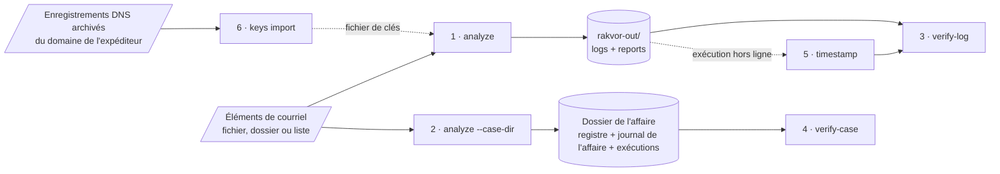
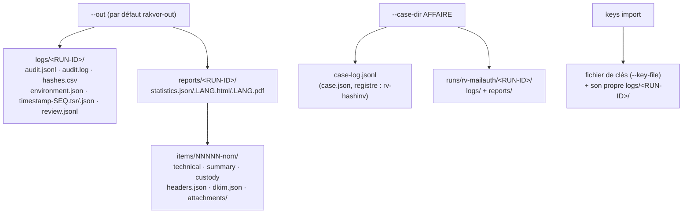

> La version de référence est la version anglaise ([quick-guide.md](quick-guide.md)) ; cette traduction la suit.

# Guide rapide

RV MailAuth cherche des signes qu'un courriel a été modifié après son envoi, ou qu'il n'est pas ce qu'il prétend être.
Il lit chaque élément que vous lui donnez (`.eml`, `.msg` d'Outlook ou `.mbox` : un fichier, un dossier ou une liste de
fichiers) sans le modifier, en calcule l'empreinte, et contrôle hors ligne chaque signature DKIM et la chaîne ARC avec
les clés publiques que vous fournissez, les sauts Received entre eux et avec l'en-tête Date, le Message-ID, les pièces
jointes et les signaux de compromission de la messagerie d'entreprise (domaines sosies, noms affichés, Reply-To
ailleurs, coordonnées de paiement). Chaque message est analysé dans un processus d'analyse séparé. Il écrit des
rapports pour l'expert et pour le client, et consigne chaque action dans un journal d'audit chaîné par empreintes. Ses
constatations sont des **signaux, pas des verdicts** : chacune dit ce qu'elle montre et ce qu'elle ne prouve pas. Un
message sans constatation n'est pas prouvé authentique, et une constatation ne prouve pas une falsification, ni ne
montre qui a modifié le message ni pourquoi ; une signature DKIM valide ne montre pas qui a écrit le message. Cette
page couvre les six tâches courantes. Le guide complet est [usage.fr.md](usage.fr.md), et chaque option figure dans
[usage-cli.md](usage-cli.md) (en anglais).



## Deux façons de l'utiliser

| Mode | Programme | Quand l'utiliser |
| --- | --- | --- |
| Application de bureau (GUI) | `rv-mailauth-gui.exe` (menu Démarrer : *RV MailAuth*) | Windows 10/11. Vous choisissez les éléments, le fichier de clés et les options dans une fenêtre, appuyez sur **Lancer l'analyse**, puis sur **Ouvrir** devant un message pour le voir dans la visionneuse. |
| Ligne de commande (CLI) | `rv-mailauth.exe` | Scripts, lots, les commandes de vérification (`verify-log`, `verify-case`, `timestamp`) et les fichiers de clés DKIM (`keys`). |

Les deux utilisent le même moteur. Avec les mêmes éléments, le même fichier de clés et les mêmes options, elles donnent
les mêmes empreintes et les mêmes constatations, et elles écrivent les mêmes fichiers.

## Application de bureau : ce que fait chaque bouton

Rien n'est écrit sur le disque avant que vous appuyiez sur **Lancer l'analyse**. Chaque changement fait avant est
gardé en mémoire, puis écrit dans le journal d'audit de l'exécution comme une entrée `ui_*` quand l'exécution démarre.
L'ouverture d'un message après l'exécution est écrite dans le journal de consultation de l'exécution (`review.jsonl`).

| Bouton ou case | Ce qu'il fait | Ce qu'il écrit |
| --- | --- | --- |
| **Ajouter des fichiers…** | Ouvre le sélecteur de fichiers de Windows et ajoute les fichiers choisis à la liste des éléments. | `ui_input_added` (une par fichier) |
| **Ajouter un dossier…** | Ajoute un dossier entier. | `ui_input_added` |
| **Ajouter le chemin** | Ajoute le chemin saisi dans la zone voisine (la touche Entrée fait de même). | `ui_input_added` |
| Glisser-déposer | Les fichiers ou dossiers déposés sur la fenêtre sont ajoutés à la liste des éléments, comme avec **Ajouter des fichiers…**. | `ui_input_added` |
| **x** (à côté d'une entrée) | Retire cette entrée de la liste des éléments. | `ui_input_removed` |
| **Inclure les sous-dossiers** | Coché par défaut : les dossiers sont lus avec leurs sous-dossiers. | `ui_recursive_changed` |
| **Parcourir…** à côté de **Dossier de l'affaire** | Choisit le dossier partagé de l'affaire. Le dossier de sortie devient alors `<case>/runs/rv-mailauth/<RUN-ID>` et n'est plus modifiable. | `ui_case_dir_changed` |
| Cases des algorithmes d'empreinte (md5 … blake3) | Un ou deux algorithmes (par défaut sha256). Quand deux sont cochés, les autres sont désactivés. | `ui_hash_selection_changed` |
| **Langue des rapports** | English, Español, Français, ou les trois. | `ui_language_changed` |
| **Parcourir…** à côté de **Dossier de sortie** | Choisit où sont écrits `logs/` et `reports/` (par défaut `rakvor-out`). | Rien avant l'exécution : le dossier utilisé est consigné dans `environment.json` |
| **Expert** et **Référence du dossier** (champs de texte) | Le nom de l'expert (par défaut votre utilisateur Windows) et une référence d'affaire facultative. | Rien avant l'exécution : l'expert est écrit dans chaque entrée d'audit et chaque rapport, la référence sur les rapports |
| **Fiche de possession** | Le modèle de la fiche de traçabilité : Colombie (Fiscalía) ou France (scellé) ; une copie en anglais est toujours ajoutée. | `ui_jurisdiction_changed` |
| **Horodatage qualifié** (case et adresse) | Coché par défaut. Demande à l'autorité RFC 3161 de cette adresse d'horodater le journal d'audit. | `ui_timestamp_changed` |
| **Parcourir…** à côté de **Certificat de signature (.p12/.pfx)** | Choisit votre certificat. Chaque rapport PDF est alors signé avec lui. Saisissez le **Mot de passe du certificat** dans le champ en dessous. Le mot de passe est gardé en mémoire uniquement et n'est jamais journalisé. | `ui_signing_certificate_changed` (le chemin seulement) |
| **Parcourir…** à côté de **Fichier de clés DKIM** | Choisit le fichier de clés (tel que l'écrit `keys import`, Tâche 6) dont les clés publiques vérifient hors ligne les signatures DKIM et ARC. Sans lui, les signatures sont `DKIM_KEY_NOT_AVAILABLE` (une divergence de l'empreinte du corps est quand même détectée). | `ui_dkim_keys_changed` |
| **Interroger les clés DNS d'aujourd'hui (preuve plus faible)** | Décoché par défaut. Cherche dans le DNS d'aujourd'hui les clés absentes du fichier de clés. Chaque requête est auditée et chaque résultat qui en dépend est signalé `DKIM_KEY_FROM_CURRENT_DNS`. | `ui_online_dns_changed` |
| **Ajouter** (et **x** à côté d'un domaine) sous **Domaines propres** | Ajoute le domaine saisi dans la zone (la touche Entrée fait de même), ou en retire un. Les domaines de votre organisation servent de référence aux contrôles de domaine sosie et de nom affiché. | `ui_own_domain_added`, `ui_own_domain_removed` |
| **Extraire les pièces jointes (attachments/ dans le dossier de chaque message)** | Décoché par défaut. Copie chaque pièce jointe, décodée, dans le dossier du message (elle est toujours listée avec son SHA-256). | `ui_extract_attachments_changed` |
| **Tous les éléments** / **Éléments signalés seulement** (Rapports par élément) | Rapports par élément pour tous les éléments, ou seulement pour ceux qui ont une constatation au-dessus d'informative. | `ui_item_reports_changed` |
| **Lancer l'analyse** | Démarre l'exécution avec les réglages affichés. | `ui_start_clicked`, puis toute l'exécution (voir [Où vont les sorties](#où-vont-les-sorties)) |
| **Annuler** | S'arrête après le message en cours de lecture et écrit des rapports partiels. | `item_cancelled`, `run_cancelled` |
| **Ouvrir le rapport** | Ouvre le rapport de statistiques (`statistics.<LANG>.html`) de l'exécution terminée. | Rien |
| **Ouvrir le dossier des journaux** | Ouvre le dossier des journaux de l'exécution. | Rien |
| **Ouvrir** (un par ligne du tableau Résultats) | Ouvre la visionneuse sur ce message, après avoir contrôlé `headers.json` et `dkim.json` avec les empreintes du journal d'audit (affiché seulement s'ils correspondent). | `ui_message_viewed` (ou `ui_message_refused`) dans `review.jsonl` |
| **Retour aux résultats** | Quitte la visionneuse de messages. | Rien |
| **ID des éléments** (panneau de résultat) | Après une exécution dans un dossier de l'affaire, liste l'identifiant de chaque élément (E0001…) et son contrôle avec le registre. Lecture seule. | Rien |
| **Avertissements** (panneau de résultat) | Liste les erreurs rencontrées pendant l'exécution. Lecture seule. | Rien ici : l'exécution journalise chaque erreur comme `item_error` |

Malgré son libellé, cet horodatage n'est qualifié au sens d'eIDAS que si l'adresse est celle d'un prestataire de
services de confiance qualifié (QTSP) inscrit sur une liste de confiance de l'UE ; l'adresse par défaut (DigiCert) ne
l'est pas.

Les sélecteurs sont aussi consignés : **Décalage d'horloge toléré (s)** (`ui_clock_skew_changed`), **Variante mbox**
(`ui_mbox_variant_changed`) et, sous **Limites du processus d'analyse (avancé)**, le délai maximal par message, la
mémoire par processus, le plus grand message analysé et les messages analysés par mbox (`ui_worker_timeout_changed`,
`ui_worker_memory_changed`, `ui_max_message_size_changed`, `ui_max_mbox_messages_changed`). Le sélecteur **Langue de
l'interface** (en haut à droite) est journalisé comme `ui_interface_language_changed`. Quand RV Hub ouvre
l'application sur un dossier de l'affaire, le journal commence par `ui_case_dir_from_launcher`.

## Tâche 1 : Analyser un courriel ou un dossier

1. Vérifiez la version une fois sur ce PC : `rv-mailauth self-test` doit afficher `PASS` pour chaque algorithme (code
   de sortie 0).
2. Lancez l'analyse sur une copie vérifiée des éléments, jamais sur le support original, avec le fichier de clés DKIM
   du domaine de l'expéditeur (la Tâche 6 en crée un ; ici, le `dkim-keys.txt` de l'échantillon) et votre propre
   domaine. Retirez `--no-timestamp` quand le PC peut joindre la TSA : l'exécution obtient alors aussi l'horodatage
   (`timestamp: ok …`).

   ```powershell
   rv-mailauth analyze -i evidence -r --hash sha256,md5 --lang es --case CASE-2026-014 --actor "Ana Ruiz" --dkim-keys dkim-keys.txt --own-domain acme.example --no-timestamp
   ```

3. Lisez le résumé. Sur une copie des éléments d'exemple (`examples\sample\evidence`, 16 fichiers, dont un mbox de
   trois messages) dans `evidence`, hors ligne (`--no-timestamp`), la commande ci-dessus affiche :

   ```text
   DONE (high-severity findings)  run 20261126T214931Z-ad6f3e
     items: 19  bytes: 63410  errors: 0  elapsed: 4.0 s
     findings: high 2, medium 13, low 7, info 10
     timestamp: off
     report: rakvor-out\reports\20261126T214931Z-ad6f3e\statistics.es.html
     logs:   rakvor-out\logs\20261126T214931Z-ad6f3e
   ```

4. Ouvrez le fichier `report:`. Puis, pour chaque élément, ouvrez `technical.<LANG>.html` (pour l'expert) ou
   `summary.<LANG>.html` (pour le client), ou **Ouvrir** le message dans l'application de bureau pour voir ses sauts,
   son tableau DKIM et ses constatations.

**Ce qu'elle écrit :** `rakvor-out/logs/<RUN-ID>/` (journal d'audit, `hashes.csv`, `environment.json`) et
`rakvor-out/reports/<RUN-ID>/` (rapport de statistiques et, par élément, un rapport technique, un résumé, une fiche de
traçabilité, `headers.json`, `dkim.json` et, pour un mbox, `mbox_index.json`).

**Comment lire le résultat :** `DONE` avec le code de sortie 0 signifie aucune constatation de gravité élevée.
`DONE (high-severity findings)` avec le code de sortie 3 est un résultat normal pour des éléments de preuve, pas une
erreur : l'échantillon contient deux messages dont le corps ne correspond plus à leur signature DKIM
(`DKIM_BODY_HASH_MISMATCH`). Ouvrez les éléments dont l'état est `problem` ou `attention`. Chaque constatation dit ce
qu'elle montre et ce qu'elle ne prouve pas ; [usage.fr.md](usage.fr.md#4-interpréter-chaque-constatation) indique quoi
vérifier ensuite pour chaque code. Un résultat DKIM ne vaut que ce que vaut la clé : utilisez la clé publiée à l'envoi
du message. `timestamp: pending` signifie que l'autorité n'a pas pu être jointe (voir la Tâche 5).

Options de l'analyse :

| Option | Ce qu'elle règle |
| --- | --- |
| `--input` (`-i`) | Un fichier ou un dossier à examiner. Répétez-la pour plusieurs. |
| `--input-list` (`-L`) | Un fichier texte avec un chemin par ligne. |
| `--recursive` (`-r`) | Lire aussi les sous-dossiers. |
| `--hash` (`-H`) | Un ou deux parmi md5, sha1, sha256, sha512, sha3-256, blake3 (par défaut sha256). |
| `--out` (`-o`) | Dossier de sortie (par défaut `rakvor-out`). |
| `--lang` (`-l`) | Langue des rapports : en, es, fr ou all. |
| `--actor` (`-a`) | Nom de l'expert dans le journal d'audit et les rapports. |
| `--case` (`-c`) | Référence de l'affaire imprimée sur les rapports. |
| `--progress` (`-p`) | bar, jsonl (un événement JSON par ligne) ou none. |
| `--jurisdiction` (`-j`) | Fiche de traçabilité : co (Colombie) ou fr (France). |
| `--tsa-url` | Autorité RFC 3161 (par défaut `http://timestamp.digicert.com`). |
| `--no-timestamp` | Aucune demande d'horodatage (laboratoires hors ligne). |
| `--sign-cert` | Votre certificat `.p12`/`.pfx` : chaque rapport PDF est signé avec lui. |
| `--sign-pass-env` | La variable d'environnement qui contient son mot de passe (par défaut `RV_SIGN_PASSWORD`). |
| `--dkim-keys` | Le fichier de clés DKIM (Tâche 6) avec lequel les signatures sont vérifiées hors ligne. |
| `--online` | Chercher aussi les clés manquantes dans le DNS d'aujourd'hui (preuve plus faible ; chaque requête est auditée). |
| `--own-domain` | Le domaine de votre organisation, pour les contrôles de domaine sosie et de nom affiché. Répétez-la pour plusieurs. |
| `--extract-attachments` | Copier chaque pièce jointe, décodée, dans le dossier de l'élément. |
| `--clock-skew` | Décalage d'horloge toléré entre serveurs, en secondes (par défaut 300). |
| `--mbox-variant` | mboxrd (par défaut) ou mboxo : comment les lignes `>From ` du corps sont déséchappées. |
| `--max-message-mb` | Plus grand message analysé, en Mio (par défaut 200). |
| `--max-mbox-messages` | Messages analysés par mbox (par défaut 50000). |
| `--worker-timeout` | Secondes allouées à un message (par défaut 120). |
| `--worker-memory-mb` | Limite de mémoire d'un processus d'analyse en Mio (par défaut 1024). |
| `--isolation` | worker (par défaut : un processus par message) ou in-process (débogage seulement). |
| `--item-reports` | all (par défaut) ou flagged : rapports par élément seulement pour les éléments avec une constatation au-dessus d'informative. |
| `--case-dir` | Le dossier partagé de l'affaire (Tâche 2). |
| `--evidence` (`-E`) | Identifiants des éléments enregistrés à analyser (Tâche 2). |

## Tâche 2 : Analyser des éléments dans un dossier de l'affaire

1. Choisissez un dossier pour l'affaire, sur le volume de l'affaire, par exemple `cases\CASE-2026-014`. rv-mailauth est
   un outil d'analyse : il vérifie chaque fichier avec le registre des éléments qu'écrit l'outil de réception,
   rv-hashinv. Il n'écrit jamais le registre lui-même.
2. Enregistrez d'abord les éléments avec rv-hashinv (il crée l'affaire) :

   ```powershell
   rv-hashinv scan -i evidence -r --case-dir cases\CASE-2026-014 --case CASE-2026-014 --jurisdiction co --no-timestamp
   ```

3. Analysez chaque élément enregistré :

   ```powershell
   rv-mailauth analyze --case-dir cases\CASE-2026-014 --dkim-keys dkim-keys.txt --own-domain acme.example --no-timestamp
   ```

4. Lisez la dernière ligne du résumé :

   ```text
     case:   CASE-2026-014 (analysis) registered 0 (new 0), verified 16, mismatched 0, not in registry 0
   ```

5. Plus tard, pour analyser de nouveau certains éléments enregistrés, donnez leurs identifiants :

   ```powershell
   rv-mailauth analyze --case-dir cases\CASE-2026-014 --evidence E0003,E0004 --dkim-keys dkim-keys.txt --no-timestamp
   ```

**Ce qu'elle écrit :** l'exécution sous `runs/rv-mailauth/<RUN-ID>/logs` et `/reports`, et ses entrées `run_started`
et `run_finished` dans `case-log.jsonl` (rv-hashinv écrit `case.json`, le registre `evidence/registry.json` et `.csv`
et sa propre exécution sous `runs/rv-hashinv/`).

**Comment lire le résultat :** `verified` compte les fichiers dont les empreintes correspondent au registre (16 : les
trois messages du mbox sont des éléments dérivés d'un seul fichier enregistré). Un fichier qui diffère du registre
reçoit la constatation élevée `EVIDENCE_HASH_MISMATCH_WITH_CASE` (il est quand même analysé) ; un fichier absent du
registre reçoit `EVIDENCE_NOT_IN_CASE_REGISTRY` (moyenne). Le code de sortie 3 avant toute lecture signifie que le
dossier de l'affaire a échoué à la vérification : rien n'y a été écrit (lancez la Tâche 4). Le code de sortie 2
signifie une erreur d'utilisation, par exemple un dossier qui appartient à une autre affaire ou un identifiant
d'élément inconnu.

## Tâche 3 : Vérifier le journal d'audit d'une exécution

1. Indiquez à `verify-log` le dossier des journaux de l'exécution (ou le `audit.jsonl` qu'il contient) :

   ```powershell
   rv-mailauth verify-log rakvor-out\logs\20261126T214931Z-ad6f3e
   ```

2. Lisez la sortie :

   ```text
   OK  139 entries, chain intact: rakvor-out\logs\20261126T214931Z-ad6f3e\audit.jsonl
       truncation not detectable without a timestamp or case record
       outputs: 251 verified of 251 recorded (md5, sha256)
   ```

3. Si l'exécution est horodatée, ajoutez `--tsa-ca <racines de la TSA.pem>` pour vérifier aussi la chaîne de
   certificats de la TSA avec les certificats racines de la TSA elle-même.

**Ce qu'elle écrit :** rien. Elle lit seulement.

**Comment lire le résultat :** `OK` (code de sortie 0) signifie qu'aucune entrée n'a été modifiée, supprimée ni
réordonnée, que chaque jeton d'horodatage correspond, que le journal de consultation (les messages ouverts dans la
visionneuse, `review entries: N`) est intact, et que chaque rapport, `headers.json`, `dkim.json`, `hashes.csv` et
`environment.json` ont toujours l'empreinte consignée par le journal. La ligne `truncation` dit ce qui ancre la fin du
journal : une exécution sans horodatage et hors d'un dossier de l'affaire ne peut pas prouver qu'aucune entrée n'a été
retirée de sa fin. `BROKEN` (code de sortie 3) liste un problème par ligne. Le code de sortie 1 signifie que le journal
ou le fichier `--tsa-ca` ne peut pas être lu. La révocation du certificat de la TSA n'est jamais vérifiée.

## Tâche 4 : Vérifier toute une affaire

1. Lancez `verify-case` sur le dossier qui contient `case.json` ; `--rehash` relit en plus chaque élément enregistré :

   ```powershell
   rv-mailauth verify-case cases\CASE-2026-014 --rehash
   ```

2. Lisez la sortie (après la Tâche 2 : l'exécution de réception de rv-hashinv et les deux exécutions de rv-mailauth) :

   ```text
   OK  case CASE-2026-014: 8 case-log entries, 16 registered items, 3 runs verified: cases\CASE-2026-014
       outputs: 463 verified of 463 recorded by the runs' audit logs
       re-hashed 16 of 16 registered items: 16 match the registry
   ```

**Ce qu'elle écrit :** rien. Elle lit seulement.

**Comment lire le résultat :** `OK` (code de sortie 0) signifie que le journal de l'affaire, le registre, le journal
d'audit et le journal de consultation de chaque exécution (de chaque outil Rakvor) et les sorties consignées des
exécutions sont intacts et (avec `--rehash`) que chaque élément enregistré accessible correspond toujours au registre.
Les avertissements (par exemple une exécution encore en cours) sont affichés mais ne font pas échouer le contrôle.
`BROKEN` (code de sortie 3) liste chaque contrôle en échec. Le code de sortie 1 signifie que le dossier n'est pas un
dossier d'affaire (pas de `case.json`).

## Tâche 5 : Ajouter l'horodatage après un travail hors ligne

1. Hors ligne, lancez l'analyse comme d'habitude, ou avec `--no-timestamp` (ou `RV_NO_TIMESTAMP=1`) pour qu'aucune
   demande ne soit envoyée. Sans `--no-timestamp`, le résumé affiche `timestamp: pending`.

   ```powershell
   rv-mailauth analyze -i evidence\03-body-edited.eml -o offline --dkim-keys dkim-keys.txt --no-timestamp
   ```

2. Une fois le réseau revenu, horodatez le dossier des journaux de l'exécution :

   ```powershell
   rv-mailauth timestamp offline\logs\20261126T214959Z-2bd532
   ```

3. Lisez le résultat : `OK  timestamp 2026-11-26T21:50:08Z by http://timestamp.digicert.com covers entry #14`.
   Utilisez `--tsa-url` pour choisir une autre autorité, et `--actor` pour nommer l'expert dans la nouvelle entrée
   d'audit.
4. Faites la Tâche 3 sur le même dossier. Elle affiche maintenant la ligne d'horodatage et `TSA signature valid` :

   ```text
   OK  15 entries, chain intact: offline\logs\20261126T214959Z-2bd532\audit.jsonl
       timestamp 2026-11-26T21:50:08Z by http://timestamp.digicert.com covers entry #14: TSA signature valid (signer: CN=DigiCert SHA256 RSA4096 Timestamp Responder 2026 1,O=DigiCert\, Inc.,C=US); chain not checked (pass --tsa-ca <CA bundle> to validate it)
       truncation: entries up to #14 are anchored by the RFC 3161 timestamp (timestamp-00014.json); 1 entry after it (timestamp_obtained) cannot be proven complete
       outputs: 18 verified of 19 recorded (sha256), 1 skipped
       not re-hashed: logs/timestamp-00014.tsr (RFC 3161 token: checked by the timestamp verification)
   ```

**Ce qu'elle écrit :** `timestamp-<SEQ>.tsr` (le jeton RFC 3161) et `timestamp-<SEQ>.json` dans le dossier des
journaux, et l'entrée `timestamp_obtained` dans `audit.jsonl`.

**Comment lire le résultat :** le code de sortie 0 signifie que l'horodatage a été obtenu et journalisé. Le code de
sortie 1 signifie que l'autorité n'a pas pu être jointe ; rien n'a changé, réessayez plus tard. Le code de sortie 3
signifie que le journal manque ou est rompu ; aucun horodatage n'est ajouté à un journal rompu. L'horodatage prouve
quand le journal existait, pas que les éléments sont authentiques.

## Tâche 6 : Préparer le fichier de clés DKIM

1. Obtenez les enregistrements DKIM que le domaine de l'expéditeur publiait **à l'envoi des messages** : un fichier de
   zone archivé, les enregistrements du fournisseur, ou un service de DNS passif daté. Notez d'où vient chacun.
2. Importez-les dans un nouveau fichier de clés. Ici, les clés publiques de l'échantillon tiennent lieu de zone
   archivée :

   ```powershell
   rv-mailauth keys import dns-archive-2026-03.zone --key-file case-keys.txt --case CASE-2026-014 --actor "Ana Ruiz" --no-timestamp
   ```

3. Lisez le résultat :

   ```text
   OK  4 DKIM keys written to case-keys.txt (sha256 7dde2edfacfc696892a6467c614dfae72c335309a736728bdf7f04fed640e331)
       source dns-archive-2026-03.zone sha256 f5de4068b295824c6f4d9b27fd4a936ed63bcc624be6c67b24a3f0e85f09092e
       timestamp: off
       logs: rakvor-out\logs\20261126T214921Z-d9e57b
   ```

   `--out` (`-o`) règle où va le dossier des journaux propre à l'import (par défaut `rakvor-out`) ; `--tsa-url` et
   `--no-timestamp` fonctionnent comme pour `analyze`.
4. Vérifiez ce que contient le fichier de clés :

   ```powershell
   rv-mailauth keys show case-keys.txt
   ```

   ```text
   case-keys.txt  sha256 7dde2edfacfc696892a6467c614dfae72c335309a736728bdf7f04fed640e331
   LINE  SELECTOR                 DOMAIN                           TYPE      BITS
   4     ed2026                   example.org                      ed25519    256
   5     m1                       mailer.example.com               rsa       2048
   6     s2025                    example.org                      rsa       2048
   7     s2026                    example.org                      rsa       2048
   4 usable keys, 0 records not usable
   ```

5. Donnez le fichier de clés à l'analyse avec `--dkim-keys case-keys.txt` (GUI : **Parcourir…** à côté de **Fichier de
   clés DKIM**).

**Ce qu'elle écrit :** le fichier de clés nommé par `--key-file` (jamais écrasé) et le journal d'audit de l'import sous
`<--out>/logs/<RUN-ID>/` (le SHA-256 de chaque source et du fichier de clés). `keys show` n'écrit rien.

**Comment lire le résultat :** le SHA-256 du fichier de clés figure dans le journal d'audit de chaque analyse qui
l'utilise. Le code de sortie 0 signifie que le fichier de clés a été écrit (`keys show` : chaque enregistrement est une
clé DKIM utilisable). Le code de sortie 1 signifie une source illisible ou un fichier de clés qui existe déjà ; le code
de sortie 2, un enregistrement DKIM mal formé, deux clés différentes sous un même nom, ou aucun enregistrement DKIM
(rien n'est écrit). Une clé publiée aujourd'hui n'est peut-être pas celle qui a signé un ancien message : les clés
tournent.

## Autres commandes

| Commande | Ce qu'elle fait |
| --- | --- |
| `rv-mailauth self-test` | Vérifie chaque algorithme d'empreinte avec des valeurs de test publiées. |
| `rv-mailauth keys` | Regroupe `import` et `show` (Tâche 6). |
| `rv-mailauth update-check` | Indique si une version plus récente est publiée. Elle ne fait que prévenir : rien n'est téléchargé. `RV_NO_UPDATE_CHECK=1` la désactive. |
| `rv-mailauth describe --json` | Affiche la description de l'outil pour RV Hub. Elle ne lit et n'écrit rien. |

## Codes de sortie

| Code | Signification | Renvoyé par |
| --- | --- | --- |
| 0 | Terminé ; aucune constatation de gravité élevée (commandes de vérification : tout ce qui est vérifié est intact ; `keys show` : chaque enregistrement est une clé utilisable). | toutes les commandes |
| 1 | Erreur d'exécution : entrée introuvable, sortie non inscriptible, journal de l'affaire verrouillé, mauvais mot de passe du certificat, TSA injoignable (`timestamp` seulement ; `analyze` affiche `timestamp: pending` et continue), dossier qui n'est pas une affaire, autotest en échec, source de clés illisible ou fichier de clés qui existe déjà, ou vérification des mises à jour impossible. | `analyze`, `keys`, `verify-log`, `verify-case`, `timestamp`, `self-test`, `update-check` |
| 2 | Erreur d'utilisation : option inconnue, valeur incorrecte, plus de deux algorithmes, un fichier `--dkim-keys` illisible, un `--own-domain` invalide, dossier d'une autre affaire, identifiant d'élément inconnu ; ou (`keys`) un enregistrement qui n'est pas une clé DKIM utilisable. | toutes les commandes (option inconnue) ; `analyze`, `keys import`, `keys show` |
| 3 | Au moins une constatation de gravité élevée, un journal rompu, un contrôle de l'affaire en échec ou (pour `update-check`) une version plus récente. | `analyze`, `verify-log`, `verify-case`, `timestamp`, `update-check` |
| 130 | Annulé avec Ctrl+C : des rapports partiels sont écrits et l'annulation figure dans le journal d'audit. | `analyze` |

## Où vont les sorties



Sans `--case-dir`, chaque exécution crée `logs/<RUN-ID>/` et `reports/<RUN-ID>/` sous `--out` (par défaut
`.\rakvor-out`, relatif au dossier courant). Avec `--case-dir`, ils vont dans `<CASE>/runs/rv-mailauth/<RUN-ID>/`.
Gardez le dossier des journaux avec les rapports, et le fichier de clés avec son journal d'import : c'est la preuve de
ce qui a été fait.
