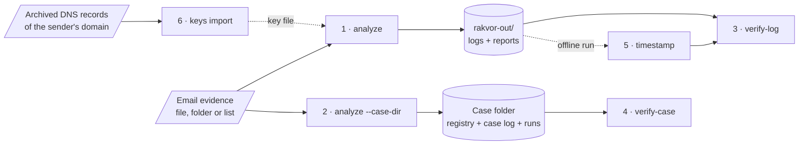
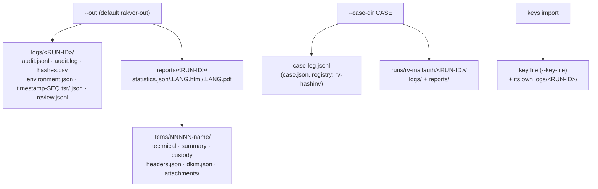

# Quick guide

RV MailAuth looks for signs that an email was changed after it was sent, or is not what it claims to be. It reads each
piece of evidence you give it (`.eml`, Outlook `.msg` or `.mbox`: one file, a folder or a list of files) without
changing it, hashes it, and checks every DKIM signature and the ARC chain offline with the public keys you supply,
the Received hops against each other and against the Date header, the Message-ID, the attachments and the signals of
business-email compromise (lookalike domains, display names, Reply-To elsewhere, payment details). Each message is
parsed in a separate worker process. It writes reports for the examiner and for the client, and records every action
in a hash-chained audit log. Its findings are **signals, not verdicts**: each one says what it shows and what it does
not prove. A message without findings is not proven authentic, and a finding does not prove forgery, nor show who
changed the message or why; a valid DKIM signature does not show who wrote the message. This page covers the six
common tasks. The full guide is [usage.md](usage.md), and every option is in [usage-cli.md](usage-cli.md).



## Two ways to use it

| Mode | Program | When to use it |
| --- | --- | --- |
| Desktop app (GUI) | `rv-mailauth-gui.exe` (Start menu: *RV MailAuth*) | Windows 10/11. You pick the evidence, the key file and the options in one window, press **Start review**, then **Open** a message to see it in the message viewer. |
| Command line (CLI) | `rv-mailauth.exe` | Scripts, batches, the verification commands (`verify-log`, `verify-case`, `timestamp`) and the DKIM key files (`keys`). |

Both use the same engine. With the same evidence, key file and options they give the same hashes and findings, and
both write the same files.

## Desktop app: what each button does

Nothing is written to disk until you press **Start review**. Each change you make before that is kept in memory,
then written to the run's audit log as a `ui_*` entry when the run starts. Opening a message after the run is written
to the run's review log (`review.jsonl`).

| Button or box | What it does | What it writes |
| --- | --- | --- |
| **Add files…** | Opens the Windows file picker and adds the chosen files to the evidence list. | `ui_input_added` (one per file) |
| **Add folder…** | Adds a whole folder. | `ui_input_added` |
| **Add path** | Adds the path typed in the box next to it (pressing Enter does the same). | `ui_input_added` |
| Drag and drop | Files or folders dropped onto the window are added to the evidence list, as with **Add files…**. | `ui_input_added` |
| **x** (next to an entry) | Removes that entry from the evidence list. | `ui_input_removed` |
| **Include subfolders** | On by default: the folders are read with their subfolders. | `ui_recursive_changed` |
| **Browse…** next to **Case folder** | Chooses the shared case folder. The output folder then becomes `<case>/runs/rv-mailauth/<RUN-ID>` and you can no longer edit it. | `ui_case_dir_changed` |
| Hash algorithm tick boxes (md5 … blake3) | One or two algorithms (default sha256). With two ticked, the others are disabled. | `ui_hash_selection_changed` |
| **Report language** | English, Español, Français, or all three. | `ui_language_changed` |
| **Browse…** next to **Output folder** | Chooses where `logs/` and `reports/` are written (default `rakvor-out`). | Nothing until the run: the folder used is recorded in `environment.json` |
| **Examiner** and **Case ID** (text fields) | The examiner's name (default: your Windows user) and an optional case reference. | Nothing until the run: the examiner is written in every audit entry and report, the case ID on the reports |
| **Custody form** | Colombia (Fiscalía) or France (scellé); an English copy is always added. | `ui_jurisdiction_changed` |
| **Trusted timestamp** (tick box and address) | On by default. Asks the RFC 3161 authority at that address to timestamp the audit log. | `ui_timestamp_changed` |
| **Browse…** next to **Signing certificate (.p12/.pfx)** | Chooses your certificate. Each PDF report is then signed with it. Type the **Certificate password** in the field below it. The password is kept in memory only and is never logged. | `ui_signing_certificate_changed` (the path only) |
| **Browse…** next to **DKIM key file** | Chooses the key file (as written by `keys import`, Task 6) whose public keys verify the DKIM and ARC signatures offline. Without it, signatures are `DKIM_KEY_NOT_AVAILABLE` (a body-hash mismatch is still found). | `ui_dkim_keys_changed` |
| **Fetch today's DNS keys (weaker evidence)** | Off by default. Looks up the keys missing from the key file in today's DNS. Each lookup is audited and each result based on it is flagged `DKIM_KEY_FROM_CURRENT_DNS`. | `ui_online_dns_changed` |
| **Add** (and **x** next to a domain) under **Own domains** | Adds the domain typed in the box (pressing Enter does the same), or removes one. Your organisation's domains are the reference for the lookalike-domain and display-name checks. | `ui_own_domain_added`, `ui_own_domain_removed` |
| **Extract attachments (attachments/ in each message folder)** | Off by default. Copies every attachment, decoded, into the message's folder (it is always listed with its SHA-256). | `ui_extract_attachments_changed` |
| **All items** / **Flagged items only** (Item reports) | Per-item reports for every item, or only for items with a finding above informational. | `ui_item_reports_changed` |
| **Start review** | Starts the run with the settings shown. | `ui_start_clicked`, then the whole run (see [Where the outputs go](#where-the-outputs-go)) |
| **Cancel** | Stops after the message being read and writes partial reports. | `item_cancelled`, `run_cancelled` |
| **Open report** | Opens the statistics report (`statistics.<LANG>.html`) of the finished run. | Nothing |
| **Open log folder** | Opens the run's log folder. | Nothing |
| **Open** (one per row of the Results table) | Opens the message viewer on that message, after checking `headers.json` and `dkim.json` against the digests in the audit log (shown only when they match). | `ui_message_viewed` (or `ui_message_refused`) in `review.jsonl` |
| **Back to results** | Leaves the message viewer. | Nothing |
| **Evidence IDs** (result panel) | After a run in a case folder, lists each item's evidence id (E0001…) and its registry check. Read-only. | Nothing |
| **Warnings** (result panel) | Lists the errors met during the run. Read-only. | Nothing here: the run logs each error as `item_error` |

The timestamp is eIDAS-qualified only if the TSA address is that of a qualified trust service provider (QTSP) on an EU
trusted list; the default address (DigiCert) is not one.

The selectors are recorded too: **Clock skew tolerated (s)** (`ui_clock_skew_changed`), **mbox variant**
(`ui_mbox_variant_changed`), and under **Worker limits (advanced)** the timeout per message, memory per worker,
largest message parsed and messages analysed per mbox (`ui_worker_timeout_changed`, `ui_worker_memory_changed`,
`ui_max_message_size_changed`, `ui_max_mbox_messages_changed`). The **Interface language** selector (top right) is
recorded as `ui_interface_language_changed`. When RV Hub opens the app on a case folder, the log starts with
`ui_case_dir_from_launcher`.

## Task 1: Analyse an email or a folder

1. Check the build once on this PC: `rv-mailauth self-test` must print `PASS` for every algorithm (exit code 0).
2. Run the analysis on a verified copy of the evidence, never on the original media, with the DKIM key file of the
   sender's domain (Task 6 makes one; here the sample's `dkim-keys.txt`) and your own domain. Leave out
   `--no-timestamp` when the PC can reach the TSA: the run then also obtains the timestamp (`timestamp: ok …`).

   ```powershell
   rv-mailauth analyze -i evidence -r --hash sha256,md5 --lang es --case CASE-2026-014 --actor "Ana Ruiz" --dkim-keys dkim-keys.txt --own-domain acme.example --no-timestamp
   ```

3. Read the summary. On a copy of the sample evidence (`examples\sample\evidence`, 16 files, one of them an mbox of
   three messages) in `evidence`, offline (`--no-timestamp`), the command above prints:

   ```text
   DONE (high-severity findings)  run 20261126T214931Z-ad6f3e
     items: 19  bytes: 63410  errors: 0  elapsed: 4.0 s
     findings: high 2, medium 13, low 7, info 10
     timestamp: off
     report: rakvor-out\reports\20261126T214931Z-ad6f3e\statistics.es.html
     logs:   rakvor-out\logs\20261126T214931Z-ad6f3e
   ```

4. Open the `report:` file. Then, for each item, open `technical.<LANG>.html` (for the examiner) or
   `summary.<LANG>.html` (for the client), or **Open** the message in the desktop app to see its hops, its DKIM table
   and its findings.

**What it writes:** `rakvor-out/logs/<RUN-ID>/` (audit log, `hashes.csv`, `environment.json`) and
`rakvor-out/reports/<RUN-ID>/` (statistics report, and per item a technical review, a summary, a custody form,
`headers.json`, `dkim.json`, and for an mbox `mbox_index.json`).

**How to read the result:** `DONE` with exit code 0 means no high-severity finding. `DONE (high-severity findings)`
with exit code 3 is a normal outcome for evidence, not an error: the sample holds two messages whose body no longer
matches its DKIM signature (`DKIM_BODY_HASH_MISMATCH`). Open the items whose status is `problem` or `attention`. Each
finding states what it shows and what it does not prove; [usage.md](usage.md#4-interpreting-each-finding) says what
to check next for each code. A DKIM result is only as good as the key: use the key published when the message was
sent. `timestamp: pending` means that the authority could not be reached (see Task 5).

Analysis options:

| Option | What it sets |
| --- | --- |
| `--input` (`-i`) | A file or folder to review. Repeat it for several. |
| `--input-list` (`-L`) | A text file with one path per line. |
| `--recursive` (`-r`) | Also read subfolders. |
| `--hash` (`-H`) | One or two of md5, sha1, sha256, sha512, sha3-256, blake3 (default sha256). |
| `--out` (`-o`) | Output folder (default `rakvor-out`). |
| `--lang` (`-l`) | Report language: en, es, fr or all. |
| `--actor` (`-a`) | Examiner name in the audit log and the reports. |
| `--case` (`-c`) | Case identifier printed on the reports. |
| `--progress` (`-p`) | bar, jsonl (one JSON event per line) or none. |
| `--jurisdiction` (`-j`) | Custody form: co (Colombia) or fr (France). |
| `--tsa-url` | RFC 3161 authority (default `http://timestamp.digicert.com`). |
| `--no-timestamp` | No timestamp request (offline labs). |
| `--sign-cert` | Your `.p12`/`.pfx` certificate: each PDF report is signed with it. |
| `--sign-pass-env` | The environment variable that holds its password (default `RV_SIGN_PASSWORD`). |
| `--dkim-keys` | The DKIM key file (Task 6) used to verify the signatures offline. |
| `--online` | Also look up the missing keys in today's DNS (weaker evidence; every lookup is audited). |
| `--own-domain` | Your organisation's domain, for the lookalike and display-name checks. Repeat it for several. |
| `--extract-attachments` | Copy every attachment, decoded, into the item folder. |
| `--clock-skew` | Clock difference tolerated between servers, in seconds (default 300). |
| `--mbox-variant` | mboxrd (default) or mboxo: how `>From ` body lines are un-escaped. |
| `--max-message-mb` | Largest message parsed, in MiB (default 200). |
| `--max-mbox-messages` | Messages analysed per mbox (default 50000). |
| `--worker-timeout` | Seconds allowed for one message (default 120). |
| `--worker-memory-mb` | Memory limit of one worker process in MiB (default 1024). |
| `--isolation` | worker (default: one process per message) or in-process (debugging only). |
| `--item-reports` | all (default) or flagged: per-item reports only for items with a finding above informational. |
| `--case-dir` | The shared case folder (Task 2). |
| `--evidence` (`-E`) | Registered evidence ids to analyse (Task 2). |

## Task 2: Analyse evidence in a case folder

1. Choose one folder for the case, on the case volume, for example `cases\CASE-2026-014`. rv-mailauth is an analysis
   tool: it verifies each file against the evidence registry that the intake tool, rv-hashinv, writes. It never writes
   the registry itself.
2. Register the evidence with rv-hashinv first (it creates the case):

   ```powershell
   rv-hashinv scan -i evidence -r --case-dir cases\CASE-2026-014 --case CASE-2026-014 --jurisdiction co --no-timestamp
   ```

3. Analyse every registered item:

   ```powershell
   rv-mailauth analyze --case-dir cases\CASE-2026-014 --dkim-keys dkim-keys.txt --own-domain acme.example --no-timestamp
   ```

4. Read the last line of the summary:

   ```text
     case:   CASE-2026-014 (analysis) registered 0 (new 0), verified 16, mismatched 0, not in registry 0
   ```

5. Later, to analyse some registered items again, give their ids:

   ```powershell
   rv-mailauth analyze --case-dir cases\CASE-2026-014 --evidence E0003,E0004 --dkim-keys dkim-keys.txt --no-timestamp
   ```

**What it writes:** the run under `runs/rv-mailauth/<RUN-ID>/logs` and `/reports`, and its `run_started` and
`run_finished` entries in `case-log.jsonl` (rv-hashinv writes `case.json`, the registry `evidence/registry.json` and
`.csv` and its own run under `runs/rv-hashinv/`).

**How to read the result:** `verified` counts the files whose hashes match the registry (16: the three messages of the
mbox are items derived from one registered file). A file that differs from the registry gets the high finding
`EVIDENCE_HASH_MISMATCH_WITH_CASE` (it is still analysed); a file not in the registry gets
`EVIDENCE_NOT_IN_CASE_REGISTRY` (medium). Exit code 3 before anything is read means that the case folder failed
verification: nothing was written to it (run Task 4). Exit code 2 means a usage error, for example a folder that
belongs to another case or an unknown evidence id.

## Task 3: Verify a run's audit log

1. Point `verify-log` at the run's log folder (or at the `audit.jsonl` in it):

   ```powershell
   rv-mailauth verify-log rakvor-out\logs\20261126T214931Z-ad6f3e
   ```

2. Read the output:

   ```text
   OK  139 entries, chain intact: rakvor-out\logs\20261126T214931Z-ad6f3e\audit.jsonl
       truncation not detectable without a timestamp or case record
       outputs: 251 verified of 251 recorded (md5, sha256)
   ```

3. If the run has a timestamp, add `--tsa-ca <TSA roots.pem>` to also check the TSA certificate chain against the
   TSA's own root certificates.

**What it writes:** nothing. It only reads.

**How to read the result:** `OK` (exit code 0) means that no entry was edited, deleted or re-ordered, that each
timestamp token matches, that the review log (messages opened in the viewer, `review entries: N`) is intact, and that
each report, `headers.json`, `dkim.json`, `hashes.csv` and `environment.json` still has the digest the log recorded.
The `truncation` line says what anchors the end of the log: a run without a timestamp and outside a case folder cannot
prove that no entry was removed from its end. `BROKEN` (exit code 3) lists one problem per line. Exit code 1 means
that the log or the `--tsa-ca` file cannot be read. Revocation of the TSA certificate is never checked.

## Task 4: Verify a whole case

1. Run `verify-case` on the folder that holds `case.json`; `--rehash` also reads every registered item again:

   ```powershell
   rv-mailauth verify-case cases\CASE-2026-014 --rehash
   ```

2. Read the output (after Task 2: the rv-hashinv intake run and the two rv-mailauth runs):

   ```text
   OK  case CASE-2026-014: 8 case-log entries, 16 registered items, 3 runs verified: cases\CASE-2026-014
       outputs: 463 verified of 463 recorded by the runs' audit logs
       re-hashed 16 of 16 registered items: 16 match the registry
   ```

**What it writes:** nothing. It only reads.

**How to read the result:** `OK` (exit code 0) means that the case log, the registry, every run's audit log and review
log (of every Rakvor tool) and the runs' recorded outputs are intact, and (with `--rehash`) that every reachable
registered item still matches the registry. Warnings (for example a run still in progress) are printed but do not fail
the check. `BROKEN` (exit code 3) lists each failed check. Exit code 1 means that the folder is not a case folder (no
`case.json`).

## Task 5: Add the timestamp after offline work

1. Offline, run the analysis as usual, or with `--no-timestamp` (or `RV_NO_TIMESTAMP=1`) so that no request is sent.
   Without `--no-timestamp`, the summary shows `timestamp: pending`.

   ```powershell
   rv-mailauth analyze -i evidence\03-body-edited.eml -o offline --dkim-keys dkim-keys.txt --no-timestamp
   ```

2. Once the network is back, timestamp the run's log folder:

   ```powershell
   rv-mailauth timestamp offline\logs\20261126T214959Z-2bd532
   ```

3. Read the result: `OK  timestamp 2026-11-26T21:50:08Z by http://timestamp.digicert.com covers entry #14`. Use
   `--tsa-url` to choose another authority, and `--actor` to name the examiner in the new audit entry.
4. Run Task 3 on the same folder. It now shows the timestamp line and `TSA signature valid`:

   ```text
   OK  15 entries, chain intact: offline\logs\20261126T214959Z-2bd532\audit.jsonl
       timestamp 2026-11-26T21:50:08Z by http://timestamp.digicert.com covers entry #14: TSA signature valid (signer: CN=DigiCert SHA256 RSA4096 Timestamp Responder 2026 1,O=DigiCert\, Inc.,C=US); chain not checked (pass --tsa-ca <CA bundle> to validate it)
       truncation: entries up to #14 are anchored by the RFC 3161 timestamp (timestamp-00014.json); 1 entry after it (timestamp_obtained) cannot be proven complete
       outputs: 18 verified of 19 recorded (sha256), 1 skipped
       not re-hashed: logs/timestamp-00014.tsr (RFC 3161 token: checked by the timestamp verification)
   ```

**What it writes:** `timestamp-<SEQ>.tsr` (the RFC 3161 token) and `timestamp-<SEQ>.json` in the log folder, and
the `timestamp_obtained` entry in `audit.jsonl`.

**How to read the result:** exit code 0 means that the timestamp was obtained and logged. Exit code 1 means that the
authority could not be reached; nothing changed, so try again later. Exit code 3 means that the log is missing or
broken; no timestamp is added to a broken log. The timestamp proves when the log existed, not that the evidence is
authentic.

## Task 6: Prepare the DKIM key file

1. Obtain the DKIM records that the sender's domain published **when the messages were sent**: an archived zone file,
   the provider's records, or a passive-DNS service with dates. Note where each one comes from.
2. Import them into a new key file. Here the sample's public keys stand in for an archived zone:

   ```powershell
   rv-mailauth keys import dns-archive-2026-03.zone --key-file case-keys.txt --case CASE-2026-014 --actor "Ana Ruiz" --no-timestamp
   ```

3. Read the result:

   ```text
   OK  4 DKIM keys written to case-keys.txt (sha256 7dde2edfacfc696892a6467c614dfae72c335309a736728bdf7f04fed640e331)
       source dns-archive-2026-03.zone sha256 f5de4068b295824c6f4d9b27fd4a936ed63bcc624be6c67b24a3f0e85f09092e
       timestamp: off
       logs: rakvor-out\logs\20261126T214921Z-d9e57b
   ```

   `--out` (`-o`) sets where the import's own log folder goes (default `rakvor-out`); `--tsa-url` and
   `--no-timestamp` work as for `analyze`.
4. Check what the key file holds:

   ```powershell
   rv-mailauth keys show case-keys.txt
   ```

   ```text
   case-keys.txt  sha256 7dde2edfacfc696892a6467c614dfae72c335309a736728bdf7f04fed640e331
   LINE  SELECTOR                 DOMAIN                           TYPE      BITS
   4     ed2026                   example.org                      ed25519    256
   5     m1                       mailer.example.com               rsa       2048
   6     s2025                    example.org                      rsa       2048
   7     s2026                    example.org                      rsa       2048
   4 usable keys, 0 records not usable
   ```

5. Give the key file to the analysis with `--dkim-keys case-keys.txt` (GUI: **Browse…** next to **DKIM key file**).

**What it writes:** the key file named by `--key-file` (never overwritten) and the import's audit log under
`<--out>/logs/<RUN-ID>/` (the SHA-256 of every source and of the key file). `keys show` writes nothing.

**How to read the result:** the key file's SHA-256 appears in the audit log of every analysis that uses it. Exit code
0 means that the key file was written (`keys show`: every record is a usable DKIM key). Exit code 1 means a source that
cannot be read or a key file that already exists; exit code 2 a malformed DKIM record, two different keys under one
name, or no DKIM record at all (nothing is written). A key published today may not be the one that signed an old
message: keys are rotated.

## Other commands

| Command | What it does |
| --- | --- |
| `rv-mailauth self-test` | Checks every hash algorithm against published test values. |
| `rv-mailauth keys` | Groups `import` and `show` (Task 6). |
| `rv-mailauth update-check` | Tells you whether a newer release is published. It only notifies: nothing is downloaded. `RV_NO_UPDATE_CHECK=1` turns it off. |
| `rv-mailauth describe --json` | Prints the tool's description for RV Hub. It reads and writes nothing. |

## Exit codes

| Code | Meaning | Returned by |
| --- | --- | --- |
| 0 | Completed; no high-severity finding (verification commands: everything checked is intact; `keys show`: every record is a usable key). | every command |
| 1 | Runtime error: input not found, output not writable, case log locked, wrong certificate password, TSA unreachable (`timestamp` only; `analyze` shows `timestamp: pending` and goes on), not a case folder, a failed self-test, a key source that cannot be read or a key file that already exists, or an update check that could not be made. | `analyze`, `keys`, `verify-log`, `verify-case`, `timestamp`, `self-test`, `update-check` |
| 2 | Usage error: unknown option, bad value, more than two algorithms, a `--dkim-keys` file that cannot be read, an invalid `--own-domain`, case folder of another case, unknown evidence id; or (`keys`) a record that is not a usable DKIM key. | every command (unknown option); `analyze`, `keys import`, `keys show` |
| 3 | At least one high-severity finding, a broken log, a failed case check, or (for `update-check`) a newer release. | `analyze`, `verify-log`, `verify-case`, `timestamp`, `update-check` |
| 130 | Cancelled with Ctrl+C: partial reports are written and the cancellation is in the audit log. | `analyze` |

## Where the outputs go



Without `--case-dir`, each run creates `logs/<RUN-ID>/` and `reports/<RUN-ID>/` under `--out` (default
`.\rakvor-out`, relative to the current folder). With `--case-dir`, they go to `<CASE>/runs/rv-mailauth/<RUN-ID>/`.
Keep the log folder with the reports, and the key file with its import log: they are the proof of what was done.
