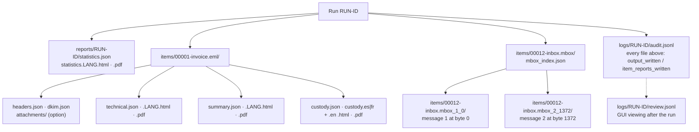
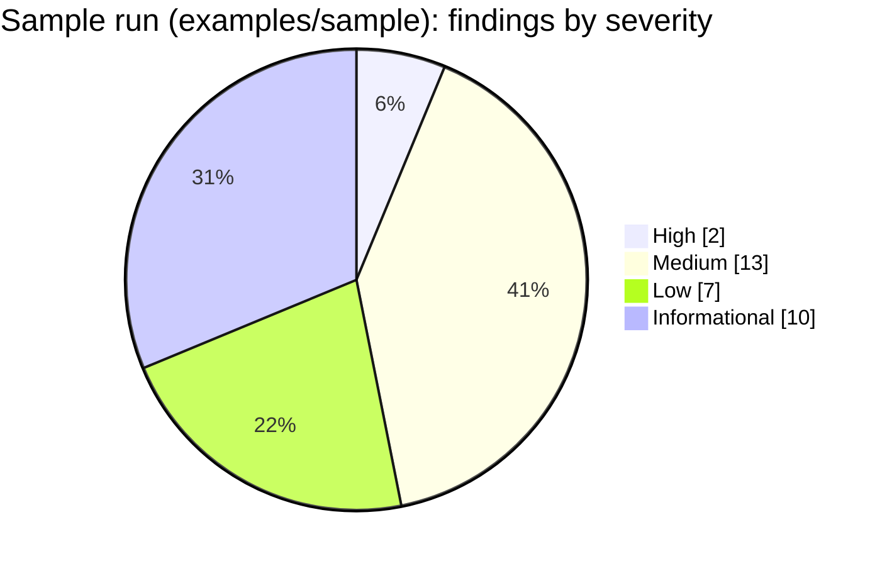

# Reports and outputs

Every run writes one **statistics report** and, for every item, a **technical review** (for examiners and
lawyers), a **customer summary** (plain language) and a **chain-of-custody form**. Each exists as JSON
(machine-readable, language-neutral) plus HTML and PDF in each selected language (`--lang en|es|fr|all`). Next to
them, every message folder holds the **per-message outputs** the analysis worked from (`headers.json`,
`dkim.json`, and with `--extract-attachments` the decoded attachments). Every file is hashed with the run's
algorithms and recorded in the audit log, so a report or output changed after the run is detectable.

## Contents

- [Report kinds](#report-kinds)
- [Per-message outputs](#per-message-outputs)
- [Status and severity](#status-and-severity)
- [Findings catalogue](#findings-catalogue)
- [Limitations printed in every report](#limitations-printed-in-every-report)
- [JSON schemas](#json-schemas)
- [Branding, signatures and PDF notes](#branding-signatures-and-pdf-notes)

## Report kinds

| Section | Statistics | Technical review | Customer summary |
| --- | :-: | :-: | :-: |
| Run ID, case, examiner, start/end, duration, interface | ✔ | ✔ (run ID, case) | case, date |
| Hash algorithms, totals, throughput | ✔ | | |
| Findings by severity and by code, items by detected type | ✔ | | |
| Duplicate groups (identical files) | ✔ | as finding | as finding |
| Item table: index, evidence id, file / message, size, status, finding count, link to the item's technical review | ✔ | | |
| Full path, size, modified time, detected type (`.eml`, `.msg`, mbox, message in an mbox), all digests | | ✔ | file name, primary digest |
| mbox message: source mbox path and digests, message number, byte offsets (separator and first header line), length | | ✔ (*Derived from*) | ✔ |
| Email sections: addresses, Received hops, DKIM/ARC table with key source and alignment, header table, Authentication-Results as stated, attachments with SHA-256 and embedded dates, BEC signals | | ✔ | plain sentences |
| Findings with **what it shows / what it does not prove** | | ✔ | plain sentence |
| Method, limitations | ✔ (limitations) | ✔ | "What we did" |
| Audit entries covering the item | | ✔ (`#first – #last`) | |
| Status and recommended next step | | ✔ | ✔ |

**`--item-reports flagged`.** Items whose status is `ok` (nothing above informational) get no technical, summary
or custody files; each skip is audited (`item_reports_skipped`). Their folder still holds the per-message outputs.
The statistics report lists them **without a link** — the name is followed by "no item report: flagged-only
mode" and a note above the table explains the mode — and `statistics.json` sets `item_reports: "flagged"` and,
per item, `item_reports_written: false` with `report_skipped: "item_reports_flagged_only"`.

**Case folder.** With `--case-dir` every report shows the item's **evidence id** (`E0001`…; a message of an mbox
carries the id of its mbox), the statistics report adds a *Case folder* section (registered, verified, mismatched,
not registered), and the custody form uses the case id, the evidence id and the intake date — see
[case-folder.md](case-folder.md).

**Size.** Item reports never list every other file: duplicate partners are capped at 10 names ("… (+N)"); the
complete groups are in the statistics report and `hashes.csv`. Lists inside a message are capped too (100
Received hops, 50 recipients, 200 attachments, 20 signatures, 20 Authentication-Results headers; raw values at 998
characters) and the totals are always given (`hops_total`, `attachments_total`, …).

## Per-message outputs

Written by the analysis (in the worker process by default) into the item folder, then hashed and recorded by the
run (`output_written`, with every digest). The GUI message viewer shows `headers.json` and `dkim.json` only when
their digests still equal the audited ones.

| File | Schema value | Holds |
| --- | --- | --- |
| `headers.json` | `rv-mailauth.headers/1` | `bytes` and `sha256` of the message analysed (for an mbox message: the un-escaped bytes); `locator` (kind, and for an mbox message the source mbox path and digests, `n`, `offset`, `message_offset`, `length`, the `From ` separator line); `headers`: From, Sender, Reply-To, Return-Path, recipients, Subject, Message-ID, Date as written and in UTC with its zone, every Received hop (`position` 1 = closest to the sender, `header_index` 0 = topmost header, from/by/with/id/for, date raw/UTC/zone), Authentication-Results as stated, MIME part count and structure problems, and for `.msg` the MAPI properties (`msg`: subject, sender, sent-representing, Internet Message-ID, submit and delivery times, whether transport headers were stored); `attachments` (index, name, content type, size, SHA-256, creation/modification dates raw and UTC, extracted path) |
| `dkim.json` | `rv-mailauth.dkim/1` | `mode` (offline/online), `evaluated` and why not, the key file path, SHA-256, keys loaded and problems; per signature: `d=`, `s=`, algorithm, canonicalization, signed header fields, `i=`, `l=`, `t=`, `x=`, `result` (`pass`, `body_hash_mismatch`, `signature_invalid`, `key_not_available`, `not_evaluated`), verifier reason, `key_source` (`key_file` with its line, `current_dns`, `none`), `aligned_with_from`; `arc`: instances and result (`none`, `pass`, `invalid`, `key_not_available`, `not_evaluated`) |
| `attachments/NNN-<name>` | — | `--extract-attachments` only: each attachment decoded, numbered as in `headers.json` (name sanitised to letters, digits, `.`, `-`, `_`, at most 60 characters) |
| `mbox_index.json` | `rv-mailauth.mbox-index/1` | In the mbox's own folder: the mbox path, size, `variant` (mboxrd/mboxo), `count`, `not_analysed` (beyond `--max-mbox-messages`) and every message: `n`, `offset` of its `From ` line, `message_offset`, `length`, the separator line and its stable id `<mbox path>#<n>@<offset>` |
| `review.jsonl` (in `logs/<RUN-ID>/`) | `rakvor.review/1` | Written by the GUI when a message is opened after the run: `ui_message_viewed` (item, files and digests, digest check passed) or `ui_message_refused` (digest differs, nothing shown). A hash chain of its own whose first entry links to the run's `run_finished` entry; `verify-log` and `verify-case` check it and print "review entries: N" |

A message of an mbox is a **derived item**: it has its own row in `hashes.csv` (`<mbox>#<n>@<offset>`, digests of
the stored bytes read again from the mbox), its own folder `<NNNNN>-<mbox name>_<n>_<offset>` and its own reports,
and every one of them cites the source mbox's digests, the message number and the byte offsets
(`derived_from` in `technical.json` and `custody.json`, `locator.mbox` in `headers.json`). Anyone can cut the same
bytes out of the registered mbox and check them.

## Status and severity

| Severity | Examples | Item status | Exit code of the run |
| --- | --- | --- | --- |
| High | `DKIM_BODY_HASH_MISMATCH`, `EVIDENCE_HASH_MISMATCH_WITH_CASE` | `problem` | 3 if any item has one |
| Medium | `DKIM_SIGNATURE_INVALID`, `LOOKALIKE_DOMAIN`, `MSG_TRANSPORT_HEADERS_MISSING` | `attention` | 0 |
| Low | `DKIM_NOT_SIGNED`, `TIMEZONE_INCONSISTENT` | `attention` | 0 |
| Informational | `DKIM_SIGNATURE_VALID`, `DKIM_KEY_NOT_AVAILABLE`, `PAYMENT_DETAILS_MENTIONED` | `ok` | 0 |

`DKIM_SIGNATURE_INVALID` is medium on purpose: with a matching body hash the failure can come from edited signed
header fields **or** from a key that is not the one that signed (a rotated key), and the tool cannot tell which
([ADR 0004](adr/0004-email-design-decisions.md)).

## Findings catalogue

The table below is generated from `i18n/en.json` (the wording printed in the English reports) and the severities
in `src/core/src/model.rs`; `src/core/tests/docs_catalogue.rs` fails when they differ. `%{name}` is replaced by
the finding's parameter (shown in the technical review and in `technical.json` → `findings[].params`). The Spanish
and French wording is in `i18n/es.json` and `i18n/fr.json` (same keys, enforced by a test). `REGISTRY_PATH_CONTENT_CHANGED` is
worded because the case-folder code is shared, but only intake tools (rv-hashinv) emit it.

<!-- findings-catalogue:start (generated from i18n/en.json by src/core/tests/docs_catalogue.rs; do not edit by hand) -->

### Email findings

| Code | Severity | Title | What it shows | What it does not prove |
| --- | --- | --- | --- | --- |
| `DKIM_BODY_HASH_MISMATCH` | High | DKIM body hash does not match | The DKIM signature of %{d} (selector %{s}) records a hash of the message body that differs from the hash of the body as it is now: the body is not the one that was signed. | It does not show who changed the body, when, or why: forwarding systems, mailing lists, antivirus footers and re-encoding by a mail client also change bodies after signing. |
| `DKIM_SIGNATURE_INVALID` | Medium | DKIM signature does not verify | The body still matches the DKIM signature of %{d} (selector %{s}), but the signature over the signed header fields does not verify with the supplied public key (key source: %{key_source}; verifier: %{reason}). Either signed header fields changed after signing, or the supplied key is not the one that signed (for example a rotated key). | It does not tell which of the two happened, nor who changed a header or why; with a rotated or wrong key a genuine message gives the same result. |
| `DKIM_KEY_FROM_CURRENT_DNS` | Medium | DKIM key taken from today's DNS | The key for %{d} (selector %{s}) was not in the examiner's key file and was fetched from the DNS at the time of the analysis (online mode). | A key published today may not be the key that signed the message; a pass or a failure with it says nothing certain about the key valid at sending time. |
| `DKIM_DOMAIN_NOT_ALIGNED` | Medium | Valid DKIM signature from another domain | The message carries a valid DKIM signature only for %{d}, which does not share its organisational domain with the From domain %{from_domain}. | Sending services, mailing lists and outsourced mail commonly sign with their own domain; it does not show that the From address was spoofed. |
| `ARC_CHAIN_INVALID` | Medium | ARC chain does not validate | The message has %{instances} ARC set(s) and the chain does not validate (%{reason}). | An intermediary may have broken the chain, or the keys of the sealers may not have been supplied; it does not show that the message was tampered with. |
| `RECEIVED_TIME_NOT_MONOTONIC` | Medium | Received times go backwards | Hop %{hop} was stamped %{hop_date}, %{earlier_by_s} s before the previous hop %{previous_hop} (%{previous_date}), beyond the tolerated clock difference (%{count} such step(s)). | Server clocks are sometimes wrong and some servers add Received headers out of order; it does not show that a header was inserted or edited. |
| `DATE_AFTER_FIRST_HOP` | Medium | Date header later than the first server | The Date header (%{date}) is %{later_by_s} s later than the time the first server received the message (%{first_hop_date}). | The sender's clock may be wrong; it does not show that the date was changed after sending. |
| `MSG_TRANSPORT_HEADERS_MISSING` | Medium | Outlook message without transport headers | The .msg file has no PR_TRANSPORT_MESSAGE_HEADERS property: the original header section (Received hops, DKIM signatures, Authentication-Results) is not available, so DKIM was not attempted. | Drafts, sent items and messages saved by some tools never had these headers; it does not show that they were removed. |
| `ATTACHMENT_DATE_AFTER_SENT` | Medium | Attachment dated after the message | The %{field} date of attachment %{attachment} (%{attachment_date}) is later than the message Date (%{date}). | These dates are written by the sending client and are easy to get wrong or to set freely; it does not show that the attachment was swapped. |
| `LOOKALIKE_DOMAIN` | Medium | Domain resembles an own domain | The %{header} domain %{domain} (%{domain_unicode}) resembles the own domain %{own_domain} (method: %{method}). | Similar names also belong to legitimate, unrelated organisations; it does not show an intent to deceive. |
| `REPLY_TO_DIFFERS` | Medium | Replies go to another organisation | The %{header} address %{address} does not share its organisational domain with the From domain %{from_domain}. | Help desks, mailing lists, bulk senders and bounce handling legitimately use other addresses; it does not show that replies are being diverted. |
| `DISPLAY_NAME_SPOOF` | Medium | Display name suggests another sender | The display name "%{display_name}" of %{address} contains another address or an own-organisation name while the address is external (%{reason}). | People write names freely and partners mention the organisation they work with; it does not show impersonation. |
| `FILE_STRUCTURE_DAMAGED` | Medium | File structure damaged or incomplete | The %{format} structure is not complete or not well formed (%{problems}); what could be read was analysed. | Truncated copies, interrupted exports and non-standard writers cause this too; it does not show deliberate damage. |
| `PARSER_FAILED` | Medium | Message analysis not completed | The analysis of this message did not complete (reason: %{reason}, exit code %{exit_code}); its email findings are missing. | It does not show that the file is malicious or damaged; size limits, time limits and unusual content also stop an analysis. |
| `DKIM_NOT_SIGNED` | Low | No DKIM signature | The message carries no DKIM-Signature header. | Many legitimate servers do not sign, and a missing signature is common; it proves nothing about authenticity either way. |
| `DKIM_SIGNATURE_NOT_EVALUATED` | Low | DKIM signature not evaluated | The DKIM signature of %{d} (selector %{s}) could not be evaluated (%{reason}). | An expired, unsupported or partial (l=) signature, or a .msg file whose original body is not stored, cannot be checked; it says nothing about the message. |
| `TIMEZONE_INCONSISTENT` | Low | Time zone inconsistent | The Date header uses zone %{date_zone} while the sender organisation's first server used %{hop_zone} (%{reason}). | Clients and servers are often set to different zones, travellers keep their home zone; it does not show that the date was edited. |
| `MESSAGE_ID_DOMAIN_MISMATCH` | Low | Message-ID from another domain | The Message-ID was generated under %{message_id_domain}, not under the From domain %{from_domain}. | Mail clients, sending services and webmail hosts generate Message-IDs with their own names; it does not show that the message is forged. |
| `DKIM_KEY_NOT_AVAILABLE` | Informational | DKIM key not available | No public key for %{name} was supplied, so the signature of %{d} (selector %{s}) could not be checked (offline analysis, no DNS query). | It says nothing about the signature; supply the key that was valid at sending time to check it. |
| `PAYMENT_DETAILS_MENTIONED` | Informational | Payment details mentioned | The subject or text mentions payment details: %{terms}. | Invoices and payment notices mention bank details all the time; it is a pointer for review, not a sign of fraud. |
| `DKIM_SIGNATURE_VALID` | Informational | DKIM signature verifies | The DKIM signature of %{d} (selector %{s}, %{a}) verifies with the key from %{key_source}: the signed header fields and the body are unchanged since signing. | It shows only that whoever held the private key of %{d} signed this content; it does not show who wrote it, that the From address is truthful, or that unsigned header fields are original. |
| `AUTH_RESULTS_RECORDED` | Informational | Receiving server's checks recorded | %{count} Authentication-Results header(s); the top one, written by %{authserv_id}, states: %{results}. | These are claims written into the message by a server; anyone handling the file could have added or edited them, and they were not re-checked. |

### Pipeline findings (non-email files, read errors, duplicates, case folder)

| Code | Severity | Title | What it shows | What it does not prove |
| --- | --- | --- | --- | --- |
| `EVIDENCE_HASH_MISMATCH_WITH_CASE` | High | Differs from the evidence registered in the case | The %{algorithm} of this file is %{actual}, but evidence %{evidence_id} was registered at intake with %{expected}: the file examined is not bit-identical to the registered item. | Who changed the file, when, or whether the change was deliberate; the analysis still ran so the examiner can decide. |
| `EXECUTABLE_CONTENT` | High | Executable content under another name | The content is a %{detected} program although the name ends in .%{extension}. | It does not show that the program is malicious; analyse it in an isolated environment. |
| `UNREADABLE` | High | File could not be read | Reading failed: %{error}. | It does not show that the file is damaged; permissions or locks can cause this. |
| `EVIDENCE_NOT_IN_CASE_REGISTRY` | Medium | Not registered in the case | No item of case %{case_id} was registered with this path or this content, so its continuity from intake cannot be shown. | That the file is altered or irrelevant; it may simply not have gone through intake. |
| `EXTENSION_MISMATCH` | Medium | Extension does not match content | The name ends in .%{extension} but the content starts with the signature of a %{detected} file. | Renaming is common and often innocent; it does not by itself prove an attempt to hide content. |
| `REGISTRY_PATH_CONTENT_CHANGED` | Medium | Registered path now holds different content | This path was registered earlier as %{previous_id} with other content; the current content gets a new evidence ID. | Which version is the original or why the content changed. |
| `DUPLICATE` | Informational | Duplicate content | Identical content (same %{algorithm}) appears in %{count} files: %{others}. | Identical hashes show identical content, not who copied the file or when. |
| `EMPTY_FILE` | Informational | Empty file | The file contains no data (0 bytes). | It does not show whether the file was emptied deliberately or created empty. |

<!-- findings-catalogue:end -->

## Limitations printed in every report

The wording, sorted by code and generated from `i18n/en.json` (the same test keeps it in step):

<!-- limitations:start (generated from i18n/en.json by src/core/tests/docs_catalogue.rs; do not edit by hand) -->

| Code | Text (en.json) |
| --- | --- |
| `BEC_HEURISTICS_FALSE_POSITIVES` | Lookalike-domain, Reply-To, display-name and payment-wording checks are heuristics with false positives and false negatives; the organisational domain comes from the bundled Public Suffix List, whose version is recorded in environment.json and may differ from the list in force when the message was sent. |
| `CLEAN_RESULT_IS_NOT_AUTHENTICITY` | A result without findings does not prove that a file is authentic or unaltered before acquisition. |
| `DKIM_NEEDS_KEY_AT_SENDING_TIME` | DKIM results depend on the public keys supplied: a check is only meaningful with the key that was valid when the message was sent. Keys are rotated, so a current key can fail a genuine message and a missing key leaves the signature unchecked. |
| `HEADERS_ARE_CLAIMS` | Received, Date and Authentication-Results headers are text that servers and clients wrote; unsigned headers can be added or edited by anyone who handled the file. |
| `MBOX_ESCAPING_AMBIGUOUS` | In an mbox, body lines starting with "From " are escaped with '>'; un-escaping follows the selected variant (mboxrd by default) and cannot always restore the original line, which can affect DKIM body hashes. |
| `MISSING_SIGNATURE_PROVES_NOTHING` | A missing DKIM signature is common and proves nothing; a valid signature covers only the signed header fields and the body, not who wrote the message. |
| `MSG_MAY_LACK_TRANSPORT_HEADERS` | Outlook .msg files do not keep the original message: the body is re-encoded (so DKIM cannot be checked) and the original header section is kept only when transport headers were stored. |
| `SIGNATURE_TABLE_LIMITED` | Type detection uses a limited table of common file signatures; unknown types are reported as unknown, not as suspicious. |
| `TIMESTAMPS_FROM_FILESYSTEM` | Modification times come from the file system of the examined copy and may differ from the original source. |
| `TIMESTAMP_PROVES_EXISTENCE_ONLY` | A trusted timestamp proves the audit log existed in this exact form at the stated time; it does not prove that the examined copy matches the original source. |

<!-- limitations:end -->

## JSON schemas

| File | `schema` value | Schema |
| --- | --- | --- |
| `statistics.json` | `rakvor.statistics/1` | [schemas/statistics.schema.json](../schemas/statistics.schema.json) |
| `technical.json` | `rakvor.item-technical/1` | [schemas/item-technical.schema.json](../schemas/item-technical.schema.json) |
| `summary.json` | `rakvor.item-summary/1` | [schemas/item-summary.schema.json](../schemas/item-summary.schema.json) |
| `custody.json` | `rakvor.item-custody/1` | [schemas/item-custody.schema.json](../schemas/item-custody.schema.json) |
| `case.json`, `evidence/registry.json` | `rakvor.case/1`, `rakvor.registry/1` | [case](../schemas/case.schema.json), [registry](../schemas/registry.schema.json) |
| `describe --json` | `rakvor.describe/1` | [schemas/describe.schema.json](../schemas/describe.schema.json) |

`headers.json`, `dkim.json` and `mbox_index.json` carry their own schema names (`rv-mailauth.headers/1`,
`rv-mailauth.dkim/1`, `rv-mailauth.mbox-index/1`); their fields are the ones listed above and are summarised in
`technical.json` → `email`. `python tests/validate_reports.py <run or case folder>` validates every JSON report
against `schemas/`. Adding a field is a minor change; removing or renaming one bumps the `/N` version.

## Branding, signatures and PDF notes

HTML and PDF reports carry the Rakvor header band (RV mark, *FORENSICS | INCIDENT RESPONSE | SECURITY* and the
tagline in the report language) on a light, printable page. With `--sign-cert`, each report shows the signer's
certificate subject and SHA-256 fingerprint (logged at `signing_certificate_loaded`, and in the JSON reports as
`run.pdf_signer_certificate_sha256`) and each PDF carries a CMS signature that Acrobat or
`pyhanko sign validate` can check. The statistics report shows the trusted timestamp (or a warning that it is
pending).

PDFs are produced by a small built-in writer (A4, Helvetica/Courier, WinAnsi encoding), so nothing has to be
installed on the examiner's PC. WinAnsi covers English, Spanish and French; characters outside it (for example a
Cyrillic lookalike domain) are printed as `?` in the PDF, while the HTML and JSON reports keep them exactly — quote
lookalike domains from the HTML or JSON, where the domain as written and its Unicode form (`domain_unicode`) are both given. Every report
file's digest is recorded in the audit log (`item_reports_written`, `statistics_report_written`).
