# Theory of operation

This page explains **why** each step of RV MailAuth works, at two levels:

- **[Part A — For clients, lawyers and judges](#part-a--for-clients-lawyers-and-judges)**: plain language,
  analogies and pictures. No knowledge of email systems or cryptography is needed.
- **[Part B — For examiners and opposing experts](#part-b--for-examiners-and-opposing-experts)**: algorithms,
  data structures, exact constants, the source file that implements each one, and the standards behind them.
  Every number in Part B is taken from the code of this commit or from the synthetic sample
  ([examples/](../examples/README.md)) run with the tool itself; where the code and a standard differ, Part B says
  so.

It describes what the tool **does**, not what it should do. Known weaknesses are stated where they apply and
collected in [admissibility.md](admissibility.md#consolidated-gap-list). How to run the tool:
[usage.md](usage.md). The exact wording of every finding: [reports.md](reports.md#findings-catalogue).

## Contents

- Part A: [A1 What the tool is](#a1-what-the-tool-is-and-is-not) ·
  [A2 Digital fingerprints](#a2-digital-fingerprints-hashes) ·
  [A3 What DKIM is](#a3-what-dkim-is-a-wax-seal-on-the-envelope) ·
  [A4 What a body hash shows](#a4-what-a-body-hash-shows) ·
  [A5 Why keys rotate](#a5-why-the-key-matters-and-why-keys-rotate) ·
  [A6 ARC](#a6-arc-seals-added-by-forwarders) ·
  [A7 Received headers](#a7-received-headers-the-postmarks) ·
  [A8 BEC signals](#a8-business-email-compromise-bec-signals) ·
  [A9 Outlook files and mailboxes](#a9-outlook-files-and-mailboxes) ·
  [A10 The tool's own diary](#a10-the-tools-own-diary-the-audit-log) ·
  [A11 Proving when](#a11-proving-when-trusted-timestamps) ·
  [A12 Signed reports and custody forms](#a12-signed-reports-and-custody-forms) ·
  [A13 What "no findings" means](#a13-what-no-findings-means)
- Part B: [B1 Source map](#b1-source-map-and-constants) ·
  [B2 Pipeline and isolation](#b2-pipeline-worker-isolation-and-reads-of-the-evidence) ·
  [B3 Hashing](#b3-single-pass-dual-hashing) ·
  [B4 Canonicalisation](#b4-dkim-canonicalisation) ·
  [B5 bh= and b=](#b5-the-body-hash-bh-and-the-header-signature-b) ·
  [B6 Offline keys](#b6-offline-key-injection-and-the-online-mode) ·
  [B7 ARC](#b7-arc) ·
  [B8 Hops and clock skew](#b8-received-hop-ordering-dates-and-clock-skew) ·
  [B9 Organisational domain](#b9-organisational-domain-from-the-public-suffix-list) ·
  [B10 Lookalikes](#b10-lookalike-domains-and-confusable-skeletons) ·
  [B11 Other BEC rules](#b11-reply-to-return-path-display-name-and-payment-wording) ·
  [B12 .msg and mbox](#b12-outlook-msg-and-mbox) ·
  [B13 Audit chain](#b13-the-audit-hash-chain) ·
  [B14 Case folder](#b14-the-case-folder) ·
  [B15 RFC 3161](#b15-rfc-3161-trusted-timestamp) ·
  [B16 Signed reports](#b16-signed-pdf-reports) ·
  [B17 Custody forms](#b17-custody-forms) ·
  [B18 Determinism](#b18-determinism-and-repeatability) ·
  [B19 References](#b19-references)

---

# Part A — For clients, lawyers and judges

## A1 What the tool is (and is not)

RV MailAuth examines emails saved as files — `.eml` (the standard internet format), Outlook `.msg`, and `.mbox`
mailboxes — and lists **signals** that a message was changed after it was sent, or is not what it claims to be.
It is a magnifying glass for an examiner, not a judge: it never says "authentic" or "forged".

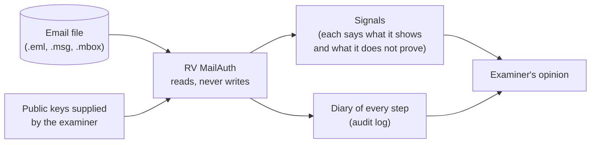

| It tells you | It does not tell you |
| --- | --- |
| Whether the text of the message is the one a mail server signed (DKIM), when the right key is supplied | Who typed the message, or whether its content is true |
| Whether the server postmarks (Received headers) and the dates are consistent with each other | That an unsigned header was never edited |
| Whether a sender's domain imitates your organisation's, or replies are steered elsewhere | That anyone intended to deceive |
| A fingerprint of every file, attachment and report, in a diary that shows any later edit | What happened to the message before it reached the examiner |

## A2 Digital fingerprints (hashes)

A **hash** is a short code computed from every byte of a file — a fingerprint. Change one character and the
fingerprint changes completely; keep the file identical and the fingerprint is the same on any computer.

| Text | SHA-256 fingerprint |
| --- | --- |
| `Importe: 1.200 EUR` | `5de4190be0c23f20e28ab9c4c88bf7c0786d68dce61119b222f96bbf7e015857` |
| `Importe: 12.000 EUR` | `b1e35a54a6ec76e1480c8c9e1739bd1271b6cb901836deb40ad296ecf513992e` |

One extra digit; the two fingerprints share nothing recognisable. The tool fingerprints every evidence file (one
or two methods, read once), every attachment and every report it writes.

## A3 What DKIM is: a wax seal on the envelope

When a company's mail server sends a message, it can add a **DKIM signature**: a seal computed with a secret key
that only that server holds. Anyone can check the seal with the matching **public key**, which the company
publishes in the internet's address book (the DNS). If the seal checks out, the sealed parts of the message — the
text and the header lines the server chose to seal (usually From, To, Subject, Date) — are exactly as they were
when the server sealed them.

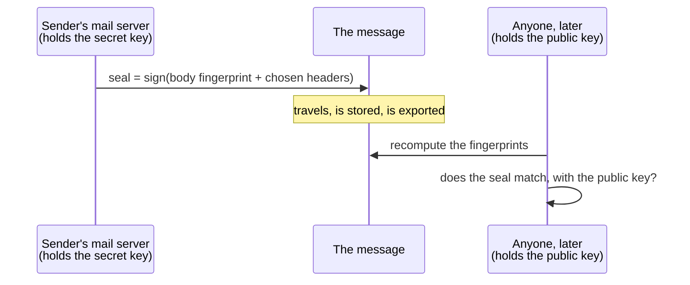

What a valid seal shows: someone holding the domain's secret key sealed **this** text and **these** headers.
What it does not show: who wrote the message, that the display name is honest, that headers outside the seal are
original, or that the account was not hijacked. A message without a seal proves nothing either way: many servers
do not seal.

## A4 What a body hash shows

The seal contains two parts. The first is a **fingerprint of the message text** (the *body hash*), written in
plain sight inside the signature. Checking it needs **no key at all**: recompute the fingerprint of the text as
it is now and compare.

In the sample message `03-body-edited.eml`, the supplier confirmed an order of **1.200 EUR**; the file now says
**12.000 EUR**. The signature still carries the fingerprint of the original text, so the comparison fails:

| | Body fingerprint (base64) |
| --- | --- |
| Written in the signature (`bh=`) | `uqPtfB1CezqNNoVfV2hm8du1wqW1+2JyxpqcXZnnTmc=` |
| Computed from the text as it is now | `Ky2onvEV9rkPdCyUMSKq0VAu3k6IitBlzBGFVntB2Mo=` |

This is the tool's only high-severity email signal (`DKIM_BODY_HASH_MISMATCH`). It shows that the text is not
the one that was sealed. It does not show who changed it or why: mailing lists, antivirus footers and some mail
programs also change text after sealing.

## A5 Why the key matters, and why keys rotate

The second part of the seal covers the sealed headers and the body fingerprint, and checking it needs the
company's **public key**. Companies replace their keys from time to time (*rotation*) and remove old ones from
the DNS. So:

- with the key that was published **when the message was sent**, a failure means sealed headers changed;
- with **today's** key, a genuine old message can fail simply because the key changed — the result is the same
  as for an edited header, and the tool cannot tell the two apart.

That is why RV MailAuth works **offline by default**: the examiner supplies the keys (from an archived copy of
the DNS, the provider, or a passive-DNS service), the tool records the key file's fingerprint, and nothing is
asked of the internet. If the examiner chooses `--online`, the missing keys are fetched from today's DNS, every
lookup is written to the diary, and each result based on such a key is flagged as **weaker evidence**
(`DKIM_KEY_FROM_CURRENT_DNS`).

## A6 ARC: seals added by forwarders

Forwarding services and mailing lists often change a message (a footer, a new subject), which breaks the
original seal. **ARC** lets each of them add its own numbered seal saying "this is what I received and what the
original checks said". The tool verifies the ARC chain with the keys supplied; a broken chain can mean an
intermediary broke it, or simply that the forwarders' keys were not supplied.

## A7 Received headers: the postmarks

Every server that handles a message stamps a **Received** line at the top: "from X, by Y, at this time". Read
from the bottom up, they trace the route; **hop 1** is the server closest to the sender.

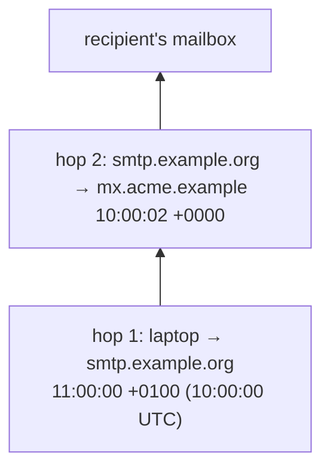

Postmarks written by the recipient's own servers are reliable as far as those servers are; postmarks lower down
were written by servers the recipient does not control, and **anyone holding the file can type new lines**. The
tool checks that the times go forward (allowing a small clock difference, 5 minutes by default), that the Date
the sender's computer wrote is not later than the first postmark, and that the time zones agree. Each
inconsistency is a signal, never proof: server clocks drift and some servers stamp oddly.

## A8 Business email compromise (BEC) signals

In a BEC fraud, a criminal impersonates a supplier or a manager to divert a payment. The tool looks for the usual
tricks, compared with your organisation's own domains (`--own-domain`):

| Signal | Example from the sample |
| --- | --- |
| **Lookalike domain** — a domain built to be read as yours | `acrne.example` ("r" + "n" reads as "m") imitating `acme.example` |
| **Replies diverted** — Reply-To or Return-Path at another organisation than From | From `@example.org`, Reply-To `bruno.proveedor@example.net` |
| **Display-name spoofing** — the name shows your organisation, the address is external | "ACME - Dirección Financiera" `<direccion.financiera@example.net>` |
| **Payment details mentioned** — bank details, IBAN, "new account", in English, Spanish or French | "bank details have changed" with a valid IBAN test number |

These are pointers for review. Each has innocent explanations (help desks, partners, ordinary invoices), stated in
every finding.

## A9 Outlook files and mailboxes

An Outlook **.msg** file is not the message as it travelled: Outlook re-encodes the text and attachments and keeps
the original header lines only sometimes. The seal can therefore not be checked on a .msg; the tool says
"not evaluated", never "failed", and asks for the original message when the seal matters.

An **mbox** is one file holding many messages one after another. The tool fingerprints the mbox as the evidence,
then treats each message as an item **derived** from it, identified by its number and its exact position (byte
offset) in the mbox — so anyone can cut out the same bytes and check them.

## A10 The tool's own diary (the audit log)

Everything the tool does is written to a diary, `audit.jsonl`. Each line carries the seal (hash) of the line
before it, like numbered pages where every page quotes the seal of the previous page. Editing, inserting,
deleting or reordering a page breaks the seals from that point on, and `rv-mailauth verify-log` (or an
independent Python script) detects it. When an examiner later opens a message in the desktop app, that is
written to a second diary, `review.jsonl`, whose first page quotes the last page of the run's diary.

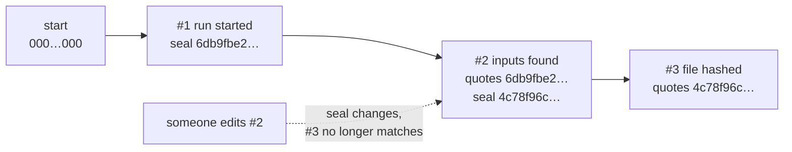

One honest limit: if the **last** pages are torn out, the remaining pages still agree with each other. That is
why the diary's final seal is also written in the case diary, printed in the reports and sent to a notary (A11).

## A11 Proving when: trusted timestamps

The diary proves its own consistency, not *when* it was written. For that, the tool sends the latest seal to a
**time-stamping authority** — an independent online notary — which signs "I saw this seal at 15:30:01 UTC". The
notary never sees the evidence, only a 32-byte seal. Without internet the run still finishes; the receipt can be
requested later with `rv-mailauth timestamp`. A timestamp proves the diary existed at that time — not that its
content is true, and not when the email itself was sent.

## A12 Signed reports and custody forms

With the examiner's certificate, every PDF report is digitally signed, so any later change is detectable with
Adobe Reader or another validator; the HTML and JSON reports are bound by their fingerprints in the diary. For
every item the tool pre-fills a **chain-of-custody form** — Colombian style (Spanish) or French style (French),
always with an English copy — with the case number, the evidence number, the fingerprints and the times of the
work. It accompanies, but does not replace, the official form of the police, prosecutor or court.

## A13 What "no findings" means

A message without findings is **not** proven authentic: the checks found nothing, and careful forgeries can leave
nothing for them to find. Every report prints the limitations listed in
[reports.md](reports.md#limitations-printed-in-every-report): DKIM needs the key valid at sending time; a missing
signature proves nothing; headers are claims; `.msg` files lack the original message; mbox un-escaping can be
ambiguous; BEC checks have false positives; a timestamp proves existence only.

---

# Part B — For examiners and opposing experts

## B1 Source map and constants

| Process | Implementation | Key constants (value in this commit) |
| --- | --- | --- |
| Input collection | [input.rs](../src/core/src/input.rs) | folders 1 level unless `--recursive`; symbolic links never followed; paths absolute, lexically normalised, de-duplicated, sorted bytewise (UTF-8), numbered from 1 |
| Hashing | [hash.rs](../src/core/src/hash.rs) | `CHUNK` = 1 MiB; at most 2 algorithms; first 4 096 bytes kept for classification |
| Routing | [analyzer.rs](../src/core/src/analyzer.rs) | `classify(name, first 4 KiB)`: OLE signature `D0 CF 11 E0 A1 B1 1A E1` → Msg if named `.msg`, else inventoried (a `.doc` is not an email); first line `From ` → Mbox; else by extension (`.msg` Msg, `.mbox`/`.mbx` Mbox, `.eml` Eml); else RFC 5322 header lines → Eml; anything else → the inventory logic (type, extension mismatch, empty, executable) |
| Worker isolation | [worker.rs](../src/core/src/worker.rs) | protocol `rv-mailauth-worker/1`; defaults `--worker-timeout` 120 s, `--worker-memory-mb` 1024; stdout ≤ 64 MiB; last 4 KiB of stderr kept |
| One message | [mail.rs](../src/core/src/mail.rs) | `--max-message-mb` 200; caps: 100 hops, 50 recipients, 200 attachments, 20 signatures, 20 Authentication-Results, raw values 998 characters, text scanned for payment wording ≤ 1 MiB |
| DKIM / ARC | [dkim.rs](../src/core/src/dkim.rs), [dnsfetch.rs](../src/core/src/dnsfetch.rs) | mail-auth 0.15.1 (rust-crypto); offline resolver with no name server; key names `selector._domainkey.domain` |
| Dates | [mail.rs](../src/core/src/mail.rs) `date_findings` | `--clock-skew` 300 s (0–86 400); zone valid if \|offset\| ≤ 14 h and a multiple of 15 min |
| BEC | [bec.rs](../src/core/src/bec.rs) | edit distance ≤ 2 for labels of ≥ 4 characters; 33 payment terms (EN/ES/FR) + IBAN mod-97 check |
| Organisational domain | [psl.rs](../src/core/src/psl.rs), [data/](../src/core/data/PSL_VERSION.txt) | Public Suffix List version `2026-11-10_11-23-57_UTC`, 10 414 rules, SHA-256 `b726c024…5ebee` |
| .msg | [msg.rs](../src/core/src/msg.rs) | MAPI tags 0x007D transport headers, 0x0037 subject, 0x0039 submit time, 0x0E06 delivery time, 0x1000 body, 0x1035 Message-ID, 0x3701 attachment data |
| mbox | [mbox.rs](../src/core/src/mbox.rs) | `--mbox-variant` mboxrd (default) or mboxo; `--max-mbox-messages` 50 000; id `<path>#<n>@<offset>` |
| Audit chain, review log | [audit.rs](../src/core/src/audit.rs), [review.rs](../src/core/src/review.rs), [verify.rs](../src/core/src/verify.rs) | genesis 64 zeros; SHA-256 over canonical JSON; review log anchored to `run_finished` |
| Case folder | [case.rs](../src/core/src/case.rs) | `rakvor.case/1`, `rakvor.registry/1`; lock wait 30 s; stale lock 600 s; role `Analysis` |
| Timestamp, report signing | [trust.rs](../src/core/src/trust.rs) (shared) | default TSA `http://timestamp.digicert.com`; HTTP timeout 15 s; nonce 8 bytes |
| Reports | [report/](../src/core/src/report/mod.rs) | built-in PDF writer, A4, WinAnsi; signature placeholder 16 384 bytes |
| Finding codes | [model.rs](../src/core/src/model.rs) | `FINDING_CODES` (22 email codes) + `PIPELINE_FINDING_CODES` (8) |

The core never prints; the CLI ([main.rs](../src/cli/src/main.rs)) and the GUI ([state.rs](../src/gui/src/state.rs))
render the same event stream, so both front-ends produce the same audit actions, findings and reports.

## B2 Pipeline, worker isolation and reads of the evidence

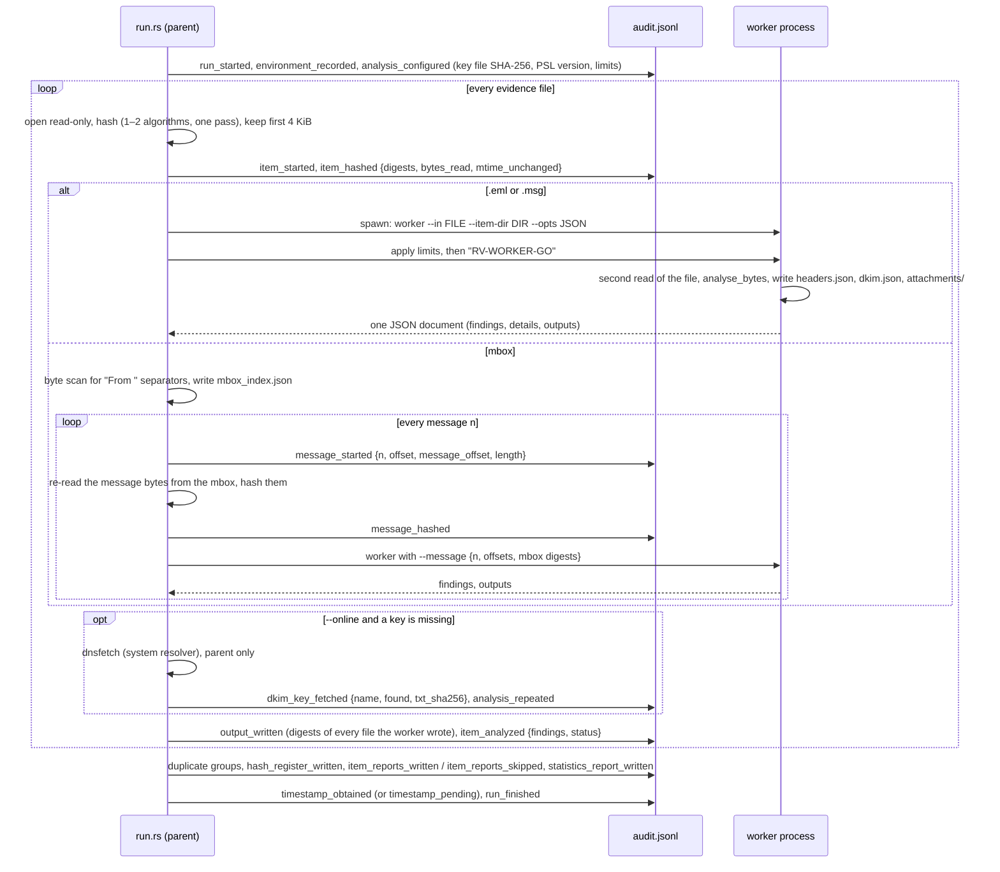

- **Reads.** The parent reads each file once to hash it; the worker reads it a second time to analyse it (an
  mbox message is re-read from the mbox at its offset and hashed again). The worker hashes the bytes it analysed
  (`headers.json` → `sha256`), so the analysed bytes are bound to the evidence digest.
- **Isolation.** The child starts with piped stdio and waits for `RV-WORKER-GO` until the parent has applied the
  limits — Windows: a Job Object with a process memory limit, kill-on-close and no error dialog; Unix:
  `RLIMIT_AS` and `RLIMIT_CORE` = 0; Linux: also an empty network namespace (`unshare(CLONE_NEWNET)`, recorded as
  `details.worker.network`). Timeout → kill. Any failure is `PARSER_FAILED` (medium) for that item only, with the
  reason and the exit code; files a failed worker left are kept and audited as `partial_output`.
- **No network in the analysis.** The worker code path contains no code that opens a connection
  (`worker_code_path_has_no_network_code`); DKIM keys come from the key file, or from records the parent fetched
  in `--online` mode.
- **Same answer in process.** `--isolation in-process` runs the same `analyze_bytes`; `src/cli/tests/worker.rs`
  checks that both give identical findings on the sample and that crash, hang and memory faults are contained.

## B3 Single-pass dual hashing

| Algorithm | Standard | Output | Status for evidence |
| --- | --- | --- | --- |
| `md5` | RFC 1321 | 128 bit | Practical collisions since 2004–2005 (Wang & Yu); legacy matching only |
| `sha1` | FIPS 180-4 | 160 bit | Practical collision 2017 (Stevens et al.); legacy matching only |
| `sha256` | FIPS 180-4 | 256 bit | Default; recommended primary |
| `sha512` | FIPS 180-4 | 512 bit | Recommended |
| `sha3-256` | FIPS 202 | 256 bit | Sound; less familiar to courts |
| `blake3` | BLAKE3 specification (2020) | 256 bit | Sound; not a NIST-approved hash |

Every 1 MiB chunk is passed to both hashers before the next read, so the two digests describe the same byte
stream (`one_pass_feeds_two_digests_identically_to_separate_passes`). The first algorithm is the primary (duplicate
groups, the customer's "digital fingerprint", first comparison with the case registry). `self-test` checks every
algorithm against the published digest of `"abc"`. The tool accepts `md5,sha1` without a SHA-2/SHA-3/BLAKE3
algorithm; choosing a collision-resistant one is the examiner's job (gap G11). Attachments and per-message
outputs are always hashed with SHA-256 (`headers.json`), and every output file additionally with the run's
algorithms (`output_written`).

## B4 DKIM canonicalisation

DKIM (RFC 6376) signs a *canonical* form of the message, so that harmless rewriting in transit does not break the
signature. `c=header/body` names the two algorithms (default `simple/simple`); `dkim.json` records it per
signature.

| | `simple` | `relaxed` |
| --- | --- | --- |
| Header fields (§3.4.1, §3.4.2) | byte for byte | name lower-cased; unfolded; runs of whitespace → one space; whitespace before and after the colon and at the end removed |
| Body (§3.4.3, §3.4.4) | trailing empty lines removed (an empty body becomes CRLF) | also: whitespace at line ends removed, runs of whitespace → one space, then trailing empty lines removed |

Consequences for the examiner: under `relaxed` body canonicalisation, re-wrapping whitespace does not change the
body hash, but **any** change of a visible character does; under `simple`, even a changed line ending inside the
body does. Content-Transfer-Encoding is **not** undone: the body hash covers the encoded bytes (quoted-printable,
base64), so re-encoding a message (as `.msg` storage does, [B12](#b12-outlook-msg-and-mbox)) changes the body hash
without any change of meaning.

**`l=` (body length).** A signature may cover only the first `l` bytes of the canonical body; bytes added after
them do not affect the result. mail-auth computes the hash over `l` bytes, and `dkim.json` records `body_length`,
but no finding flags a signature whose `l=` is shorter than the body (gap G-MAIL5): check `body_length` against
the body when a signature has `l=`.

## B5 The body hash (bh=) and the header signature (b=)

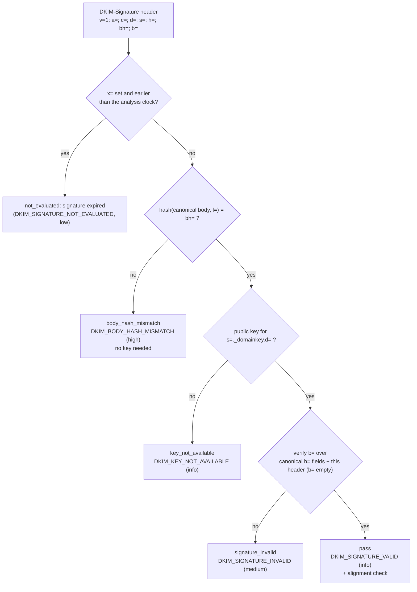

This is mail-auth's order (`dkim/verify.rs`), reproduced by the classification in `dkim.rs` `classify`:

1. **Expiry first.** A signature with `x=` that is not later than both `t=` and the **current clock** is reported
   expired before anything else is computed. For forensic work on old mail this means a signature with a short
   `x=` is never evaluated, not even its body hash (gap G-MAIL4, [HANDOFF](HANDOFF.md#6-open-work)).
2. **`bh=` needs no key.** It is the base64 of the hash (SHA-256 for `rsa-sha256` and `ed25519-sha256`) of the
   canonical body. In `03-body-edited.eml` (relaxed/relaxed): `bh=uqPtfB1C…ZnnTmc=` was computed over a body
   saying `1.200 EUR`; the body now says `12.000 EUR` and hashes to `Ky2onvEV…B2Mo=`. A mismatch shows the
   body changed after signing whatever key is or is not supplied, hence **high**.
3. **`b=` needs the key.** It is the signature (RSA PKCS#1 v1.5, or Ed25519) over the canonical header fields
   listed in `h=` (each taken from the bottom-most unused instance; a name listed more times than it occurs signs
   its absence — the sample signs `from` twice so that a second From cannot be added) followed by the
   DKIM-Signature header itself with `b=` emptied. The body enters only through `bh=`. With a matching body hash,
   a failure means a signed header changed **or** the key is not the one that signed; `05-rotated-key.eml` is a
   genuine message checked with the selector's new key and gives exactly the same result as
   `04-header-edited.eml`. Hence **medium**, with both explanations in the wording ([ADR
   0004](adr/0004-email-design-decisions.md)).
4. **Alignment.** A passing signature whose `d=` does not share the From domain's organisational domain
   ([B9](#b9-organisational-domain-from-the-public-suffix-list)) gives `DKIM_DOMAIN_NOT_ALIGNED` when no passing
   signature is aligned (relaxed, DMARC-style). Sending services sign with their own domain; this is not spoofing
   by itself.

Independent check: `tests/oracle_dkim.py` re-verifies every sample signature with dkimpy and the same keys and must
agree signature by signature (pass vs not pass).

## B6 Offline key injection and the online mode

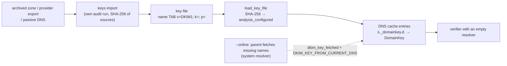

- **Key file.** One record per key: `selector._domainkey.domain<TAB>v=DKIM1; k=rsa; p=…`, or a BIND zone-file TXT
  record (TTL and class optional, quoted strings joined, parentheses across lines, `;` comments outside quotes).
  `keys import` validates every DKIM record with the same parser `analyze` uses, skips other record types, other
  names and revoked keys (empty `p=`) — each listed in its audit log — merges identical duplicates, refuses two
  different keys under one name, and writes a sorted, normalised file whose header names every source and its
  SHA-256. `keys show` lists selector, domain, key type and bits.
- **Injection.** For every DKIM-Signature, ARC-Message-Signature and ARC-Seal the tool computes the key name and,
  when the key file (first) or the parent's fetch (second) has it, parses it as a DKIM key record and inserts it
  into the verifier's TXT cache under `name.`. The verifier itself is built with `ResolverConfig::from_parts(None,
  [], [])`: a name not in the cache fails at once and is classified `key_not_available`.
- **Provenance in the report.** Each signature records `key_source` (`key_file` with the line number, or
  `current_dns`) in `dkim.json` and in the finding.
- **Online mode.** Only names missing from the key file are fetched, once per run, by the parent with the system
  resolver configuration; each fetch is an audit entry with the TXT record's SHA-256, elapsed time and error, and
  the item is analysed again with the fetched keys (`analysis_repeated`). A key published today may not be the
  one that signed (rotated, revoked, re-published by the domain's current holder), hence
  `DKIM_KEY_FROM_CURRENT_DNS` (medium) on every signature verified with it.

What no tool can supply: proof that a key in the key file **was** the domain's key at sending time. That rests on
the provenance of the archive, which the examiner documents.

## B7 ARC

ARC (RFC 8617) adds, per intermediary *i*, an `ARC-Authentication-Results`, an `ARC-Message-Signature` (a
DKIM-like signature over the message as received by *i*) and an `ARC-Seal` (a signature over the ARC headers of
sets 1…*i*, with `cv=` the chain validation status *i* found). The tool runs mail-auth's `verify_arc` with the
same injected keys and reports `none` (no ARC headers), `pass`, `invalid` (structure broken, a signature fails or
`cv=fail`) or `key_not_available`. `ARC_CHAIN_INVALID` (medium) means the chain as stored does not validate; the
sample `15-forwarded-unknown-key.eml` has an incomplete set (1 instance, "Broken or missing ARC chain"). An ARC
pass shows what the sealers stated; it does not re-establish the original DKIM result.

## B8 Received hop ordering, dates and clock skew

```text
parse_received(value)                                         src/core/src/mail.rs
  date  = text after the last ';' (RFC 5322 date-time), parsed to UTC + zone offset
  from, by, with, id, for = first token after each keyword, (comments) removed
  header_index = 0 for the topmost Received header; position = hops_total − header_index
                 → position 1 = the bottom-most header = the hop closest to the sender
date_findings(h, skew)
  timed hops sorted by position; for consecutive hops a, b: if t(b) + skew < t(a) → backwards step
      first backwards step → RECEIVED_TIME_NOT_MONOTONIC {hop, previous_hop, earlier_by_s, count}
  if Date + skew > t(first timed hop) → DATE_AFTER_FIRST_HOP {later_by_s}
  Date zone invalid (|offset| > 14 h or not a multiple of 15 min) → TIMEZONE_INCONSISTENT (invalid_offset)
  else if the first hop was stamped by a server of the From organisation (org(by) = org(From))
      and its zone ≠ the Date zone → TIMEZONE_INCONSISTENT (sender_server_zone_differs)
attachments: creation-date / modification-date (MIME Content-Disposition, or .msg PR_CREATION_TIME /
  PR_LAST_MODIFICATION_TIME) later than Date + skew → ATTACHMENT_DATE_AFTER_SENT (≤ 10 per message)
Message-ID: org(domain after '@') ≠ org(From domain), domain containing a dot → MESSAGE_ID_DOMAIN_MISMATCH
```

Real values from `12-mailbox.mbox#3`: hop 1 stamped `2026-11-11T10:00:00Z`, hop 2 `09:40:00Z` (1 200 s earlier,
beyond the 300 s tolerance) → `RECEIVED_TIME_NOT_MONOTONIC`; Date `11:30:00Z`, 5 400 s after hop 1 →
`DATE_AFTER_FIRST_HOP`; Date zone `+0500`, the sender's server `+0000` → `TIMEZONE_INCONSISTENT`; Message-ID under
`mailer.example.com`, From `example.org` → `MESSAGE_ID_DOMAIN_MISMATCH`.

What hop analysis can and cannot show: the order of hops is the order of the header lines, and the times are what
each server wrote. Lines added by the recipient's own servers are as trustworthy as those servers; lines below
them could have been written by anyone, including at the time the file was edited. A consistent route is
therefore not proof of a genuine route; an inconsistent one is a reason to look, with clock drift, queued
retries and mis-set server zones as innocent explanations. `--clock-skew` (0–86 400 s) sets the tolerance and is
recorded in `analysis_configured`.

## B9 Organisational domain from the Public Suffix List

Alignment, Reply-To/Return-Path, Message-ID and display-name comparisons and the lookalike labels use the
**organisational (registrable) domain**: the public suffix plus one label (`psl.rs`, the algorithm of
publicsuffix.org):

```text
org_domain(d): lower-case, trailing dot removed, punycode labels decoded to Unicode
  rules = ICANN + PRIVATE sections of the bundled list (10 414 rules)
  the longest matching rule wins; an exception rule (!x.y) beats a wildcard (*.y);
  an unlisted top-level label is a public suffix (implicit *)
  org = matched public suffix + one more label; a domain that IS a public suffix is its own org domain
examples: mail.acme.example → acme.example        a.b.example.co.uk → example.co.uk
```

Using the PRIVATE section means that two customers of one hosting platform (for example two sites under a
platform's shared domain listed there) are different organisations, as browsers treat them. The list is pinned
(version, commit, SHA-256 in `PSL_VERSION.txt`, checked by a test, recorded per run); it may differ from the
list in force when the message was sent ([ADR 0004](adr/0004-email-design-decisions.md)).

## B10 Lookalike domains and confusable skeletons

For each sender-side domain (From, Sender, Reply-To, Return-Path) that is not an own domain, and each
`--own-domain`, `bec::lookalike` tries, in order:

| Method | Rule | Example |
| --- | --- | --- |
| `punycode` | the Unicode form of the domain has the same organisational domain as the own domain, although the ASCII forms differ | an `xn--` spelling of the own domain |
| `same_name_other_suffix` | same registrable label, other suffix | `acme.example` vs `acme.test` |
| `confusable` / `punycode_confusable` | Unicode TR39 **skeletons** of the two labels are equal (`unicode-security`) | `acrne` → skeleton `acme`; Cyrillic `а` (U+0430) → Latin `a` |
| `edit_distance_1` / `_2` | Levenshtein distance ≤ 2 between the labels, own label ≥ 4 characters | `acme` vs `acne`, `acmee` |

A skeleton maps every character to a prototype of its confusable class (UTS #39 §4, data file
`confusables.txt`) after lower-casing, so strings that look alike map to the same skeleton. The sample's
`acrne.example` gives `method: confusable` (r + n → m). The comparison is label against label (organisational
domains), so a subdomain of the own domain never matches. Edit distance has false positives between short
unrelated names; the 4-character floor limits them.

## B11 Reply-To, Return-Path, display name and payment wording

- `REPLY_TO_DIFFERS`: the first Reply-To address, and the Return-Path, whose organisational domain differs from
  the From domain's (one finding per header). Return-Path is set by the last delivering server from the SMTP
  envelope sender; bounce handlers and bulk senders use other domains legitimately.
- `DISPLAY_NAME_SPOOF`, reason `address_in_name`: the display name contains something shaped like an address
  (local part, `@`, a dotted domain) different from the actual address. Reason `own_name_external_address`: the
  address is not an own domain and the display name contains an own domain, or its registrable label (≥ 4
  characters) as a whole word (`ACME - Dirección Financiera` from `@example.net`).
- `PAYMENT_DETAILS_MENTIONED` (info): whole-word, case-insensitive matches in the subject and text parts (≤ 1 MiB)
  of 33 terms — English (`iban`, `bank details`, `wire transfer`, `new account`, …), Spanish (`datos bancarios`,
  `cuenta bancaria`, `clabe`, …), French (`coordonnées bancaires`, `rib`, `virement`, …) — plus `iban_number` for
  an IBAN-shaped sequence whose ISO 13616 check (mod 97 = 1) holds. The sample `09-payment-details.eml` lists
  `bank details, coordonnées bancaires, datos bancarios, iban, iban_number, nouvelles coordonnées`.

## B12 Outlook .msg and mbox

**.msg (MS-OXMSG).** A compound file whose MAPI properties are streams `__substg1.0_<TAG><TYPE>` (string types
0x001F UTF-16LE and 0x001E 8-bit, binary 0x0102) and fixed-size entries of `__properties_version1.0`; attachments
are storages `__attach_version1.0_#XXXXXXXX`. Outlook stores the body and attachments re-encoded; the original
header section survives only in `PR_TRANSPORT_MESSAGE_HEADERS` (0x007D). With it, the hops, dates and
Authentication-Results are analysed from the stored header text and the DKIM signatures are listed but not
evaluated (`msg_body_not_original`, [B4](#b4-dkim-canonicalisation)); without it, `MSG_TRANSPORT_HEADERS_MISSING`
(medium) and the summary comes from the MAPI properties (subject, sender or sent-representing address, submit
time). A damaged compound file is `FILE_STRUCTURE_DAMAGED` (format `msg`).

**mbox.** A message starts at a line beginning `From ` that is the first line of the file or follows an empty
line; the stored message runs to the next separator, minus the empty line in front of it. Writers escape body
lines starting `From ` with `>`; **mboxrd** also escapes lines already starting `>…From `, so reading strips one
`>` from every `^>+From ` line; **mboxo** strips it only from `^>From ` and cannot tell an escaped line from an
original `>From ` line. The wrong variant changes the body bytes and therefore the body hash (limitation
`MBOX_ESCAPING_AMBIGUOUS`); message 1 of the sample contains an escaped `>From ` line and verifies under mboxrd.
The split is a byte scan in the parent; each message is a derived item with id `<path>#<n>@<offset>`, hashed
again from the mbox bytes (`message_hashed`) and analysed by its own worker. Bytes before the first separator, no
separator at all, or an empty last message are `FILE_STRUCTURE_DAMAGED` (format `mbox`) on the container.

## B13 The audit hash chain

Each line of `audit.jsonl` is one JSON object: `seq`, `ts_utc`, `run_id`, `actor`, `action`, optional `item`,
`details`, `prev_entry_hash`, `entry_hash` ([audit.rs](../src/core/src/audit.rs)). `audit.log` is a readable copy of
the same actions; it is not chained and not authoritative.

```text
canonical(e)      = JSON of e without "entry_hash"; keys sorted at every level; no whitespace; UTF-8,
                    non-ASCII not escaped; integers only
                    (Python: json.dumps(e, sort_keys=True, separators=(",", ":"), ensure_ascii=False))
entry_hash_n      = SHA-256( canonical(e_n) )                 hex, lower case
prev_entry_hash_1 = 64 × "0";   prev_entry_hash_n = entry_hash_(n-1);   seq_n = n
```

**Worked example** (three illustrative entries computed for this page with the rule above — not from the email sample; `rv-mailauth verify-log` accepts them):

```text
#1 canonical (287 bytes)
{"action":"run_started","actor":"Ana Ruiz","details":{"algorithms":["sha256","md5"],"tool":"rv-mailauth",
"version":"0.1.0"},"prev_entry_hash":"0000000000000000000000000000000000000000000000000000000000000000",
"run_id":"20261021T152805Z-e8fd7a","seq":1,"ts_utc":"2026-10-21T15:28:05.817Z"}
   entry_hash = 6db9fbe2ebb025947fc663b32c09cab8d2ed072e7ae5d7ec3250671c34ee71c9

#2 canonical (245 bytes)
{"action":"inputs_resolved","actor":"Ana Ruiz","details":{"bytes":234,"items":3},
"prev_entry_hash":"6db9fbe2…34ee71c9","run_id":"20261021T152805Z-e8fd7a","seq":2,"ts_utc":"2026-10-21T15:28:05.819Z"}
   entry_hash = 4c78f96cb3e945d2705676d5bafa1942cad3146342a9fff9bf94e89f905754aa

#3 canonical (381 bytes)
{"action":"item_hashed","actor":"Ana Ruiz","details":{"bytes_read":61,"hashes":{"sha256":"80e089ad…183c3c"},
"index":2,"mtime_unchanged":true},"item":"D:\\ev\\acta.txt","prev_entry_hash":"4c78f96c…905754aa", …,"seq":3,…}
   entry_hash = 558b0ea25f29bcc8af1cbbcbbc191d1511ad8d040fffea1db6d1a79f76376223

#2 edited ("items":2) → f6a7e0fc0991175781ba340d8a338b11060c28db304e3e33bcf12f3e30a04264 ≠ stored
```

What `verify-log` prints for the three variants (real output):

```text
original           OK  3 entries, chain intact: ./audit.jsonl                                        exit 0
#2 edited          BROKEN  - line 2: entry_hash does not match its content (edited entry)            exit 3
#2 deleted         BROKEN  - line 2: sequence 3 where 2 was expected (deleted or re-ordered entry)
                           - line 2: prev_entry_hash does not link to the previous entry             exit 3
#3 removed (end)   OK  2 entries, chain intact                                                       exit 0
                       truncation not detectable without a timestamp or case record
```

The last variant is why `verify-log` also compares the end of the log with records kept outside it (next
paragraphs): on a standalone log with no timestamp it can only say so.

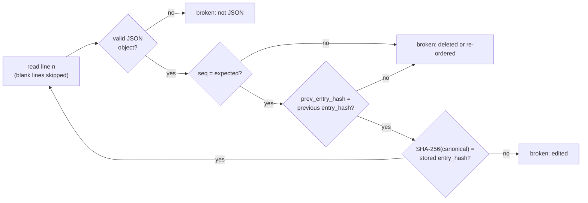

| Proves | Does not prove, on its own |
| --- | --- |
| No entry was edited, inserted, deleted or reordered **before the last entry present** | That entries were not removed **from the end**: a shorter chain is still valid (see the last line above). Only an anchor outside the log shows that |
| The order of work equals the order of entries | That the whole chain was not recomputed by someone who rewrote it from scratch |
| Report and output digests are bound to the run | When the entries were written (host clock, `ts_utc`) |

External anchors close those gaps: a complete run ends with `run_finished` (or `run_failed` / `run_cancelled`);
the case log records the run's final entry count and head ([B14](#b14-the-case-folder)); the RFC 3161 token binds
entry *N* ([B15](#b15-rfc-3161-trusted-timestamp)); the statistics report prints the head and entry count at the
time it was written; a signed PDF report binds that head to the examiner's key.

`verify-log` uses the first two automatically ([src/core/src/verify.rs](../src/core/src/verify.rs)):

| Anchor found | Check | Result line |
| --- | --- | --- |
| `timestamp-<K>.json` | entry `#K` exists and its hash is the token's imprint; every `timestamp_obtained` entry still has its token file | `truncation: entries up to #K are anchored by the RFC 3161 timestamp (…); n entries after it (…) cannot be proven complete` |
| run in `<CASE>/runs/<tool>/<RUN-ID>/logs` | `run_finished` in the case log: entry `#M` = `audit_entries` exists with hash `audit_head`; only `timestamp_obtained` after it | `truncation: the final entry #M is anchored by the case log (run_finished)` |
| neither | — | `truncation not detectable without a timestamp or case record` |

A log that ends before `#K` or `#M` is reported as `truncated: …` (exit 3). The highest anchor wins; when it is
the final entry, the log is complete as far as anything outside it can tell.

Independent check: [tests/verify_chain.py](../tests/verify_chain.py) re-implements the chain in Python (standard
library) and re-hashes the evidence listed in `hashes.csv` (it needs that file: it is a run checker, not a case-log
checker). The append-only file is opened with `create_new` + `append`: an existing log is never overwritten; only
the `timestamp` command re-opens a log, after verifying it.

**Review log.** Viewing after the run never touches `audit.jsonl` (its chain is closed at `run_finished`; only
`timestamp_obtained` may follow). The GUI message viewer appends to `review.jsonl` in the same folder
([review.rs](../src/core/src/review.rs)): same entry and hash rule, plus `anchor_seq` / `anchor_hash` in the first
entry, whose `prev_entry_hash` is the `entry_hash` of the run's `run_finished` entry. `verify-log` and
`verify-case` check it whenever it exists: chain intact, first entry anchored to **this** run's `run_finished`,
every entry naming this run. An edited entry, a deleted one, or a review log copied next to another run is a
failure (exit 3); the count is printed as "review entries: N".

## B14 The case folder

Layout and contract: [case-folder.md](case-folder.md). This section explains why the design holds.

```text
<CASE>/case.json               {"schema":"rakvor.case/1","case_id","jurisdiction","created_utc","created_by":{…}}
<CASE>/case-log.jsonl          same chain rule as audit.jsonl; first entry case_created (carries case_json_sha256)
<CASE>/case-log.lock           exists only while a tool appends (created with create_new, removed on drop)
<CASE>/evidence/registry.json  {"schema":"rakvor.registry/1","items":[{evidence_id, path, size, hashes,
                               registered_by:{tool, version, run_id, audit_seq}, registered_utc}]}
<CASE>/evidence/registry.csv   evidence_id,path,size,<algorithms present>,run_id
<CASE>/runs/<tool>/<RUN-ID>/{logs,reports}/
```

A registry entry as the intake tool (rv-hashinv) writes it — here for a file of its own sample (path shortened):

```json
{
  "evidence_id": "E0003",
  "hashes": { "md5": "d0532b1672c85a82f561ad2de7e9a57a",
              "sha256": "42503ebb0f9892b30b72e11cfa0cbf5bcb5d60f667d611fa9598c9b4e835c643" },
  "path": "D:\\export\\foto-vacaciones.jpg",
  "registered_by": { "audit_seq": 12, "run_id": "20261021T152805Z-e8fd7a", "tool": "rv-hashinv", "version": "…" },
  "registered_utc": "2026-10-21T15:28:05.909Z",
  "size": 112
}
```

`registered_by.audit_seq` = 12 points at the `item_hashed` entry of that run's `audit.jsonl` that holds the same
digests, so every registry row can be traced to a sealed log entry.

### Rules

| Rule | Code | Why |
| --- | --- | --- |
| A broken case is never extended | every append re-runs `verify_log_and_registry` under the lock: case-log chain, first entry `case_created`, `case.json` digest, registry digest = last `registry_sha256` in the log | a tool cannot silently build on an edited case |
| One writer at a time | `case-log.lock` created exclusively; wait ≤ 30 s; a lock older than 600 s is reported as stale and **never deleted automatically** | two tools never interleave entries |
| Only the intake role writes the registry | `register` (intake); analysis tools only read it | the reference values cannot drift |
| Paths are compared normalised | `normalize_path`: absolute, lexically normalised (`.`/`..` removed); `same_path`: case-insensitive on Windows (`to_lowercase`), exact elsewhere | the same file is found again by path; `D:\Evidence\a.pdf` = `d:\evidence\A.PDF` on Windows |
| A case run always shares an algorithm with the registry | `ensure_case_algorithm`: if the selection is disjoint from the algorithms present in **every** registered item, add SHA-256 (or the registry's first algorithm), replacing the second choice if two were selected; audited as `case_algorithm_added` | comparison is always possible |
| Evidence ids are never reused | next id = highest number + 1; same path **and** same content keeps its id | an id means one content forever |

### Matching an item against the registry (analysis role)

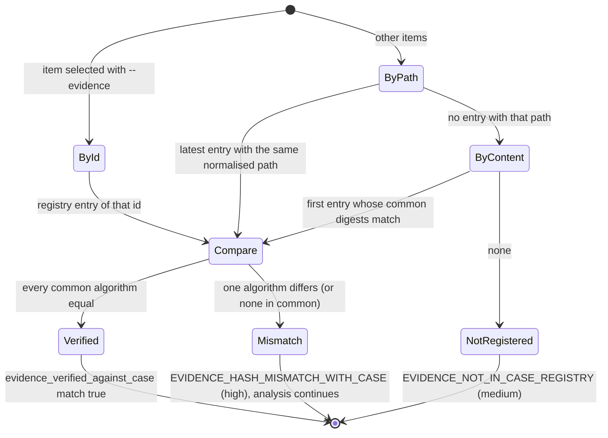

rv-mailauth is the **analysis** role (`CASE_ROLE = Analysis`): it runs the matching above for every item and
never writes the registry. A message of an mbox is matched through its mbox (the registered file) and carries
the mbox's evidence id. A mismatch does not stop the analysis: the examiner decides what the difference
means, and the report shows both digests.

### Cross-linking of the two chains

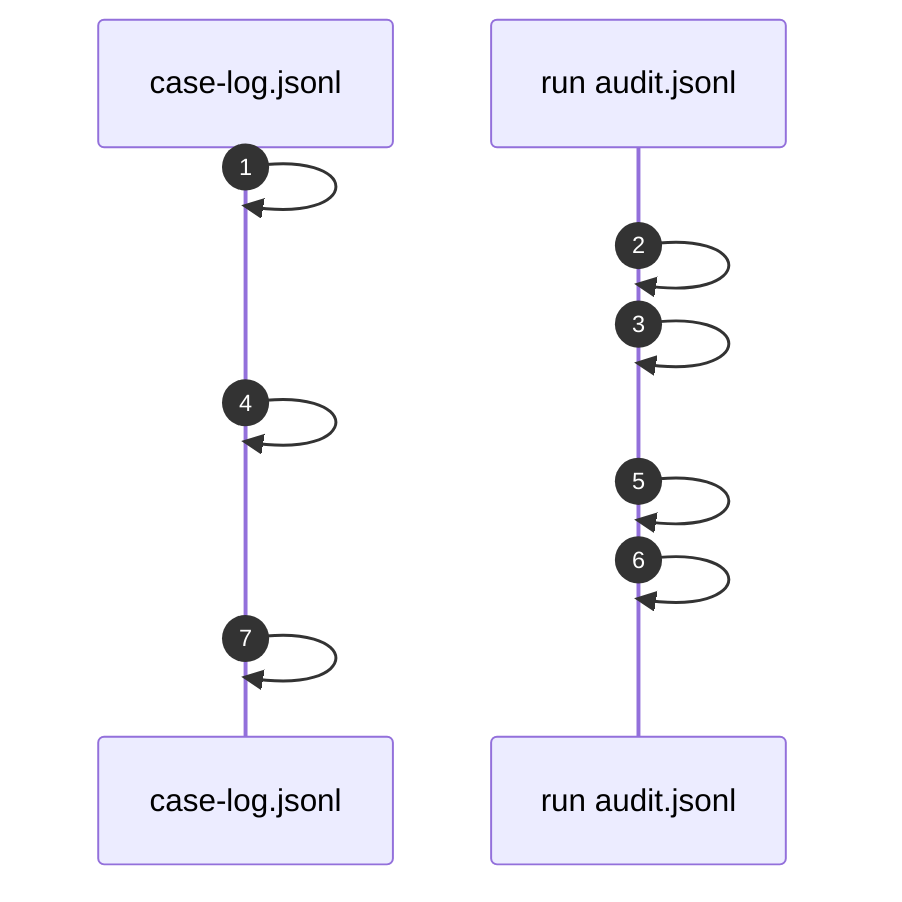

(Values from a real intake run; an analysis run has the same links without `evidence_registered`, and its audit
log records `evidence_verified_against_case` / `evidence_not_in_case_registry` per item instead.) `verify-case` checks, for every `run_started` in the case log: the run's
`audit.jsonl` chain and timestamp tokens; that its `case_linked` names this case and quotes the `run_started` hash;
and that entry `audit_entries` of the run has hash `audit_head`, with only `timestamp_obtained` allowed after it.
It also checks every run's `review.jsonl` (B13) and warns about run folders the case log never announced. Editing either chain therefore breaks a link, and
truncating a finished run's audit log is detected here (and by `verify-log` on that run, which finds the case log
from the run folder's location, [B13](#b13-the-audit-hash-chain)).

With `--rehash`, `verify-case` also re-hashes the evidence: every registry entry whose path is still a file is
read once with the entry's own algorithms (at most two, standard order) and compared with the registry. A path
registered more than once (its content changed between intakes, so it received a new id) is compared with its
latest registration; the earlier ids are listed as superseded. A difference is a problem (exit 3); an unreachable
or unreadable file is a warning, because evidence copies often live on another workstation.

What `verify-case` does **not** do: validate the TSA certificate chain (it checks each token's TSA signature;
the chain needs `verify-log --tsa-ca`, B15), or prove that the registry's first content equals
the original source.

## B15 RFC 3161 trusted timestamp

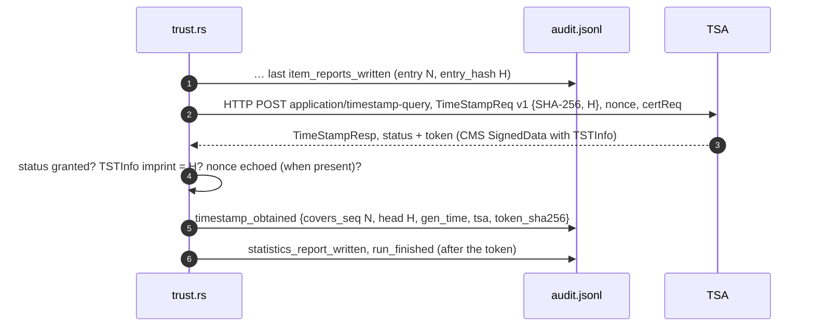

The **message imprint is the chain head itself**: the 32 bytes of `entry_hash` of entry *N*, declared as a SHA-256
value. It is not hashed again, so `openssl ts -verify -digest <H>` works directly. Request layout (69 bytes; head
from the worked example of B13, example nonce):

```text
30 43                                   TimeStampReq SEQUENCE, 67 bytes
   02 01 01                             version v1
   30 31                                messageImprint
      30 0D 06 09 60 86 48 01 65 03 04 02 01 05 00     hashAlgorithm sha256 (2.16.840.1.101.3.4.2.1), NULL
      04 20 55 8B 0E A2 … 37 62 23      hashedMessage = entry_hash (32 bytes)
   02 08 1F 3A 5C 7E 9B 2D 4F 60        nonce (8 bytes, high bit cleared: positive INTEGER)
   01 01 FF                             certReq TRUE
```

- Nonce: first 8 bytes of SHA-256(clock, process id), high bit cleared. It detects a replayed response; it is not
  a secret.
- The response is limited to 1 MiB and 15 s. `TSTInfo` is read by a minimal DER walk because many TSAs write
  fractional seconds in `genTime`, which strict decoders reject; `gen_time` is stored to the second. Example: the
  test TSA's token said `15:30:01.367038`, the log says `2026-10-21T15:30:01Z`.
- Stored next to the log: `timestamp-<NNNNN>.tsr` (the DER **TimeStampResp**, not only the token) and
  `timestamp-<NNNNN>.json` (tsa, gen_time, covers_seq, head, token_sha256, file).
- Offline → `timestamp_pending` and the run completes; `rv-mailauth timestamp <log>` later re-verifies the chain and
  appends `timestamp_obtained` for the then-current head (earlier entries are never rewritten).
- `verify-log` and `verify-case` re-check every token the audit log records (`timestamp_obtained`; a recorded token
  whose `.tsr` or `.json` is missing, or whose metadata disagrees with the entry, is a problem — deleting the
  metadata file does not skip the checks) and any token file next to the log that no entry records: that entry
  `covers_seq` is still in the log (otherwise: `truncated`), the `.tsr` SHA-256 against `token_sha256`, the TSA status, and that the imprint equals the `entry_hash` of
  `covers_seq`. They also verify the TSA's **CMS signature** (`trust::verify_token`, the same code as RV Hub,
  rv-pdfauth and rv-imgauth): the content type is `id-ct-TSTInfo`; there is exactly one SignerInfo and its
  certificate is in the token; the signed attributes carry content-type, a message-digest equal to the digest of
  the TSTInfo, and an ESS signing-certificate (v1 or v2) matching that certificate; the RSA PKCS#1 v1.5 signature
  over the signed attributes verifies; and the certificate's extended key usage is critical and contains only
  `id-kp-timeStamping` (RFC 3161 §2.3, as rv-certcheck and OpenSSL's `timestampsign` purpose). Any failure ("signature value does not verify") fails the log (exit 3).
- The **TSA certificate chain** is validated only by `verify-log --tsa-ca <CA bundle>` (PEM or DER): a path from
  the TSA certificate, through the certificates in the token, to one of the bundle's certificates, trying every
  candidate issuer and anchor (cross-signed intermediates, renewed anchors, self-issued key-rollover
  intermediates; at most 8 deep, no loops) and accepting a path only if (an RFC 5280 subset, `trust::check_path`):
  every RSA signature verifies and every certificate is valid at `genTime`; every intermediate has
  `cA=TRUE` (an anchor too, or is v1 / has keyCertSign); an issuer with keyUsage has `keyCertSign`; no
  `pathLenConstraint` is exceeded (self-issued certificates not counted); directoryName name constraints hold
  (other name forms are not evaluated: a path carrying such names under such a constraint is rejected); and no
  certificate has an unsupported critical extension (policyConstraints, policyMappings and inhibitAnyPolicy
  included: policy processing is not implemented, such chains fail closed). 34 fixture chains
  (`tests/fixtures/tsa-chains`) pin these rules, each cross-checked with `openssl verify -purpose timestampsign`. Without it the output says
  "chain not checked": the token is shown to be signed by the certificate it carries, not that this certificate
  belongs to a TSA you trust. **Revocation (CRL/OCSP), policy OID and accuracy are never checked**, and only RSA
  signers are supported (an ECDSA token fails as "signature not checked"). Revocation must be established
  separately, from CRL/OCSP evidence that covers `genTime`, before relying on the time in court (gap G18,
  [usage.md](usage.md#6-timestamps)). Independent signature/chain check of the test token (no revocation check:
  no CRL is supplied and OpenSSL does not query OCSP):
  `openssl ts -verify -digest 53b0de42…a91a61 -in timestamp-00018.tsr -CAfile ca.pem -untrusted tsa.pem` →
  `Verification: OK`.
- The default TSA URL is plain HTTP; integrity rests on the TSA's signature, which is why the OpenSSL check
  matters. eIDAS qualified status depends on the TSA chosen ([admissibility.md](admissibility.md)).

Standards: RFC 3161 (Time-Stamp Protocol), RFC 5816 (ESSCertIDv2 update), RFC 5652 (CMS).

## B16 Signed PDF reports

Reports are written by a small built-in PDF writer ([report/pdf.rs](../src/core/src/report/pdf.rs)): PDF 1.4,
A4, the standard Helvetica, Helvetica-Bold and Courier fonts with WinAnsiEncoding (English, Spanish and French
characters; anything else becomes `?`), no embedded fonts, one cross-reference table, one `%%EOF`.

With `--sign-cert`, the file is written **once** with a signature placeholder and then signed in place (no
incremental update):

```text
a technical.en.pdf written by the shared PDF writer (39 620 bytes, from the reference tool), real values
… 9 0 obj << /Type /Sig /Filter /Adobe.PPKLite /SubFilter /adbe.pkcs7.detached
             /ByteRange [0 0000006359 0000039129 0000000491] /Contents <3082…000> /M (D:…) /Reason (…) >>
  widget /FT /Sig /T (RakvorExaminerSignature), invisible, on page 1;  catalog /AcroForm /SigFlags 3
0                  6359                                   39129              39620
├──── signed ──────┤<── /Contents: 32 770 bytes ─────────>├──── signed ──────┤
                     "<" + 32 768 hex digits + ">"  = room for 16 384 bytes of CMS (2 086 used here)
```

1. Write the whole PDF with `/ByteRange [0 0000000000 0000000000 0000000000]` and `/Contents <000…0>`, and keep
   the offset at which the signature dictionary object was written (the xref offset of `9 0 obj` above).
2. Locate both placeholders **inside that object only** — page text that happens to contain `/Contents <0000` or
   the byte-range marker is never touched (unit test `placeholder_bytes_in_page_text_are_left_alone`) — and fill
   the byte range with fixed-width (10-digit) numbers, so no offset moves.
3. Sign `file[0 .. 6359] ‖ file[39129 .. 39620]` ([trust.rs](../src/core/src/trust.rs) `PdfSigner`): CMS
   SignedData, detached, SHA-256, RSA PKCS #1 v1.5, signed attributes content-type, signing-time and
   message-digest, certificates from the `.p12`/`.pfx`. RSA keys only.
4. Write the DER as upper-case hex into the placeholder.

Independent check of the file above with pyHanko: `INTACT:UNTRUSTED,UNTOUCHED`, coverage `ENTIRE_FILE`, digest
SHA-256 (untrusted only because the test certificate has no trusted root). The trust test does the same on every
signed PDF of a run ([tests/validate_pdf_signature.py](../tests/validate_pdf_signature.py), through
`RV_TEST_PYTHON`): each must be intact and cryptographically valid; an untrusted chain is expected with the test CA.

This is a plain ISO 32000-1 CMS signature. It is not a PAdES baseline signature (ETSI EN 319 142-1: SubFilter
`ETSI.CAdES.detached` and a signing-certificate-v2 attribute), it carries no signature timestamp and no revocation
data. Its legal weight depends on the certificate ([admissibility.md](admissibility.md), gap G3). The certificate
subject and SHA-256 fingerprint are logged as `signing_certificate_loaded` and printed on every report (HTML, PDF,
and `run.pdf_signer_certificate_sha256` in the JSON); the password is never logged, and the interactive prompt does
not echo it.

## B17 Custody forms

One form per item, `custody.json` plus HTML and PDF in the jurisdiction's language and in English
([report/mod.rs](../src/core/src/report/mod.rs) `custody_*`, [templates/custody.html](../templates/custody.html),
[schemas/item-custody.schema.json](../schemas/item-custody.schema.json)).

| Field | Colombia (`co`, Spanish) | France (`fr`, French) | Filled from |
| --- | --- | --- | --- |
| Title and legal basis | Ley 906 de 2004 arts. 254–266, Fiscalía manual, Ley 527 de 1999 | CPP arts. 156 ff.; seal number refers to the judicial *scellé* | i18n catalogue |
| Case | Case number (NUNC) | Case / procedure reference | `case_id` |
| Item code | Evidence item (EMP/EF) code | Seal number | evidence id `E0001…` in a case folder, else `<RUN-ID>-<NNNNN>` |
| Registered at intake | date and time (UTC) | same | registry `registered_utc` (case folder only) |
| Description, location | file name · size · detected type; path of the examined copy | same | the run |
| Integrity values | every digest of the run | same | `item_hashed` (`message_hashed` for an mbox message) |
| Derived from (mbox message) | source mbox path and digests, message number, separator and first-header offsets, length | same | `derived_from` |
| Operations | tool, version, run id, start and end (UTC), audit entries `#first–#last` | same | the run |
| Transfers | 6 blank rows: date and time, delivered by, received by (name, ID, signature), purpose, condition of packaging / media | same | to sign by hand |
| Signatures | examiner, receiver | same | to sign by hand |

`custody.json` lists `transfers: []`: the tool never invents a transfer; the physical chain is completed by
people. The form is a working aid, not the official Fiscalía *Registro de Cadena de Custodia* or a French
*scellé* record ([admissibility.md](admissibility.md#consolidated-gap-list), G9).

## B18 Determinism and repeatability

| Same input + same build gives the same … | Varies between runs |
| --- | --- |
| evidence digests, `bytes_read`, detected types, findings and their parameters (for the same key file, PSL and options) | `run_id`, `ts_utc`, every `entry_hash` (they include time) |
| item order and numbering (sorted paths), duplicate groups | absolute paths of the outputs, host, OS user (in `environment.json`) |
| `hashes.csv` rows | report digests (reports print run id, times, the audit head); PDF `/CreationDate` |
| evidence ids for an unchanged path and content (case folder) | the RFC 3161 token and nonce |
| DKIM results with the same key file | `--online` results (today's DNS); a signature whose `x=` falls between two runs (B5) |

Item numbers follow the shared rule of every Rakvor tool: each path is made absolute and lexically normalised and
the items are sorted by that string **bytewise (UTF-8)**, so `a-b/x.eml` comes before `a/x.eml` ('-' 0x2D < '/'
0x2F) ([input.rs](../src/core/src/input.rs) `items_are_sorted_by_normalised_path_bytes`). mbox messages keep
their mbox's number and are ordered by offset. There is no Python profile of rv-mailauth; CI verifies a case
folder written by the forge's Python profile ([tests/golden/](../tests/golden/regenerate.py)) and the sample
run in-process and in worker processes gives identical findings (`src/cli/tests/worker.rs`). File names that are
not valid UTF-8 are outside this contract.

`environment.json` records the tool version, `rustc` version, target triple, every package and version listed in
`Cargo.lock` (573 entries at this commit, for all platforms — not only those compiled into this binary), OS,
host, OS user, working directory and command line (or the GUI settings), so a second examiner can rebuild the same
version and repeat the run (ISO/IEC 27037 repeatability and reproducibility, [admissibility.md](admissibility.md#61-isoiec-270372012--identification-collection-acquisition-and-preservation-of-digital-evidence)).

## B19 References

Email standards

- RFC 5322 (Internet Message Format, 2008) — header fields, `Received`, `Date`, `Message-ID`; RFC 2045–2049 and
  RFC 2183 (MIME, Content-Disposition `creation-date` / `modification-date`).
- RFC 6376 (DKIM signatures, 2011) — §3.4 canonicalisation, §3.5 tags (`bh=`, `b=`, `h=`, `l=`, `t=`, `x=`), §3.6
  key records, §5.4 header selection; RFC 8463 (Ed25519 for DKIM, 2018); RFC 8301 (DKIM cryptographic algorithm
  update, 2018).
- RFC 8617 (Authenticated Received Chain, 2019); RFC 8601 (Authentication-Results header field, 2019).
- RFC 7489 (DMARC, 2015) — organisational domain and relaxed alignment, as used here (DMARC itself is not
  evaluated).
- RFC 4155 (the application/mbox media type, 2005) — the mboxo/mboxrd escaping variants.
- [MS-OXMSG] Outlook Item (.msg) File Format and [MS-OXPROPS] Exchange Server Protocols Master Property List
  (Microsoft Open Specifications) — property tags of [B12](#b12-outlook-msg-and-mbox); [MS-CFB] Compound File
  Binary format.
- Unicode Technical Standard #39, *Unicode Security Mechanisms* (§4 confusable detection, skeletons); RFC 5890–5891
  (IDNA, punycode labels).
- Public Suffix List, <https://publicsuffix.org/list/> (version pinned in `src/core/data/PSL_VERSION.txt`).
- ISO 13616-1 (IBAN structure and mod-97 check).

Hashing, timestamps and signatures

- NIST FIPS 180-4 (Secure Hash Standard, 2015); NIST FIPS 202 (SHA-3, 2015); RFC 1321 (MD5, 1992); J. O'Connor et
  al., *BLAKE3: one function, fast everywhere* (2020).
- RFC 3161 (Time-Stamp Protocol, 2001); RFC 5816 (ESSCertIDv2, 2010); RFC 5652 (CMS, 2009); RFC 8017 (PKCS #1 v2.2,
  2016); RFC 5280 (X.509 PKI profile, 2008); ISO 32000-1:2008 (PDF 1.7, §12.8).
- X. Wang, H. Yu, "How to Break MD5 and Other Hash Functions", EUROCRYPT 2005; M. Stevens et al., "The first
  collision for full SHA-1", CRYPTO 2017.
- ISO/IEC 27037:2012 — see [admissibility.md](admissibility.md) for what was verified of it.

Independent oracles used to cross-check this tool: dkimpy for every DKIM verdict of the sample
([tests/oracle_dkim.py](../tests/oracle_dkim.py), through `RV_TEST_PYTHON`, in CI); Python `hashlib`/`blake3` for
[examples/sample/expected_hashes.csv](../examples/sample/expected_hashes.csv) and
[tests/verify_chain.py](../tests/verify_chain.py); JSON Schemas via
[tests/validate_reports.py](../tests/validate_reports.py); pyHanko for signed PDFs
([tests/validate_pdf_signature.py](../tests/validate_pdf_signature.py)); OpenSSL for RFC 3161 tokens (manual,
[B15](#b15-rfc-3161-trusted-timestamp)); a case folder written by the Python profile of the forge
([tests/golden/](../tests/golden/regenerate.py)).
