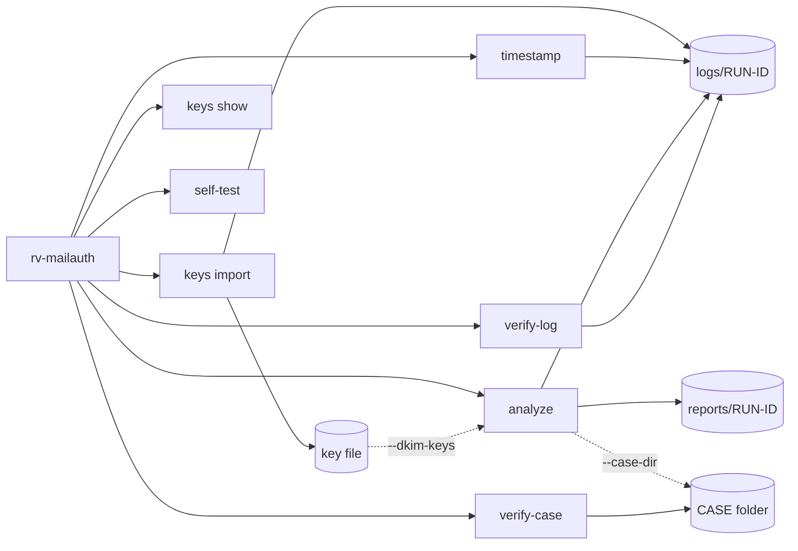

# Command-line reference

<!-- Generated by `rv-mailauth docs-cli`. Do not edit by hand: CI fails if this file differs. -->



## rv-mailauth

```text
DESCRIPTION:
  rv-mailauth looks for signals that an email was altered after it was sent or is not what it
  claims to be. It reads .eml (RFC 5322), Outlook .msg and .mbox files (every message of an mbox
  is an item of its own): a single file, a whole folder (bulk) or a list of files. For each one:
    1. opens the file read-only and hashes it in one pass with one or two algorithms;
    2. parses the headers: From, Sender, Reply-To, Return-Path, Message-ID, Date, every Received
       hop and Authentication-Results (headers.json); for .msg, the stored transport headers;
    3. verifies every DKIM signature and the ARC chain OFFLINE with the public keys you supply
       (--dkim-keys); nothing is looked up on the network unless you add --online (dkim.json);
    4. checks the Received hops against each other and against Date (order, time zones,
       --clock-skew), the Message-ID domain and the MIME structure;
    5. lists the attachments with their SHA-256 and embedded dates (--extract-attachments also
       copies them out);
    6. flags business-email-compromise (BEC) signals: lookalike domains and display names that
       imitate --own-domain, Reply-To/Return-Path at another organisation, payment-details wording;
    7. writes a technical review and a customer summary (HTML, PDF and JSON).
  Each message is parsed in a separate worker process with a time and memory limit (--isolation),
  so a hostile message cannot stop a bulk run. Each run also writes a statistics report and an
  audit trail under <OUT>/logs/<RUN-ID>/; every action is appended to a hash-chained log that
  `rv-mailauth verify-log` can check later. The result is a set of signals for an examiner, never
  a verdict that a message is authentic or forged.

  CASE FOLDER (--case-dir): Rakvor tools share one folder per case. rv-hashinv, the intake tool,
  registers each evidence file once (evidence ids E0001, E0002, ...). rv-mailauth is an analysis
  tool: before analysing a file it re-hashes it and verifies it against that registry, so the
  reports prove the examined file is bit-identical to the registered one. `rv-mailauth
  verify-case <CASE>` checks the whole case.

Usage: rv-mailauth <COMMAND>

Commands:
  analyze      Look for signals of alteration and BEC in emails: a file, a folder or a list of files
  keys         DKIM key files: import archived DNS TXT records, show what a key file holds
  verify-log   Verify an audit log (audit.jsonl): edited, deleted or re-ordered entries, and
               truncation
  self-test    Check every hash algorithm against known-answer test vectors
  timestamp    Add an RFC 3161 timestamp to a finished run (e.g. after working offline)
  verify-case  Verify a whole case folder: case log, evidence registry and every run's audit log
  help         Print this message or the help of the given subcommand(s)

Options:
  -h, --help
          Print help (see a summary with '-h')

  -V, --version
          Print version

Run `rv-mailauth <COMMAND> --help` for the options, examples and exit codes of each command.
```

## rv-mailauth analyze

```text
DESCRIPTION:
  rv-mailauth looks for signals that an email was altered after it was sent or is not what it
  claims to be. It reads .eml (RFC 5322), Outlook .msg and .mbox files (every message of an mbox
  is an item of its own): a single file, a whole folder (bulk) or a list of files. For each one:
    1. opens the file read-only and hashes it in one pass with one or two algorithms;
    2. parses the headers: From, Sender, Reply-To, Return-Path, Message-ID, Date, every Received
       hop and Authentication-Results (headers.json); for .msg, the stored transport headers;
    3. verifies every DKIM signature and the ARC chain OFFLINE with the public keys you supply
       (--dkim-keys); nothing is looked up on the network unless you add --online (dkim.json);
    4. checks the Received hops against each other and against Date (order, time zones,
       --clock-skew), the Message-ID domain and the MIME structure;
    5. lists the attachments with their SHA-256 and embedded dates (--extract-attachments also
       copies them out);
    6. flags business-email-compromise (BEC) signals: lookalike domains and display names that
       imitate --own-domain, Reply-To/Return-Path at another organisation, payment-details wording;
    7. writes a technical review and a customer summary (HTML, PDF and JSON).
  Each message is parsed in a separate worker process with a time and memory limit (--isolation),
  so a hostile message cannot stop a bulk run. Each run also writes a statistics report and an
  audit trail under <OUT>/logs/<RUN-ID>/; every action is appended to a hash-chained log that
  `rv-mailauth verify-log` can check later. The result is a set of signals for an examiner, never
  a verdict that a message is authentic or forged.

  CASE FOLDER (--case-dir): Rakvor tools share one folder per case. rv-hashinv, the intake tool,
  registers each evidence file once (evidence ids E0001, E0002, ...). rv-mailauth is an analysis
  tool: before analysing a file it re-hashes it and verifies it against that registry, so the
  reports prove the examined file is bit-identical to the registered one. `rv-mailauth
  verify-case <CASE>` checks the whole case.

Usage: rv-mailauth analyze [OPTIONS]

Options:
  -i, --input <PATH>
          File or folder to review. Repeat for several.
          
          Folders are reviewed one level deep unless --recursive is given. Symbolic links are not
          followed.
          Default: none (required unless --input-list, --case-dir or --evidence is given).
          Example: --input D:\evidence --input E:\phone-export\chat.txt

  -L, --input-list <FILE>
          Text file with one path per line (bulk review). Lines starting with # are ignored.
          
          Relative paths are resolved from the list file's folder.
          Default: none. Example: --input-list case-014-files.txt

  -r, --recursive
          Also review files in subfolders.
          
          Default: off (only the first level of each folder). Example: -i D:\evidence --recursive

  -H, --hash <ALGO>
          Hash algorithm(s): one or two of md5, sha1, sha256, sha512, sha3-256, blake3.
          
          Both are computed in the same read of each file. More than two is refused (exit code 2).
          Default: sha256. Example: --hash sha256,md5   or   --hash sha256 --hash blake3

  -o, --out <DIR>
          Folder where logs/ and reports/ are created. Created if missing. Ignored with --case-dir.
          
          Default: ./rakvor-out. Example: --out E:\case-014\rv-mailauth

  -l, --lang <LANG>
          Report language: en, es, fr, or all (one HTML and PDF per language). JSON is
          language-neutral.
          
          Default: en. Example: --lang es   or   --lang all

  -a, --actor <NAME>
          Name of the examiner, written in every audit entry and report.
          
          Default: the operating-system user name. Example: --actor "Ana Ruiz"

  -c, --case <ID>
          Case or engagement identifier printed on the reports. With --case-dir it names the case
          when the folder is created, and must match case.json afterwards (it can be left out).
          Default: none. Example: --case CASE-2026-014

  -p, --progress <MODE>
          How progress is shown: bar, jsonl or none.
          
          Default: bar (hidden automatically when stderr is not a terminal).
          Example: --progress jsonl

          Possible values:
          - bar:   Progress bar with elapsed time, throughput and ETA on stderr
          - jsonl: One JSON event per line on stdout (for scripts and other tools)
          - none:  No progress output; only the final summary

  -j, --jurisdiction <CC>
          Chain-of-custody form per item: co (Colombia, Fiscalía style, Spanish) or fr (France,
          scellés, French).
          An English copy is always added. With --case-dir the case's jurisdiction applies.
          Default: co
          Example: --jurisdiction fr

      --tsa-url <URL>
          RFC 3161 time-stamping authority for the audit chain head.
          Default: http://timestamp.digicert.com
          Example: --tsa-url https://freetsa.org/tsr

      --no-timestamp
          Do not request a trusted timestamp (offline labs). Also set by RV_NO_TIMESTAMP=1.
          Default: off (a timestamp is requested)
          Example: --no-timestamp

      --sign-cert <P12>
          Examiner's certificate (.p12/.pfx, RSA) used to sign every PDF report. The password is
          read from
          the environment variable named by --sign-pass-env, or asked for interactively.
          Default: none (PDFs are not signed)
          Example: --sign-cert C:\certs\ana-ruiz.p12

      --sign-pass-env <VAR>
          Environment variable holding the certificate password.
          Default: RV_SIGN_PASSWORD
          Example: --sign-pass-env CERT_PASS

      --case-dir <DIR>
          Shared case folder that links the Rakvor tools of one case (created with --case if
          missing).
          Outputs go to <DIR>/runs/rv-mailauth/<RUN-ID>/; every hashed file is registered in
          <DIR>/evidence/registry.json; the run is recorded in <DIR>/case-log.jsonl.
          With no --input, every registered item is examined again.
          Default: none (standalone run in --out)
          Example: --case-dir E:\CASE-014 --case CASE-014

  -E, --evidence <IDS>
          Registered evidence ids to examine (needs --case-dir), comma-separated or repeated.
          Default: none (the --input files, or every registered item)
          Example: --evidence E0001,E0007

      --dkim-keys <FILE>
          DKIM public keys to verify signatures with, OFFLINE: one record per key,
          "selector._domainkey.domain<TAB>v=DKIM1; k=rsa; p=..." or a BIND zone-file TXT record
          (see `keys import`). Use the keys published when the messages were sent. The file's
          SHA-256 and the keys it holds go into the audit log.
          Default: none (every signature is DKIM_KEY_NOT_AVAILABLE)
          Example: --dkim-keys E:\CASE-014\keys.txt

      --online
          Fetch the keys missing from --dkim-keys from TODAY's DNS (the system resolver). This is
          weaker evidence: the key published today may not be the one that signed the message
          (rotated, revoked, or re-published by whoever controls the domain now). Every lookup is
          an audit entry, and each result based on it carries DKIM_KEY_FROM_CURRENT_DNS (medium).
          Lookups run in the main process; worker processes never use the network.
          Default: off (no network access for DKIM)
          Example: --online

      --own-domain <DOMAIN>
          Your organisation's own domain, for the lookalike-domain and display-name checks.
          Repeat (or separate with commas) for several.
          Default: none (the lookalike and display-name checks have nothing to compare with)
          Example: --own-domain acme.example --own-domain acme-group.example

      --extract-attachments
          Copy every attachment, decoded, to <ITEM>/attachments/ (hashed and audited like every
          output). Attachments are always listed with their SHA-256, even without this option.
          Default: off
          Example: --extract-attachments

      --clock-skew <SECONDS>
          Clock difference tolerated between servers, in seconds (0 to 86400), before the order of
          the Received hops or a Date after the first hop is a finding.
          Default: 300
          Example: --clock-skew 900

      --mbox-variant <VARIANT>
          mbox flavour for un-escaping ">From " body lines: mboxrd or mboxo. The wrong flavour can
          change the body bytes, and so the DKIM body hash, of a message that quotes "From " lines.
          Default: mboxrd
          Example: --mbox-variant mboxo

      --max-message-mb <MB>
          Largest message parsed, in MiB (1 to 4096); a larger one is PARSER_FAILED (too_large).
          Default: 200
          Example: --max-message-mb 1024

      --max-mbox-messages <N>
          Messages analysed per mbox (1 to 10000000); the rest is listed as not analysed.
          Default: 50000
          Example: --max-mbox-messages 200000

      --worker-timeout <SECONDS>
          Seconds a worker process may spend on one message (1 to 86400) before it is stopped
          (PARSER_FAILED, timeout).
          Default: 120
          Example: --worker-timeout 600

      --worker-memory-mb <MB>
          Memory limit of one worker process in MiB (128 to 1048576): a job object on Windows, the
          address space on Linux/macOS. Exceeding it is PARSER_FAILED (memory_limit).
          Default: 1024
          Example: --worker-memory-mb 4096

      --isolation <MODE>
          Where messages are parsed: worker (a separate process per message, with the limits
          above) or in-process (no isolation; for debugging). The choice is in the audit log.
          Default: worker
          Example: --isolation in-process

      --item-reports <WHICH>
          Per-item report files for every item (all) or only for items with findings above info
          (flagged). Skipped items are still listed in the statistics report; each skip is audited.
          Default: all
          Example: --item-reports flagged

  -h, --help
          Print help (see a summary with '-h')

EXAMPLES:
  Review one message offline with the sender's archived DKIM key (SHA-256, English reports):
    rv-mailauth analyze --input evidence/invoice.eml --dkim-keys keys/example-org-2026.txt
  Review a folder and its subfolders with SHA-256 + MD5, Spanish reports, our own domain:
    rv-mailauth analyze -i D:\evidence -r --hash sha256,md5 --lang es --case CASE-2026-014 \
      --dkim-keys case-keys.txt --own-domain acme.example
  Review the files listed in a text file, reports in the three languages, machine-readable progress:
    rv-mailauth analyze --input-list files.txt --lang all --progress jsonl > events.jsonl
  Large mbox: copy the attachments out, reports only for flagged messages:
    rv-mailauth analyze -i E:\export\inbox.mbox --extract-attachments --item-reports flagged
  Turn archived DNS records into a key file first; verify the audit log afterwards:
    rv-mailauth keys import dns-archive-2026-03.zone --key-file case-keys.txt
    rv-mailauth verify-log rakvor-out/logs/<RUN-ID>/audit.jsonl
  Analyse every item registered in a case folder (after rv-hashinv intake), then verify the case:
    rv-mailauth analyze --case-dir E:\CASE-014 --dkim-keys E:\CASE-014\keys.txt
    rv-mailauth verify-case E:\CASE-014
  Analyse two registered items of the case only:
    rv-mailauth analyze --case-dir E:\CASE-014 --evidence E0001,E0002

EXIT CODES:
  0    Completed; no high-severity finding.
  1    Runtime error (input not found, output not writable, case log locked, ...).
       See the audit log.
  2    Usage error (unknown option, more than two hash algorithms, unsupported language, a
       --dkim-keys file that cannot be read, an invalid --own-domain). With --case-dir: folder
       of another case or schema, --case missing when creating the case, unknown evidence id.
  3    Completed with at least one high-severity finding (e.g. a DKIM body hash that no longer
       matches the body, evidence that differs from the case registry), or the case folder
       fails verification (nothing is written to it).
  130  Cancelled with Ctrl+C. Partial reports and the cancellation are written to the audit log.

FILES WRITTEN:
  <OUT>/logs/<RUN-ID>/audit.jsonl          Hash-chained log of every action (one JSON object/line).
  <OUT>/logs/<RUN-ID>/audit.log            The same actions, human-readable.
  <OUT>/logs/<RUN-ID>/hashes.csv           Hash register: index, path, size, digests, status; the
                                           messages of an mbox as <MBOX>#<n>@<offset>.
  <OUT>/logs/<RUN-ID>/environment.json     Tool and dependency versions, OS, host, user, arguments.
  <OUT>/logs/<RUN-ID>/timestamp-<SEQ>.tsr  RFC 3161 token for the audit chain head (+ .json).
  <OUT>/reports/<RUN-ID>/statistics.json   Run statistics (+ statistics.<LANG>.html and .pdf).
  <ITEM> = <OUT>/reports/<RUN-ID>/items/<NNNNN>-<NAME>; message n of an mbox, found at byte
           <offset>, is the item <NNNNN>-<NAME>_<n>_<offset> (a folder of its own):
  <ITEM>/headers.json                      Parsed headers, Received hops, Authentication-Results,
                                           .msg properties.
  <ITEM>/dkim.json                         Every DKIM signature and the ARC chain: result, key
                                           source (key file line or current DNS), alignment.
  <ITEM>/attachments/NNN-<NAME>            --extract-attachments: each attachment, decoded.
  <ITEM>/mbox_index.json                   mbox only: every message with its offset and length.
  <ITEM>/technical.json|.<LANG>.html|.pdf  Technical review (findings, headers, DKIM, attachments).
  <ITEM>/summary.json|.<LANG>.html|.pdf    Customer summary.
  <ITEM>/custody.json|.<es|fr|en>.html|.pdf  Chain-of-custody form.
  Every file under <ITEM> is hashed with the selected algorithms and recorded in the audit log.
  With --item-reports flagged, items without findings above info get no technical, summary or
  custody files (each skip is audited).
  With --case-dir <CASE>, logs/ and reports/ go to <CASE>/runs/rv-mailauth/<RUN-ID>/, and:
  <CASE>/case-log.jsonl                    Hash-chained case log of every tool: run_started and
                                           run_finished of this run are appended to it.
  <CASE>/case.json                         Case id and jurisdiction (only if the folder is new).
  The evidence registry (<CASE>/evidence/registry.json) is read, never written, by rv-mailauth.

FORENSIC NOTES:
  - Evidence is opened read-only and never modified; modification times are compared before and
    after. Work on a verified copy (write-blocked image or export), not on original media.
  - Findings are signals, not a verdict: a message without findings is not proven authentic, and
    a finding does not prove forgery. Read "What it does not prove" and the Limitations section.
  - DKIM shows that the signed headers and body are unchanged since a holder of the domain's
    signing key signed them. It does not show who wrote the message, that the display name is
    truthful, that unsigned headers are original, or when the message was sent. A message that
    passes can still be fraud sent from a real (compromised or lookalike) account.
  - Key at send time: a result is only as good as the key. Use the key published when the
    message was sent (archived DNS, the provider, passive DNS) and import it with `keys import`.
    Keys are rotated: today's key may not verify an old genuine message (DKIM_SIGNATURE_INVALID),
    and a key fetched today with --online is weaker evidence (DKIM_KEY_FROM_CURRENT_DNS).
  - DKIM_BODY_HASH_MISMATCH (high): the body differs from what was signed, whatever the key.
    DKIM_SIGNATURE_INVALID (medium) can come from edited signed headers or from a key that is not
    the one that signed; the tool cannot tell which.
  - Outlook .msg files keep the original transport headers only when Outlook stored them
    (PR_TRANSPORT_MESSAGE_HEADERS); without them (MSG_TRANSPORT_HEADERS_MISSING) there is
    nothing to verify. Outlook rebuilds the body, so DKIM over a .msg is reported as not
    evaluated, never as failed.
  - Received hops are written by each server: only the hops added by servers you trust (usually
    the recipient's own) are reliable. Times are compared with the --clock-skew tolerance.
  - BEC heuristics (lookalike domains, display-name imitation, Reply-To or Return-Path elsewhere,
    payment-details wording) are signals for review, never proof of fraud.
  - Each message is parsed in a worker process (without network on Linux) limited by
    --worker-timeout and --worker-memory-mb; a crash or limit is PARSER_FAILED for that item only.
  - Each audit entry stores the SHA-256 of the previous one; editing, deleting or re-ordering any
    line is detected by `verify-log`. The --dkim-keys file's SHA-256 and every --online lookup
    are in the audit log. Keep the log folder with the reports.
  - MD5 and SHA-1 are accepted for compatibility with older case files; pair them with SHA-256 or
    BLAKE3.
  - The chain head is timestamped by an RFC 3161 authority (proves when the log existed). Offline?
    The run finishes with `timestamp_pending`; run `rv-mailauth timestamp <LOG>` later.
  - With --sign-cert every PDF is signed with the examiner's certificate; the password is never
    logged.
  - Case folder: every item is compared with the registry (by --evidence id, else by path, else
    by content) before it is analysed; a different hash is the high finding
    EVIDENCE_HASH_MISMATCH_WITH_CASE (the analysis still runs), a file not in the registry is
    EVIDENCE_NOT_IN_CASE_REGISTRY (medium). The case log and registry digest are re-verified
    before every write; a broken case is refused (exit 3). Appends happen under case-log.lock.
  - Each run's audit.jsonl records case_linked (the case-log entry it started from); the case
    log records the run's final audit head, so the two chains vouch for each other.
```

## rv-mailauth keys

```text
DKIM key files: import archived DNS TXT records, show what a key file holds

Usage: rv-mailauth keys <COMMAND>

Commands:
  import  Turn archived DNS TXT records into a normalised DKIM key file; the import is audited
  show    List the keys of a key file: selector, domain, key type and bits
  help    Print this message or the help of the given subcommand(s)

Options:
  -h, --help
          Print help (see a summary with '-h')

DESCRIPTION:
  DKIM public keys for offline verification (`analyze --dkim-keys FILE`). A key file has one key
  per record: "selector._domainkey.domain<TAB>v=DKIM1; k=rsa; p=..." or a BIND zone-file TXT
  record. `keys import` turns archived DNS records into such a file and audits the import;
  `keys show` lists what a key file holds. Nothing is ever fetched from the network.

EXAMPLES:
  rv-mailauth keys import dns-archive-2026-03.zone --key-file case-keys.txt
  rv-mailauth keys show case-keys.txt
```

## rv-mailauth keys import

```text
Turn archived DNS TXT records into a normalised DKIM key file; the import is audited

Usage: rv-mailauth keys import [OPTIONS] --key-file <FILE> <FILE>...

Arguments:
  <FILE>...
          Archived DNS records: BIND zone files or "selector._domainkey.domain<TAB>TXT" lists.
          Read-only; their SHA-256 goes into the audit log and the key file header.
          Default: none (at least one is required)
          Example: dns-archive-2026-03.zone

Options:
      --key-file <FILE>
          The normalised key file to write (refused if it already exists).
          Default: none (required)
          Example: --key-file case-keys.txt

  -o, --out <DIR>
          Folder where logs/<RUN-ID>/ of the import is created. Created if missing.
          Default: ./rakvor-out
          Example: --out E:\case-014\rv-mailauth

  -a, --actor <NAME>
          Name of the examiner, written in every audit entry.
          Default: the operating-system user name
          Example: --actor "Ana Ruiz"

  -c, --case <ID>
          Case or engagement identifier recorded in the audit log.
          Default: none
          Example: --case CASE-2026-014

      --tsa-url <URL>
          RFC 3161 time-stamping authority for the audit chain head.
          Default: http://timestamp.digicert.com
          Example: --tsa-url https://freetsa.org/tsr

      --no-timestamp
          Do not request a trusted timestamp (offline labs). Also set by RV_NO_TIMESTAMP=1.
          Default: off (a timestamp is requested)
          Example: --no-timestamp

  -h, --help
          Print help (see a summary with '-h')

DESCRIPTION:
  Reads archived DNS TXT records (BIND zone-file lines, or "selector._domainkey.domain<TAB>TXT
  value" lines), keeps the records under selector._domainkey.domain and validates each one as a
  DKIM key record (v=DKIM1, k=rsa|ed25519, a usable p= key) with the parser `analyze` uses. Other
  record types (A, MX, SOA, ...), other TXT names (SPF, DMARC) and revoked keys (empty p=) are
  skipped and listed in the audit log. Identical duplicates are merged. The keys are written,
  sorted by name, to a new normalised key file whose header names every source and its SHA-256.
  Nothing is written if any DKIM record is malformed, has a name relative to $ORIGIN (write
  selector._domainkey.domain in full), or two different keys share one name.

FILES WRITTEN:
  <KEY-FILE>                            The normalised key file (never overwritten).
  <OUT>/logs/<RUN-ID>/audit.jsonl|.log  Hash-chained log of the import: keys_import_started
                                        (each source's path, size and SHA-256), key_imported
                                        (name, key type, bits, SHA-256 of the record),
                                        record_ignored, output_written (key file SHA-256).
  <OUT>/logs/<RUN-ID>/environment.json  Tool and dependency versions, OS, host, user, arguments.
  <OUT>/logs/<RUN-ID>/timestamp-<SEQ>.tsr  RFC 3161 token for the chain head (+ .json).

FORENSIC NOTES:
  - Record where each archive comes from (zone backup, provider export, passive DNS) and when it
    was valid: DKIM results are only as good as the key at send time.
  - The key file's SHA-256 printed here appears in the audit log of every `analyze` run that uses
    it. `rv-mailauth verify-log <LOG>` checks the import log later.

EXAMPLES:
  rv-mailauth keys import dns-archive-2026-03.zone --key-file case-keys.txt
  rv-mailauth keys import example-org.txt mailer-example-com.zone --key-file keys.txt -o E:\lab \
    --case CASE-014 --actor "Ana Ruiz"

EXIT CODES:
  0  The key file was written and the import logged.
  1  A source cannot be read, the key file already exists or cannot be written, or the audit log
     cannot be created.
  2  Usage error, or a DKIM record is malformed, two different keys share one name, or no DKIM
     key record was found (nothing is written).
```

## rv-mailauth keys show

```text
List the keys of a key file: selector, domain, key type and bits

Usage: rv-mailauth keys show <FILE>

Arguments:
  <FILE>
          Key file (as written by `keys import`, or by hand in the same format).
          Default: none (required)
          Example: case-keys.txt

Options:
  -h, --help
          Print help (see a summary with '-h')

DESCRIPTION:
  Lists every usable key of a key file (line, selector, domain, key type, bits) with the file's
  SHA-256, then every record `analyze` could not use. Nothing is written.

EXAMPLES:
  rv-mailauth keys show case-keys.txt
  rv-mailauth keys show examples/sample/dkim-keys.txt

EXIT CODES:
  0  Every record of the file is a usable DKIM key.
  1  The file cannot be read.
  2  At least one record is not a usable DKIM key (listed).
```

## rv-mailauth verify-log

```text
Verify an audit log (audit.jsonl): edited, deleted or re-ordered entries, and truncation

Usage: rv-mailauth verify-log [OPTIONS] <LOG>

Arguments:
  <LOG>
          Path to audit.jsonl, or to the run's log folder that contains it.
          
          Example: rakvor-out/logs/20261019T101500Z-a1b2c3

Options:
      --tsa-ca <PEM>
          CA bundle (PEM with one or more certificates, or one DER certificate) that the TSA
          certificate of every timestamp token must chain to, at the token's genTime.
          
          Default: none (the TSA signature is checked, the chain is not).
          Example: --tsa-ca C:\certs\tsa-roots.pem

  -h, --help
          Print help (see a summary with '-h')

CHECKS:
  - every entry links to the previous one (hash chain): an edited, deleted or re-ordered entry
    breaks it;
  - every timestamp token the log records (timestamp_obtained) is still next to it with its
    metadata (timestamp-<SEQ>.tsr with the recorded SHA-256, timestamp-<SEQ>.json agreeing): a
    missing file is a problem, never a skipped check; a token file no entry records is checked
    too. Every token covers the hash of the entry it names;
  - the TSA's CMS signature of every token: signer certificate in the token, ESS
    signing-certificate binding, message digest over TSTInfo, RSA signature, and an extended key
    usage that is critical and only timeStamping (RFC 3161). With --tsa-ca, also the TSA
    certificate path up to that CA bundle at the token's genTime (every candidate issuer tried;
    CA flag, keyCertSign, pathLenConstraint, directoryName name constraints, no unsupported
    critical extension); without it the output says "chain not checked". Revocation is
    never checked: establish it from CRL/OCSP evidence covering genTime;
  - truncation: a chain alone cannot show that entries were removed from its end. The log must
    still contain the entry covered by its RFC 3161 timestamp (covers_seq) and, for a run inside
    a case folder (<CASE>/runs/<TOOL>/<RUN-ID>/logs), end with the audit head that the case log
    recorded at run_finished (only timestamp_obtained may follow). Entries after the last
    anchored one are listed as not provable; with neither record the output says
    "truncation not detectable without a timestamp or case record".

EXAMPLES:
  rv-mailauth verify-log rakvor-out/logs/20261019T101500Z-a1b2c3/audit.jsonl
  rv-mailauth verify-log rakvor-out/logs/20261019T101500Z-a1b2c3
  rv-mailauth verify-log E:\CASE-014\runs\rv-mailauth\20261019T101500Z-a1b2c3\logs
  rv-mailauth verify-log rakvor-out/logs/20261019T101500Z-a1b2c3 --tsa-ca digicert-tsa-roots.pem

EXIT CODES:
  0  The chain is intact and agrees with its timestamps and case record (if any).
  1  The log or the --tsa-ca file cannot be read.
  3  The chain is broken (an entry was edited, deleted or re-ordered), a timestamp does not
     match or does not verify (altered token, invalid TSA signature, chain not trusted by
     --tsa-ca), or the log is shorter than its timestamp or case record says (truncated).
```

## rv-mailauth self-test

```text
Check every hash algorithm against known-answer test vectors

Usage: rv-mailauth self-test

Options:
  -h, --help
          Print help (see a summary with '-h')

EXAMPLES:
  rv-mailauth self-test

EXIT CODES:
  0  All algorithms give the published answer for the input "abc".
  1  At least one algorithm failed: do not use this build for evidence.
```

## rv-mailauth timestamp

```text
Add an RFC 3161 timestamp to a finished run (e.g. after working offline)

Usage: rv-mailauth timestamp [OPTIONS] <LOG>

Arguments:
  <LOG>
          The run's log folder (or its audit.jsonl).
          
          Example: rakvor-out/logs/20261019T101500Z-a1b2c3

Options:
      --tsa-url <URL>
          RFC 3161 time-stamping authority.
          Default: http://timestamp.digicert.com
          Example: --tsa-url https://freetsa.org/tsr

  -a, --actor <NAME>
          Name written in the new audit entry.
          Default: the operating-system user name
          Example: --actor "Ana Ruiz"

  -h, --help
          Print help (see a summary with '-h')

EXAMPLES:
  rv-mailauth timestamp rakvor-out/logs/20261019T101500Z-a1b2c3
  rv-mailauth timestamp rakvor-out/logs/20261019T101500Z-a1b2c3 --tsa-url https://freetsa.org/tsr

EXIT CODES:
  0  Timestamp obtained and logged.
  1  The TSA could not be reached (nothing changed; try again).
  3  The log is missing or broken: no timestamp is added.
```

## rv-mailauth verify-case

```text
Verify a whole case folder: case log, evidence registry and every run's audit log

Usage: rv-mailauth verify-case [OPTIONS] <CASE>

Arguments:
  <CASE>
          The case folder (the one that holds case.json).
          
          Example: E:\CASE-014

Options:
      --rehash
          Also re-hash every registered item still reachable and compare it with the registry.
          Default: off (only the registry's digest is checked)
          Example: --rehash

  -h, --help
          Print help (see a summary with '-h')

CHECKS:
  - case-log.jsonl is an intact hash chain starting with case_created; case.json is unchanged;
  - evidence/registry.json has the SHA-256 recorded at the last registry change;
  - every run announced in the case log has an intact audit.jsonl (and valid timestamp
    tokens: imprint and TSA signature; the TSA chain is not checked, use verify-log
    --tsa-ca), its case_linked entry points to its run_started entry, and the audit head
    recorded at run_finished is its final entry (only timestamp_obtained may follow);
  - with --rehash: every registered item still reachable at its registered path is read again
    and its digests are compared with the registry (the latest registration of a path).

EXAMPLES:
  rv-mailauth verify-case E:\CASE-014
  rv-mailauth verify-case E:\CASE-014 --rehash

EXIT CODES:
  0  The case folder is intact (warnings, e.g. a run still in progress or an item not
     reachable for --rehash, are printed).
  1  The folder is not a case folder (no case.json).
  3  At least one check failed: the case was edited, truncated or re-ordered, or (--rehash)
     an evidence file differs from the registry.
```

## rv-mailauth describe

```text
Describe this tool as JSON (schema rakvor.describe/1) for RV Hub and scripts

Usage: rv-mailauth describe [OPTIONS]

Options:
      --json
          Print JSON: one pretty-printed object with sorted keys.
          Default: on (JSON is the only format)
          Example: --json

  -h, --help
          Print help (see a summary with '-h')

DESCRIPTION:
  Prints what this tool is, what it accepts and how to launch it, validated by
  schemas/describe.schema.json. RV Hub reads it to list the tool, start its GUI on a case
  folder (rv-mailauth-gui.exe --case-dir <CASE> [FILES...]) and suggest the tool for a file.
  Fields: schema, tool, title, version, role (analysis), main_verb (analyze), accepts
  (extensions eml, mbox, msg; signatures of .msg and mbox), case_formats, log_formats, cli_exe,
  gui_exe, exit_codes. Nothing is read or written; no audit log is created.

EXAMPLES:
  rv-mailauth describe --json

EXIT CODES:
  0  The description was printed.
```

