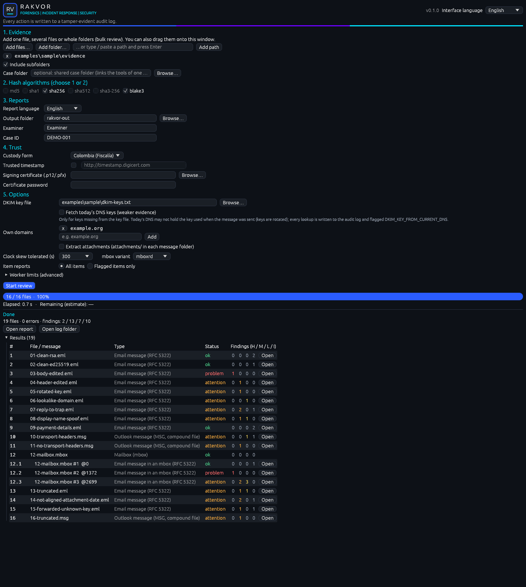
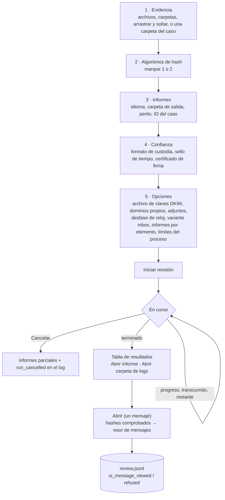
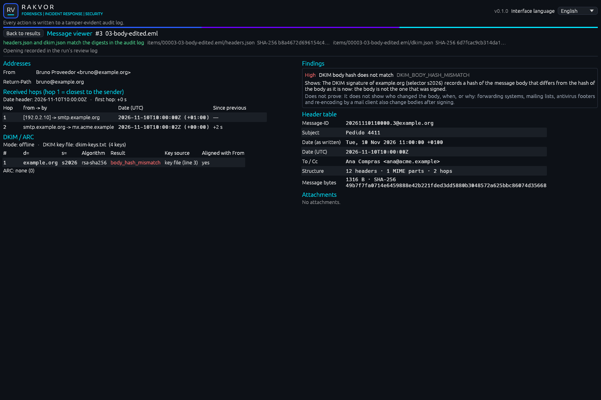

> La versión de referencia es la inglesa ([usage-gui.md](usage-gui.md)); esta traducción la sigue.

# Uso de la aplicación de escritorio (Windows 10/11)

Inicie **RV MailAuth** desde el menú Inicio (instalador) o haga doble clic en `rv-mailauth-gui.exe` (zip portable).
Usa el mismo motor que `rv-mailauth analyze`, no necesita otro software y también funciona en máquinas virtuales sin
controlador gráfico (renderizado por software). El idioma de la interfaz (English, Español, Français, arriba a la
derecha) cambia todas las etiquetas a la vez y es independiente del idioma de los informes.



## Flujo de trabajo



## La ventana

| Zona | Qué hace |
| --- | --- |
| **1. Evidencia** | *Agregar archivos…* y *Agregar carpeta…* abren los selectores de Windows; también puede arrastrar archivos o carpetas a la ventana (o al icono del `.exe` antes de que arranque), o pegar una ruta y pulsar Enter. *Incluir subcarpetas* está activada por defecto. `.eml`, `.msg` y `.mbox` se analizan como correo; los demás archivos se inventarían. **Carpeta del caso** enlaza la ejecución con una carpeta de caso compartida ([abajo](#carpeta-del-caso)). |
| **2. Algoritmos de hash** | Marque uno o dos (md5, sha1, sha256, sha512, sha3-256, blake3). Con dos marcados, los demás se desactivan; el último no se puede desmarcar. |
| **3. Informes** | Idioma de los informes (English, Español, Français o los tres), carpeta de salida, nombre del perito (por defecto su usuario de Windows), ID del caso opcional. |
| **4. Confianza** | *Formato de custodia* (Colombia, Fiscalía / Francia, scellé), *Sello de tiempo confiable* (activado por defecto; dirección de la TSA editable), *Certificado de firma* (`.p12`/`.pfx`) y su contraseña (solo en memoria, nunca registrada) para que se firme cada PDF. |
| **5. Opciones** | *Archivo de claves DKIM*: las claves públicas aportadas por el perito (como las escribe `rv-mailauth keys import`); sin él, las firmas no se pueden comprobar sin red. *Consultar las claves DNS de hoy (evidencia más débil)*: solo para las claves que faltan en el archivo; cada consulta se audita y se marca `DKIM_KEY_FROM_CURRENT_DNS`. *Dominios propios*: los dominios de su organización para las comprobaciones de dominios parecidos y de nombre visible (agregar / quitar con **x**). *Extraer los adjuntos*, *Desfase de reloj tolerado* (s), *Variante mbox* (mboxrd / mboxo), *Informes por elemento* (todos los elementos / solo elementos señalados), y en *Límites del proceso de análisis (avanzado)*: tiempo por mensaje, memoria por proceso, mensaje más grande analizado, mensajes analizados por mbox. |
| **Iniciar revisión / Cancelar** | Iniciar se habilita en cuanto hay evidencia (o una carpeta del caso). Durante una ejecución los ajustes quedan bloqueados y el botón pasa a ser *Cancelar*. |
| **Progreso** | Barra por bytes procesados, archivos hechos / total, tiempo transcurrido y tiempo restante estimado; debajo, el archivo que se está leyendo. |
| **Resultado** | Conteos (archivos, errores, hallazgos alto / medio / bajo / info), **Abrir informe** (página de estadísticas en el idioma de los informes) y **Abrir carpeta de logs**, luego la tabla **Resultados**: una fila por archivo y una fila sangrada por mensaje de un mbox (`12.2  12-mailbox.mbox #2 @1372`), con tipo, estado y conteos de hallazgos. |

## El visor de mensajes

**Abrir** en una fila de resultados muestra ese mensaje, releído **solo** a partir de las salidas auditadas de la
ejecución.



```mermaid
sequenceDiagram
    participant U as Perito
    participant G as GUI
    participant A as audit.jsonl (cadena verificada)
    participant F as items/…/headers.json, dkim.json
    participant R as review.jsonl
    U->>G: Abrir (fila)
    G->>A: verificar la cadena; leer los hashes output_written de los dos archivos
    G->>F: leer los dos archivos, SHA-256
    alt hashes iguales
        G-->>U: visor de mensajes (direcciones, saltos, DKIM/ARC, tabla de cabeceras, adjuntos, hallazgos)
        G->>R: ui_message_viewed {item, archivos + SHA-256, digest_ok: true}
    else un hash difiere o falta un archivo
        G-->>U: "Mensaje no mostrado" con el motivo
        G->>R: ui_message_refused {digest_ok: false, reason}
    end
```

| Sección | Muestra |
| --- | --- |
| Línea de cabecera | `#3  03-body-edited.eml` (con `@offset` para un mensaje de un mbox), luego "headers.json y dkim.json coinciden con los hashes del log de auditoría" con los dos hashes, y "Apertura registrada en el log de revisión de la ejecución" |
| Direcciones | From, Sender, Reply-To, Return-Path; se marca una dirección de otro dominio organizativo distinto del de From |
| Saltos Received | Salto 1 = el más cercano al remitente; from → by, fecha en UTC con la zona, tiempo desde el salto anterior; un salto anterior al previo se marca *fuera de orden*, un retraso de más de una hora *hueco*; la cabecera Date y su distancia al primer salto |
| DKIM / ARC | Modo (sin red / en línea) y el archivo de claves con su número de claves; por firma `d=`, `s=`, algoritmo, resultado (p. ej. `body_hash_mismatch` en rojo), origen de la clave (archivo de claves con su línea, DNS actual, ninguno), alineada con From; el resultado ARC |
| Tabla de cabeceras | Message-ID, Subject, Date tal como está escrita y en UTC, To/Cc, estructura (cabeceras, partes MIME, saltos), bytes del mensaje y SHA-256, problemas MIME, Authentication-Results tal como figura; para `.msg`, el estado de las cabeceras de transporte de Outlook y la hora de envío |
| Adjuntos | Nombre, tipo de contenido, tamaño, SHA-256, fechas incrustadas |
| Hallazgos | Cada hallazgo con su severidad, su código, lo que muestra y lo que no demuestra |

El visor trabaja sobre la ejecución terminada en esta ventana. Si el log de revisión no se puede escribir (por ejemplo,
una carpeta de solo lectura), la línea de estado lo indica y la entrada se anota en el preámbulo de auditoría de la
siguiente ejecución. `rv-mailauth verify-log <carpeta de logs>` y `verify-case` comprueban el log de revisión e
imprimen su número de entradas ([usage.es.md](usage.es.md#8-verificar-una-ejecución)).

## Carpeta del caso

Complete **Carpeta del caso** en la sección 1 para trabajar dentro de una carpeta de caso compartida
([case-folder.md](case-folder.md), en inglés). La **Carpeta de salida** muestra entonces
`<case>\runs\rv-mailauth\<RUN-ID>` y no se puede editar, y puede iniciar sin agregar evidencia (se analiza cada
elemento registrado). Para una carpeta que todavía no es un caso, complete también **ID del caso** y el formato de
custodia: se escriben una sola vez en `case.json` (el registro queda vacío: registre primero la evidencia con
rv-hashinv). Tras la ejecución, el panel de resultados lista el **ID de evidencia** de cada elemento y su control
contra el registro. El cambio se audita como `ui_case_dir_changed`.

RV Hub abre la aplicación con la carpeta del caso ya completada: `rv-mailauth-gui.exe --case-dir <CASE> [FILES...]`
(o `--case-dir=<CASE>`). El log de auditoría empieza entonces con `ui_case_dir_from_launcher`; un `--case-dir` sin
carpeta se ignora, se indica en la ventana y se registra como `ui_launch_argument_ignored`.

## Lo que registra la GUI

Sus elecciones forman parte del registro de la evidencia. Antes de que empiece la ejecución, la GUI las escribe en el
log de auditoría de la ejecución; lo que se consulta después de la ejecución va al log de revisión de la ejecución.

| Acción | Registrada como |
| --- | --- |
| Agregar / quitar evidencia | `ui_input_added`, `ui_input_removed` |
| Selección de hash, idioma de los informes, idioma de la interfaz, subcarpetas | `ui_hash_selection_changed`, `ui_language_changed`, `ui_interface_language_changed`, `ui_recursive_changed` |
| Carpeta del caso (escrita o desde RV Hub) | `ui_case_dir_changed`, `ui_case_dir_from_launcher`, `ui_launch_argument_ignored` |
| Ajustes de confianza | `ui_jurisdiction_changed`, `ui_timestamp_changed`, `ui_signing_certificate_changed` (solo la ruta, nunca la contraseña) |
| Opciones de correo | `ui_dkim_keys_changed`, `ui_online_dns_changed`, `ui_own_domain_added`, `ui_own_domain_removed`, `ui_extract_attachments_changed`, `ui_clock_skew_changed`, `ui_mbox_variant_changed`, `ui_item_reports_changed`, `ui_worker_timeout_changed`, `ui_worker_memory_changed`, `ui_max_message_size_changed`, `ui_max_mbox_messages_changed` |
| Pulsar Iniciar | `ui_start_clicked` (ajustes finales) |
| Pulsar Cancelar | `item_cancelled`, `run_cancelled` |
| Abrir un mensaje después de la ejecución | `ui_message_viewed` o `ui_message_refused` en `review.jsonl` |

Los errores durante la ejecución aparecen en **Advertencias** y en el log como `item_error`. Los mensajes de validación
mostrados antes de una ejecución (p. ej. "Add at least one file or folder") no se registran: todavía no existe ninguna
ejecución y, por tanto, ningún log.

## Mismos resultados que la línea de comandos

Una ejecución en la GUI con la misma evidencia, los mismos algoritmos, el mismo archivo de claves y las mismas opciones
da los mismos hashes y hallazgos que `rv-mailauth analyze`; `environment.json` registra `"frontend": "gui"` y los
ajustes usados, y cada mensaje se analiza en su propio proceso de análisis, como en la línea de comandos.
