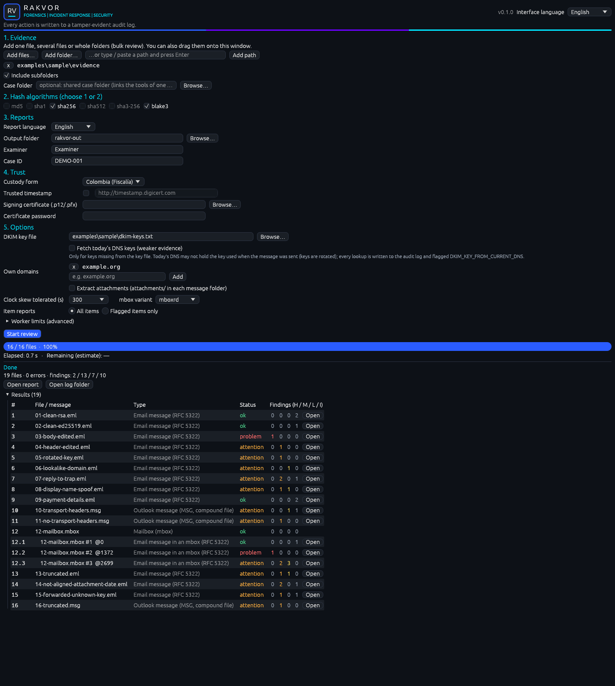
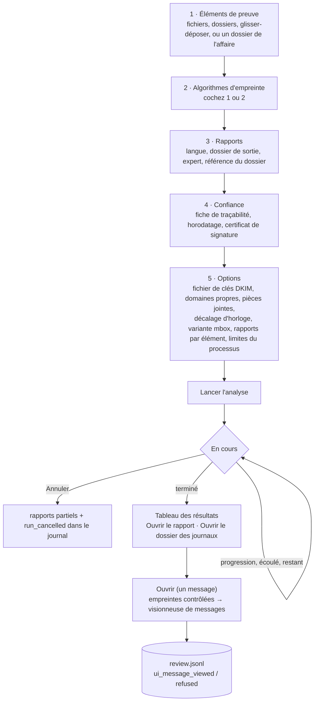
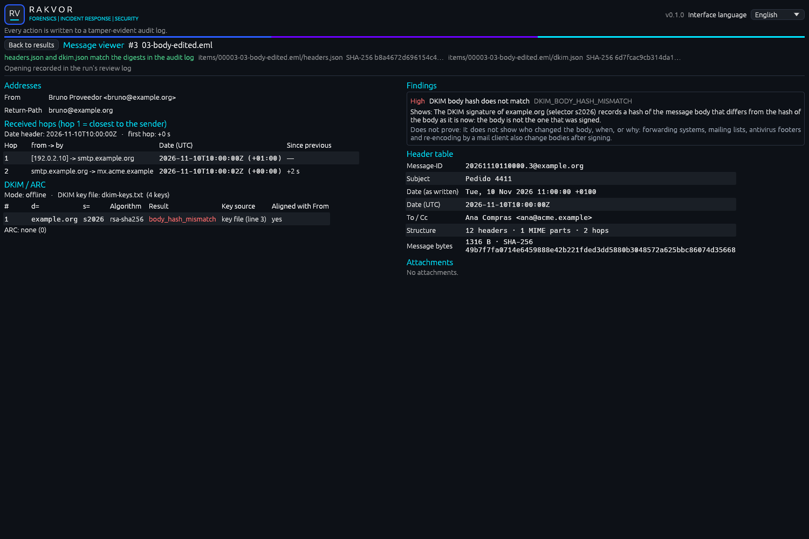

> La version de référence est la version anglaise ([usage-gui.md](usage-gui.md)) ; cette traduction la suit.

# Utiliser l'application de bureau (Windows 10/11)

Lancez **RV MailAuth** depuis le menu Démarrer (programme d'installation) ou double-cliquez sur `rv-mailauth-gui.exe`
(zip portable). Elle utilise le même moteur que `rv-mailauth analyze`, ne demande aucun autre logiciel et fonctionne
aussi sur des machines virtuelles sans pilote graphique (rendu logiciel). La langue de l'interface (English, Español,
Français, en haut à droite) change tous les libellés d'un coup et est indépendante de la langue des rapports.



## Déroulement



## La fenêtre

| Zone | Ce qu'elle fait |
| --- | --- |
| **1. Éléments de preuve** | *Ajouter des fichiers…* et *Ajouter un dossier…* ouvrent les sélecteurs de Windows ; vous pouvez aussi glisser des fichiers ou des dossiers sur la fenêtre (ou sur l'icône du `.exe` avant son lancement), ou coller un chemin et appuyer sur Entrée. *Inclure les sous-dossiers* est coché par défaut. Les `.eml`, `.msg` et `.mbox` sont analysés comme courriels ; les autres fichiers sont inventoriés. **Dossier de l'affaire** relie l'exécution à un dossier d'affaire partagé ([ci-dessous](#dossier-de-laffaire)). |
| **2. Algorithmes d'empreinte** | Cochez-en un ou deux (md5, sha1, sha256, sha512, sha3-256, blake3). Quand deux sont cochés, les autres sont désactivés ; le dernier ne peut pas être décoché. |
| **3. Rapports** | Langue des rapports (English, Español, Français, ou les trois), dossier de sortie, nom de l'expert (par défaut votre utilisateur Windows), référence du dossier facultative. |
| **4. Confiance** | *Fiche de possession* (Colombie, Fiscalía / France, scellé) pour la fiche de traçabilité, *Horodatage qualifié* (coché par défaut ; adresse de la TSA modifiable), *Certificat de signature* (`.p12`/`.pfx`) et son mot de passe (gardé en mémoire uniquement, jamais journalisé) pour que chaque PDF soit signé. |
| **5. Options** | *Fichier de clés DKIM* : les clés publiques fournies par l'expert (telles que les écrit `rv-mailauth keys import`) ; sans lui, les signatures ne peuvent pas être vérifiées hors ligne. *Interroger les clés DNS d'aujourd'hui (preuve plus faible)* : seulement pour les clés absentes du fichier ; chaque requête est auditée et signalée `DKIM_KEY_FROM_CURRENT_DNS`. *Domaines propres* : les domaines de votre organisation pour les contrôles de domaine sosie et de nom affiché (ajout / retrait avec **x**). *Extraire les pièces jointes*, *Décalage d'horloge toléré* (s), *Variante mbox* (mboxrd / mboxo), *Rapports par élément* (tous les éléments / éléments signalés seulement), et sous *Limites du processus d'analyse (avancé)* : délai par message, mémoire par processus, plus grand message analysé, messages analysés par mbox. |
| **Lancer l'analyse / Annuler** | Lancer est actif dès qu'il y a des éléments (ou un dossier de l'affaire). Pendant une exécution, les réglages sont verrouillés et le bouton devient *Annuler*. |
| **Progression** | Barre selon les octets traités, fichiers traités / total, temps écoulé et temps restant estimé ; le fichier en cours de lecture en dessous. |
| **Résultat** | Nombres (fichiers, erreurs, constatations élevées / moyennes / faibles / info), **Ouvrir le rapport** (page des statistiques dans la langue des rapports) et **Ouvrir le dossier des journaux**, puis le tableau **Résultats** : une ligne par fichier et une ligne en retrait par message d'un mbox (`12.2  12-mailbox.mbox #2 @1372`), avec le type, l'état et le nombre de constatations. |

## La visionneuse de messages

**Ouvrir** sur une ligne des résultats affiche ce message, relu **uniquement** à partir des sorties auditées de
l'exécution.



```mermaid
sequenceDiagram
    participant U as Expert
    participant G as GUI
    participant A as audit.jsonl (chaîne vérifiée)
    participant F as items/…/headers.json, dkim.json
    participant R as review.jsonl
    U->>G: Ouvrir (ligne)
    G->>A: vérifier la chaîne ; lire les empreintes output_written des deux fichiers
    G->>F: lire les deux fichiers, SHA-256
    alt empreintes égales
        G-->>U: visionneuse (adresses, sauts, DKIM/ARC, table des en-têtes, pièces jointes, constatations)
        G->>R: ui_message_viewed {item, fichiers + SHA-256, digest_ok: true}
    else une empreinte diffère ou un fichier manque
        G-->>U: « Message non affiché » avec la raison
        G->>R: ui_message_refused {digest_ok: false, reason}
    end
```

| Section | Affiche |
| --- | --- |
| Ligne d'en-tête | `#3  03-body-edited.eml` (avec `@offset` pour un message d'un mbox), puis « headers.json et dkim.json correspondent aux empreintes du journal d'audit » avec les deux empreintes, et « Ouverture consignée dans le journal de consultation de l'exécution » |
| Adresses | From, Sender, Reply-To, Return-Path ; une adresse d'un autre domaine organisationnel que celui de From est signalée |
| Sauts Received | Saut 1 = le plus proche de l'expéditeur ; from → by, date en UTC avec le fuseau, temps depuis le saut précédent ; un saut antérieur au précédent est marqué *hors d'ordre*, un délai de plus d'une heure *écart* ; l'en-tête Date et son écart avec le premier saut |
| DKIM / ARC | Mode (hors ligne / en ligne) et le fichier de clés avec son nombre de clés ; par signature `d=`, `s=`, algorithme, résultat (p. ex. `body_hash_mismatch` en rouge), source de la clé (fichier de clés avec sa ligne, DNS actuel, aucune), alignée avec From ; le résultat ARC |
| Table des en-têtes | Message-ID, Subject, Date telle qu'écrite et en UTC, To/Cc, structure (en-têtes, parties MIME, sauts), octets du message et SHA-256, problèmes MIME, Authentication-Results tel qu'indiqué ; pour un `.msg`, l'état des en-têtes de transport d'Outlook et l'heure d'envoi |
| Pièces jointes | Nom, type de contenu, taille, SHA-256, dates intégrées |
| Constatations | Chaque constatation avec sa gravité, son code, ce qu'elle montre et ce qu'elle ne prouve pas |

La visionneuse travaille sur l'exécution terminée dans cette fenêtre. Si le journal de consultation ne peut pas être
écrit (par exemple un dossier en lecture seule), la ligne d'état le dit et l'entrée est notée dans le préambule d'audit
de l'exécution suivante. `rv-mailauth verify-log <dossier des journaux>` et `verify-case` contrôlent le journal de
consultation et affichent son nombre d'entrées ([usage.fr.md](usage.fr.md#8-vérifier-une-exécution)).

## Dossier de l'affaire

Renseignez **Dossier de l'affaire** dans la section 1 pour travailler dans un dossier d'affaire partagé
([case-folder.md](case-folder.md), en anglais). Le **Dossier de sortie** affiche alors
`<case>\runs\rv-mailauth\<RUN-ID>` et n'est pas modifiable, et vous pouvez lancer sans ajouter d'élément (chaque
élément enregistré est analysé). Pour un dossier qui n'est pas encore une affaire, renseignez aussi
**Référence du dossier** et la fiche de traçabilité : elles sont écrites une seule fois dans `case.json` (le registre
reste vide : enregistrez d'abord les éléments avec rv-hashinv). Après l'exécution, le panneau des résultats liste
l'**identifiant** de chaque élément et son contrôle avec le registre. Le changement est audité comme
`ui_case_dir_changed`.

RV Hub ouvre l'application avec le dossier de l'affaire déjà renseigné : `rv-mailauth-gui.exe --case-dir <CASE>
[FILES...]` (ou `--case-dir=<CASE>`). Le journal d'audit commence alors par `ui_case_dir_from_launcher` ; un
`--case-dir` sans dossier est ignoré, affiché dans la fenêtre et journalisé comme `ui_launch_argument_ignored`.

## Ce que la GUI consigne

Vos choix font partie de la trace des éléments de preuve. Avant le début de l'exécution, la GUI les écrit dans le
journal d'audit de l'exécution ; la consultation après l'exécution va dans le journal de consultation de l'exécution.

| Action | Consignée sous |
| --- | --- |
| Ajouter / retirer un élément | `ui_input_added`, `ui_input_removed` |
| Sélection des empreintes, langue des rapports, langue de l'interface, sous-dossiers | `ui_hash_selection_changed`, `ui_language_changed`, `ui_interface_language_changed`, `ui_recursive_changed` |
| Dossier de l'affaire (saisi ou depuis RV Hub) | `ui_case_dir_changed`, `ui_case_dir_from_launcher`, `ui_launch_argument_ignored` |
| Réglages de confiance | `ui_jurisdiction_changed`, `ui_timestamp_changed`, `ui_signing_certificate_changed` (le chemin seulement, jamais le mot de passe) |
| Options de courriel | `ui_dkim_keys_changed`, `ui_online_dns_changed`, `ui_own_domain_added`, `ui_own_domain_removed`, `ui_extract_attachments_changed`, `ui_clock_skew_changed`, `ui_mbox_variant_changed`, `ui_item_reports_changed`, `ui_worker_timeout_changed`, `ui_worker_memory_changed`, `ui_max_message_size_changed`, `ui_max_mbox_messages_changed` |
| Clic sur Lancer | `ui_start_clicked` (réglages finaux) |
| Clic sur Annuler | `item_cancelled`, `run_cancelled` |
| Ouvrir un message après l'exécution | `ui_message_viewed` ou `ui_message_refused` dans `review.jsonl` |

Les erreurs pendant l'exécution apparaissent sous **Avertissements** et dans le journal comme `item_error`. Les
messages de validation affichés avant une exécution (p. ex. « Add at least one file or folder ») ne sont pas
journalisés : aucune exécution, et donc aucun journal, n'existe encore.

## Mêmes résultats que la ligne de commande

Une exécution dans la GUI avec les mêmes éléments, les mêmes algorithmes, le même fichier de clés et les mêmes options
donne les mêmes empreintes et les mêmes constatations que `rv-mailauth analyze` ; `environment.json` consigne
`"frontend": "gui"` et les réglages utilisés, et chaque message est analysé dans son propre processus d'analyse, comme
en ligne de commande.
