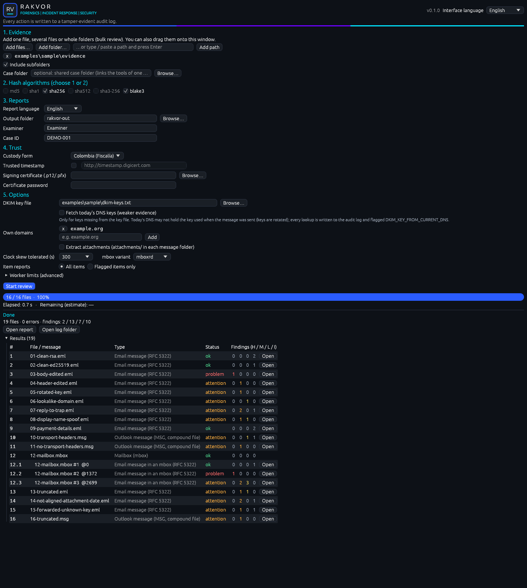
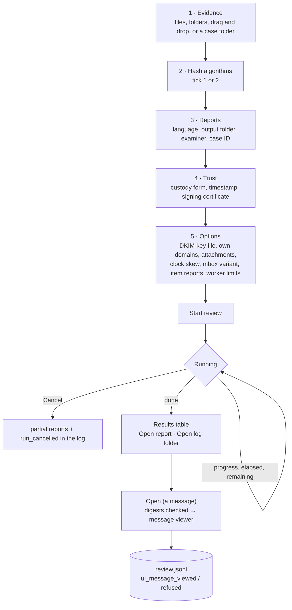
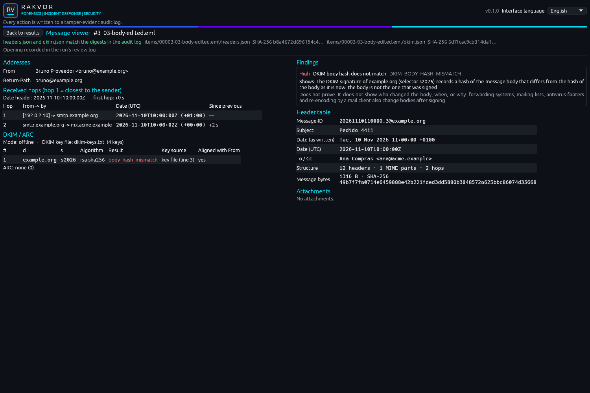

# Using the desktop app (Windows 10/11)

Start **RV MailAuth** from the Start menu (installer) or double-click `rv-mailauth-gui.exe` (portable zip). It
runs the same engine as `rv-mailauth analyze`, needs no other software, and also runs on virtual machines without a
graphics driver (software rendering). The interface language (English, Español, Français, top right) changes every
label at once and is independent of the report language.



## Workflow



## The window

| Area | What it does |
| --- | --- |
| **1. Evidence** | *Add files…* and *Add folder…* open the Windows pickers; you can also drag files or folders onto the window (or onto the `.exe` icon before it starts), or paste a path and press Enter. *Include subfolders* is on by default. `.eml`, `.msg` and `.mbox` are analysed as email; other files are inventoried. **Case folder** links the run to a shared case folder ([below](#case-folder)). |
| **2. Hash algorithms** | Tick one or two (md5, sha1, sha256, sha512, sha3-256, blake3). With two ticked, the others are disabled; the last one cannot be unticked. |
| **3. Reports** | Report language (English, Español, Français, or all three), output folder, examiner name (defaults to your Windows user), optional case ID. |
| **4. Trust** | *Custody form* (Colombia, Fiscalía / France, scellé), *Trusted timestamp* (on by default; TSA address editable), *Signing certificate* (`.p12`/`.pfx`) and its password (kept in memory only, never logged) so every PDF is signed. |
| **5. Options** | *DKIM key file* — the public keys supplied by the examiner (as written by `rv-mailauth keys import`); without it signatures cannot be checked offline. *Fetch today's DNS keys (weaker evidence)* — only for keys missing from the file; every lookup is audited and flagged `DKIM_KEY_FROM_CURRENT_DNS`. *Own domains* — your organisation's domains for the lookalike and display-name checks (add / remove with **x**). *Extract attachments*, *Clock skew tolerated* (s), *mbox variant* (mboxrd / mboxo), *Item reports* (all items / flagged items only), and under *Worker limits (advanced)*: timeout per message, memory per worker, largest message parsed, messages analysed per mbox. |
| **Start review / Cancel** | Start is enabled once evidence (or a case folder) is set. During a run the settings are locked and the button becomes *Cancel*. |
| **Progress** | Bar by bytes processed, files done / total, elapsed time and estimated time remaining; the file being read below. |
| **Result** | Counts (files, errors, findings high / medium / low / info), **Open report** (statistics page in the report language) and **Open log folder**, then the **Results** table: one row per file and one indented row per mbox message (`12.2  12-mailbox.mbox #2 @1372`), with type, status and finding counts. |

## The message viewer

**Open** on a results row shows that message, read back **only** from the run's audited outputs.



```mermaid
sequenceDiagram
    participant U as Examiner
    participant G as GUI
    participant A as audit.jsonl (chain verified)
    participant F as items/…/headers.json, dkim.json
    participant R as review.jsonl
    U->>G: Open (row)
    G->>A: verify the chain; read output_written digests of the two files
    G->>F: read both files, SHA-256
    alt digests equal
        G-->>U: message viewer (addresses, hops, DKIM/ARC, header table, attachments, findings)
        G->>R: ui_message_viewed {item, files + SHA-256, digest_ok: true}
    else a digest differs or a file is missing
        G-->>U: "Message not shown" with the reason
        G->>R: ui_message_refused {digest_ok: false, reason}
    end
```

| Section | Shows |
| --- | --- |
| Header line | `#3  03-body-edited.eml` (with `@offset` for an mbox message), then "headers.json and dkim.json match the digests in the audit log" with both digests, and "Opening recorded in the run's review log" |
| Addresses | From, Sender, Reply-To, Return-Path; an address of another organisational domain than From is marked |
| Received hops | Hop 1 = closest to the sender; from → by, date in UTC with the zone, time since the previous hop; a hop earlier than the previous one is marked *out of order*, a delay over one hour *gap*; the Date header and its distance to the first hop |
| DKIM / ARC | Mode (offline / online) and the key file with its key count; per signature `d=`, `s=`, algorithm, result (e.g. `body_hash_mismatch` in red), key source (key file with its line, current DNS, none), aligned with From; the ARC result |
| Header table | Message-ID, Subject, Date as written and in UTC, To/Cc, structure (headers, MIME parts, hops), message bytes and SHA-256, MIME problems, Authentication-Results as stated; for `.msg` the Outlook transport-headers status and submit time |
| Attachments | Name, content type, size, SHA-256, embedded dates |
| Findings | Each finding with severity, code, what it shows and what it does not prove |

The viewer works on the run finished in this window. If the review log cannot be written (for example a
read-only folder), the status line says so and the entry is noted in the audit preamble of the next run instead.
`rv-mailauth verify-log <log folder>` and `verify-case` check the review log and print its entry count
([usage.md](usage.md#8-verifying-a-run)).

## Case folder

Fill **Case folder** in section 1 to work inside a shared case folder ([case-folder.md](case-folder.md)). The
**Output folder** then shows `<case>\runs\rv-mailauth\<RUN-ID>` and cannot be edited, and you may start without
adding evidence (every registered item is analysed). For a folder that is not a case yet, also fill **Case ID** and
the custody form: they are written once to `case.json` (the registry stays empty: register the evidence with
rv-hashinv first). After the run, the result panel lists each item's **evidence id** and registry check. The
change is audited as `ui_case_dir_changed`.

RV Hub opens the app with the case folder already filled: `rv-mailauth-gui.exe --case-dir <CASE> [FILES...]` (or
`--case-dir=<CASE>`). The audit log then starts with `ui_case_dir_from_launcher`; a `--case-dir` without a folder
is ignored, shown in the window and logged as `ui_launch_argument_ignored`.

## What the GUI records

Your choices are part of the evidence record. Before the run starts, the GUI writes them to the run's audit log;
viewing after the run goes to the run's review log.

| Action | Logged as |
| --- | --- |
| Add / remove evidence | `ui_input_added`, `ui_input_removed` |
| Hash selection, report language, interface language, subfolders | `ui_hash_selection_changed`, `ui_language_changed`, `ui_interface_language_changed`, `ui_recursive_changed` |
| Case folder (typed or from RV Hub) | `ui_case_dir_changed`, `ui_case_dir_from_launcher`, `ui_launch_argument_ignored` |
| Trust settings | `ui_jurisdiction_changed`, `ui_timestamp_changed`, `ui_signing_certificate_changed` (path only, never the password) |
| Email options | `ui_dkim_keys_changed`, `ui_online_dns_changed`, `ui_own_domain_added`, `ui_own_domain_removed`, `ui_extract_attachments_changed`, `ui_clock_skew_changed`, `ui_mbox_variant_changed`, `ui_item_reports_changed`, `ui_worker_timeout_changed`, `ui_worker_memory_changed`, `ui_max_message_size_changed`, `ui_max_mbox_messages_changed` |
| Press Start | `ui_start_clicked` (final settings) |
| Press Cancel | `item_cancelled`, `run_cancelled` |
| Open a message after the run | `ui_message_viewed` or `ui_message_refused` in `review.jsonl` |

Errors during the run appear under **Warnings** and in the log as `item_error`. Validation messages shown before a
run (e.g. "Add at least one file or folder") are not logged: no run, and therefore no log, exists yet.

## Same results as the command line

A GUI run with the same evidence, algorithms, key file and options gives the same digests and findings as
`rv-mailauth analyze`; `environment.json` records `"frontend": "gui"` and the settings used, and each message is
analysed in its own worker process, as on the command line.
