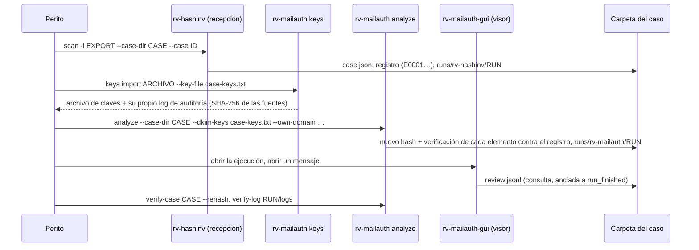

> La versión de referencia es la inglesa ([usage.md](usage.md)); esta traducción la sigue.

# Guía de uso: de la recepción de la evidencia a un caso verificado

Esta guía acompaña al perito en un caso de correo electrónico de principio a fin: registrar la evidencia con
**rv-hashinv**, preparar las claves DKIM, analizar con **rv-mailauth**, revisar los mensajes en la aplicación de
escritorio y verificar el caso completo antes de entregarlo. Las tareas habituales en breve:
[quick-guide.es.md](quick-guide.es.md). Cada opción: [usage-cli.md](usage-cli.md) (generado a partir de `--help`, en
inglés). La aplicación de escritorio: [usage-gui.es.md](usage-gui.es.md). Por qué funciona cada paso:
[theory.md](theory.md) (en inglés). Qué contiene cada informe: [reports.md](reports.md) (en inglés).



## Contenido

- [1. Antes de empezar](#1-antes-de-empezar)
- [2. Recorrido de un caso](#2-recorrido-de-un-caso) (con [RV Hub y `describe --json`](#26-inicio-desde-rv-hub---case-dir-y-describe---json))
- [3. Leer las salidas](#3-leer-las-salidas)
- [4. Interpretar cada hallazgo](#4-interpretar-cada-hallazgo)
- [5. Trabajar sin carpeta del caso](#5-trabajar-sin-carpeta-del-caso)
- [6. Sellos de tiempo](#6-sellos-de-tiempo)
- [7. Firmar los informes con el certificado del perito](#7-firmar-los-informes-con-el-certificado-del-perito)
- [8. Verificar una ejecución](#8-verificar-una-ejecución)
- [9. Solución de problemas](#9-solución-de-problemas)

## 1. Antes de empezar

| Comprobación | Cómo |
| --- | --- |
| La herramienta instalada es la versión auténtica y funciona | [installation.es.md](installation.es.md), pasos 2–6: `SHA256SUMS`, procedencia, Authenticode, `rv-mailauth self-test`, la ejecución de la muestra |
| La evidencia es una **exportación nativa** | Archivos `.eml` o un mbox exportados del servidor de correo o del buzón, a partir de una copia verificada (no impresiones ni reenvíos). `.msg` solo cuando no existe otra cosa: DKIM no se puede evaluar sobre él ([theory.md B12](theory.md#b12-outlook-msg-and-mbox), en inglés). PST/OST no se leen: expórtelos antes con una herramienta documentada |
| Las claves DKIM válidas **cuando se enviaron los mensajes** | De una zona archivada del dominio del remitente, del proveedor o de un servicio de DNS pasivo con fechas. Anote de dónde viene cada clave: el resultado vale lo que vale la clave ([theory.md A5](theory.md#a5-why-the-key-matters-and-why-keys-rotate), en inglés) |
| Los dominios propios de su organización (casos BEC) | Los dominios que imitaría un estafador: `--own-domain acme.example --own-domain acme-group.example` |
| El reloj del puesto | Sincronizado (fuente horaria anotada); el log de auditoría lo usa |
| Base legal | Mandato para examinar la correspondencia; base de protección de datos ([admissibility.md](admissibility.md#55-personal-data-and-the-secrecy-of-correspondence), en inglés) |

## 2. Recorrido de un caso

Los comandos y salidas que siguen son reales, de la muestra sintética ([examples/](../examples/README.md), en inglés)
copiada en `demo\evidence` (rutas abreviadas, sellos de tiempo desactivados).

### 2.1 Recepción con rv-hashinv

rv-hashinv abre la carpeta del caso y registra cada archivo una sola vez (ID de evidencia `E0001`…). rv-mailauth es una
herramienta de **análisis**: nunca escribe el registro ([case-folder.md](case-folder.md), en inglés).

```powershell
rv-hashinv scan -i demo\evidence --case-dir demo\CASE-DEMO --case CASE-DEMO --jurisdiction co --hash sha256,md5 --actor "Ana Ruiz"
#   items: 16  bytes: 60323  errors: 0  elapsed: 0.2 s
#   case:   CASE-DEMO (intake) registered 16 (new 16), verified 0, mismatched 0, not in registry 0
```

El mbox se registra como **un** archivo; sus mensajes pasan a ser elementos derivados en el análisis (2.3).

### 2.2 Preparar las claves DKIM

```powershell
rv-mailauth keys import demo\dkim-keys.txt --key-file demo\case-keys.txt -o demo\keys-log --case CASE-DEMO --actor "Ana Ruiz"
# OK  4 DKIM keys written to demo/case-keys.txt (sha256 8c0e8749…f9d7d9)
#     source demo/dkim-keys.txt sha256 f5de4068…5f09092e
rv-mailauth keys show demo\case-keys.txt
# LINE  SELECTOR   DOMAIN               TYPE      BITS
# 4     ed2026     example.org          ed25519    256
# 5     m1         mailer.example.com   rsa       2048
# 6     s2025      example.org          rsa       2048
# 7     s2026      example.org          rsa       2048
# 4 usable keys, 0 records not usable
```

(Aquí las claves públicas de la muestra hacen las veces de un archivo de zona archivado). `keys import` acepta
archivos de zona BIND y listas `selector._domainkey.domain<TAB>TXT`, conserva solo los registros de claves DKIM,
rechaza los registros mal formados y los duplicados en conflicto (no escribe nada, código de salida 2), nunca
sobrescribe un archivo de claves, y escribe su propio log de auditoría con el SHA-256 de cada fuente. Conserve el
archivo de zona, el archivo de claves y ese log con el caso.

### 2.3 Análisis

```powershell
rv-mailauth analyze --case-dir demo\CASE-DEMO --dkim-keys demo\case-keys.txt --own-domain acme.example --actor "Ana Ruiz"
# DONE (high-severity findings)  run 20261112T121910Z-2c3dd5
#   items: 19  bytes: 63410  errors: 0  elapsed: 2.5 s
#   findings: high 2, medium 13, low 7, info 10
#   case:   CASE-DEMO (analysis) registered 0 (new 0), verified 16, mismatched 0, not in registry 0
```

El código de salida 3 significa aquí "terminado, con al menos un hallazgo alto" (dos mensajes cuyo cuerpo ya no
coincide con su firma DKIM); no es un error. Sin `--input`, se analiza cada elemento registrado; `--evidence E0012`
analiza uno; `-i <archivo>` analiza un archivo y lo empareja con el registro por ruta y, si no, por contenido. La
ejecución vuelve a hashear cada archivo antes de analizarlo: un hash distinto es `EVIDENCE_HASH_MISMATCH_WITH_CASE`
(alto), un archivo que no está en el registro, `EVIDENCE_NOT_IN_CASE_REGISTRY` (medio).

Opciones que cambian el análisis (todas se registran en `analysis_configured`):

| Opción | Úsela cuando |
| --- | --- |
| `--dkim-keys FILE` | Siempre, cuando DKIM importa. Sin ella, cada firma cuyo hash del cuerpo coincide es `DKIM_KEY_NOT_AVAILABLE` |
| `--online` | Solo cuando no existe ningún archivo de zona, y dígalo: el DNS de hoy puede no contener la clave usada en el momento del envío; cada resultado lleva `DKIM_KEY_FROM_CURRENT_DNS` (medio) |
| `--own-domain D` | Casos BEC: activa las comprobaciones de dominio parecido y de nombre visible |
| `--clock-skew S` | Servidores con un desfase conocido (por defecto 300 s) |
| `--mbox-variant mboxo` | El exportador escribió mboxo (un `>` quitado solo de las líneas `>From `); la variante equivocada puede romper un hash del cuerpo |
| `--extract-attachments` | Necesita los archivos adjuntos (decodificados, hasheados, auditados); de todas formas siempre se listan con su SHA-256 |
| `--item-reports flagged` | Buzones grandes: informes por elemento solo para los elementos con hallazgos por encima de informativo |
| `--max-message-mb`, `--max-mbox-messages`, `--worker-timeout`, `--worker-memory-mb` | Mensajes o buzones muy grandes ([usage-cli.md](usage-cli.md#rv-mailauth-analyze), en inglés) |

### 2.4 Revisión en la aplicación de escritorio

Inicie `rv-mailauth-gui`, complete **Carpeta del caso** (o deje que RV Hub la abra), ejecute y luego abra cualquier
mensaje de la tabla de resultados: el **visor de mensajes** muestra las direcciones, los saltos Received con el tiempo
entre ellos, la tabla DKIM/ARC con el origen de la clave, la tabla de cabeceras, los adjuntos y los hallazgos, solo
después de comprobar que `headers.json` y `dkim.json` conservan los hashes registrados en el log de auditoría. Cada
apertura se escribe en el `review.jsonl` de la ejecución ([usage-gui.es.md](usage-gui.es.md)).

### 2.5 Verificar el caso completo

```powershell
rv-mailauth verify-case demo\CASE-DEMO --rehash
# OK  case CASE-DEMO: 6 case-log entries, 16 registered items, 2 runs verified: demo/CASE-DEMO
#     re-hashed 16 of 16 registered items: 16 match the registry
rv-mailauth verify-log demo\CASE-DEMO\runs\rv-mailauth\20261112T121910Z-2c3dd5\logs
# OK  156 entries, chain intact: …\audit.jsonl
#     truncation: the final entry #156 is anchored by the case log (run_finished)
```

Después de abrir dos mensajes en el visor, los dos comandos agregan una línea: `review entries: 2 (review.jsonl,
anchored to run_finished)` para `verify-log`, `review entries: 2` para `verify-case`. El `verify-case` de rv-hashinv
0.3.1 también acepta la carpeta (código de caso compartido; no imprime las entradas de revisión). Luego entregue la
carpeta del caso, el archivo de claves y su log de importación.

### 2.6 Inicio desde RV Hub: `--case-dir` y `describe --json`

RV Hub (el lanzador de Rakvor) encuentra las herramientas instaladas, las abre sobre una carpeta del caso y sugiere
cuál conviene para un archivo. Se apoya en dos puntos de entrada de RV MailAuth:

- **`rv-mailauth-gui.exe --case-dir <CASE> [FILES...]`** inicia la aplicación de escritorio con **Carpeta del caso** ya
  completada (`--case-dir=<CASE>` también funciona). Los demás argumentos se cargan como evidencia, como cuando se
  sueltan archivos sobre el icono. El ajuste se escribe en el log de auditoría de la ejecución como
  `ui_case_dir_from_launcher` seguido de `ui_case_dir_changed`; un `--case-dir` sin carpeta se ignora, se indica en la
  ventana y se registra como `ui_launch_argument_ignored`.
- **`rv-mailauth describe --json`** imprime un objeto JSON (claves ordenadas) que lee RV Hub; está oculto en
  `rv-mailauth --help` pero aparece en [usage-cli.md](usage-cli.md). No lee ni escribe nada. Esquema:
  [`schemas/describe.schema.json`](../schemas/describe.schema.json) (`rakvor.describe/1`, idéntico en toda
  herramienta Rakvor).

| Campo | Valor para rv-mailauth |
| --- | --- |
| `schema` | `rakvor.describe/1` |
| `tool`, `title`, `version` | `rv-mailauth`, `RV MailAuth`, la versión del producto (`version.txt`) |
| `role` | `analysis` (verifica la evidencia contra el registro; nunca lo escribe) |
| `main_verb` | `analyze` |
| `accepts` | extensiones `eml`, `mbox`, `msg`; firmas `d0cf11e0a1b11ae1` en el desplazamiento 0 (`.msg`, archivo compuesto OLE) y `46726f6d20` (`From `) en el desplazamiento 0 (mbox) |
| `case_formats`, `log_formats` | `rakvor.case/1`; `rakvor.audit/1` = `logs/audit.jsonl`, `rakvor.review/1` = `logs/review.jsonl` |
| `cli_exe`, `gui_exe` | `rv-mailauth.exe`, `rv-mailauth-gui.exe` |
| `exit_codes` | El significado de 0, 1, 2, 3 y 130 (tabla de la sección 9) |

## 3. Leer las salidas

```text
CASE-DEMO\runs\rv-mailauth\<RUN-ID>\
  logs\      audit.jsonl (+ audit.log), hashes.csv, environment.json, timestamp-*.tsr/.json, review.jsonl
  reports\   statistics.json / .<lang>.html / .pdf
             items\00001-01-clean-rsa.eml\        headers.json, dkim.json, technical.*, summary.*, custody.*
             items\00012-12-mailbox.mbox\         mbox_index.json (+ reports of the container)
             items\00012-12-mailbox.mbox_2_1372\  message 2 of the mbox, at byte 1372
```

Empiece por `statistics.<lang>.html` (conteos y tabla de elementos) y luego la revisión técnica de cada elemento
señalado. `hashes.csv` lista cada archivo de evidencia y cada mensaje de un mbox (`<mbox>#<n>@<offset>`). Los campos de
cada archivo: [reports.md](reports.md#per-message-outputs) (en inglés).

## 4. Interpretar cada hallazgo

Qué hace el perito a continuación; el texto que imprimen los informes está en
[reports.md](reports.md#findings-catalogue) (en inglés).

| Hallazgo (severidad) | Mire | No concluya |
| --- | --- | --- |
| `DKIM_BODY_HASH_MISMATCH` (alto) | El `bh=` de la firma; cualquier pie, lista o reenviador en los saltos; pida otra copia (el elemento enviado del remitente, una exportación del servidor) y compárelas | Quién cambió el cuerpo, ni que fuera malintencionado |
| `DKIM_SIGNATURE_INVALID` (medio) | La procedencia de la clave y sus fechas de validez para `s=`; qué cabeceras firmadas (`h=`) parecen editadas; vuelva a ejecutar con la clave válida en el momento del envío | Que se editaron cabeceras: una clave rotada o equivocada da el mismo resultado |
| `DKIM_KEY_NOT_AVAILABLE` (info) | Obtenga la clave del selector nombrado; vuelva a ejecutar | Nada sobre la firma |
| `DKIM_KEY_FROM_CURRENT_DNS` (medio) | Sustitúyala por una clave archivada; si no, dígalo | Nada seguro sobre la clave en el momento del envío |
| `DKIM_SIGNATURE_NOT_EVALUATED` (bajo) | El motivo: `msg_body_not_original` (pida el original MIME), "signature expired" (la etiqueta `x=` es anterior a hoy: compruebe `bh=` a mano, brecha G-MAIL4) | Nada sobre el mensaje |
| `DKIM_DOMAIN_NOT_ALIGNED` (medio) | Si el dominio firmante es el proveedor de correo del remitente o un servicio de marketing | Suplantación |
| `ARC_CHAIN_INVALID` (medio) | Los reenviadores en los saltos; aporte las claves de los selladores | Manipulación |
| `RECEIVED_TIME_NOT_MONOTONIC`, `DATE_AFTER_FIRST_HOP`, `TIMEZONE_INCONSISTENT` | Qué servidores pusieron la fecha de los saltos (los saltos del propio destinatario son los fiables); el reloj y la zona del dispositivo del remitente | Que se insertó una cabecera o se cambió una fecha |
| `MESSAGE_ID_DOMAIN_MISMATCH` (bajo) | El cliente o servicio de envío que genera los Message-ID | Falsificación |
| `ATTACHMENT_DATE_AFTER_SENT` (medio) | Los metadatos propios del adjunto; otras copias del adjunto | Que se sustituyó el adjunto |
| `MSG_TRANSPORT_HEADERS_MISSING` (medio) | Si el `.msg` es un borrador o un elemento enviado; pida el original | Que se quitaron cabeceras |
| `LOOKALIKE_DOMAIN`, `REPLY_TO_DIFFERS`, `DISPLAY_NAME_SPOOF` (medio) | Quién es el titular del dominio (fecha de registro, WHOIS), si la contraparte usa de verdad esa dirección, la correspondencia genuina anterior | Intención de engañar |
| `PAYMENT_DETAILS_MENTIONED` (info) | Si los datos bancarios cambiaron frente a mensajes genuinos anteriores; confírmelo por teléfono con un contacto conocido | Fraude |
| `AUTH_RESULTS_RECORDED` (info) | Qué servidor la escribió (`authserv_id`): solo tiene sentido la línea del propio servidor del destinatario | Que SPF/DKIM/DMARC pasaron: la línea es una afirmación, no se vuelve a comprobar |
| `FILE_STRUCTURE_DAMAGED`, `PARSER_FAILED` (medio) | Otra copia o exportación; `PARSER_FAILED` da el motivo (timeout, límite de memoria): suba el límite y vuelva a ejecutar | Que el archivo se dañó a propósito |
| `EVIDENCE_HASH_MISMATCH_WITH_CASE` (alto) | Los dos hashes en el informe; qué copia se analizó | Quién cambió el archivo |

## 5. Trabajar sin carpeta del caso

El mismo comando funciona de forma independiente (sin registro, sin log del caso); las salidas van a `--out` (por
defecto `.\rakvor-out`):

```powershell
rv-mailauth analyze -i D:\export -r --hash sha256,md5 --lang all --case CASE-2026-014 --dkim-keys case-keys.txt --own-domain acme.example --out D:\work\mail
```

Sin carpeta del caso, nada fuera de la ejecución ancla el final de su log de auditoría salvo el sello de tiempo
RFC 3161 ([§8](#8-verificar-una-ejecución)); use una carpeta del caso para los casos reales.

## 6. Sellos de tiempo

Por defecto, cada ejecución pide a la TSA (`http://timestamp.digicert.com`, se cambia con `--tsa-url`) que firme la
cabeza de la cadena de auditoría justo antes de escribir el informe de estadísticas. El token cubre cada hash de
evidencia, cada hallazgo y cada hash de informe por elemento registrados antes de él, no el informe de estadísticas ni
`run_finished`, que se escriben después ([theory.md B15](theory.md#b15-rfc-3161-trusted-timestamp), en inglés).

| Situación | Qué ocurre | Qué hacer |
| --- | --- | --- |
| TSA accesible | `timestamp_obtained`; archivos `timestamp-NNNNN.tsr` y `.json` en la carpeta de logs; el informe estadístico muestra la hora | Verifique con OpenSSL (abajo) |
| Sin red | `timestamp_pending`; la ejecución termina; advertencia en el informe estadístico y en la consola | Más tarde, con red: `rv-mailauth timestamp <carpeta de logs>` |
| `--no-timestamp` / `RV_NO_TIMESTAMP=1` / casilla desmarcada en la GUI | No hay solicitud | Use `rv-mailauth timestamp` más tarde si hace falta |
| Cadena rota | `rv-mailauth timestamp` se niega (salida 3): no se agrega sello de tiempo a un log roto | Investigue; no repare |

`verify-log` verifica el hash del token, que cubra la cabeza registrada y la firma CMS de la TSA
(`TSA signature valid (signer: …)`). La cadena del certificado de la TSA solo se valida con `--tsa-ca`:

```bash
rv-mailauth verify-log <log folder> --tsa-ca <TSA roots.pem>
# → … TSA signature valid (signer: …); chain validated to … (revocation not checked)
# sin --tsa-ca: … chain not checked (pass --tsa-ca <CA bundle> to validate it)
```

Un archivo de CA ilegible da salida 1; un fallo de firma o de cadena da salida 3; un token registrado en el log cuyo
`.tsr` o `.json` falta también da salida 3. La revocación nunca se verifica (brecha G18). Como verificación
independiente de **firma y cadena**, use OpenSSL (Git for Windows incluye `openssl.exe`); tampoco verifica la
revocación (no se le da ninguna CRL y OpenSSL no consulta OCSP):

```bash
cd <log folder>
N=00022                                                   # del nombre de archivo timestamp-00022.tsr
H=$(python -c "import json;print(json.load(open('timestamp-$N.json'))['head'])")
openssl ts -reply -in timestamp-$N.tsr -text              # genTime, policy OID, TSA name, serial, nonce, accuracy
openssl ts -reply -in timestamp-$N.tsr -token_out -out token.der
openssl pkcs7 -inform DER -in token.der -print_certs > tsa-certs.pem   # certificados enviados por la TSA
openssl ts -verify -digest "$H" -in timestamp-$N.tsr -CAfile <TSA root.pem> -untrusted tsa-certs.pem
# → "Verification: OK"  (solo la firma y la cadena, no la revocación)
```

Establezca por separado el estado de revocación del certificado de la TSA, a partir de evidencia CRL/OCSP que cubra
genTime (una CRL emitida después de genTime por la CA de la TSA, o una respuesta OCSP archivada en el momento del
sellado), p. ej.
`openssl verify -crl_check -CRLfile tsa-ca.crl -CAfile <TSA root.pem> -untrusted tsa-certs.pem -attime <genTime-epoch> tsa.pem`,
o `rv-certcheck analyze --crl … --ocsp …`. Obtenga el certificado raíz de la TSA en el repositorio de la propia TSA, no
del token. Guarde la salida en el expediente del caso: es la evidencia de que la hora es auténtica.

> **Fechas de la CRL y `-attime`.** OpenSSL aplica `-attime` también a la CRL, así que `openssl verify -crl_check -attime <genTime-epoch>` solo funciona con una CRL cuyo intervalo `thisUpdate`–`nextUpdate` contenga genTime; una CRL emitida después de genTime falla con "CRL is not yet valid". Para usar como evidencia una CRL posterior, verifique su firma (`openssl crl -in tsa-ca.crl -CAfile <TSA root.pem> -noout -verify`) y luego busque en ella el número de serie del certificado de la TSA (`openssl crl -in tsa-ca.crl -noout -text`): si no aparece, o aparece con una fecha de revocación posterior a genTime, no estaba revocado en genTime. Una CA puede quitar de sus CRL los certificados vencidos, así que para un certificado de TSA ya vencido un número de serie ausente no es concluyente: use una CRL anterior a su vencimiento, o una respuesta OCSP archivada en el momento del sellado.

## 7. Firmar los informes con el certificado del perito

`--sign-cert <file.p12|.pfx>` firma **cada informe PDF** (estadísticas, técnico, resumen, custodia) con su propio
certificado (solo claves RSA). La contraseña se lee de la variable de entorno indicada por `--sign-pass-env` (por
defecto `RV_SIGN_PASSWORD`) o se pide en la terminal (no se muestra nada mientras escribe). Nunca se registra; el log
registra `signing_certificate_loaded` con el sujeto y el SHA-256 del certificado, y cada informe imprime ambos
(`Signed by <subject> (certificate SHA-256 <fingerprint>)`). Una contraseña incorrecta detiene la ejecución
(`run_failed`, salida 1) antes de leer cualquier evidencia. En la GUI: *4. Confianza → Certificado de firma* y
*Contraseña del certificado* (solo en memoria).

```powershell
$s = Read-Host "Certificate password" -AsSecureString
$env:RV_SIGN_PASSWORD = [Runtime.InteropServices.Marshal]::PtrToStringBSTR(
    [Runtime.InteropServices.Marshal]::SecureStringToBSTR($s))
rv-mailauth analyze --case-dir D:\cases\CASE-2026-014 -i E:\export -r --sign-cert C:\certs\ana-ruiz.p12
Remove-Item Env:RV_SIGN_PASSWORD
(Get-PfxCertificate C:\certs\ana-ruiz.p12).GetCertHashString("SHA256")   # publique esta huella
```

Verifique un informe firmado con Adobe Acrobat/Reader (panel de firmas) o con pyHanko:
`pyhanko sign validate --pretty-print --trust <your CA or certificate .pem> technical.en.pdf` (resultado esperado:
intacto, cobertura del archivo completo). Los informes HTML y JSON no se firman; sus hashes están en la cadena de
auditoría sellada en el tiempo. El peso legal de esta firma depende del certificado
([admissibility.md](admissibility.md) G3).

## 8. Verificar una ejecución

Cualquiera (usted, un colega, el perito de la contraparte) puede verificar una ejecución con su carpeta de logs, su
carpeta de informes y la copia de la evidencia:

```powershell
rv-mailauth verify-log demo\CASE-DEMO\runs\rv-mailauth\20261112T121910Z-2c3dd5\logs
# OK  156 entries, chain intact: …\audit.jsonl
#     truncation: the final entry #156 is anchored by the case log (run_finished)
#     review entries: 2 (review.jsonl, anchored to run_finished)
#     outputs: 251 verified of 251 recorded (sha256)
# con sello de tiempo, una línea más por token, p. ej.:
#     timestamp 2026-11-12T11:52:14Z by http://timestamp.digicert.com covers entry #137: TSA signature valid (signer: …); chain not checked (…)
# y el token aparece después de la línea outputs:
#     not re-hashed: logs/timestamp-00137.tsr (RFC 3161 token: checked by the timestamp verification)
```

La línea `truncation:` dice qué respalda la longitud del log; `review entries` cuenta los mensajes abiertos en el visor
de la GUI después de la ejecución (un `review.jsonl` editado, o copiado de otra ejecución, deja el log en `BROKEN`).
Una ejecución independiente con sello de tiempo imprime
`truncation: entries up to #137 are anchored by the RFC 3161 timestamp (timestamp-00137.json); 3 entries after it
(timestamp_obtained, statistics_report_written, run_finished) cannot be proven complete`; una ejecución independiente
sin sello de tiempo imprime `truncation not detectable without a timestamp or case record`. Un log más corto que lo
que dicen su sello de tiempo o el registro del caso es `BROKEN` (`truncated: …`, código de salida 3).

La línea `outputs:` es el nuevo hash de cada archivo que, según el log, escribió la ejecución (los informes de cada
elemento, el `headers.json` y el `dkim.json` de cada mensaje, `mbox_index.json`, los adjuntos extraídos, los informes
de estadísticas, `hashes.csv`, `environment.json`), con cada algoritmo que registró el log; para un archivo, gana la
última entrada. Un archivo editado, borrado o sustituido después de la ejecución deja la ejecución en `BROKEN` (código
de salida 3) y se nombra (ejecución de la muestra, un byte agregado a `statistics.json`):

```text
BROKEN  …\audit.jsonl
  - output reports/statistics.json: sha256 differs from audit entry #155 (recorded 622c…e1f4, now 9d58…8efb): edited or replaced after the run
    outputs: 250 verified of 251 recorded (sha256), 1 changed
```

Un archivo borrado se lee `output reports/items/<folder>/dkim.json: missing (recorded by audit entry #N): deleted or
moved after the run`. Una ruta registrada que es absoluta, contiene `..` o se resuelve fuera de la carpeta de la
ejecución mediante un enlace simbólico o una unión se rechaza y nunca se lee. El token del sello de tiempo aparece como
`not re-hashed` porque la comprobación del sello de tiempo ya lo verifica; lo mismo ocurre con el archivo de claves de
`keys import`, escrito fuera de la carpeta de la ejecución. Los archivos que la ejecución no registró (cualquier cosa
agregada después a la carpeta) no se comprueban.

| Paso | Comando | Prueba |
| --- | --- | --- |
| 1 | `rv-mailauth verify-log <log>` (salida 0 intacto, 3 roto, truncado o una salida cambiada) | Ninguna entrada se editó, borró ni reordenó; el token del sello de tiempo coincide con la cabeza que cubre; el log sigue llegando a la entrada que cubre su sello de tiempo y, en una carpeta del caso, a la última entrada registrada en el log del caso (la línea `truncation:` nombra el ancla); `review.jsonl` intacto y anclado a esta ejecución |
| 2 | `python tests/verify_chain.py <log>` (árbol de código) | Lo mismo, con una implementación independiente; además vuelve a hashear la evidencia listada en `hashes.csv` (un mensaje de un mbox a partir de su rango de bytes en el mbox) y cada salida que registra el log de auditoría |
| 3 | OpenSSL ([Sellos de tiempo](#6-sellos-de-tiempo)) | La TSA realmente firmó esa cabeza en ese momento |
| 4 | Paso 1 (línea `outputs:`); el script de abajo para una comprobación independiente | Cada archivo de informe, cada salida por mensaje (`headers.json`, `dkim.json`, adjuntos, `mbox_index.json`), `environment.json` y `hashes.csv` conservan el hash registrado en el log |
| 5 | `rv-mailauth verify-case <CASE> --rehash` | La ejecución es la que anunció el log del caso, completa hasta su entrada final registrada, con cada salida registrada sin cambios; la evidencia accesible sigue coincidiendo con el registro |
| 6 | `python tests/validate_reports.py <CASE or report folder>` | Cada informe JSON, `case.json` y `registry.json` cumplen sus esquemas |

El paso 4 está integrado en `verify-log` y `verify-case`. Para comprobarlo con código que se lee en una pantalla (una
implementación independiente, p. ej. para el perito de la contraparte), vuelva a calcular el hash de cada archivo que
registró la ejecución:

```bash
python - "<log folder>" "<report folder>" <<'EOF'
import hashlib, json, pathlib, sys
log, rep = pathlib.Path(sys.argv[1]), pathlib.Path(sys.argv[2])
def digest(p, algo):
    h = hashlib.new({"sha3-256": "sha3_256"}.get(algo, algo)); h.update(p.read_bytes()); return h.hexdigest()
checked = bad = 0
for line in (log / "audit.jsonl").open(encoding="utf-8"):
    e = json.loads(line); a, d = e["action"], e["details"]
    if a == "item_reports_written":
        files = {rep / d["folder"] / k: v for k, v in d["files"].items()}
    elif a == "statistics_report_written":
        files = {rep / k: v for k, v in d["files"].items()}
    elif a == "output_written":
        files = {rep / d["file"]: d["hashes"]}
    elif a in ("environment_recorded", "hash_register_written"):
        files = {log / e["item"]: d}
    else:
        continue
    for p, digests in files.items():
        algo = next(x for x in ("sha256", "sha512", "sha3-256", "sha1", "md5") if x in digests)
        checked += 1
        got = digest(p, algo) if p.is_file() else "missing"
        if got != digests[algo]:
            bad += 1; print("MISMATCH", p, algo, got)
print(f"{checked} files checked, {bad} mismatches"); sys.exit(3 if bad else 0)
EOF
```

Sobre la ejecución de la muestra en una carpeta del caso (19 elementos, informes en inglés) comprueba 251 archivos;
agregar un byte a `statistics.json` da `MISMATCH … statistics.json` y el código de salida 3. Un solo archivo en
PowerShell: `(Get-FileHash <archivo> -Algorithm SHA256).Hash.ToLower()` y busque el valor en `audit.jsonl`.

## 9. Solución de problemas

### Códigos de salida

| Comando | 0 | 1 | 2 | 3 | 130 |
| --- | --- | --- | --- | --- | --- |
| `analyze` | terminado, ningún hallazgo alto | error de ejecución (entrada inexistente, salida no escribible, contraseña del certificado incorrecta, log del caso bloqueado) | error de uso (opción o algoritmo desconocidos, tres algoritmos, idioma desconocido, un archivo `--dkim-keys` ilegible, un `--own-domain` no válido; con `--case-dir`: carpeta de otro caso, falta `--case` al crearla, ID de evidencia desconocido) | terminado, ≥ 1 hallazgo alto; o la carpeta del caso no pasa la verificación (no se escribe nada) | cancelado (Ctrl+C), informes parciales escritos |
| `verify-log` | intacto | log ilegible | — | cadena rota, token que no coincide, truncado (más corto que su sello de tiempo o su registro del caso), o una salida registrada editada, borrada o sustituida | — |
| `verify-case` | caso intacto (se imprimen avisos) | no es una carpeta de caso (no tiene `case.json`) | — | al menos una comprobación falló, p. ej. cambió una salida registrada de una ejecución (con `--rehash`: un archivo de evidencia difiere del registro) | — |
| `timestamp` | obtenido y registrado | TSA inaccesible (no cambió nada) | — | log ausente, roto o ilegible (no se agrega nada) | — |
| `keys import` | archivo de claves escrito, importación registrada | una fuente ilegible, el archivo de claves ya existe o no se puede escribir | error de uso, un registro DKIM mal formado, dos claves con el mismo nombre, o ningún registro DKIM (no se escribe nada) | — | — |
| `keys show` | cada registro es una clave utilizable | archivo ilegible | al menos un registro no es una clave utilizable (se lista) | — | — |
| `self-test` | todo pasa | un fallo: no use este programa | — | — | — |
| `describe` | descripción impresa | — | error de uso (opción desconocida) | — | — |

### Mensajes

| Mensaje | Solución |
| --- | --- |
| `at most 2 hash algorithms can run at the same time (got 3)` | Elija uno o dos algoritmos |
| `unknown hash algorithm '…': use md5, sha1, sha256, sha512, sha3-256 or blake3` | Ortografía: `sha3-256` (también `sha3`, `sha3_256`) |
| `… is neither a file nor a folder (symbolic links are not followed)` | Apunte al destino del enlace, o cópielo |
| `--dkim-keys …: not a readable file` (salida 2) | Compruebe la ruta; ejecute `rv-mailauth keys show <archivo>` |
| `'…' is not a domain name (e.g. acme.example)` (salida 2) | `--own-domain` acepta dominios, no direcciones ni URL (se aceptan `@acme.example` y un punto final) |
| `error: not imported (nothing written): records that are not usable DKIM keys:` (`keys import`) | Corrija o quite los registros listados (un nombre relativo a `$ORIGIN` debe escribirse completo: `selector._domainkey.domain`) |
| `error: … already exists: choose another --key-file` (`keys import`) | Un archivo de claves importado nunca se sobrescribe: elija un nombre nuevo |
| Todas las firmas son `DKIM_KEY_NOT_AVAILABLE` | No hay `--dkim-keys`, o el archivo de claves no tiene ningún registro para esos `s=`/`d=`; `keys show` lista lo que contiene |
| `PARSER_FAILED` (motivo `timeout` o `memory_limit`) | Suba `--worker-timeout` / `--worker-memory-mb` y vuelva a ejecutar; el resto de la ejecución no se ve afectado |
| Un mensaje de un mbox falla DKIM mientras las otras copias se verifican | Pruebe `--mbox-variant mboxo` (o `mboxrd`) para coincidir con el exportador ([theory.md B12](theory.md#b12-outlook-msg-and-mbox), en inglés) |

| Mensaje | Solución |
| --- | --- |
| `… is not a case folder yet: give --case ID (and --jurisdiction) to create it` | Primera ejecución en una carpeta del caso nueva: agregue `--case` |
| `the case folder … belongs to case X, not Y` | Carpeta equivocada o `--case` equivocado; omita `--case` después de la creación |
| `evidence id(s) not in the case registry: E0042` | Revise `evidence\registry.csv`; los ID son `E` + número (`e7` = `E0007`) |
| `--evidence needs an existing case folder with a registry` | Haga primero la recepción |
| `refusing to extend a broken case (…)` / `the case folder … fails verification` | Ejecute `verify-case`; investigue qué cambió; **no repare** a mano un log del caso: abra una carpeta del caso nueva y documente por qué |
| `the case log is locked by <tool> run <id> (since …)` | Otra herramienta está escribiendo; espere y vuelva a ejecutar |
| `stale case lock … held by … for more than 10 minutes` | Asegúrese de que ninguna herramienta Rakvor esté trabajando en el caso, luego borre `case-log.lock` a mano (nunca es automático) y anótelo en el expediente del caso |
| `cannot load signing certificate …: wrong password or unsupported file` | Revise `RV_SIGN_PASSWORD`; el archivo debe ser un `.p12`/`.pfx` con clave privada |
| `only RSA signing certificates are supported` | Use un certificado RSA (ECDSA no se admite para firmar informes) |
| `warning: timestamp pending (…)` | Ver [Sellos de tiempo](#6-sellos-de-tiempo) |
| `refusing to append to a broken audit log` (`timestamp`) | El log fue editado; investigue con `verify-log`; no repare |
| `no audit log at …: nothing to timestamp` (`timestamp`) | Indique la carpeta `logs\<RUN-ID>` de la ejecución (o su `audit.jsonl`) |
| `truncated: …` (`verify-log`) | Se quitaron entradas del final del log después de hacerse el sello de tiempo o el registro del caso; investigue, no repare |
