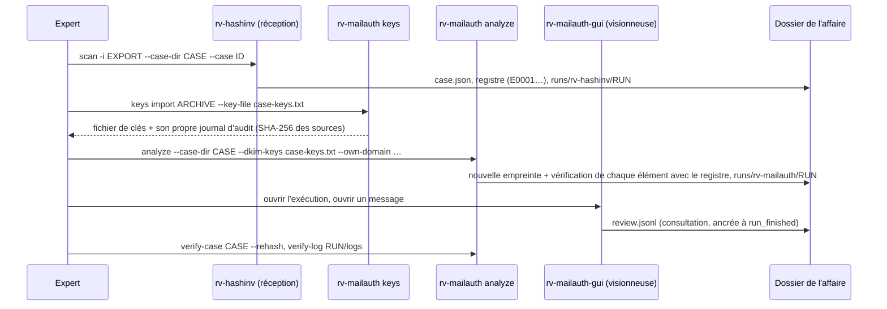

> La version de référence est la version anglaise ([usage.md](usage.md)) ; cette traduction la suit.

# Guide d'utilisation : de l'enregistrement à une affaire vérifiée

Ce guide accompagne l'expert dans une affaire de courriel de bout en bout : enregistrer les éléments avec
**rv-hashinv**, préparer les clés DKIM, analyser avec **rv-mailauth**, examiner les messages dans l'application de
bureau et vérifier toute l'affaire avant de la remettre. Les tâches courantes en bref :
[quick-guide.fr.md](quick-guide.fr.md). Chaque option : [usage-cli.md](usage-cli.md) (généré à partir de `--help`, en
anglais). L'application de bureau : [usage-gui.fr.md](usage-gui.fr.md). Pourquoi chaque étape fonctionne :
[theory.md](theory.md) (en anglais). Ce que contient chaque rapport : [reports.md](reports.md) (en anglais).



## Sommaire

- [1. Avant de commencer](#1-avant-de-commencer)
- [2. Parcours d'une affaire](#2-parcours-dune-affaire) (avec [RV Hub et `describe --json`](#26-démarrer-depuis-rv-hub---case-dir-et-describe---json))
- [3. Lire les sorties](#3-lire-les-sorties)
- [4. Interpréter chaque constatation](#4-interpréter-chaque-constatation)
- [5. Travailler sans dossier d'affaire](#5-travailler-sans-dossier-daffaire)
- [6. Horodatages](#6-horodatages)
- [7. Signer les rapports avec le certificat de l'expert](#7-signer-les-rapports-avec-le-certificat-de-lexpert)
- [8. Vérifier une exécution](#8-vérifier-une-exécution)
- [9. Dépannage](#9-dépannage)

## 1. Avant de commencer

| Contrôle | Comment |
| --- | --- |
| L'outil installé est la version authentique et fonctionne | [installation.fr.md](installation.fr.md), étapes 2–6 : `SHA256SUMS`, provenance, Authenticode, `rv-mailauth self-test`, l'exécution de l'échantillon |
| Les éléments sont un **export natif** | Des fichiers `.eml` ou un mbox exportés du serveur de messagerie ou de la boîte aux lettres, à partir d'une copie vérifiée (pas d'impressions ni de transferts). Le `.msg` seulement quand rien d'autre n'existe : DKIM ne peut pas y être évalué ([theory.md B12](theory.md#b12-outlook-msg-and-mbox), en anglais). Les PST/OST ne sont pas lus : exportez-les d'abord avec un outil documenté |
| Les clés DKIM valides **à l'envoi des messages** | D'une zone archivée du domaine de l'expéditeur, du fournisseur, ou d'un service de DNS passif daté. Notez d'où vient chaque clé : le résultat ne vaut que ce que vaut la clé ([theory.md A5](theory.md#a5-why-the-key-matters-and-why-keys-rotate), en anglais) |
| Les domaines propres de votre organisation (affaires BEC) | Les domaines qu'un fraudeur imiterait : `--own-domain acme.example --own-domain acme-group.example` |
| L'horloge du poste | Synchronisée (source de temps notée) ; le journal d'audit l'utilise |
| Base légale | Mandat d'examiner la correspondance ; base de protection des données ([admissibility.md](admissibility.md#55-personal-data-and-the-secrecy-of-correspondence), en anglais) |

## 2. Parcours d'une affaire

Les commandes et sorties ci-dessous sont réelles, issues de l'échantillon synthétique
([examples/](../examples/README.md), en anglais) copié dans `demo\evidence` (chemins abrégés, horodatages désactivés).

### 2.1 Réception avec rv-hashinv

rv-hashinv ouvre le dossier de l'affaire et enregistre chaque fichier une seule fois (identifiants `E0001`…).
rv-mailauth est un outil d'**analyse** : il n'écrit jamais le registre ([case-folder.md](case-folder.md), en anglais).

```powershell
rv-hashinv scan -i demo\evidence --case-dir demo\CASE-DEMO --case CASE-DEMO --jurisdiction co --hash sha256,md5 --actor "Ana Ruiz"
#   items: 16  bytes: 60323  errors: 0  elapsed: 0.2 s
#   case:   CASE-DEMO (intake) registered 16 (new 16), verified 0, mismatched 0, not in registry 0
```

Le mbox est enregistré comme **un** fichier ; ses messages deviennent des éléments dérivés dans l'analyse (2.3).

### 2.2 Préparer les clés DKIM

```powershell
rv-mailauth keys import demo\dkim-keys.txt --key-file demo\case-keys.txt -o demo\keys-log --case CASE-DEMO --actor "Ana Ruiz"
# OK  4 DKIM keys written to demo/case-keys.txt (sha256 8c0e8749…f9d7d9)
#     source demo/dkim-keys.txt sha256 f5de4068…5f09092e
rv-mailauth keys show demo\case-keys.txt
# LINE  SELECTOR   DOMAIN               TYPE      BITS
# 4     ed2026     example.org          ed25519    256
# 5     m1         mailer.example.com   rsa       2048
# 6     s2025      example.org          rsa       2048
# 7     s2026      example.org          rsa       2048
# 4 usable keys, 0 records not usable
```

(Ici, les clés publiques de l'échantillon tiennent lieu d'archive.) `keys import` accepte les fichiers de zone BIND et
les listes `selector._domainkey.domain<TAB>TXT`, ne garde que les enregistrements de clés DKIM, refuse les
enregistrements mal formés et les doublons contradictoires (rien n'est écrit, code de sortie 2), n'écrase jamais un
fichier de clés, et écrit son propre journal d'audit avec le SHA-256 de chaque source. Gardez l'archive, le fichier de
clés et ce journal avec l'affaire.

### 2.3 Analyse

```powershell
rv-mailauth analyze --case-dir demo\CASE-DEMO --dkim-keys demo\case-keys.txt --own-domain acme.example --actor "Ana Ruiz"
# DONE (high-severity findings)  run 20261112T121910Z-2c3dd5
#   items: 19  bytes: 63410  errors: 0  elapsed: 2.5 s
#   findings: high 2, medium 13, low 7, info 10
#   case:   CASE-DEMO (analysis) registered 0 (new 0), verified 16, mismatched 0, not in registry 0
```

Le code de sortie 3 signifie ici « terminé, avec au moins une constatation élevée » (deux messages dont le corps ne
correspond plus à leur signature DKIM) ; ce n'est pas une erreur. Sans `--input`, chaque élément enregistré est
analysé ; `--evidence E0012` en analyse un ; `-i <fichier>` analyse un fichier et le rapproche du registre par chemin,
sinon par contenu. L'exécution hache de nouveau chaque fichier avant de l'analyser : une empreinte différente est
`EVIDENCE_HASH_MISMATCH_WITH_CASE` (élevée), un fichier absent du registre `EVIDENCE_NOT_IN_CASE_REGISTRY` (moyenne).

Options qui changent l'analyse (toutes consignées dans `analysis_configured`) :

| Option | À utiliser quand |
| --- | --- |
| `--dkim-keys FILE` | Toujours, quand DKIM compte. Sans elle, chaque signature dont l'empreinte du corps correspond est `DKIM_KEY_NOT_AVAILABLE` |
| `--online` | Seulement quand aucune archive n'existe, et dites-le : le DNS d'aujourd'hui peut ne plus contenir la clé utilisée à l'envoi ; chaque résultat porte `DKIM_KEY_FROM_CURRENT_DNS` (moyenne) |
| `--own-domain D` | Affaires BEC : active les contrôles de domaine sosie et de nom affiché |
| `--clock-skew S` | Serveurs connus pour dériver (par défaut 300 s) |
| `--mbox-variant mboxo` | L'outil d'export a écrit du mboxo (un `>` retiré seulement des lignes `>From `) ; la mauvaise variante peut casser une empreinte du corps |
| `--extract-attachments` | Vous avez besoin des fichiers joints (décodés, hachés, audités) ; ils sont de toute façon toujours listés avec leur SHA-256 |
| `--item-reports flagged` | Grandes boîtes aux lettres : rapports par élément seulement pour les éléments avec des constatations au-dessus d'informative |
| `--max-message-mb`, `--max-mbox-messages`, `--worker-timeout`, `--worker-memory-mb` | Très gros messages ou boîtes aux lettres ([usage-cli.md](usage-cli.md#rv-mailauth-analyze), en anglais) |

### 2.4 Examen dans l'application de bureau

Lancez `rv-mailauth-gui`, renseignez **Dossier de l'affaire** (ou laissez RV Hub l'ouvrir), lancez l'analyse, puis
ouvrez n'importe quel message du tableau des résultats : la **visionneuse de messages** affiche les adresses, les sauts
Received avec le temps entre eux, le tableau DKIM/ARC avec la source de la clé, la table des en-têtes, les pièces
jointes et les constatations, seulement après avoir vérifié que `headers.json` et `dkim.json` ont toujours les
empreintes consignées dans le journal d'audit. Chaque ouverture est écrite dans le `review.jsonl` de l'exécution
([usage-gui.fr.md](usage-gui.fr.md)).

### 2.5 Vérifier toute l'affaire

```powershell
rv-mailauth verify-case demo\CASE-DEMO --rehash
# OK  case CASE-DEMO: 6 case-log entries, 16 registered items, 2 runs verified: demo/CASE-DEMO
#     re-hashed 16 of 16 registered items: 16 match the registry
rv-mailauth verify-log demo\CASE-DEMO\runs\rv-mailauth\20261112T121910Z-2c3dd5\logs
# OK  156 entries, chain intact: …\audit.jsonl
#     truncation: the final entry #156 is anchored by the case log (run_finished)
```

Après l'ouverture de deux messages dans la visionneuse, les deux commandes ajoutent une ligne : `review entries: 2
(review.jsonl, anchored to run_finished)` pour `verify-log`, `review entries: 2` pour `verify-case`. Le `verify-case`
de rv-hashinv 0.3.1 accepte aussi le dossier (code d'affaire partagé ; il n'affiche pas les entrées de consultation).
Remettez ensuite le dossier de l'affaire, le fichier de clés et son journal d'import.

### 2.6 Démarrer depuis RV Hub (`--case-dir` et `describe --json`)

RV Hub (le lanceur Rakvor) trouve les outils installés, les ouvre sur un dossier d'affaire et suggère celui qui
convient à un fichier. Il s'appuie sur deux points d'entrée de RV MailAuth :

- **`rv-mailauth-gui.exe --case-dir <CASE> [FILES...]`** démarre l'application de bureau avec **Dossier de l'affaire**
  déjà renseigné (`--case-dir=<CASE>` fonctionne aussi). Les autres arguments sont préchargés comme éléments, comme
  quand des fichiers sont déposés sur l'icône. Le préréglage est écrit dans le journal d'audit de l'exécution comme
  `ui_case_dir_from_launcher` suivi de `ui_case_dir_changed` ; un `--case-dir` sans dossier est ignoré, affiché dans
  la fenêtre et journalisé comme `ui_launch_argument_ignored`.
- **`rv-mailauth describe --json`** affiche un objet JSON (clés triées) que lit RV Hub ; il est masqué dans
  `rv-mailauth --help` mais figure dans [usage-cli.md](usage-cli.md). Il ne lit ni n'écrit rien. Schéma :
  [`schemas/describe.schema.json`](../schemas/describe.schema.json) (`rakvor.describe/1`, identique dans chaque outil
  Rakvor).

| Champ | Valeur pour rv-mailauth |
| --- | --- |
| `schema` | `rakvor.describe/1` |
| `tool`, `title`, `version` | `rv-mailauth`, `RV MailAuth`, la version du produit (`version.txt`) |
| `role` | `analysis` (vérifie les éléments avec le registre ; ne l'écrit jamais) |
| `main_verb` | `analyze` |
| `accepts` | extensions `eml`, `mbox`, `msg` ; signatures `d0cf11e0a1b11ae1` au décalage 0 (`.msg`, fichier composé OLE) et `46726f6d20` (`From `) au décalage 0 (mbox) |
| `case_formats`, `log_formats` | `rakvor.case/1` ; `rakvor.audit/1` = `logs/audit.jsonl`, `rakvor.review/1` = `logs/review.jsonl` |
| `cli_exe`, `gui_exe` | `rv-mailauth.exe`, `rv-mailauth-gui.exe` |
| `exit_codes` | La signification de 0, 1, 2, 3 et 130 (tableau de la section 9) |

## 3. Lire les sorties

```text
CASE-DEMO\runs\rv-mailauth\<RUN-ID>\
  logs\      audit.jsonl (+ audit.log), hashes.csv, environment.json, timestamp-*.tsr/.json, review.jsonl
  reports\   statistics.json / .<lang>.html / .pdf
             items\00001-01-clean-rsa.eml\        headers.json, dkim.json, technical.*, summary.*, custody.*
             items\00012-12-mailbox.mbox\         mbox_index.json (+ reports of the container)
             items\00012-12-mailbox.mbox_2_1372\  message 2 of the mbox, at byte 1372
```

Commencez par `statistics.<lang>.html` (nombres et tableau des éléments), puis le rapport technique de chaque élément
signalé. `hashes.csv` liste chaque fichier et chaque message d'un mbox (`<mbox>#<n>@<offset>`). Les champs de chaque
fichier : [reports.md](reports.md#per-message-outputs) (en anglais).

## 4. Interpréter chaque constatation

Ce que fait l'expert ensuite ; le libellé imprimé dans les rapports est dans
[reports.md](reports.md#findings-catalogue) (en anglais).

| Constatation (gravité) | Examinez | Ne concluez pas |
| --- | --- | --- |
| `DKIM_BODY_HASH_MISMATCH` (élevée) | Le `bh=` de la signature ; tout pied de page, liste ou relais dans les sauts ; demandez une autre copie (élément envoyé de l'expéditeur, export du serveur) et comparez | Qui a changé le corps, ni que c'était malveillant |
| `DKIM_SIGNATURE_INVALID` (moyenne) | La provenance de la clé et ses dates de validité pour `s=` ; quels en-têtes signés (`h=`) semblent modifiés ; relancez avec la clé valide à l'envoi | Que des en-têtes ont été modifiés : une clé tournée ou erronée donne le même résultat |
| `DKIM_KEY_NOT_AVAILABLE` (info) | Obtenez la clé du sélecteur nommé ; relancez | Quoi que ce soit sur la signature |
| `DKIM_KEY_FROM_CURRENT_DNS` (moyenne) | Remplacez-la par une clé archivée ; sinon, dites-le | Quoi que ce soit de certain sur la clé à l'envoi |
| `DKIM_SIGNATURE_NOT_EVALUATED` (faible) | La raison : `msg_body_not_original` (demandez l'original MIME), « signature expired » (la balise `x=` est antérieure à aujourd'hui : contrôlez `bh=` à la main, écart G-MAIL4) | Quoi que ce soit sur le message |
| `DKIM_DOMAIN_NOT_ALIGNED` (moyenne) | Si le domaine signataire est le fournisseur de messagerie de l'expéditeur ou un service de marketing | Une usurpation |
| `ARC_CHAIN_INVALID` (moyenne) | Les relais dans les sauts ; fournissez les clés des scelleurs | Une altération |
| `RECEIVED_TIME_NOT_MONOTONIC`, `DATE_AFTER_FIRST_HOP`, `TIMEZONE_INCONSISTENT` | Quels serveurs ont daté les sauts (les sauts du destinataire lui-même sont les fiables) ; l'horloge et le fuseau de l'appareil de l'expéditeur | Qu'un en-tête a été inséré ou une date changée |
| `MESSAGE_ID_DOMAIN_MISMATCH` (faible) | Le client ou service d'envoi qui génère les Message-ID | Une falsification |
| `ATTACHMENT_DATE_AFTER_SENT` (moyenne) | Les métadonnées propres de la pièce jointe ; d'autres copies de la pièce jointe | Que la pièce jointe a été remplacée |
| `MSG_TRANSPORT_HEADERS_MISSING` (moyenne) | Si le `.msg` est un brouillon ou un élément envoyé ; demandez l'original | Que des en-têtes ont été retirés |
| `LOOKALIKE_DOMAIN`, `REPLY_TO_DIFFERS`, `DISPLAY_NAME_SPOOF` (moyenne) | Qui détient le domaine (date d'enregistrement, WHOIS), si l'interlocuteur utilise vraiment cette adresse, la correspondance authentique antérieure | Une intention de tromper |
| `PAYMENT_DETAILS_MENTIONED` (info) | Si les coordonnées bancaires ont changé par rapport aux messages authentiques antérieurs ; confirmez par téléphone avec un contact connu | Une fraude |
| `AUTH_RESULTS_RECORDED` (info) | Quel serveur l'a écrite (`authserv_id`) : seule la ligne du serveur du destinataire lui-même a un sens | Que SPF/DKIM/DMARC ont réussi : la ligne est une affirmation, non revérifiée |
| `FILE_STRUCTURE_DAMAGED`, `PARSER_FAILED` (moyenne) | Une autre copie ou un autre export ; `PARSER_FAILED` donne la raison (délai, limite de mémoire) : augmentez la limite et relancez | Que le fichier a été endommagé volontairement |
| `EVIDENCE_HASH_MISMATCH_WITH_CASE` (élevée) | Les deux empreintes dans le rapport ; quelle copie a été analysée | Qui a changé le fichier |

## 5. Travailler sans dossier d'affaire

La même commande fonctionne en autonome (sans registre, sans journal de l'affaire) ; les sorties vont dans `--out`
(par défaut `.\rakvor-out`) :

```powershell
rv-mailauth analyze -i D:\export -r --hash sha256,md5 --lang all --case CASE-2026-014 --dkim-keys case-keys.txt --own-domain acme.example --out D:\work\mail
```

Sans dossier de l'affaire, rien hors de l'exécution n'ancre la fin de son journal d'audit, sauf l'horodatage RFC 3161
([§8](#8-vérifier-une-exécution)) ; utilisez un dossier de l'affaire pour les affaires réelles.

## 6. Horodatages

Par défaut, chaque exécution demande à la TSA (`http://timestamp.digicert.com`, à changer avec `--tsa-url`) de signer
la tête de la chaîne d'audit juste avant l'écriture du rapport de statistiques. Le jeton couvre chaque empreinte
d'élément, chaque constatation et chaque empreinte de rapport par élément consignées avant lui, pas le rapport de
statistiques ni `run_finished`, écrits après ([theory.md B15](theory.md#b15-rfc-3161-trusted-timestamp), en anglais).

| Situation | Ce qui se passe | Que faire |
| --- | --- | --- |
| TSA joignable | `timestamp_obtained` ; fichiers `timestamp-NNNNN.tsr` et `.json` dans le dossier des journaux ; le rapport statistique affiche l'heure | Vérifiez avec OpenSSL (ci-dessous) |
| Hors ligne | `timestamp_pending` ; l'exécution se termine ; avertissement sur le rapport statistique et dans la console | Plus tard, en ligne : `rv-mailauth timestamp <dossier des journaux>` |
| `--no-timestamp` / `RV_NO_TIMESTAMP=1` / case décochée dans la GUI | Aucune demande | Utilisez `rv-mailauth timestamp` plus tard si besoin |
| Chaîne rompue | `rv-mailauth timestamp` refuse (sortie 3) : aucun horodatage n'est ajouté à un journal rompu | Enquêtez ; ne réparez pas |

`verify-log` vérifie l'empreinte du jeton, qu'il couvre la tête consignée et la signature CMS de la TSA
(`TSA signature valid (signer: …)`). La chaîne de certificats de la TSA n'est validée qu'avec `--tsa-ca` :

```bash
rv-mailauth verify-log <log folder> --tsa-ca <TSA roots.pem>
# → … TSA signature valid (signer: …); chain validated to … (revocation not checked)
# sans --tsa-ca : … chain not checked (pass --tsa-ca <CA bundle> to validate it)
```

Un fichier d'AC illisible donne la sortie 1 ; un échec de signature ou de chaîne donne la sortie 3 ; un jeton consigné
dans le journal dont le `.tsr` ou le `.json` manque donne aussi la sortie 3. La révocation n'est jamais vérifiée
(lacune G18). Comme contrôle indépendant de **la signature et de la chaîne**, utilisez OpenSSL (Git for Windows fournit
`openssl.exe`) ; il ne vérifie pas non plus la révocation (aucune CRL ne lui est fournie et OpenSSL n'interroge pas
OCSP) :

```bash
cd <log folder>
N=00022                                                   # d'après le nom du fichier timestamp-00022.tsr
H=$(python -c "import json;print(json.load(open('timestamp-$N.json'))['head'])")
openssl ts -reply -in timestamp-$N.tsr -text              # genTime, policy OID, TSA name, serial, nonce, accuracy
openssl ts -reply -in timestamp-$N.tsr -token_out -out token.der
openssl pkcs7 -inform DER -in token.der -print_certs > tsa-certs.pem   # certificats envoyés par la TSA
openssl ts -verify -digest "$H" -in timestamp-$N.tsr -CAfile <TSA root.pem> -untrusted tsa-certs.pem
# → "Verification: OK"  (signature et chaîne seulement, pas la révocation)
```

Établissez séparément l'état de révocation du certificat de la TSA, à partir de preuves CRL/OCSP couvrant genTime
(une CRL émise après genTime par l'AC de la TSA, ou une réponse OCSP archivée au moment de l'horodatage), p. ex.
`openssl verify -crl_check -CRLfile tsa-ca.crl -CAfile <TSA root.pem> -untrusted tsa-certs.pem -attime <genTime-epoch> tsa.pem`,
ou `rv-certcheck analyze --crl … --ocsp …`. Obtenez le certificat racine de la TSA dans le dépôt de la TSA elle-même,
pas dans le jeton. Conservez la sortie au dossier : c'est la preuve que l'heure est authentique.

> **Dates de la CRL et `-attime`.** OpenSSL applique aussi `-attime` à la CRL, donc `openssl verify -crl_check -attime <genTime-epoch>` ne fonctionne qu'avec une CRL dont l'intervalle `thisUpdate`–`nextUpdate` contient genTime ; une CRL émise après genTime échoue avec « CRL is not yet valid ». Pour utiliser comme preuve une CRL plus récente, vérifiez sa signature (`openssl crl -in tsa-ca.crl -CAfile <TSA root.pem> -noout -verify`), puis cherchez-y le numéro de série du certificat de la TSA (`openssl crl -in tsa-ca.crl -noout -text`) : absent, ou listé avec une date de révocation postérieure à genTime, il n'était pas révoqué à genTime. Une AC peut retirer de ses CRL les certificats expirés : pour un certificat de TSA expiré depuis, un numéro de série absent n'est donc pas probant ; utilisez une CRL antérieure à son expiration, ou une réponse OCSP archivée au moment de l'horodatage.

## 7. Signer les rapports avec le certificat de l'expert

`--sign-cert <file.p12|.pfx>` signe **chaque rapport PDF** (statistiques, revue technique, synthèse, traçabilité) avec
votre propre certificat (clés RSA uniquement). Le mot de passe est lu dans la variable d'environnement nommée par
`--sign-pass-env` (par défaut `RV_SIGN_PASSWORD`) ou demandé dans le terminal (rien ne s'affiche pendant la saisie). Il
n'est jamais journalisé ; le journal consigne `signing_certificate_loaded` avec le sujet et le SHA-256 du certificat,
et chaque rapport affiche les deux (`Signed by <subject> (certificate SHA-256 <fingerprint>)`). Un mot de passe erroné
arrête l'exécution (`run_failed`, sortie 1) avant toute lecture d'élément. Dans la GUI : *4. Confiance → Certificat de
signature* et *Mot de passe du certificat* (gardé en mémoire seulement).

```powershell
$s = Read-Host "Certificate password" -AsSecureString
$env:RV_SIGN_PASSWORD = [Runtime.InteropServices.Marshal]::PtrToStringBSTR(
    [Runtime.InteropServices.Marshal]::SecureStringToBSTR($s))
rv-mailauth analyze --case-dir D:\cases\CASE-2026-014 -i E:\export -r --sign-cert C:\certs\ana-ruiz.p12
Remove-Item Env:RV_SIGN_PASSWORD
(Get-PfxCertificate C:\certs\ana-ruiz.p12).GetCertHashString("SHA256")   # publiez cette empreinte
```

Vérifiez un rapport signé avec Adobe Acrobat/Reader (panneau Signatures) ou pyHanko :
`pyhanko sign validate --pretty-print --trust <your CA or certificate .pem> technical.en.pdf` (attendu : intact,
couverture du fichier entier). Les rapports HTML et JSON ne sont pas signés ; leurs empreintes figurent dans la chaîne
d'audit horodatée. La portée juridique de cette signature dépend du certificat ([admissibility.md](admissibility.md)
G3).

## 8. Vérifier une exécution

N'importe qui (vous, un collègue, l'expert de la partie adverse) peut vérifier une exécution avec son dossier des
journaux, son dossier des rapports et la copie des éléments :

```powershell
rv-mailauth verify-log demo\CASE-DEMO\runs\rv-mailauth\20261112T121910Z-2c3dd5\logs
# OK  156 entries, chain intact: …\audit.jsonl
#     truncation: the final entry #156 is anchored by the case log (run_finished)
#     review entries: 2 (review.jsonl, anchored to run_finished)
#     outputs: 251 verified of 251 recorded (sha256)
# avec un horodatage, une ligne de plus par jeton, p. ex. :
#     timestamp 2026-11-12T11:52:14Z by http://timestamp.digicert.com covers entry #137: TSA signature valid (signer: …); chain not checked (…)
# et le jeton est listé après la ligne outputs :
#     not re-hashed: logs/timestamp-00137.tsr (RFC 3161 token: checked by the timestamp verification)
```

La ligne `truncation:` dit ce qui garantit la longueur du journal ; `review entries` compte les messages ouverts dans
la visionneuse de la GUI après l'exécution (un `review.jsonl` modifié, ou copié d'une autre exécution, rend le journal
`BROKEN`). Une exécution autonome horodatée affiche
`truncation: entries up to #137 are anchored by the RFC 3161 timestamp (timestamp-00137.json); 3 entries after it
(timestamp_obtained, statistics_report_written, run_finished) cannot be proven complete` ; une exécution autonome sans
horodatage affiche `truncation not detectable without a timestamp or case record`. Un journal plus court que ce
qu'indiquent son horodatage ou la trace de l'affaire est `BROKEN` (`truncated: …`, code de sortie 3).

La ligne `outputs:` est le nouveau hachage de chaque fichier que, selon le journal, l'exécution a écrit (les rapports
de chaque élément, le `headers.json` et le `dkim.json` de chaque message, `mbox_index.json`, les pièces jointes
extraites, les rapports de statistiques, `hashes.csv`, `environment.json`), avec chaque algorithme consigné par le
journal ; pour un fichier, la dernière entrée l'emporte. Un fichier modifié, supprimé ou remplacé après l'exécution rend
l'exécution `BROKEN` (code de sortie 3) et est nommé (exécution de l'échantillon, un octet ajouté à
`statistics.json`) :

```text
BROKEN  …\audit.jsonl
  - output reports/statistics.json: sha256 differs from audit entry #155 (recorded 622c…e1f4, now 9d58…8efb): edited or replaced after the run
    outputs: 250 verified of 251 recorded (sha256), 1 changed
```

Un fichier supprimé donne `output reports/items/<folder>/dkim.json: missing (recorded by audit entry #N): deleted or
moved after the run`. Un chemin consigné qui est absolu, contient `..` ou mène hors du dossier de l'exécution par un
lien symbolique ou une jonction est refusé et jamais lu. Le jeton d'horodatage est listé comme `not re-hashed` parce
que le contrôle d'horodatage ci-dessus le vérifie déjà ; de même pour le fichier de clés de `keys import`, écrit hors
du dossier de l'exécution. Les fichiers que l'exécution n'a pas consignés (tout ce qui a été ajouté au dossier plus
tard) ne sont pas contrôlés.

| Étape | Commande | Prouve |
| --- | --- | --- |
| 1 | `rv-mailauth verify-log <log>` (sortie 0 intact, 3 rompu, tronqué ou une sortie modifiée) | Aucune entrée modifiée, supprimée ni réordonnée ; le jeton d'horodatage correspond à la tête qu'il couvre ; le journal atteint toujours l'entrée couverte par son horodatage et, dans un dossier de l'affaire, la dernière entrée consignée dans le journal de l'affaire (la ligne `truncation:` nomme l'ancre) ; `review.jsonl` intact et ancré à cette exécution |
| 2 | `python tests/verify_chain.py <log>` (arborescence des sources) | Pareil, avec une implémentation indépendante ; hache aussi de nouveau les éléments listés dans `hashes.csv` (un message d'un mbox d'après sa plage d'octets dans le mbox) et chaque sortie consignée par le journal d'audit |
| 3 | OpenSSL ([Horodatages](#6-horodatages)) | La TSA a réellement signé cette tête à ce moment |
| 4 | Étape 1 (ligne `outputs:`) ; script ci-dessous pour un contrôle indépendant | Chaque fichier de rapport, chaque sortie par message (`headers.json`, `dkim.json`, pièces jointes, `mbox_index.json`), `environment.json` et `hashes.csv` ont toujours l'empreinte consignée dans le journal |
| 5 | `rv-mailauth verify-case <CASE> --rehash` | L'exécution est celle annoncée par le journal de l'affaire, complète jusqu'à son entrée finale consignée, avec chaque sortie consignée inchangée ; les éléments accessibles correspondent toujours au registre |
| 6 | `python tests/validate_reports.py <CASE or report folder>` | Chaque rapport JSON, `case.json` et `registry.json` sont conformes à leurs schémas |

L'étape 4 est intégrée à `verify-log` et `verify-case`. Pour la contrôler avec un code qui tient sur un écran (une
implémentation indépendante, p. ex. pour l'expert de la partie adverse), recalculez l'empreinte de chaque fichier
consigné par l'exécution :

```bash
python - "<log folder>" "<report folder>" <<'EOF'
import hashlib, json, pathlib, sys
log, rep = pathlib.Path(sys.argv[1]), pathlib.Path(sys.argv[2])
def digest(p, algo):
    h = hashlib.new({"sha3-256": "sha3_256"}.get(algo, algo)); h.update(p.read_bytes()); return h.hexdigest()
checked = bad = 0
for line in (log / "audit.jsonl").open(encoding="utf-8"):
    e = json.loads(line); a, d = e["action"], e["details"]
    if a == "item_reports_written":
        files = {rep / d["folder"] / k: v for k, v in d["files"].items()}
    elif a == "statistics_report_written":
        files = {rep / k: v for k, v in d["files"].items()}
    elif a == "output_written":
        files = {rep / d["file"]: d["hashes"]}
    elif a in ("environment_recorded", "hash_register_written"):
        files = {log / e["item"]: d}
    else:
        continue
    for p, digests in files.items():
        algo = next(x for x in ("sha256", "sha512", "sha3-256", "sha1", "md5") if x in digests)
        checked += 1
        got = digest(p, algo) if p.is_file() else "missing"
        if got != digests[algo]:
            bad += 1; print("MISMATCH", p, algo, got)
print(f"{checked} files checked, {bad} mismatches"); sys.exit(3 if bad else 0)
EOF
```

Sur l'exécution de l'échantillon dans un dossier de l'affaire (19 éléments, rapports en anglais), cela contrôle
251 fichiers ; ajouter un octet à `statistics.json` donne `MISMATCH … statistics.json` et le code de sortie 3. Un seul
fichier en PowerShell : `(Get-FileHash <fichier> -Algorithm SHA256).Hash.ToLower()` puis cherchez la valeur dans
`audit.jsonl`.

## 9. Dépannage

### Codes de sortie

| Commande | 0 | 1 | 2 | 3 | 130 |
| --- | --- | --- | --- | --- | --- |
| `analyze` | terminé, aucune constatation élevée | erreur d'exécution (entrée introuvable, sortie non inscriptible, mauvais mot de passe du certificat, journal de l'affaire verrouillé) | erreur d'utilisation (option ou algorithme inconnu, trois algorithmes, langue inconnue, un fichier `--dkim-keys` illisible, un `--own-domain` invalide ; avec `--case-dir` : dossier d'une autre affaire, `--case` absent à la création, identifiant d'élément inconnu) | terminé, ≥ 1 constatation élevée ; ou le dossier de l'affaire échoue à la vérification (rien n'est écrit) | annulé (Ctrl+C), rapports partiels écrits |
| `verify-log` | intact | journal illisible | — | chaîne rompue, jeton discordant, tronqué (plus court que son horodatage ou le registre de l'affaire), ou une sortie consignée modifiée, supprimée ou remplacée | — |
| `verify-case` | affaire intacte (avertissements affichés) | pas un dossier d'affaire (pas de `case.json`) | — | au moins un contrôle a échoué, p. ex. une sortie consignée d'une exécution a changé (avec `--rehash` : un fichier diffère du registre) | — |
| `timestamp` | obtenu et consigné | TSA injoignable (rien n'a changé) | — | journal absent, rompu ou illisible (rien n'est ajouté) | — |
| `keys import` | fichier de clés écrit, import journalisé | une source illisible, le fichier de clés existe déjà ou ne peut pas être écrit | erreur d'utilisation, un enregistrement DKIM mal formé, deux clés sous un même nom, ou aucun enregistrement DKIM (rien n'est écrit) | — | — |
| `keys show` | chaque enregistrement est une clé utilisable | fichier illisible | au moins un enregistrement n'est pas une clé utilisable (listé) | — | — |
| `self-test` | tout réussit | un échec : n'utilisez pas ce programme | — | — | — |
| `describe` | description affichée | — | erreur d'utilisation (option inconnue) | — | — |

### Messages

| Message | Solution |
| --- | --- |
| `at most 2 hash algorithms can run at the same time (got 3)` | Choisissez un ou deux algorithmes |
| `unknown hash algorithm '…': use md5, sha1, sha256, sha512, sha3-256 or blake3` | Orthographe : `sha3-256` (aussi `sha3`, `sha3_256`) |
| `… is neither a file nor a folder (symbolic links are not followed)` | Pointez sur la cible du lien, ou copiez-la |
| `--dkim-keys …: not a readable file` (sortie 2) | Vérifiez le chemin ; lancez `rv-mailauth keys show <fichier>` |
| `'…' is not a domain name (e.g. acme.example)` (sortie 2) | `--own-domain` prend des domaines, pas des adresses ni des URL (`@acme.example` et un point final sont acceptés) |
| `error: not imported (nothing written): records that are not usable DKIM keys:` (`keys import`) | Corrigez ou retirez les enregistrements listés (un nom relatif à `$ORIGIN` doit être écrit en entier : `selector._domainkey.domain`) |
| `error: … already exists: choose another --key-file` (`keys import`) | Un fichier de clés importé n'est jamais écrasé : choisissez un nouveau nom |
| Toutes les signatures sont `DKIM_KEY_NOT_AVAILABLE` | Pas de `--dkim-keys`, ou le fichier de clés n'a aucun enregistrement pour ces `s=`/`d=` ; `keys show` liste ce qu'il contient |
| `PARSER_FAILED` (raison `timeout` ou `memory_limit`) | Augmentez `--worker-timeout` / `--worker-memory-mb` et relancez ; le reste de l'exécution n'est pas touché |
| Un message d'un mbox échoue à DKIM alors que les autres copies se vérifient | Essayez `--mbox-variant mboxo` (ou `mboxrd`) pour correspondre à l'outil d'export ([theory.md B12](theory.md#b12-outlook-msg-and-mbox), en anglais) |

| Message | Solution |
| --- | --- |
| `… is not a case folder yet: give --case ID (and --jurisdiction) to create it` | Première exécution dans un nouveau dossier d'affaire : ajoutez `--case` |
| `the case folder … belongs to case X, not Y` | Mauvais dossier ou mauvais `--case` ; omettez `--case` après la création |
| `evidence id(s) not in the case registry: E0042` | Consultez `evidence\registry.csv` ; les ID sont `E` + numéro (`e7` = `E0007`) |
| `--evidence needs an existing case folder with a registry` | Faites d'abord l'enregistrement |
| `refusing to extend a broken case (…)` / `the case folder … fails verification` | Lancez `verify-case` ; cherchez ce qui a changé ; **ne réparez pas** un journal d'affaire à la main : ouvrez un nouveau dossier d'affaire et documentez pourquoi |
| `the case log is locked by <tool> run <id> (since …)` | Un autre outil écrit ; attendez et relancez |
| `stale case lock … held by … for more than 10 minutes` | Assurez-vous qu'aucun outil Rakvor ne travaille sur l'affaire, puis supprimez `case-log.lock` à la main (jamais automatiquement) et notez-le au dossier |
| `cannot load signing certificate …: wrong password or unsupported file` | Vérifiez `RV_SIGN_PASSWORD` ; le fichier doit être un `.p12`/`.pfx` avec une clé privée |
| `only RSA signing certificates are supported` | Utilisez un certificat RSA (ECDSA n'est pas pris en charge pour signer les rapports) |
| `warning: timestamp pending (…)` | Voir [Horodatages](#6-horodatages) |
| `refusing to append to a broken audit log` (`timestamp`) | Le journal a été modifié ; enquêtez avec `verify-log` ; ne réparez pas |
| `no audit log at …: nothing to timestamp` (`timestamp`) | Indiquez le dossier `logs\<RUN-ID>` de l'exécution (ou son `audit.jsonl`) |
| `truncated: …` (`verify-log`) | Des entrées ont été retirées de la fin du journal après l'horodatage ou la trace de l'affaire ; enquêtez, ne réparez pas |
