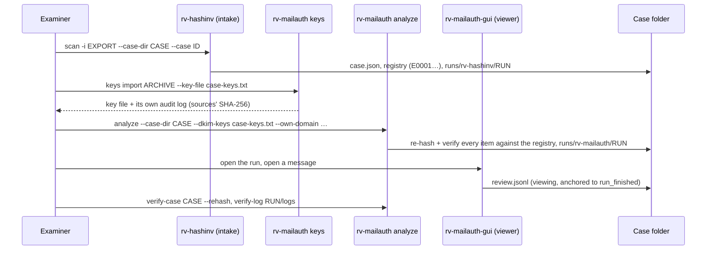

# Usage guide: from intake to a verified case

This guide walks an examiner through one email case end to end: registering the evidence with **rv-hashinv**,
preparing the DKIM keys, analysing with **rv-mailauth**, reviewing messages in the desktop app, and verifying the
whole case before handing it over. Every option: [usage-cli.md](usage-cli.md) (generated from `--help`). The
desktop app: [usage-gui.md](usage-gui.md). Why each step works: [theory.md](theory.md). What each report holds:
[reports.md](reports.md).



## Contents

- [1. Before you start](#1-before-you-start)
- [2. Case walkthrough](#2-case-walkthrough) (incl. [RV Hub and `describe --json`](#26-starting-from-rv-hub---case-dir-and-describe---json))
- [3. Reading the outputs](#3-reading-the-outputs)
- [4. Interpreting each finding](#4-interpreting-each-finding)
- [5. Working without a case folder](#5-working-without-a-case-folder)
- [6. Timestamps](#6-timestamps)
- [7. Signing reports with the examiner certificate](#7-signing-reports-with-the-examiner-certificate)
- [8. Verifying a run](#8-verifying-a-run)
- [9. Troubleshooting](#9-troubleshooting)

## 1. Before you start

| Check | How |
| --- | --- |
| The installed tool is the genuine release and works | [installation.md](installation.md) steps 2–6: `SHA256SUMS`, provenance, Authenticode, `rv-mailauth self-test`, the sample run |
| The evidence is a **native export** | `.eml` files or an mbox exported from the mail server or the mailbox, from a verified copy (not printouts or forwards). `.msg` only when nothing else exists — DKIM cannot be evaluated on it ([theory.md B12](theory.md#b12-outlook-msg-and-mbox)). PST/OST are not read: export them first with a documented tool |
| The DKIM keys valid **when the messages were sent** | From an archived zone of the sender's domain, the provider, or a passive-DNS service with dates. Note where each key comes from: the result is only as good as the key ([theory.md A5](theory.md#a5-why-the-key-matters-and-why-keys-rotate)) |
| Your organisation's own domains (BEC cases) | The domains a fraudster would imitate: `--own-domain acme.example --own-domain acme-group.example` |
| The workstation clock | Synchronised (time source noted); the audit log uses it |
| Legal basis | Mandate to examine the correspondence; data-protection basis ([admissibility.md](admissibility.md#55-personal-data-and-the-secrecy-of-correspondence)) |

## 2. Case walkthrough

Commands and outputs below are real, from the synthetic sample ([examples/](../examples/README.md)) copied to
`demo\evidence` (paths shortened, timestamps off).

### 2.1 Intake with rv-hashinv

rv-hashinv opens the case folder and registers every file once (evidence ids `E0001`…). rv-mailauth is an
**analysis** tool: it never writes the registry ([case-folder.md](case-folder.md)).

```powershell
rv-hashinv scan -i demo\evidence --case-dir demo\CASE-DEMO --case CASE-DEMO --jurisdiction co --hash sha256,md5 --actor "Ana Ruiz"
#   items: 16  bytes: 60323  errors: 0  elapsed: 0.2 s
#   case:   CASE-DEMO (intake) registered 16 (new 16), verified 0, mismatched 0, not in registry 0
```

The mbox is registered as **one** file; its messages become derived items in the analysis (2.3).

### 2.2 Prepare the DKIM keys

```powershell
rv-mailauth keys import demo\dkim-keys.txt --key-file demo\case-keys.txt -o demo\keys-log --case CASE-DEMO --actor "Ana Ruiz"
# OK  4 DKIM keys written to demo/case-keys.txt (sha256 8c0e8749…f9d7d9)
#     source demo/dkim-keys.txt sha256 f5de4068…5f09092e
rv-mailauth keys show demo\case-keys.txt
# LINE  SELECTOR   DOMAIN               TYPE      BITS
# 4     ed2026     example.org          ed25519    256
# 5     m1         mailer.example.com   rsa       2048
# 6     s2025      example.org          rsa       2048
# 7     s2026      example.org          rsa       2048
# 4 usable keys, 0 records not usable
```

(Here the sample's public keys stand in for an archive.) `keys import` accepts BIND zone files and `selector._domainkey.domain<TAB>TXT` lists, keeps only DKIM key
records, refuses malformed records and conflicting duplicates (nothing written, exit 2), never overwrites a key
file, and writes its own audit log with the SHA-256 of every source. Keep the archive, the key file and that log
with the case.

### 2.3 Analysis

```powershell
rv-mailauth analyze --case-dir demo\CASE-DEMO --dkim-keys demo\case-keys.txt --own-domain acme.example --actor "Ana Ruiz"
# DONE (high-severity findings)  run 20261112T121910Z-2c3dd5
#   items: 19  bytes: 63410  errors: 0  elapsed: 2.5 s
#   findings: high 2, medium 13, low 7, info 10
#   case:   CASE-DEMO (analysis) registered 0 (new 0), verified 16, mismatched 0, not in registry 0
```

Exit code 3 here means "completed, with at least one high finding" (two messages whose body no longer matches its
DKIM signature); it is not an error. Without `--input`, every registered item is analysed; `--evidence E0012`
analyses one; `-i <file>` analyses a file and matches it against the registry by path, else by content. The run
re-hashes every file before analysing it: a different digest is `EVIDENCE_HASH_MISMATCH_WITH_CASE` (high), a
file not in the registry `EVIDENCE_NOT_IN_CASE_REGISTRY` (medium).

Options that change the analysis (all recorded in `analysis_configured`):

| Option | Use it when |
| --- | --- |
| `--dkim-keys FILE` | Always, when DKIM matters. Without it every signature whose body hash matches is `DKIM_KEY_NOT_AVAILABLE` |
| `--online` | Only when no archive exists, and disclose it: today's DNS may not hold the key used at sending time; each result carries `DKIM_KEY_FROM_CURRENT_DNS` (medium) |
| `--own-domain D` | BEC cases: enables the lookalike and display-name checks |
| `--clock-skew S` | Servers known to drift (default 300 s) |
| `--mbox-variant mboxo` | The exporter wrote mboxo (one `>` stripped only from `>From ` lines); the wrong variant can break a body hash |
| `--extract-attachments` | You need the attachment files (decoded, hashed, audited); they are always listed with SHA-256 anyway |
| `--item-reports flagged` | Large mailboxes: per-item reports only for items with findings above informational |
| `--max-message-mb`, `--max-mbox-messages`, `--worker-timeout`, `--worker-memory-mb` | Very large messages or mailboxes ([usage-cli.md](usage-cli.md#rv-mailauth-analyze)) |

### 2.4 Review in the desktop app

Start `rv-mailauth-gui`, fill **Case folder** (or let RV Hub open it), run, then open any message from the results
table: the **message viewer** shows the addresses, the Received hops with the time between them, the DKIM/ARC
table with the key source, the header table, the attachments and the findings — only after checking that
`headers.json` and `dkim.json` still have the digests recorded in the audit log. Each opening is written to the
run's `review.jsonl` ([usage-gui.md](usage-gui.md)).

### 2.5 Verify the whole case

```powershell
rv-mailauth verify-case demo\CASE-DEMO --rehash
# OK  case CASE-DEMO: 6 case-log entries, 16 registered items, 2 runs verified: demo/CASE-DEMO
#     re-hashed 16 of 16 registered items: 16 match the registry
rv-mailauth verify-log demo\CASE-DEMO\runs\rv-mailauth\20261112T121910Z-2c3dd5\logs
# OK  156 entries, chain intact: …\audit.jsonl
#     truncation: the final entry #156 is anchored by the case log (run_finished)
```

After two messages were opened in the viewer, both commands add a line: `review entries: 2 (review.jsonl,
anchored to run_finished)` for `verify-log`, `review entries: 2` for `verify-case`. rv-hashinv 0.3.1's `verify-case` also
accepts the folder (shared case code; it does not print review entries). Then hand over the case folder, the key file and its import
log.

### 2.6 Starting from RV Hub: `--case-dir` and `describe --json`

RV Hub (the Rakvor launcher) finds the installed tools, opens them on a case folder and suggests which one fits a
file. It relies on two entry points of RV MailAuth:

- **`rv-mailauth-gui.exe --case-dir <CASE> [FILES...]`** starts the desktop app with **Case folder** already filled
  (`--case-dir=<CASE>` also works). Other arguments are pre-loaded as evidence, as when files are dropped on the
  icon. The preset is written to the run's audit log as `ui_case_dir_from_launcher` followed by
  `ui_case_dir_changed`; a `--case-dir` without a folder is ignored, shown in the window and logged as
  `ui_launch_argument_ignored`.
- **`rv-mailauth describe --json`** prints one JSON object (sorted keys) that RV Hub reads; it is hidden from
  `rv-mailauth --help` but listed in [usage-cli.md](usage-cli.md). It reads and writes nothing. Schema:
  [`schemas/describe.schema.json`](../schemas/describe.schema.json) (`rakvor.describe/1`, identical in every Rakvor
  tool).

| Field | Value for rv-mailauth |
| --- | --- |
| `schema` | `rakvor.describe/1` |
| `tool`, `title`, `version` | `rv-mailauth`, `RV MailAuth`, the product version (`version.txt`) |
| `role` | `analysis` (verifies evidence against the registry; never writes it) |
| `main_verb` | `analyze` |
| `accepts` | extensions `eml`, `mbox`, `msg`; signatures `d0cf11e0a1b11ae1` at offset 0 (`.msg`, OLE compound file) and `46726f6d20` (`From `) at offset 0 (mbox) |
| `case_formats`, `log_formats` | `rakvor.case/1`; `rakvor.audit/1` = `logs/audit.jsonl`, `rakvor.review/1` = `logs/review.jsonl` |
| `cli_exe`, `gui_exe` | `rv-mailauth.exe`, `rv-mailauth-gui.exe` |
| `exit_codes` | The meaning of 0, 1, 2, 3 and 130 (table in section 9) |

## 3. Reading the outputs

```text
CASE-DEMO\runs\rv-mailauth\<RUN-ID>\
  logs\      audit.jsonl (+ audit.log), hashes.csv, environment.json, timestamp-*.tsr/.json, review.jsonl
  reports\   statistics.json / .<lang>.html / .pdf
             items\00001-01-clean-rsa.eml\        headers.json, dkim.json, technical.*, summary.*, custody.*
             items\00012-12-mailbox.mbox\         mbox_index.json (+ reports of the container)
             items\00012-12-mailbox.mbox_2_1372\  message 2 of the mbox, at byte 1372
```

Start with `statistics.<lang>.html` (counts and the item table), then the technical review of each flagged item.
`hashes.csv` lists every evidence file and every mbox message (`<mbox>#<n>@<offset>`). The fields of every file:
[reports.md](reports.md#per-message-outputs).

## 4. Interpreting each finding

What the examiner does next; the wording printed in the reports is in
[reports.md](reports.md#findings-catalogue).

| Finding (severity) | Look at | Do not conclude |
| --- | --- | --- |
| `DKIM_BODY_HASH_MISMATCH` (high) | The `bh=` of the signature; any footer, list or forwarder in the hops; ask for another copy (sender's sent item, server export) and compare | Who changed the body, or that it was malicious |
| `DKIM_SIGNATURE_INVALID` (medium) | The key's provenance and validity dates for `s=`; which signed headers (`h=`) look edited; re-run with the key valid at sending time | That headers were edited — a rotated or wrong key gives the same result |
| `DKIM_KEY_NOT_AVAILABLE` (info) | Obtain the key for the named selector; re-run | Anything about the signature |
| `DKIM_KEY_FROM_CURRENT_DNS` (medium) | Replace it with an archived key; disclose otherwise | Anything certain about the key at sending time |
| `DKIM_SIGNATURE_NOT_EVALUATED` (low) | The reason: `msg_body_not_original` (ask for the MIME original), "signature expired" (the `x=` tag is before today: check `bh=` by hand, gap G-MAIL4) | Anything about the message |
| `DKIM_DOMAIN_NOT_ALIGNED` (medium) | Whether the signing domain is the sender's mail provider or marketing service | Spoofing |
| `ARC_CHAIN_INVALID` (medium) | The forwarders in the hops; supply the sealers' keys | Tampering |
| `RECEIVED_TIME_NOT_MONOTONIC`, `DATE_AFTER_FIRST_HOP`, `TIMEZONE_INCONSISTENT` | Which servers stamped the hops (the recipient's own hops are the reliable ones); the sender's device clock and zone | That a header was inserted or a date changed |
| `MESSAGE_ID_DOMAIN_MISMATCH` (low) | The sending client or service that generates Message-IDs | Forgery |
| `ATTACHMENT_DATE_AFTER_SENT` (medium) | The attachment's own metadata; other copies of the attachment | That the attachment was swapped |
| `MSG_TRANSPORT_HEADERS_MISSING` (medium) | Whether the `.msg` is a draft or sent item; ask for the original | That headers were removed |
| `LOOKALIKE_DOMAIN`, `REPLY_TO_DIFFERS`, `DISPLAY_NAME_SPOOF` (medium) | Who owns the domain (registration date, WHOIS), whether the counterpart really uses that address, earlier genuine correspondence | Intent to deceive |
| `PAYMENT_DETAILS_MENTIONED` (info) | Whether bank details changed compared with earlier genuine messages; confirm by phone with a known contact | Fraud |
| `AUTH_RESULTS_RECORDED` (info) | Which server wrote it (`authserv_id`): only the recipient's own server's line is meaningful | That SPF/DKIM/DMARC passed — the line is a claim, not re-checked |
| `FILE_STRUCTURE_DAMAGED`, `PARSER_FAILED` (medium) | Another copy or export; `PARSER_FAILED` gives the reason (timeout, memory limit) — raise the limit and re-run | That the file was damaged on purpose |
| `EVIDENCE_HASH_MISMATCH_WITH_CASE` (high) | Both digests in the report; which copy was analysed | Who changed the file |

## 5. Working without a case folder

The same command works standalone (no registry, no case log); outputs go to `--out` (default `.\rakvor-out`):

```powershell
rv-mailauth analyze -i D:\export -r --hash sha256,md5 --lang all --case CASE-2026-014 --dkim-keys case-keys.txt --own-domain acme.example --out D:\work\mail
```

Without a case folder, nothing outside the run anchors the end of its audit log except the RFC 3161 timestamp
([§8](#8-verifying-a-run)); use a case folder for casework.

## 6. Timestamps

By default each run asks the TSA (`http://timestamp.digicert.com`, change with `--tsa-url`) to sign the audit
chain head just before the statistics report is written. The token covers every evidence digest, finding and
item-report digest recorded before it, not the statistics report and `run_finished` written after it
([theory.md B15](theory.md#b15-rfc-3161-trusted-timestamp)).

| Situation | What happens | What to do |
| --- | --- | --- |
| TSA reachable | `timestamp_obtained`; files `timestamp-NNNNN.tsr` and `.json` in the log folder; statistics report shows the time | Verify with OpenSSL (below) |
| Offline | `timestamp_pending`; the run completes; warning on the statistics report and the console | Later, online: `rv-mailauth timestamp <log folder>` |
| `--no-timestamp` / `RV_NO_TIMESTAMP=1` / GUI unticked | No request | Use `rv-mailauth timestamp` later if needed |
| Broken chain | `rv-mailauth timestamp` refuses (exit 3): no timestamp is added to a broken log | Investigate; do not repair |

`verify-log` checks the token's digest, that it covers the logged head and the TSA's CMS signature
(`TSA signature valid (signer: …)`). The TSA certificate chain is validated only with `--tsa-ca`:

```bash
rv-mailauth verify-log <log folder> --tsa-ca <TSA roots.pem>
# → … TSA signature valid (signer: …); chain validated to … (revocation not checked)
# without --tsa-ca: … chain not checked (pass --tsa-ca <CA bundle> to validate it)
```

An unreadable bundle exits 1; a signature or chain failure exits 3; a token the log records whose `.tsr` or
`.json` is missing exits 3 too. Revocation is never checked (gap G18). As an independent **signature and chain**
check, use OpenSSL (Git for Windows ships `openssl.exe`); it does not check revocation either (no CRL is supplied
and OpenSSL does not query OCSP):

```bash
cd <log folder>
N=00022                                                   # from the file name timestamp-00022.tsr
H=$(python -c "import json;print(json.load(open('timestamp-$N.json'))['head'])")
openssl ts -reply -in timestamp-$N.tsr -text              # genTime, policy OID, TSA name, serial, nonce, accuracy
openssl ts -reply -in timestamp-$N.tsr -token_out -out token.der
openssl pkcs7 -inform DER -in token.der -print_certs > tsa-certs.pem   # certificates sent by the TSA
openssl ts -verify -digest "$H" -in timestamp-$N.tsr -CAfile <TSA root.pem> -untrusted tsa-certs.pem
# → "Verification: OK"  (signature and chain only, not revocation)
```

Establish the TSA certificate's revocation status separately, from CRL/OCSP evidence that covers genTime (a CRL
issued after genTime by the TSA's CA, or an OCSP response archived at stamping time), e.g.
`openssl verify -crl_check -CRLfile tsa-ca.crl -CAfile <TSA root.pem> -untrusted tsa-certs.pem -attime <genTime-epoch> tsa.pem`,
or `rv-certcheck analyze --crl … --ocsp …`. Get the TSA root certificate from the TSA's own repository, not from the token. Record the output in the case file:
it is the evidence that the time is genuine.

> **CRL dates and `-attime`.** OpenSSL applies `-attime` to the CRL as well, so `openssl verify -crl_check -attime <genTime-epoch>` only works with a CRL whose `thisUpdate`–`nextUpdate` interval contains genTime; a CRL issued after genTime fails with "CRL is not yet valid". To use a later CRL as evidence, check its signature (`openssl crl -in tsa-ca.crl -CAfile <TSA root.pem> -noout -verify`), then look up the TSA certificate's serial in it (`openssl crl -in tsa-ca.crl -noout -text`): absent, or listed with a revocation date after genTime, means not revoked at genTime. A CA may drop expired certificates from its CRLs, so for a TSA certificate that has since expired an absent serial is not conclusive: use a CRL from before its expiry, or an OCSP response archived at stamping time.

## 7. Signing reports with the examiner certificate

`--sign-cert <file.p12|.pfx>` signs **every PDF report** (statistics, technical, summary, custody) with your own
certificate (RSA keys only). The password is read from the environment variable named by `--sign-pass-env`
(default `RV_SIGN_PASSWORD`) or asked for on the terminal (nothing is echoed while you type). It is never logged;
the log records `signing_certificate_loaded` with the subject and the certificate's SHA-256, and every report prints
both (`Signed by <subject> (certificate SHA-256 <fingerprint>)`). A wrong password stops the run (`run_failed`, exit 1) before any evidence is read. In the GUI: *4. Trust →
Signing certificate* and *Certificate password* (kept in memory only).

```powershell
$s = Read-Host "Certificate password" -AsSecureString
$env:RV_SIGN_PASSWORD = [Runtime.InteropServices.Marshal]::PtrToStringBSTR(
    [Runtime.InteropServices.Marshal]::SecureStringToBSTR($s))
rv-mailauth analyze --case-dir D:\cases\CASE-2026-014 -i E:\export -r --sign-cert C:\certs\ana-ruiz.p12
Remove-Item Env:RV_SIGN_PASSWORD
(Get-PfxCertificate C:\certs\ana-ruiz.p12).GetCertHashString("SHA256")   # publish this fingerprint
```

Check a signed report with Adobe Acrobat/Reader (Signature panel) or pyHanko:
`pyhanko sign validate --pretty-print --trust <your CA or certificate .pem> technical.en.pdf` (expected: intact,
coverage of the entire file). HTML and JSON reports are not signed; their digests are in the timestamped audit
chain. The legal weight of this signature depends on the certificate ([admissibility.md](admissibility.md) G3).

## 8. Verifying a run

Anyone — you, a colleague, an opposing expert — can check a run with its log folder, its report folder and the
evidence copy:

```powershell
rv-mailauth verify-log demo\CASE-DEMO\runs\rv-mailauth\20261112T121910Z-2c3dd5\logs
# OK  156 entries, chain intact: …\audit.jsonl
#     truncation: the final entry #156 is anchored by the case log (run_finished)
#     review entries: 2 (review.jsonl, anchored to run_finished)
# with a timestamp, one more line per token, e.g.:
#     timestamp 2026-11-12T11:52:14Z by http://timestamp.digicert.com covers entry #137: TSA signature valid (signer: …); chain not checked (…)
```

The `truncation:` line says what vouches for the length of the log; `review entries` counts the messages opened
in the GUI viewer after the run (an edited `review.jsonl`, or one copied from another run, makes the log
`BROKEN`). A standalone run with a timestamp prints
`truncation: entries up to #137 are anchored by the RFC 3161 timestamp (timestamp-00137.json); 3 entries after it
(timestamp_obtained, statistics_report_written, run_finished) cannot be proven complete`; a standalone run without
a timestamp prints `truncation not detectable without a timestamp or case record`. A log shorter than its
timestamp or case record is `BROKEN` (`truncated: …`, exit 3).

| Step | Command | Proves |
| --- | --- | --- |
| 1 | `rv-mailauth verify-log <log>` (exit 0 intact, 3 broken or truncated) | No entry edited, deleted or reordered; timestamp token matches the head it covers; the log still reaches the entry its timestamp covers and, in a case folder, the final entry recorded in the case log (the `truncation:` line names the anchor); `review.jsonl` intact and anchored to this run |
| 2 | `python tests/verify_chain.py <log>` (source tree) | Same, with an independent implementation; also re-hashes the evidence listed in `hashes.csv` |
| 3 | OpenSSL ([Timestamps](#6-timestamps)) | The TSA really signed that head at that time |
| 4 | Script below | Every report file, every per-message output (`headers.json`, `dkim.json`, attachments, `mbox_index.json`), `environment.json` and `hashes.csv` still has the digest recorded in the log |
| 5 | `rv-mailauth verify-case <CASE> --rehash` | The run is the one the case log announced, complete up to its recorded final entry; the reachable evidence still matches the registry |
| 6 | `python tests/validate_reports.py <CASE or report folder>` | Every JSON report, `case.json` and `registry.json` match their schemas |

Step 4 (no built-in command yet, gap G19) — re-hash every file the run recorded:

```bash
python - "<log folder>" "<report folder>" <<'EOF'
import hashlib, json, pathlib, sys
log, rep = pathlib.Path(sys.argv[1]), pathlib.Path(sys.argv[2])
def digest(p, algo):
    h = hashlib.new({"sha3-256": "sha3_256"}.get(algo, algo)); h.update(p.read_bytes()); return h.hexdigest()
checked = bad = 0
for line in (log / "audit.jsonl").open(encoding="utf-8"):
    e = json.loads(line); a, d = e["action"], e["details"]
    if a == "item_reports_written":
        files = {rep / d["folder"] / k: v for k, v in d["files"].items()}
    elif a == "statistics_report_written":
        files = {rep / k: v for k, v in d["files"].items()}
    elif a == "output_written":
        files = {rep / d["file"]: d["hashes"]}
    elif a in ("environment_recorded", "hash_register_written"):
        files = {log / e["item"]: d}
    else:
        continue
    for p, digests in files.items():
        algo = next(x for x in ("sha256", "sha512", "sha3-256", "sha1", "md5") if x in digests)
        checked += 1
        got = digest(p, algo) if p.is_file() else "missing"
        if got != digests[algo]:
            bad += 1; print("MISMATCH", p, algo, got)
print(f"{checked} files checked, {bad} mismatches"); sys.exit(3 if bad else 0)
EOF
```

On the sample run in a case folder (19 items, English reports) this checks 251 files; appending one byte to `statistics.json` gives
`MISMATCH … statistics.json` and exit code 3. A single file in PowerShell: `(Get-FileHash <file> -Algorithm
SHA256).Hash.ToLower()` and search the value in `audit.jsonl`.

## 9. Troubleshooting

### Exit codes

| Command | 0 | 1 | 2 | 3 | 130 |
| --- | --- | --- | --- | --- | --- |
| `analyze` | done, no high finding | runtime error (input not found, output not writable, wrong certificate password, case log locked) | usage error (unknown option or algorithm, three algorithms, unknown language, a `--dkim-keys` file that cannot be read, an invalid `--own-domain`; with `--case-dir`: another case's folder, `--case` missing at creation, unknown evidence id) | done, ≥ 1 high finding; or the case folder fails verification (nothing written) | cancelled (Ctrl+C), partial reports written |
| `verify-log` | intact | log unreadable | — | broken chain, token mismatch, or truncated (shorter than its timestamp or case record) | — |
| `verify-case` | case intact (warnings printed) | not a case folder (no `case.json`) | — | at least one check failed (with `--rehash`: an evidence file differs from the registry) | — |
| `timestamp` | obtained and logged | TSA unreachable (nothing changed) | — | log missing, broken or unreadable (nothing added) | — |
| `keys import` | key file written, import logged | a source unreadable, the key file exists or cannot be written | usage error, a malformed DKIM record, two keys under one name, or no DKIM record (nothing written) | — | — |
| `keys show` | every record is a usable key | file unreadable | at least one record is not a usable key (listed) | — | — |
| `self-test` | all pass | a failure: do not use the build | — | — | — |
| `describe` | description printed | — | usage error (unknown option) | — | — |

### Messages

| Message | Fix |
| --- | --- |
| `at most 2 hash algorithms can run at the same time (got 3)` | Pick one or two algorithms |
| `unknown hash algorithm '…': use md5, sha1, sha256, sha512, sha3-256 or blake3` | Spelling: `sha3-256` (also `sha3`, `sha3_256`) |
| `… is neither a file nor a folder (symbolic links are not followed)` | Point at the link's target, or copy it |
| `--dkim-keys …: not a readable file` (exit 2) | Check the path; run `rv-mailauth keys show <file>` |
| `'…' is not a domain name (e.g. acme.example)` (exit 2) | `--own-domain` takes domains, not addresses or URLs (`@acme.example` and a trailing dot are accepted) |
| `error: not imported (nothing written): records that are not usable DKIM keys:` (`keys import`) | Fix or remove the listed records (a name relative to `$ORIGIN` must be written in full: `selector._domainkey.domain`) |
| `error: … already exists: choose another --key-file` (`keys import`) | An imported key file is never overwritten: pick a new name |
| Every signature is `DKIM_KEY_NOT_AVAILABLE` | No `--dkim-keys`, or the key file has no record for those `s=`/`d=`; `keys show` lists what it holds |
| `PARSER_FAILED` (reason `timeout` or `memory_limit`) | Raise `--worker-timeout` / `--worker-memory-mb` and re-run; the rest of the run is unaffected |
| An mbox message fails DKIM while the other copies verify | Try `--mbox-variant mboxo` (or `mboxrd`) to match the exporter ([theory.md B12](theory.md#b12-outlook-msg-and-mbox)) |

| Message | Fix |
| --- | --- |
| `… is not a case folder yet: give --case ID (and --jurisdiction) to create it` | First run in a new case folder: add `--case` |
| `the case folder … belongs to case X, not Y` | Wrong folder or wrong `--case`; leave `--case` out after creation |
| `evidence id(s) not in the case registry: E0042` | Check `evidence\registry.csv`; ids are `E` + number (`e7` = `E0007`) |
| `--evidence needs an existing case folder with a registry` | Run the intake first |
| `refusing to extend a broken case (…)` / `the case folder … fails verification` | Run `verify-case`; investigate what changed; **do not repair** a case log by hand — open a new case folder and document why |
| `the case log is locked by <tool> run <id> (since …)` | Another tool is writing; wait and run again |
| `stale case lock … held by … for more than 10 minutes` | Make sure no Rakvor tool is working on the case, then delete `case-log.lock` by hand (never automatic) and note it in the case file |
| `cannot load signing certificate …: wrong password or unsupported file` | Check `RV_SIGN_PASSWORD`; the file must be a `.p12`/`.pfx` with a private key |
| `only RSA signing certificates are supported` | Use an RSA certificate (ECDSA is not supported for report signing) |
| `warning: timestamp pending (…)` | See [Timestamps](#6-timestamps) |
| `refusing to append to a broken audit log` (`timestamp`) | The log was edited; investigate with `verify-log`; do not repair |
| `no audit log at …: nothing to timestamp` (`timestamp`) | Point at the run's `logs\<RUN-ID>` folder (or its `audit.jsonl`) |
| `truncated: …` (`verify-log`) | Entries were removed from the end of the log after the timestamp or the case record was made; investigate, do not repair |
