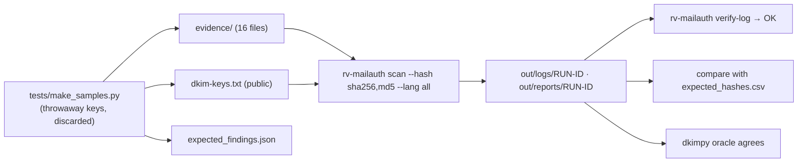

# Examples

## `sample/` — synthetic messages that trigger every email finding

All content is synthetic: addresses under `example.org`, `example.net`, `example.com` and the reserved
`.example` TLD (`acme.example` is "our" organisation), IBANs from the ISO 13616 documentation. The messages
were signed with throwaway keys generated by `tests/make_samples.py`; only the **public** keys are kept, in
`dkim-keys.txt` (simple and BIND forms). The private keys were discarded after signing.

| File | What it demonstrates | Expected findings (with `--dkim-keys sample/dkim-keys.txt --own-domain acme.example`) |
| --- | --- | --- |
| `01-clean-rsa.eml` | Genuine RSA-signed message with the receiving server's Authentication-Results | DKIM_SIGNATURE_VALID, AUTH_RESULTS_RECORDED |
| `02-clean-ed25519.eml` | Genuine Ed25519-signed message (relaxed/simple) | DKIM_SIGNATURE_VALID |
| `03-body-edited.eml` | Amount in the body changed after signing | DKIM_BODY_HASH_MISMATCH |
| `04-header-edited.eml` | Signed Subject changed after signing | DKIM_SIGNATURE_INVALID |
| `05-rotated-key.eml` | Genuine, but the key file has only the selector's NEW key | DKIM_SIGNATURE_INVALID |
| `06-lookalike-domain.eml` | `acrne.example` imitating `acme.example` | LOOKALIKE_DOMAIN, DKIM_NOT_SIGNED |
| `07-reply-to-trap.eml` | Valid signature, Reply-To at another organisation | DKIM_SIGNATURE_VALID, REPLY_TO_DIFFERS |
| `08-display-name-spoof.eml` | "ACME - Dirección Financiera" from an external address | DISPLAY_NAME_SPOOF, DKIM_NOT_SIGNED |
| `09-payment-details.eml` | "Bank details have changed", IBAN test number (EN/ES/FR) | DKIM_SIGNATURE_VALID, PAYMENT_DETAILS_MENTIONED |
| `10-transport-headers.msg` | Outlook .msg keeping the transport headers of a signed message | DKIM_SIGNATURE_NOT_EVALUATED, AUTH_RESULTS_RECORDED |
| `11-no-transport-headers.msg` | Outlook .msg without transport headers | MSG_TRANSPORT_HEADERS_MISSING |
| `12-mailbox.mbox` | Three messages (each is an item): clean with an escaped ">From " line; body tampered; hops out of order, Date after the first hop, other zone, Message-ID of another domain | #1 DKIM_SIGNATURE_VALID · #2 DKIM_BODY_HASH_MISMATCH · #3 DKIM_NOT_SIGNED, RECEIVED_TIME_NOT_MONOTONIC, DATE_AFTER_FIRST_HOP, TIMEZONE_INCONSISTENT, MESSAGE_ID_DOMAIN_MISMATCH |
| `13-truncated.eml` | Multipart message cut in the middle of an attachment | FILE_STRUCTURE_DAMAGED, DKIM_NOT_SIGNED |
| `14-not-aligned-attachment-date.eml` | Signed by a sending service's domain; attachment modification-date after the message | DKIM_SIGNATURE_VALID, DKIM_DOMAIN_NOT_ALIGNED, ATTACHMENT_DATE_AFTER_SENT |
| `15-forwarded-unknown-key.eml` | Selector whose key was not supplied; incomplete ARC set | DKIM_KEY_NOT_AVAILABLE, ARC_CHAIN_INVALID |
| `16-truncated.msg` | Interrupted copy of a .msg | FILE_STRUCTURE_DAMAGED |

The exact codes per file (and per mbox message, `12-mailbox.mbox#<n>`) are in `expected_findings.json`, which
`src/core/tests/samples.rs` checks on every test run; `tests/oracle_dkim.py` (dkimpy) re-verifies every DKIM
signature with the same keys. `expected_hashes.csv` holds the digests of every file in all six algorithms,
computed independently with Python's `hashlib` and `blake3`.



Run it:

```bash
examples/sample/run.sh target/release/rv-mailauth          # Linux / macOS
```

```powershell
.\examples\sample\run.ps1 -Bin .\rv-mailauth.exe          # Windows
```

Expected: 16 files plus 3 mbox messages (19 items), 0 errors, exit code 3 (the tampered samples have high
findings). Regenerate everything with `python tests/make_samples.py` (new keys, so new signatures and hashes;
commit the whole output together).
